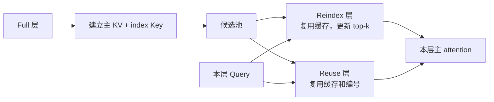

CSA2 的关键变化在层轴：相邻层不必重复建立同样的全局 KV 和候选池，但每一层仍有自己的 Query 和主 attention 权重。

## 三种角色

Full 创建主 KV、索引 Key 并完成首次选择；Reindex 复用缓存但用本层 Indexer 更新 top-k；Reuse 同时复用主 KV 和最新编号，却仍用自己的 Query 重新计算主 attention。共享数据、共享编号和本层权重是三件事。

## 候选池不是免费计算

首次 Full 可按块内最大 index score 选择 $R$ 个块形成候选池；后续 Reindex 在池内重选 top-k。V4.1 报告中的 $b=8,R=2048,K=512$ 绑定具体配置，不能当作通用常数。参考实现可能先对更大范围执行 einsum 再 mask，候选池语义成立也不代表子集 FLOPs 已经兑现。

CED 改变全局 KV 的来源，CSA2 决定跨层共享，Bounded Replay 改变窗口状态持久化。它们解决不同问题，不能把三个倍率直接相乘。缓存字节还要加上索引、窗口、量化 scale 和状态。

参考 [V4.1 §2.3](https://arxiv.org/html/2609.19969v1#S2.SS3) 与固定 [`model.py`](https://huggingface.co/deepseek-ai/DeepSeek-V4.1-Flash/blob/314113f8a7dadb388215396ba5fbee2c610a04d6/inference/model.py)。
