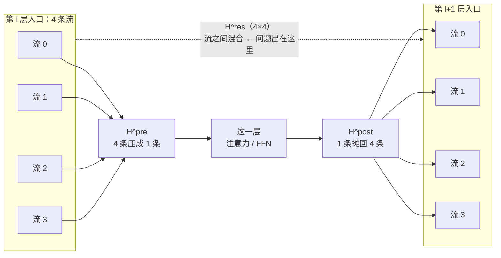

注意力改过了（04–12），FFN 改过了（13、15），还剩第 00 篇那张层结构图里最不起眼的一条线：**残差**。

$$
\mathbf{x}_{l+1}=\mathbf{x}_l+\mathcal{F}(\mathbf{x}_l,\mathcal{W}_l)
$$

它看起来没什么可改的——就是一个加号。但正是这个加号撑起了深层网络：$\mathbf{x}_l$ 可以**原封不动**地直达任意深层，这叫**恒等映射**（identity mapping），梯度因此不会在反传时被逐层缩放掉。

Hyper-Connections 的想法是把这一条流加宽成 $n$ 条。而 mHC（DeepSeek-V4 用的版本，$n=4$）要解决的是加宽之后冒出来的问题。读完你能回答：加宽为什么会破坏恒等映射、双随机矩阵为什么能修好它、以及这个修复的代价是什么。

## 先看一个例子

把残差流从 $C$ 维扩成 $n\times C$（$n$ 条并行的流），层与层之间就需要三个新的映射（§1 式 (3)）：

$$
\mathbf{x}_{l+1}=\mathcal{H}_l^{res}\mathbf{x}_l+\mathcal{H}_l^{post\top}\mathcal{F}\big(\mathcal{H}_l^{pre}\mathbf{x}_l,\mathcal{W}_l\big)
$$

| 映射 | 形状 | 作用 |
| --- | --- | --- |
| $\mathcal{H}_l^{pre}$ | $1\times n$ | 把 $n$ 条流压成一条（$nC\to C$）喂给这一层 |
| $\mathcal{H}_l^{post}$ | $1\times n$ | 把这一层的输出摊回 $n$ 条流（$C\to nC$） |
| $\mathcal{H}_l^{res}$ | $n\times n$ | **在 $n$ 条流之间混合** |

画出来是这样（$n=4$，V4 的取值）：



虚线那条就是麻烦的来源：标准残差里它是一个加号（系数恒为 1），这里变成了一个 $4\times4$ 的矩阵。

多了 $\mathcal{H}^{res}$，模型就能学习「信息在哪条流上走」。但代价马上来了。

## 加宽破坏了什么

把上式展开到 $L$ 层（§1 式 (4)）：

$$
\begin{aligned}
\mathbf{x}_L &= \underbrace{\left(\prod_{i=1}^{L-l}\mathcal{H}_{L-i}^{res}\right)}_{\text{不再是恒等}}\mathbf{x}_l\\
&\quad +\sum_{i=l}^{L-1}\left(\prod_{j=1}^{L-1-i}\mathcal{H}_{L-j}^{res}\right)\\
&\qquad\ \mathcal{H}_i^{post\top}\mathcal{F}(\cdot)
\end{aligned}
$$

对比标准残差：那里 $\mathbf{x}_l$ 前面的系数**就是 1**，原样直达。而这里它前面挂着一长串 $\mathcal{H}^{res}$ 的连乘。

**如果这些矩阵不受约束，连乘就会指数地放大或衰减。** 这不是理论担忧，跑一下就能看到（`toy.py`，$n=4$、61 层）：

```
    层        无约束 HC 的 ‖∏H‖₂         mHC（双随机）的 ‖∏H‖₂
    1             1.785e+00                  1.0000
    5             6.866e+00                  1.0000
   10             7.861e+00                  1.0000
   20             4.014e+01                  1.0000
   40             1.973e+04                  1.0000
   61             6.187e+05                  1.0000
```

**61 层之后复合矩阵的谱范数到了 6×10⁵。** 前向信号和反向梯度都会按这个量级被放大——训练不稳定、规模上不去。

## mHC：把 $\mathcal{H}^{res}$ 关进一个集合

mHC 的做法是：**不让 $\mathcal{H}^{res}$ 乱取值，而是把它投影到「双随机矩阵」构成的集合上**（Birkhoff polytope，§4.1 式 (6)）：

$$
\begin{aligned}
&\mathcal{P}(\mathcal{H}_l^{res})=\big\{\mathcal{H}_l^{res}\ \big|\ \mathcal{H}_l^{res}\mathbf{1}_n=\mathbf{1}_n,\\
&\qquad\ \mathbf{1}_n^\top\mathcal{H}_l^{res}=\mathbf{1}_n^\top,\ \ \mathcal{H}_l^{res}\ge 0\big\}
\end{aligned}
$$

用人话说：**非负、每行和为 1、每列和为 1**。

为什么这个集合刚好合适？三条性质，层层递进：

1. **双随机矩阵是置换矩阵的凸组合**（Birkhoff polytope 就是置换矩阵的凸包）。直觉上，它做的事是「把 $n$ 条流的内容按某种比例重新分配」——**既不凭空造出信号，也不凭空吞掉信号**。
2. 因此 $\|\mathcal{H}_l^{res}\|_2\le 1$，单层是**非扩张**（non-expansive）的，不会放大。
3. **双随机矩阵对乘法封闭**——两个双随机矩阵相乘仍是双随机。所以无论叠多少层，复合**仍然**满足 $\|\prod\mathcal{H}^{res}\|_2\le 1$。

第 3 条是关键：它让稳定性**贯穿深度**，而不只是单层成立。上面表格里 mHC 那一列从第 1 层到第 61 层恒等于 1.0000，就是这三条性质的直接后果。

还有一个漂亮的退化情形：**$n=1$ 时，唯一的 $1\times1$ 双随机矩阵就是 $[1]$**。也就是说 mHC 在 $n=1$ 时**自动退化成标准残差连接**——恒等映射被完整地包含在这个设计里，而不是近似。

### 怎么投影过去：Sinkhorn-Knopp

给定一个任意矩阵，怎么把它变成双随机？先指数化保证非负，然后**交替做列归一化和行归一化**（§4.2 式 (9)）：

$$
\begin{aligned}
\mathbf{M}^{(0)} &= \exp(\tilde{\mathcal{H}}^{res}_l)\\
\mathbf{M}^{(t)} &= \mathcal{T}_r\big(\mathcal{T}_c(\mathbf{M}^{(t-1)})\big)\\
\mathcal{H}_l^{res} &= \mathbf{M}^{(t_{\max})}
\end{aligned}
$$

归一化行会破坏列的和，归一化列又会破坏行的和——但反复交替会收敛。理论上要 $t_{\max}\to\infty$，**实践中 V4 取 $t_{\max}=20$**（§4.2、§4.2.1）。

三个映射的最终参数化（§4.2 式 (8)）：

$$
\begin{aligned}
\mathcal{H}_l^{pre} &= \sigma(\tilde{\mathcal{H}}_l^{pre})\\
\mathcal{H}_l^{post} &= 2\sigma(\tilde{\mathcal{H}}_l^{post})\\
\mathcal{H}_l^{res} &= \mathrm{Sinkhorn\text{-}Knopp}(\tilde{\mathcal{H}}_l^{res})
\end{aligned}
$$

$\sigma$ 是 sigmoid：$\mathcal{H}^{pre}$ 被限制在 $(0,1)$，$\mathcal{H}^{post}$ 在 $(0,2)$。**三个映射各用各的约束**，只有流间混合那个需要双随机。

## 代价

加宽残差流不是免费的（§3.2 表 2）：

| 代价 | 量级 |
| --- | --- |
| 每 token 的 I/O | 约 $n$ 倍 |
| 中间激活要保存 | 常常被迫开 gradient checkpointing |
| 流水线并行的通信 | 约 $n$ 倍 |

论文用一组 kernel 融合把这件事压下来（§4.3.1）：把除以 RMSNorm 范数的操作重排到矩阵乘之后、把两次扫描与反向矩阵乘融合、把 Sinkhorn 迭代放进单个 kernel（反向时在片上重算迭代而不是保存）。

效果（$C=7168$、$n=4$）：

```
标准残差：每 token 7,168 个数
n=4 条流：每 token 28,672 个数（4×）
融合把读取从 (3n+1)C=93,184 降到 (n+1)C=35,840，写入从 3nC=86,016 降到 nC=28,672
```

最终论文报告 mHC 的 wall-time 开销约为 overlapped 1F1B pipeline stage 的 **6.7%**（V4 §3.4.2）。

**注意这个 6.7% 的口径**：它是相对流水线 stage 的比例，不是相对整个训练步，也不是相对单层前向。引用时要带上条件。

## 代码实现

> 完整可运行脚本见文章目录下的 `toy.py`。

```python
def sinkhorn_knopp(M, t_max=20):
    """交替列归一化 / 行归一化，把正矩阵推向双随机。论文式 (9)，t_max=20。"""
    X = np.exp(M)
    for _ in range(t_max):
        X = X / X.sum(axis=0, keepdims=True)   # 列归一化
        X = X / X.sum(axis=1, keepdims=True)   # 行归一化
    return X
```

脚本验证了四件事：

1. Sinkhorn 的输出确实满足行和=列和=1、非负、谱范数 ≤ 1；
2. 双随机**对乘法封闭**（三个相乘仍是双随机）；
3. 61 层复合后，无约束 HC 到 `6.187e+05`，mHC 恒为 `1.0000`；
4. $n=1$ 时 Sinkhorn 的输出就是 `[[1.0]]`——退化成标准残差。

## 代价与边界

- 双随机保证的是**非扩张**（不放大），不保证不衰减到 0。$\|\cdot\|_2\le1$ 允许信号变小；论文强调的是抑制爆炸这一侧。
- Sinkhorn 取 $t_{\max}=20$ 是截断，不是精确投影。截断后的矩阵只是近似双随机，上面 toy 里的误差在 $10^{-6}$ 量级。
- $n$ 倍 I/O 是结构性的，kernel 融合只能减少冗余读写，不能消除加宽本身的代价。
- 本篇的 toy 用随机矩阵说明**连乘的数值行为**，不是对真实训练动态的模拟；真实的 $\mathcal{H}^{res}$ 由数据学出，分布与随机矩阵不同。
- 6.7% 的开销绑定论文的并行配置与硬件。本机没有 GPU，本篇未做任何性能验证。
- 论文正文给出了「双随机 ⇒ 谱范数 ≤ 1」这一性质与几何解释，**但没有给出该不等式的独立证明步骤**。

## 自测

1. 标准残差里 $\mathbf{x}_l$ 前面的系数是什么？HC 展开后变成了什么？
2. 双随机的三条性质里，哪一条保证了「叠多少层都稳」？为什么这一条最关键？
3. 为什么 $n=1$ 时 mHC 会自动退化成标准残差？这说明这个设计有什么好性质？
4. Sinkhorn 为什么要**交替**归一化行和列？做一次行归一化不够吗？
5. 动手：在 `toy.py` 里把 `t_max` 从 20 改成 1 和 3，看输出离双随机有多远（行和/列和的偏差），以及 61 层复合后的谱范数还是不是 1。

## 来源

- [mHC: Manifold-Constrained Hyper-Connections](https://arxiv.org/abs/2512.24880) §1（式 (1)–(4)：标准残差、HC、展开式）、§3（式 (5)：HC 的系数参数化）、§4.1（式 (6)：Birkhoff polytope 与非扩张）、§4.2（式 (7)–(9)：参数化与 Sinkhorn-Knopp）、§4.3.1（kernel 融合与 I/O）、§3.2 表 2（I/O 与通信代价）
- [DeepSeek-V4](https://arxiv.org/abs/2606.19348) §2.2（V4 中 $n_{\rm hc}=4$、$t_{\max}=20$）、§3.4.2（6.7% wall-time 开销）
- 上一篇：[15 · Engram](../15-engram/)
- 下一篇：[17 · DSpark](../17-dspark/)——草稿模块本身也可以重新设计。
