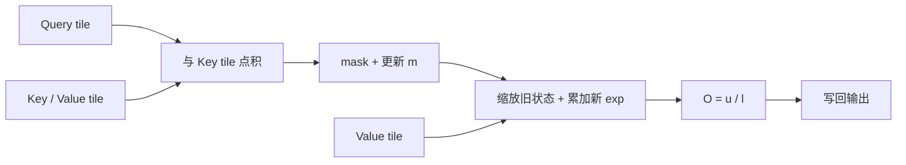

FlashAttention 改变的是内存访问组织，不是 attention 的数学结果。在给定 mask、scale 和 dropout 语义下，它仍计算同一个 softmax，只是不把完整分数矩阵写回 HBM。

## 一行只保留三种状态

对当前 Query 行，维护最大值 $m$、相对指数和 $\ell$、Value 加权分子 $u$：

$$m=\max s_j,\qquad \ell=\sum_j e^{s_j-m},\qquad u=\sum_j e^{s_j-m}v_j.$$

处理新 tile 时：

$$m'=\max(m,\max s),\quad \alpha=e^{m-m'},$$
$$\ell'=\alpha\ell+\sum e^{s-m'},\quad u'=\alpha u+\sum e^{s-m'}v.$$

最后输出 $O=u/\ell$，并用 $LSE=m+\log\ell$ 支持反向。

旧分母和旧分子必须使用同一个 $\alpha$。因果边界允许跳过完全在未来的 tile，但不能跳过部分可见 tile 的 mask。

## 反向和版本

前向通常保存 $O$ 与 LSE，反向重算 QK、mask 和概率块，再求 $dQ,dK,dV$。dropout 还需要重现相同 RNG 状态，单纯重新设置 seed 不足以证明一致。

FA1 组合分块、在线 softmax 和反向重算；FA2 调整 CTA/warp 分工；FA3 面向 Hopper 引入 TMA、WGMMA 和 warp specialization；FA4 的优化点绑定更新后的硬件与实现。论文算法、源码分派和具体 GPU 配置要分开写。

给定稀疏候选后，DeepSeek sparse kernel 仍可用 `scores_max_prev`、`scores_max`、`scores_scale`、`sum_exp`、`acc_o` 维护同一在线状态，并把 sink 加进分母。优化候选访问不等于恢复 dense 全历史。

参考 [FlashAttention](https://arxiv.org/abs/2205.14135v2)、[FlashAttention-2](https://tridao.me/publications/flash2/flash2.pdf)、[FlashAttention-3](https://arxiv.org/abs/2407.08608v2)、[FlashAttention-4](https://arxiv.org/abs/2603.05451v1) 和 [flash-attention 固定提交](https://github.com/Dao-AILab/flash-attention/tree/54b044c8cf897dfcc2577a665559d1bfda0bfc80)。
