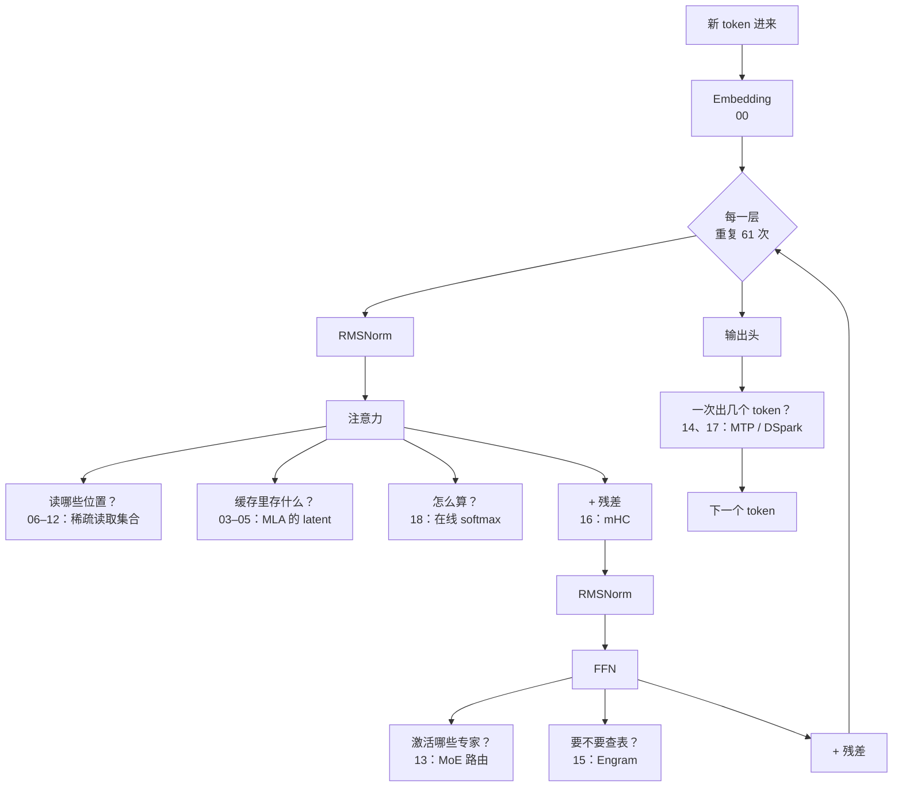

前面十九篇各讲一个机制。这一篇只做一件事：**把它们放回同一次 decode 里**，看清楚每个机制在哪一步起作用、省掉了什么、以及彼此之间的依赖关系。

读完你应该能对着一张图，说出每一层的取舍——以及为什么「模型算什么」到这里就讲完了，剩下的问题属于运行时。

## 一个 token 的旅程



四个问题，对应四组篇目——**它们互相正交，可以独立开关**：

| 问题               | 机制                                     | 省的是                        |
| ------------------ | ---------------------------------------- | ----------------------------- |
| 缓存里存什么       | MQA/GQA → **MLA**（03–05）               | 显存与带宽（每 token 的宽度） |
| 这一步读哪些位置   | SWA / NSA / DSA / **CSA / HCA**（06–12） | 计算与带宽（读多少个）        |
| FFN 激活哪部分     | **MoE**（13）+ **Engram**（15）          | 计算（FLOPs）                 |
| 一次产出几个 token | **MTP**（14）→ **DSpark**（17）          | 前向次数                      |

另外两篇作用在别处：**mHC**（16）改的是残差流本身，**FlashAttention**（18）不改任何数学、只改 kernel 怎么算。

## 两条轴，不要混

整个系列最该带走的一个区分，来自第 02 篇那个公式：

$$
\text{KV cache 字节} = \underbrace{(d_c+d_r)}_{\text{每 token 多宽}} \times \underbrace{L}_{\text{读多少行}} \times n_{\text{layers}} \times \text{bytes}
$$

|              | **表示的宽度**                     | **读取的集合**                |
| ------------ | ---------------------------------- | ----------------------------- |
| 问的问题     | 每个 token 在缓存里占多宽？        | 这一步要读多少个 token？      |
| 典型机制     | GQA、**MLA**                       | SWA、NSA、DSA、CSA、HCA       |
| 压到极限是   | MQA（$n_h\to1$）、MLA（$d_c+d_r$） | 窗口（常数）、top-$k$（常数） |
| 对质量的风险 | 表示能力不足                       | 看漏了相关位置                |

**两条轴可以同时压**——CSA 就是「在 MLA 之上再做稀疏」的典型（第 10 篇）。但它们的失败模式不同，不能互相替代。

## 一组可比较的数字

把各机制在**同一套 V3 结构参数**（61 层、BF16）下的效果放在一起。注意这些来自不同口径，**只能看量级，不能当作横向排名**：

| 机制                | 口径                 | 效果                        | 出处                |
| ------------------- | -------------------- | --------------------------- | ------------------- |
| KV cache：MHA → MLA | 每 token 每层元素数  | 40960 → 576（**71.1×**）    | 第 04 篇，V3 config |
| 128K 上下文的缓存   | BF16 字节            | 610 GiB → 8.58 GiB          | 第 04 篇            |
| MLA 的矩阵吸收      | 乘法次数（$L$=128K） | 86 亿 → 6717 万（**128×**） | 第 05 篇            |
| MoE 激活比例        | 激活/总专家          | 9/257 ≈ **3.5%**            | 第 13 篇，V3 config |
| MTP                 | 每轮产出 token       | 1 → **1.85**（接受率 85%）  | 第 14 篇，V3 §5.4.3 |
| 在线 softmax        | 中间状态             | $O(L)$ → **$O(1)$**         | 第 18 篇            |

**这些数字不能相乘。** 它们作用在不同的量上（显存、乘法次数、前向次数），而且各自绑定不同的条件。

## 依赖关系

有几处不是随便拼的，顺序有讲究：

1. **CSA 依赖 DSA**（第 10 篇）：CSA = 先按 $m$ 压缩，再在压缩条目上做 DSA 的 top-$k$。所以读 CSA 之前必须先懂 DSA。
2. **矩阵吸收依赖解耦 RoPE**（第 05 篇）：只有把位置编码从内容分支里拿出去，上投影矩阵才与位置无关，才能被吸收进 Query。**这两件事是同一个设计的两面。**
3. **稀疏选择的粒度必须对齐 KV 共享的粒度**（03 → 08 → 09 → 10）：GQA 组内共享块索引、DSA 在所有 query head 间共享 top-$k$、CSA 的 MQA 模式——同一条规律出现了四次。因为稀疏的收益主要是**访存**收益，如果每个 head 各选各的，实际要搬的是并集。
4. **DSpark 建立在 MTP 之上**（第 17 篇）：它的对照基线就是 MTP-1。

## 反复出现的三个道理

读完十九篇，有三句话值得单独记住：

**① 决定速度的常常是搬运，不是算术。**
MLA 省的是缓存带宽，稀疏注意力省的是读取量，FlashAttention 的乘法反而更多却更快。第 02 篇「decode 是带宽受限的」这句话，是后面十几篇的共同前提。

**② 把不影响输出的部分做便宜。**
MoE 的均衡 bias 只影响「选谁」、不进入权重（13）；DSA 的 indexer 只用来排序，所以可以用 ReLU 和 FP8（09）；FA-4 的条件重缩放用数值余量换向量乘法（18）。**先分清哪些计算真正进入结果**，不进入的那些就有降本空间。

**③ 覆盖率不等于保真度。**
第 12 篇那张表最能说明问题：HCA 覆盖了 100% 的注意力质量，输出余弦却只有 0.095。**「读到了」和「读清楚了」是两件事**——选择的损失和表示的损失要分开算。

## 诚实的边界

这个系列从头到尾遵守同一套规矩，这里再明确一次：

- **本机没有 GPU/NPU。** 全系列没有任何性能实测。所有倍数要么是按公式算的（乘法次数、元素数、字节数），要么是论文数字并标注了原始条件。
- **论文没写的内容标成「论文中未找到」**，不做推测。例如 V4 的 CSA:HCA 层数比例、按层的 bytes/token 对照、CSA/HCA 的单独消融表，论文均未给出。
- **toy 代码是语义验证，不是性能模拟。** 每篇的 `toy.py` 用 `assert` 固定住文中的结论，可以证明「算术和不变量成立」，不能证明「在真实硬件上更快」。
- **V2/V3、V3.2、V4、V4.1 的同名模块不自动兼容。** 跨版本套用前要重新核对。

跑一遍全部验证：

```bash
uv run scripts/verify_toys.py     # 20 篇文章的 toy，结论都是 assert
pnpm test                         # 动画积木的单测
```

## 交接：剩下的问题属于运行时

到这里，「模型要算什么」已经讲完了。但第 00 篇那个问题还剩一半没回答：

> 算的东西少了，时间就会同比减少吗？

**不会。** 每个算子都要由 CPU 提交给设备，而提交的次数不随算子变小而减少。MLA 把缓存压了 71 倍、MoE 只激活 3.5% 的参数——这些都让每个算子变得更小，于是**提交开销在总时间里的占比反而更高了**。

这正是 [vLLM 图模式系列](../../vllm-graph/) 的起点。那套笔记讲：

- 一次 decode 的工作怎么分到 CPU 提交和设备执行两条车道上；
- `torch.compile` 让算子变少、CUDA Graph 让提交变少，这是两笔不同的钱；
- 四条边界决定什么能进图，vLLM 的选路如何在运行时判断；
- 以及为什么「图模式不是无条件更快」。

两个系列合起来，才是一次 decode 的完整故事。

## 自测

1. 「表示的宽度」和「读取的集合」各是什么？举一个同时压两条轴的机制。
2. 为什么矩阵吸收必须和解耦 RoPE 一起出现？
3. 「稀疏选择的粒度要对齐 KV 共享的粒度」——这条规律在哪几篇出现过？为什么它成立？
4. 本篇那张数字表为什么不能相乘？
5. 从第 12 篇的结果说明：为什么「覆盖率 100%」的机制反而可能输出最差？
6. 模型侧已经把算子压得很小了，为什么这反而让运行时的提交开销更突出？

## 来源

- 本篇是对第 00–18 篇的综合，不引入新的论文结论；各机制的出处见对应篇目
- 结构参数来自 `reference/DeepSeek-V3/inference/configs/config_671B.json`
- 上一篇：[18 · FlashAttention](../18-flash-attention/)
- 下一套笔记：[vLLM 图模式](../../vllm-graph/)
