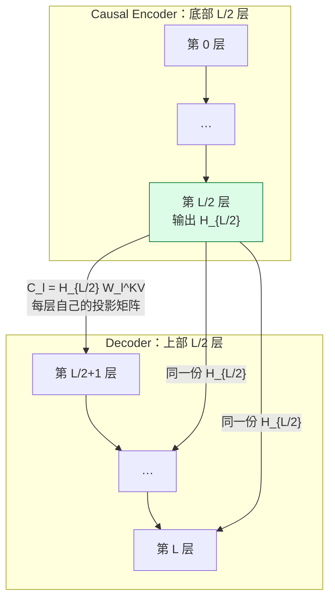

第 19 篇把 00–18 串完了，但那条链假设的是「一段 prompt，然后一路 decode」。**agent workflow 不是这样的**：每调用一次工具，就有一段新内容拼进上下文，然后又是一次 prefill。

于是 prefill 不再是一次性开销，而是**反复发生**的——而且每次都是 cache miss。V4.1-Flash 的 CED（Causal Encoder-Decoder）就是针对这件事。

读完你能回答：CED 为什么能把 prefill 砍掉近一半、它对 KV cache 的影响是什么、以及为什么它必须配一个叫「SWA Bounded Replay」的补丁。

> 本篇按 [DeepSeek-V4.1-Flash](https://arxiv.org/abs/2609.19969) 写。上一个阶段讲的 CSA/HCA 是 V4 的设计，**V4.1-Flash 用的是纯 CSA2**（下一篇），两者不要混。

## 先看一个例子

一个 61 层的模型，prompt 有 $N$ 个 token。标准做法：**每个 token 都要走完全部 61 层**，才能把每层的 KV 都算出来。prefill 的代价是 $O(NL)$。

CED 的观察是：**decoder 层的 global KV，真的必须由 decoder 层自己的隐藏状态生成吗？**



CED 的回答是「不必」。对 $l>L/2$ 的 decoder 层，global KV 不从本层隐藏状态 $H_l$ 生成，而是**从 encoder 最后一层的输出 $H_{L/2}$ 生成**（§2.2 式 (1)）：

$$
C_l = H_{L/2}\,W_l^{KV},\qquad Z_l = H_{L/2}\,W_l^{Z},\qquad l>\frac{L}{2}
$$

注意 $W_l^{KV}$ 和 $W_l^{Z}$ **仍然是逐层不同的**——每个 decoder 层有自己的投影矩阵，只是**输入源**统一成了 $H_{L/2}$。

## 为什么这能省

因为 prefill 的目的就是把各层的 KV 算出来备用。如果上半层的 global KV 都能从 $H_{L/2}$ 投影得到，那么 **prefill 只需要把 prompt 完整跑过前 $L/2$ 层**，剩下的 KV 用矩阵乘投影出来就行。

论文给出的复杂度（$N\gg n_{\rm win}$）：

$$
\mathcal{O}(NL)\quad\longrightarrow\quad \mathcal{O}\!\left(\frac{NL}{2}+n_{\rm win}\cdot\frac{L}{2}\right)\approx\mathcal{O}\!\left(\frac{NL}{2}\right)
$$

**近似减半。** 第二项 $n_{\rm win}\cdot L/2$ 是下面要说的 replay 代价——它只和窗口大小有关，不随 prompt 长度增长，所以在长 prompt 下可以忽略。

decoder 仍然有自己的 query 和完整的注意力计算，**省掉的是「为每个 prompt token 再跑一遍上半层来生成 global KV」这件事**。

## 代价：SWA 必须 replay

这里有个不对称：**global KV 可以从 $H_{L/2}$ 投影出来，SWA 的 local KV 不行**。

任意层 $l$ 的 local key/value 直接由该层隐藏状态 $H_l$ 得到（§2.2）。而 SWA 依赖跨层累积——第 19 篇那个「可达范围靠叠层传递」的性质，在这里反过来成了麻烦：**要精确重建第 $l$ 层的 SWA KV，就得真的把 token 过一遍第 $l$ 层**。

精确重建的代价是重放 $L\times n_{\rm win}$ 个 token，太贵。于是有了 **SWA Bounded Replay**（§3.2.2）：

> **只重放最近 $n_{\rm win}$ 个 token，并把 SWA 截断到 replay segment 内，接受近似状态。**

从 replay 起点 $s$ 开始，位置 $i$ 的 query 只看：

$$
\big[\max(s,\ i-W+1),\ i\big]
$$

和标准窗口 $[i-W+1,\ i]$ 相比，多了一个 $\max(s,\cdot)$ ——**窗口被 replay 起点截断了**。这是一个承认的近似：replay segment 开头那几个位置看到的历史比正常情况少。

论文说这个近似重建对回答质量只有 negligible impact（§3.2.2），但**没有给出量化的质量对照**。

两种 replay 的分工：

|                                | 做什么                                                                                                                                                                                                         |
| ------------------------------ | -------------------------------------------------------------------------------------------------------------------------------------------------------------------------------------------------------------- |
| **Encoder SWA Bounded Replay** | SWA KV 从 persistent cache 里拿掉；缺失时重放缓存前缀的最近 $n_{\rm win}$ 个 token 只重新生成 SWA KV（复用已缓存的 global KV），未缓存的后缀则同时生成两者                                                     |
| **Decoder SWA Bounded Replay** | CED 下 decoder 的 global KV 已由 encoder 输出投影得到，prefill 时只重放 prompt 最近 $n_{\rm win}$ 个 token，把这些 encoder 输出过一遍 decoder 层，生成 decode 起步需要的 SWA KV（**且不用于 prefix caching**） |

## 部署：两种 KV 分两层存

这是本篇最有工程味的一处。既然 SWA KV 可以重放出来，**它就不必长期保存**（§3.2.1）：

|               | global KV           | SWA KV                                             |
| ------------- | ------------------- | -------------------------------------------------- |
| 存在哪        | persistent KV cache | 每台机器约 **10% host DRAM** 的分布式短 TTL 内存池 |
| 生命周期      | 至少 **72 小时**    | 短 TTL                                             |
| miss 了怎么办 | 必须有              | **bounded replay 回填**                            |

**「能重算的就不长期存」**——这是一个很干净的取舍：用少量重算换掉大量持久存储。结果是 persistent KV footprint 降到约 V4-Flash 的 **1/8**（§3.2.2、§2.1）。

注意这 1/8 是**持久占用**的比例，不是单 token 的缓存宽度。宽度那一项是下一篇 CSA2 + FP4 的功劳（约 890 bytes/token，V4-Flash 的 1/4）。两个数字口径不同，**不能相乘也不能混用**。

## 代码实现

> 完整可运行脚本见文章目录下的 `toy.py`，纯 Python。

```python
def prefill_cost(N, L, n_win, ced=False):
    """prefill 要把多少个 (token, 层) 对真正算一遍。"""
    if not ced:
        return N * L                                  # 每个 token 走完全部层
    encoder = N * (L // 2)                            # 完整跑前半层
    replay = n_win * (L // 2)                         # 只重放最近 n_win 个过 decoder
    return encoder + replay
```

输出：

```
L=61 层，n_win=128

  prompt 长度     标准 prefill   CED prefill       省掉
        512         31,232        19,200    38.5%
      2,048        124,928        65,280    47.7%
      8,192        499,712       249,600    50.1%
     32,768      1,998,848       986,880    50.6%
    131,072      7,995,392     3,936,000    50.8%

prompt 越长，replay 那一项越可以忽略 → 越接近渐近线 50.8%
（L=61 是奇数，encoder 取 floor(L/2)=30 层，所以渐近线略高于 50%）
短 prompt（512）只省 38.5%，因为 n_win=128 的重放占比还不小

SWA Bounded Replay 的窗口截断（W=8、replay 起点 s=100）：
  位置 100：标准窗口 [93, 100] → 截断后 [100, 100]，少看 7 个
  位置 103：标准窗口 [96, 103] → 截断后 [100, 103]，少看 4 个
  位置 107：标准窗口 [100, 107] → 截断后 [100, 107]，完整 ✓
  从第 W-1 个位置起窗口就恢复完整了 —— 近似只影响 replay 段开头的 7 个位置
  无论上下文多长，受影响的都是 7 个位置（常数）
```

最后那段量化了这个近似的范围：**只有 replay 段开头的 $W-1$ 个位置看得比正常少**，再往后窗口就完整了。受影响的位置数是常数，不随上下文增长——这解释了为什么论文敢说影响 negligible。

另外注意第一组数字里 512 那行只省 38.5%，而长 prompt 到 50.8%：**CED 对短 prompt 的收益明显更小**，因为固定的 replay 成本摊不开。agent workflow 恰好是长上下文、反复 prefill 的场景，这正是 CED 的目标负载。

## 代价与边界

- CED 把模型结构**对半切开**，encoder 的输出要同时服务所有 decoder 层的 global KV。这是很强的结构约束，必须从训练时就这么设计。
- SWA 的近似是真实存在的：replay 段开头的位置看到的历史比正常少。论文称影响 negligible，但**未给出量化的质量对照**。
- 「prefill 减半」是**计算量**的减半，不是墙钟减半。实际收益还取决于 replay、投影、以及访存。
- SWA KV 放短 TTL 池意味着**miss 会触发重放**。命中率低的负载下，重放本身会成为开销。
- 1/8（persistent footprint，CED + bounded replay）和 1/4（每 token 宽度，CSA2 + FP4）是两个不同口径的数字，论文分别给出，不要混用。
- 论文没有给出 CED 的质量消融（去掉 CED 的同配置对照），本机也无法验证。

## 自测

1. 为什么 decoder 的 global KV 可以从 $H_{L/2}$ 投影出来，而 SWA 的 local KV 不行？
2. prefill 复杂度里的第二项 $n_{\rm win}\cdot L/2$ 是什么？为什么长 prompt 下可以忽略？
3. SWA Bounded Replay 的窗口公式比标准窗口多了什么？受影响的位置有多少个？
4. 为什么 SWA KV 可以放短 TTL 池而 global KV 不行？
5. 「persistent footprint 1/8」和「890 bytes/token 是 1/4」为什么不能相乘？

## 来源

- [DeepSeek-V4.1-Flash](https://arxiv.org/abs/2609.19969) §2.2（CED 与式 (1)、prefill 复杂度）、§3.2.1（两层存储与 TTL）、§3.2.2（SWA Bounded Replay 与窗口截断）、§2.1 与图 1(b)（整体容量数字）
- 上一篇：[19 · 一次 decode 的全链路](../19-full-path/)
- 下一篇：[21 · CSA2](../21-csa2/)——沿第三个维度压缩：层。
