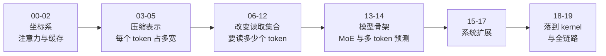

这套笔记从「一个 token 进入模型之后发生了什么」开始，一路走到 MLA、稀疏注意力、MoE 和 kernel。**不假设你学过深度学习**，但也不停留在比喻上：每篇都给公式、给维度、给能跑的代码和源码行号。

## 这套笔记怎么读

它是一条链，不是文章集合。每一篇的开头都承接上一篇留下的**具体缺口**，结尾又暴露出新的问题：



两条主线贯穿始终，**不要混淆**：

| 主线           | 问的问题                   | 对应篇目        |
| -------------- | -------------------------- | --------------- |
| **表示的宽度** | 每个 token 在缓存里占多宽？ | 03、04、05      |
| **读取的集合** | 这一步要读多少个 token？   | 06–12           |

第 02 篇会把这两条线从同一个公式里拆出来。

## 阶段 0 · 坐标系

| 篇                                      | 解决的问题                                     |
| --------------------------------------- | ---------------------------------------------- |
| [00 · 从一个 token 到一次前向](./00-forward-pass/) | 张量、矩阵乘、一层 Transformer 到底算了什么     |
| [01 · 注意力从零推一遍](./01-attention/) | 打分、掩码、softmax、加权求和，用能手算的数字   |
| [02 · KV Cache](./02-kv-cache/)         | 为什么要缓存、缓存多大——4096 token 就要 15 GiB |

## 阶段 1 · 压缩表示（每个 token 占多宽）

| 篇                                   | 解决的问题                                          |
| ------------------------------------ | --------------------------------------------------- |
| [03 · MQA 与 GQA](./03-mqa-gqa/)     | 让多个 head 共享 K/V，省了多少、丢了什么            |
| [04 · MLA](./04-mla/)                | 不存 K/V，改存共享 latent——V3 真实配置下差 71 倍    |
| [05 · 解耦 RoPE 与矩阵吸收](./05-mla-absorb/) | 位置编码为什么必须单独走，上投影为什么可以不花 |

## 阶段 2 · 改变读取集合（这一步读多少个）

| 篇                                     | 解决的问题                                      |
| -------------------------------------- | ----------------------------------------------- |
| [06 · 稀疏注意力地图](./06-sparse-map/) | 三个指标把所有稀疏注意力放进同一张坐标系        |
| [07 · SWA](./07-swa/)                  | 最简单的固定窗口，以及它为什么不够              |
| [08 · NSA](./08-nsa/)                  | 压缩、选块、窗口三分支；选块的打分是白捡的      |
| [09 · DSA](./09-dsa/)                  | 打分本身也要便宜：Lightning Indexer             |
| [10 · CSA](./10-csa/)                  | 先把序列压短，再稀疏地读——两级相乘的省法        |
| [11 · HCA](./11-hca/)                  | 反过来：压得更狠但全读；与 CSA 交错使用         |
| [12 · 机制对照](./12-comparison/)      | 同一组输入上跑一遍：为什么覆盖率高 ≠ 输出对     |

## 阶段 3 · 模型骨架

| 篇                           | 解决的问题                                   |
| ---------------------------- | -------------------------------------------- |
| [13 · DeepSeekMoE](./13-moe/) | 671B 参数、每 token 只激活 37B 是怎么做到的   |
| [14 · MTP 与推测解码](./14-mtp/) | 一次前向只出一个 token 的限制怎么突破      |

## 阶段 4 · 系统扩展

| 篇                           | 解决的问题                                    |
| ---------------------------- | --------------------------------------------- |
| [15 · Engram](./15-engram/)  | 在 MoE 之外再开一条稀疏的轴：查表而不是计算   |
| [16 · mHC](./16-mhc/)        | 把残差流加宽成 n 条，又不让它爆                |
| [17 · DSpark](./17-dspark/)  | 半自回归草稿器 + 按置信度排验证长度            |

## 阶段 5 · 落到 kernel 与全链路

| 篇                                            | 解决的问题                                  |
| --------------------------------------------- | ------------------------------------------- |
| [18 · FlashAttention](./18-flash-attention/)  | 公式没变、怎么算变了：在线 softmax          |
| [19 · 一次 decode 的全链路](./19-full-path/)  | 把 00–18 串成一条路径，并交接到 vLLM 系列   |

## 附录 · V4.1 专题

V4.1-Flash 换掉了 V4 的 CSA–HCA 混合，改用纯 CSA2，并把 prefill 与持久缓存一起重做：

| 篇                           | 解决的问题                                        |
| ---------------------------- | ------------------------------------------------- |
| [20 · CED](./20-ced/)        | agent workflow 的 prefill 为什么贵——把前半个模型变成编码器 |
| [21 · CSA2](./21-csa2/)      | 沿第三个维度压缩：跨层共享 KV，加上 FP4            |

## 三条阅读路线

- **第一次读**：00 → 01 → 02 → 04 → 06 → 19。给出完整骨架。
- **只关心长上下文**：02 → 04 → 06 → 07 → 08 → 09 → 10 → 11 → 12。
- **只关心省显存**：02 → 03 → 04 → 05。
- **只关心推理加速**：02 → 13 → 14 → 17 → 18，然后转 [vLLM 图模式系列](../vllm-graph/)。

## 每篇的固定结构

1. **先看一个例子**——小到能手算的具体数字
2. **图或动画**——时间顺序、逐步累积的过程用可交互动画，静态结构用 draw.io
3. **机制**——从例子推到一般形式，公式里每个符号前文都定义过
4. **代码实现**——可在 CPU 跑的最小实现 + 带行号的真实源码对照
5. **代价与边界**——换来了什么、付出了什么、什么条件下不成立
6. **自测**——3–5 个问题加一个动手实验

多数篇章目下都有一个 `toy.py`，文中的结论都写成了 `assert`。跑一遍就能自己验证（15 · Engram 例外：它直接引用 vLLM 源码片段，图中数值按同一算法离线实算）：

```bash
uv run --with numpy python toy.py      # 单篇
uv run scripts/verify_toys.py          # 全部
```

## 统一约定

**符号**（全系列一致）：$t$ 当前位置，$s$ 被读取的历史位置，$L$ 序列长度，$h$ head 下标，$n_h$ head 数，$d_k/d_v$ 每个 head 的 K/V 维度，$d_c$ 压缩后的 latent 维度，$d_r$ 位置分支维度，$\alpha_{t,s}$ 注意力权重。

**配色**（图与动画一致）：蓝=Query / 当前计算对象，青=Key / 索引，绿=Value / 缓存，橙=选择与调度，紫=参数与权重，灰=被掩盖或跳过。实线是数据流，虚线是索引或控制流。

**共用 toy 输入**：序列「我 / 在 / 读 / 注意力」，$d=8$，$n_h=2$，$d_k=d_v=4$，$d_c=3$，$d_r=2$。不同机制在同一组输入上对照，便于横向比较。

## 证据等级

本站对四类说法分得很清，阅读时请注意措辞：

| 来源            | 能证明什么                     |
| --------------- | ------------------------------ |
| 公式 / 论文     | 设计意图与数学性质             |
| 源码（带行号）  | 字段、调用顺序、分支条件       |
| 本地 toy 运行   | 这组输入下的算术与不变量       |
| profiler + 对照 | 只有它能证明时间收益           |

**本机没有 GPU/NPU**，因此本站不把未运行过的吞吐、显存或加速比写成实测；论文数字保留其原始条件并标注出处。论文没写的内容会明确写成「论文中未找到」，不做推测。

## 版本边界

源码结论以文章标注的 commit 为准（DeepSeek-V3 参考实现为 `9b4e9788`），配置数字来自对应的 `configs/*.json`。V2/V3、V3.2、V4 与 V4.1 的同名模块并不自动兼容，跨版本套用前要重新核对。
