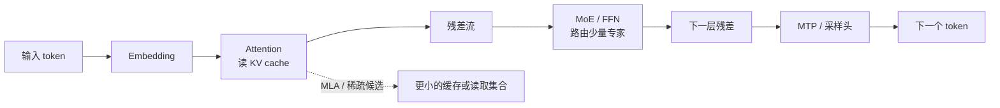

这套笔记从一次 decode 读哪些数据开始，逐步回答三个问题：缓存里存什么、这一层读取哪些位置、读取之后如何把结果交给下一层。论文中的模型设计、公开源码的实现和本地可复现的 toy 计算始终分开标注。

## 先看全链路

不要把“压缩缓存”“减少候选”“减少 kernel 提交”混成一个优化。它们分别发生在表示、序列访问和运行时三个层次。

## 阅读路线

| 阶段              | 文章                                                                                                              | 读完能回答                                    |
| ----------------- | ----------------------------------------------------------------------------------------------------------------- | --------------------------------------------- |
| 建立坐标          | [01 · Attention 与 KV Cache](./01-attention-kv-cache/)                                                            | 一行 Query 如何在因果边界内读出 Value？       |
| 压缩表示          | [02 · MLA](./02-mla/)                                                                                             | 为什么 latent 能减少缓存，而不改变可见序列？  |
| 改变读取集合      | [03 · NSA](./03-nsa/)、[04 · DSA](./04-dsa/)、[05 · CSA](./05-csa/)、[06 · HCA](./06-hca/)、[07 · SWA](./07-swa/) | 选择、压缩和窗口分别改了哪一条轴？            |
| 对照与验证        | [08 · 机制对照](./08-attention-comparison/)、[09 · 源码与 toy 验证](./09-experiments/)                            | 哪些结论可以用小算例检查？                    |
| 模型骨架          | [10 · DeepSeekMoE](./10-deepseek-moe/)、[11 · MTP](./11-mtp/)                                                     | token 如何路由到专家，并产生未来 token 监督？ |
| 系统扩展          | [12 · Engram](./12-engram/)、[13 · mHC](./13-mhc/)、[14 · DSpark](./14-dspark/)                                   | 记忆、残差和草稿模块如何接入主干？            |
| 长上下文与 kernel | [15 · CED](./15-ced/)、[16 · CSA2](./16-csa2/)、[17 · FlashAttention](./17-flash-attention/)                      | 跨层缓存和在线 softmax 如何落到实现？         |

每一篇都可以独立阅读；第一次阅读建议完成 01 → 02 → 08，再按兴趣选择后续专题。

## 版本边界

本文使用文章中标注的论文版本和源码 revision 解释语义。V2/V3、V3.2、V4 与 V4.1 的同名模块并不自动兼容。论文实验数字保留原条件；本地没有 GPU/NPU，因此本文不把未运行的 kernel、吞吐或显存数字写成本地测量。

## 统一图示约定

图表使用同一套颜色：蓝色是计算路径，绿色是缓存或持久数据，橙色是选择/调度，紫色是融合或参数。实线代表数据流，虚线代表索引或控制流。draw.io 源文件和 `.wisp.svg` 产物与文章放在同一目录；Mermaid 用于读者可以沿箭头追踪的流程。

## 如何核对结论

先读公式确定对象，再看固定 revision 的字段和调用点，最后用 CPU toy 输入检查边界。一个 toy 结果只能证明这组输入下的算术一致，不能证明真实权重、并行策略或设备性能。
