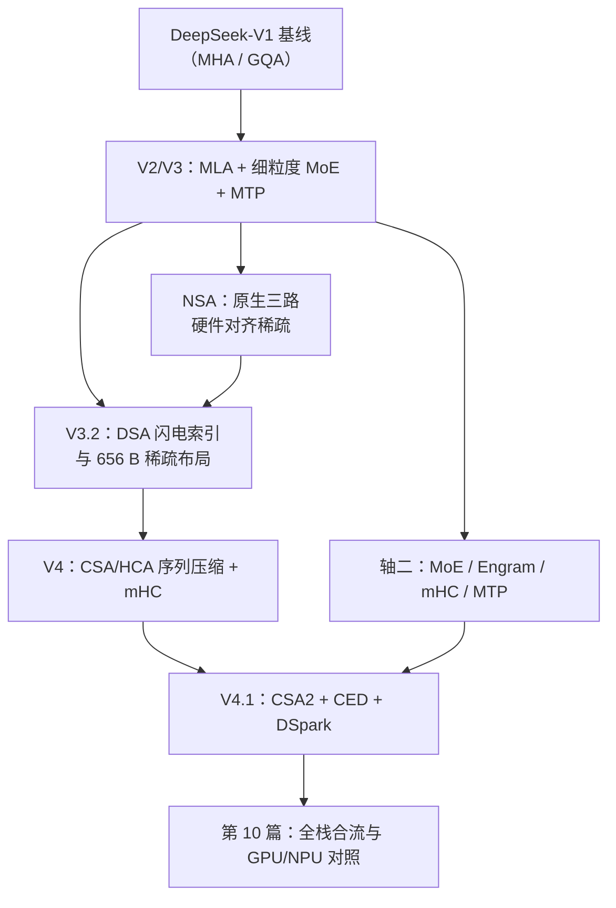

本系列作为全站**系列三**，专注拆解 DeepSeek 从 V2[^ds-v2]、V3[^ds-v3] 演进到 V4[^ds-v4] 与 V4.1[^ds-v41] 的十大架构创新：模型究竟如何绕过密集 Transformer 的显存带宽墙、参数激活墙与残差信号增益极限。

与前序系列分工清晰：硬件 Roofline、RoPE、GQA、FlashAttention 与低比特量化底座见[系列一：大模型推理基础底座](../foundations/)；NVLink / HCCS 集合通信、PD 分离与 EP 通算重叠见[系列二：分布式并行与通信系统](../distributed/)。

如**图 1** 所示，从 DeepSeek-V2 到 V4.1 的每一次迭代都服从同一系统第一性原理——在 Decode 阶段受限于 HBM 与片间带宽的前提下，持续压榨**每字节搬运换取的有效信息密度**。

## 两条核心演化轴线

十篇内容沿两条主线推进，最终在第 10 篇单步全链路视图中合流：

1. **轴线一 · 注意力与 KV 压缩（第 01–05 篇）**：从低秩联合压缩与矩阵吸收（MLA）出发，经原生三路硬件对齐稀疏（NSA）与闪电索引器（DSA），演进到 V4 的门控序列压缩（CSA / HCA），最终在 V4.1 通过三维压缩（CSA2）与非对称编码-解码（CED）将长上下文全局缓存压至每词元 `890 B`。
2. **轴线二 · 主干稀疏、记忆分离与解码加速（第 06–09 篇）**：用细粒度混合专家与无辅助损失动态偏置实现计算稀疏，用 Engram 开辟 $O(1)$ 查表存储轴，用流形受限超连接（mHC）稳住宽残差流，再以 MTP 与 DSpark 打破单步只吐一个词元的访存瓶颈。
3. **全链路合流与双硬件对照（第 10 篇）**：把同一解码步内的所有模块串成完整张量流，并在同一视角下对照 NVIDIA（`vLLM` / `FlashMLA`）与华为昇腾（`vllm-ascend` / CANN）两大真实生产栈[^ds-vllm][^ds-ascend]。

## 10 篇章节路线与核心机制

| 篇目                                                       | 核心瓶颈与解决的问题                | 关键机制与数值核验重点                                    |
| :--------------------------------------------------------- | :---------------------------------- | :-------------------------------------------------------- |
| [01 多头潜在注意力（MLA）](./01-mla/)                      | GQA 掉精度，直接压缩又卡 RoPE       | 低秩潜向量 $c_t^{KV}$、解耦 RoPE 与矩阵吸收数值等价       |
| [02 原生稀疏注意力（NSA）](./02-swa-and-nsa/)              | 固定滑窗丢失远处关键上下文          | 汇聚点、NSA 三路门控融合与 GQA 组共享连续块 MMA           |
| [03 DeepSeek 稀疏注意力（DSA）](./03-dsa/)                 | 静态分块选不准，全量打分太贵        | FP8 ReLU 闪电索引、Top-K 动态选词与 `656 B + 132 B` 布局  |
| [04 序列压缩注意力（上）：CSA 与 HCA](./04-csa-and-hca/)   | 逐词元存储随上下文长度线性爆炸      | CSA（`m=4` 重叠折块）与 HCA（`m'=128` 稠密）及输出逆 RoPE |
| [05 序列压缩注意力（下）：CSA2 与 CED](./05-csa2-and-ced/) | 跨层冗余缓存与多轮工具前缀重算      | 三维压缩 `890 B`、HSI 两级索引、CED 投影与 SWA 有界重放   |
| [06 细粒度混合专家（DeepSeekMoE）](./06-moe/)              | 稠密 FFN 占据绝大多数激活参数与塌缩 | 细粒度切分 + 共享专家、无辅助损失偏置均衡与 EP 通信       |
| [07 条件记忆（Engram）](./07-engram/)                      | 静态实体知识占用深度推理算力        | 多头质数哈希 $O(1)$ 查表、上下文门控与 DRAM 异步预取      |
| [08 流形受限超连接（mHC）](./08-mhc/)                      | 扩宽 $n=4$ 残差流引发层间信号爆炸   | Birkhoff 双随机多面体、Sinkhorn 投影与 V4.1 Mega-mHC      |
| [09 MTP 与动态推测解码（DSpark）](./09-mtp-and-dspark/)    | 单步只吐 1 词元浪费权重访存带宽     | 无损拒绝采样、V3 串联 MTP 与 V4.1 DSpark 单层草稿         |
| [10 串珠成链与双硬件全景](./10-architecture-synthesis/)    | 多重优化如何在单步与双生态协同落地  | V4.1 单步全链路张量流与 NVIDIA / 昇腾双栈映射对照         |

## 核验标准与上游源码快照

每一章均配套自包含的 NumPy 核心实现（含张量形状断言与实测输出）与交互式动画图解；算法与工程符号全部对齐以下公开论文与上游源码快照：

- **推理引擎源码**：`vllm`（`bb23c0a81779`）[^ds-vllm] 与 `vllm-ascend`（`3649b8ff7fd6`）[^ds-ascend]；
- **模型与内核参考仓**：`DeepSeek-V3`（`9b4e9788e4a3`）[^ds-v3-repo]、`FlashMLA`（`395cb3afbb33`）[^ds-flashmla]、`DeepEP`（`f6aa38fe06cd`）[^ds-deepep] 与 `Engram`（`fb7f84a21f91`）[^ds-engram]。

读完 `01 → 10` 后，模型单步前向的每张张量与访存约束已全部透明；下一站可进入[系列四：vLLM 与昇腾推理引擎](../vllm/)，追踪调度器、异步执行、`torch.compile` 与 CUDA Graph / ACLGraph 的工程编排。

[^ds-vllm]: vLLM Project. _vLLM Inference Engine_. https://github.com/vllm-project/vllm/tree/bb23c0a81779ba733923a7dab9b840b4e533f6a5 (commit `bb23c0a8`).

[^ds-ascend]: vLLM Ascend Project. _vLLM Ascend Plugin_. https://github.com/vllm-project/vllm-ascend/tree/3649b8ff7fd69e707db2c634073d2b4c40eadf15 (commit `3649b8ff`).

[^ds-v2]: DeepSeek-AI. _DeepSeek-V2: A Strong, Economical, and Efficient Mixture-of-Experts Language Model_. https://arxiv.org/abs/2405.04434 (2024).

[^ds-v3]: DeepSeek-AI. _DeepSeek-V3 Technical Report_. https://arxiv.org/abs/2412.19437 (2024).

[^ds-v4]: DeepSeek-AI. _DeepSeek-V4 Technical Report_. https://arxiv.org/abs/2606.19348 (2026).

[^ds-v41]: DeepSeek-AI. _DeepSeek-V4.1-Flash Technical Report_. https://arxiv.org/abs/2609.19969 (2026).

[^ds-v3-repo]: DeepSeek-AI. _DeepSeek-V3 Reference Code_. https://github.com/deepseek-ai/DeepSeek-V3/tree/9b4e9788e4a3a731f7567338ed15d3ec549ce03b (commit `9b4e9788`).

[^ds-flashmla]: DeepSeek-AI. _FlashMLA Kernel Repository_. https://github.com/deepseek-ai/FlashMLA/tree/395cb3afbb331fef7b1b21e9340861b9436b42d8 (commit `395cb3af`).

[^ds-deepep]: DeepSeek-AI. _DeepEP Expert Parallel Communication Library_. https://github.com/deepseek-ai/DeepEP/tree/f6aa38fe06cd4a0489e70730365d4e0114970a2f3 (commit `f6aa38fe`).

[^ds-engram]: DeepSeek-AI. _Engram Conditional Memory Repository_. https://github.com/deepseek-ai/Engram/tree/fb7f84a21f91223715394a33a1dc24bbfb7f788e (commit `fb7f84a2`).
