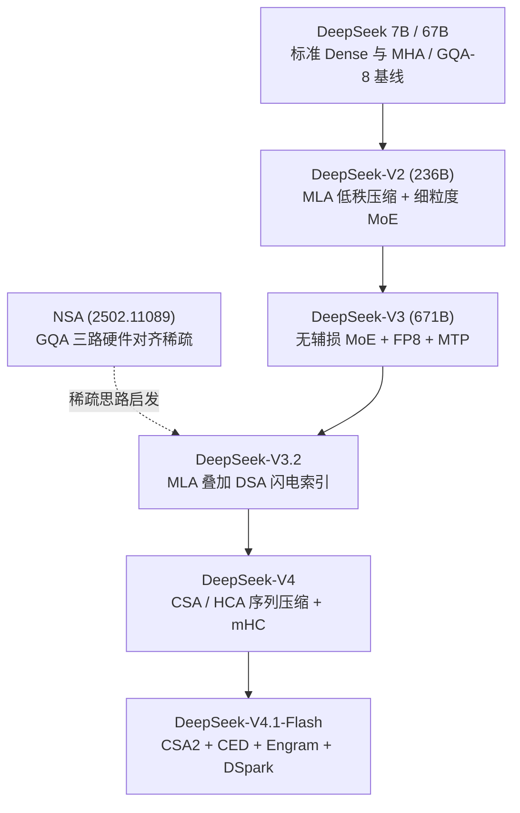

当大模型推理进入百万 token 上下文与多轮工具调用阶段，真正卡住吞吐与部署成本的瓶颈主要落在三处：解码阶段注意力 **KV Cache（Key-Value Cache，键值缓存）**的容量与显存带宽墙、稠密 **FFN（Feed-Forward Network，前馈网络）**随总参数同步放大的激活计算量，以及深度堆叠网络里残差信号跨层传递的数值边界。本系列沿 DeepSeek-V2[^ds-v2]、V3[^ds-v3] 到 V4[^ds-v4] 与 V4.1[^ds-v41] 的时间线，拆解模型架构与推理算子如何协同改写这三道约束。

关于硬件 Roofline 模型、RoPE、GQA、FlashAttention 与低比特量化底座，可先参阅[《推理与异构硬件基础》](../foundations/)；NVLink 与 HCCS 跨卡通信、PD 分离及专家并行通信调度见[《分布式并行与跨卡通信》](../distributed/)。

如图 1 所示，从 V2 到 V4.1 的五代架构演进始终围绕同一条工程主线推进：持续提高每字节显存搬运与每单位激活算力的有效信息密度。

## 两条核心演化轴线

前五篇（第 01–05 篇）沿着注意力与 KV 压缩轴线推进。先是 V2/V3 的 **MLA（Multi-Head Latent Attention，多头潜在注意力）**用低秩联合投影与矩阵吸收在不削减多头表达力的前提下压缩单 token 缓存宽度；随后面对长序列计算瓶颈，社区与 DeepSeek 先后探索了 **NSA（Native Sparse Attention，原生稀疏注意力）**与面向单头潜空间的 **DSA（DeepSeek Sparse Attention，DeepSeek 稀疏注意力）**闪电索引器；到 V4 与 V4.1 时，压缩进一步跨越单层边界，通过门控序列折叠 **CSA/HCA**、跨层缓存与索引复用 **CSA2** 以及半程 **CED（Causal Encoder-Decoder，因果编码-解码）**切分，把 40 层全局 KV 压到每 token 仅 890 B。

后四篇（第 06–09 篇）则拆解主干计算稀疏、条件记忆与解码吞吐，并最终在第 10 篇合流。模型先用细粒度专家切分与无辅助损失偏置均衡把 671B 参数模型的单步激活压到 37B，再用 Engram 把局部固定搭配从多层推理外包给 $O(1)$ 哈希查表；同时以 **mHC（Manifold-Constrained Hyper-Connections，流形受限超连接）**稳住四流残差增益，用 MTP 与 DSpark 打破每步仅生成一个 token 的权重访存限制。

最终在第 10 篇，全系列将这些组件放入同一次单步解码前向流里，对照 NVIDIA（`vLLM` / `FlashMLA` / `DeepEP`）与华为昇腾（`vllm-ascend` / CANN）两条生产栈的实现落点[^ds-vllm][^ds-ascend]。

## 章节路线与核心机制

下表汇总了十篇文章各自切入的工程瓶颈与核心核验对象：

| 篇目                                                    | 核心瓶颈与问题               | 关键机制与核验重点                     |
| :------------------------------------------------------ | :--------------------------- | :------------------------------------- |
| [01 MLA 多头潜在注意力](./01-mla/)                      | GQA 掉精度，压缩受阻于 RoPE  | 低秩 $c_t^{KV}$、解耦 RoPE 与矩阵吸收  |
| [02 NSA 原生稀疏注意力](./02-swa-and-nsa/)              | 固定滑窗丢失远处关键上下文   | Attention Sink、三路门控与 GQA 组块    |
| [03 DSA 稀疏注意力](./03-dsa/)                          | 静态分块难兼容单头 MLA       | FP8 ReLU 闪电索引、Top-$k$ 与 656+132B |
| [04 序列压缩（上）：CSA 与 HCA](./04-csa-and-hca/)      | 逐 token 缓存随上下文线增    | CSA（$m=4$）、HCA（$m'=128$）与逆 RoPE |
| [05 序列压缩（下）：CSA2 与 CED](./05-csa2-and-ced/)    | 跨层冗余与多轮前缀重算       | 890 B/tok 三维压缩、HSI 与 CED 边界    |
| [06 DeepSeekMoE 细粒度混合专家](./06-moe/)              | 稠密 FFN 激活全量且粗 MoE 冗 | 共享+细粒度专家、无辅损均衡与 EP       |
| [07 Engram 条件记忆](./07-engram/)                      | 静态实体占用多层推理算力     | 多头质数哈希、上下文门控与 DRAM 预取   |
| [08 mHC 流形受限超连接](./08-mhc/)                      | 四流残差引发跨层信号发散     | Birkhoff 双随机、Sinkhorn 与核融合     |
| [09 MTP 与 DSpark 动态推测解码](./09-mtp-and-dspark/)   | 单步 1 token 浪费权重带宽    | 拒绝采样、V3 MTP 与 DSpark 草稿头      |
| [10 串珠成链与双硬件全景](./10-architecture-synthesis/) | 多机制单步协同与双生态落地   | V4.1 全链路张量流与 NVIDIA/昇腾对照    |

## 参考实现与源码基线

第 01–09 篇均附有可独立运行的 PyTorch 参考代码，其中涉及恒等变换与概率归约的核心机制（如 MLA 矩阵吸收、NSA 分块在线 Softmax、CSA 重叠折叠与逆 RoPE）附带双精度数值核验。

文中对照的推理引擎与算子仓库（包括 `vllm`[^ds-vllm]、`vllm-ascend`[^ds-ascend]、`DeepSeek-V3`[^ds-v3-repo]、`FlashMLA`[^ds-flashmla]、`DeepEP`[^ds-deepep] 与 `Engram`[^ds-engram]）的具体版本与提交基线列于文末脚注。

从下一篇[01 MLA 多头潜在注意力](./01-mla/)开始，我们先看 DeepSeek 如何用线性代数把 128 个注意力头的 KV 缓存折叠成一条低秩向量；全部十篇读完后，可以顺势进入[《vLLM 与昇腾推理引擎》](../vllm/)追踪调度器、`torch.compile` 与静态图编排。

[^ds-v2]: DeepSeek-AI，“DeepSeek-V2: A Strong, Economical, and Efficient Mixture-of-Experts Language Model”，2024。[arXiv:2405.04434](https://arxiv.org/abs/2405.04434)。

[^ds-v3]: DeepSeek-AI，“DeepSeek-V3 Technical Report”，2024。[arXiv:2412.19437](https://arxiv.org/abs/2412.19437)。

[^ds-v4]: DeepSeek-AI，“DeepSeek-V4 Technical Report”，2026。[arXiv:2606.19348](https://arxiv.org/abs/2606.19348)。

[^ds-v41]: DeepSeek-AI，“DeepSeek-V4.1-Flash Technical Report”，2026。[arXiv:2609.19969](https://arxiv.org/abs/2609.19969)。

[^ds-vllm]: vLLM 项目，[GitHub](https://github.com/vllm-project/vllm/tree/bb23c0a81779ba733923a7dab9b840b4e533f6a5)，commit `bb23c0a8`。

[^ds-ascend]: vLLM Ascend 项目，[GitHub](https://github.com/vllm-project/vllm-ascend/tree/3649b8ff7fd69e707db2c634073d2b4c40eadf15)，commit `3649b8ff`。

[^ds-v3-repo]: DeepSeek-AI，`DeepSeek-V3` 参考推理代码，[GitHub](https://github.com/deepseek-ai/DeepSeek-V3/tree/9b4e9788e4a3a731f7567338ed15d3ec549ce03b)，commit `9b4e9788`。

[^ds-flashmla]: DeepSeek-AI，`FlashMLA` Kernel 仓库，[GitHub](https://github.com/deepseek-ai/FlashMLA/tree/395cb3afbb331fef7b1b21e9340861b9436b42d8)，commit `395cb3af`。

[^ds-deepep]: DeepSeek-AI，`DeepEP` 专家并行通信库，[GitHub](https://github.com/deepseek-ai/DeepEP/tree/f6aa38fe06cd4a0489e70730365d4e0114970a2f3)，commit `f6aa38fe`。

[^ds-engram]: DeepSeek-AI，`Engram` 条件记忆参考实现，[GitHub](https://github.com/deepseek-ai/Engram/tree/fb7f84a21f91223715394a33a1dc24bbfb7f788e)，commit `fb7f84a2`。
