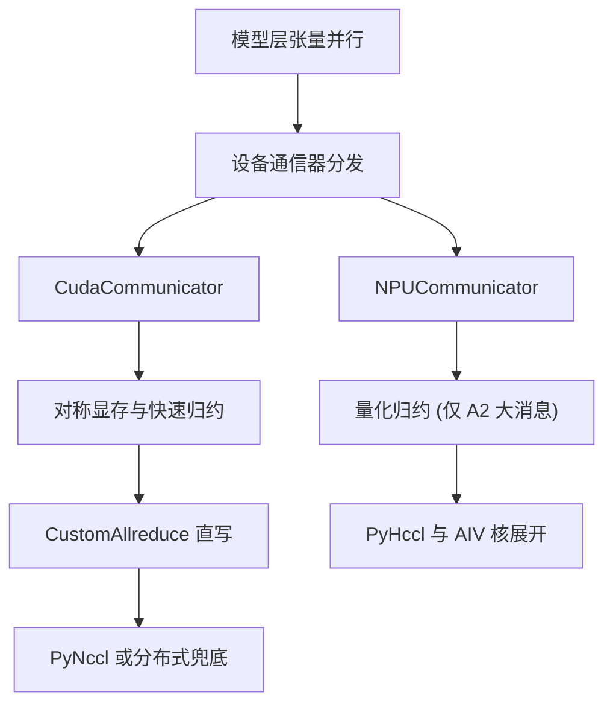

import RingCollectivesExplainer from '../../../../explainers/distributed/RingCollectivesExplainer';

当模型权重、中间激活或长序列 KV Cache 超出单张加速卡的显存上限，多卡拆分后的推理端到端耗时由单卡计算访存与跨卡、跨机链路上的**集合通信（Collectives）**开销共同决定。估算一次跨卡传输耗时，需要将其拆解为固定延迟与链路带宽两项物理代价，再看软件栈如何依消息大小与互连拓扑选择最短路径。

## 延迟带宽模型与环形及树形集合通信

估算多卡通信耗时的时候，单次点对点发送 $S$ 字节消息的端到端耗时通常写为如下两项之和：

$$
T(S) = \alpha + \beta \cdot S
$$

其中 $\alpha$ 表示单跳控制面建链、Kernel 发射与协议握手的固定时延（通常为几微秒到数十微秒），而 $\beta = 1 / \text{BW}$ 是链路有效带宽 $\text{BW}$ 的倒数，即每传输 1 字节载荷所需的物理耗时（通常折算为 $\mu\text{s}/\text{B}$ 或 $\text{ns}/\text{B}$）。

由这条公式可以直接区分推理阶段的两类典型压力区：解码（Decode）阶段每步通信通常只有几十 KB 的小消息，总耗时几乎由跳数相关的固定延迟 $\alpha$ 主导；预填充（Prefill）阶段一次需要归约数十 MB 激活张量，耗时则主要由载荷体积与带宽倒数 $\beta$ 决定。

在多卡并行最频繁使用的全局求和归约（`AllReduce`）中，工程上常将 $P$ 张卡的协同拆分为 `ReduceScatter` 与 `AllGather` 两个连续阶段：第一阶段经过 $P - 1$ 步，每张卡先把长为 $S$ 字节的向量切为 $P$ 份，每步沿环向下一跳发送 $S / P$ 字节并原地累加，结束时第 $r$ 张卡刚好持有其中一个分片的完整全局和；第二阶段再经过 $P - 1$ 步，每张卡把刚算得的完整分片顺时针传递并直接覆写下游槽位，最终全组都集齐完整的归约向量。

设 4 张卡的初始向量分别为 $[1, 2, 0, 4]$、$[3, 1, 2, 0]$、$[0, 4, 1, 2]$ 与 $[2, 1, 3, 2]$，目标全局求和结果为 $[6, 8, 6, 8]$。可以通过图 1 的步进按钮依次查看各卡在两阶段 6 跳传输中的分片变化与累计耗时。

<RingCollectivesExplainer
  client:visible
  title="图 1：4 卡 Ring AllReduce（ReduceScatter + AllGather）分步推演"
/>

如图 1 所示，4 卡环形归约在每个阶段各走 $P - 1$ 跳，每跳传输 $S / P$ 字节数据，其总延迟为：

$$
T_{\text{Ring}}(P, S) = 2(P - 1)\alpha + 2\frac{P - 1}{P} S \beta
$$

若改用二叉树形归约（`Tree AllReduce`），各卡先沿树形拓扑逐层向上归约到根节点，再从根节点向下广播完整结果，总延迟变为：

$$
T_{\text{Tree}}(P, S) = 2(\log_2 P)\alpha + 2(\log_2 P) S \beta
$$

两者的权衡随消息大小反转：当消息极小（$S \to 0$）且卡数较多时，Tree 算法的跳数 $2\log_2 P$ 明显低于 Ring 的 $2(P - 1)$，能够显著压低 $\alpha$ 累积延迟；而一旦进入大消息带宽受限区，Ring 算法每卡累计收发量仅为 $2\frac{P - 1}{P}S$（带宽利用率达到 $(P - 1)/P$），而 Tree 算法需要在上层节点反复转发全量数据 $2(\log_2 P)S$，因此大消息下 Ring 的带宽利用率优势显著。

## 物理互连层级与超节点拓扑

公式中的 $\alpha$ 与 $\beta$ 最终都锚定在硬件物理互连的层级结构上。阅读硬件拓扑时，区分**纵向扩展域（Scale-Up）**与**横向扩展域（Scale-Out）**的边界至关重要，NVIDIA GPU 与华为昇腾 NPU 的三层物理互联栈如图 2 所示。


自上而下看图 2 的第一层，数据搬运从单卡内部的存储引擎就已分道扬镳。NVIDIA GPU 围绕 Tensor Core 与高带宽显存（HBM3e）配备异步张量内存加速器（TMA，Tensor Memory Accelerator），由硬件直接完成全局显存与片上共享内存之间的多维张量块搬运；华为昇腾 NPU 则在 DaVinci AI Core 内部将负责矩阵乘的 Cube 核与负责向量算子的 Vector 核解耦，中间以片上 `UB（Unified Buffer）` 作为暂存，并由专职系统直接内存访问（SDMA）引擎异步承担片内外与卡间数据搬移。

走出一张卡的封装边界，便进入决定高频算子切分上限的 Scale-Up 高速域。NVIDIA 在单机 8 卡内以 NVLink 4/5 接入 NVSwitch 全交叉交换网络（支持网内硬件归约 NVLS SHARP），并在机柜级进一步演进为 GB200 NVL72 多节点 NVLink（MNNVL）超节点，把 72 颗 GPU 拉进统一 NVLink 内存域。

华为昇腾则在 Ascend 910B（A2）上通过全连接华为缓存一致性系统（HCCS，Huawei Cache Coherence System）环与 SDMA 零拷贝直写实现机内对等互联，并在 Ascend 910C（A3）与 CloudMatrix 384 超节点中借助 `Unified Bus（灵衢统一总线）` 把百卡级 NPU 纳入统一内存编址对等池，将高带宽内存语义从单机扩展到整机柜。

当集群规模继续超出单一超节点的边界，跨节点流量才下沉到 Scale-Out 参数面网络。NVIDIA 集群通常经由 ConnectX-7/8 网卡接入 InfiniBand 或 RoCEv2 多轨交换网络，并借助 GPUDirect RDMA 与 GPU 侧直接发射队列（IBGDA，InfiniBand GPUDirect Async）让设备 Kernel 绕过 CPU 直接驱动网卡；昇腾集群则依靠片上集成的多轨 RoCE 端口走 `DEVICE_RDMA` 或 `DEVICE_URMA` 协议栈实现跨机点对点传输。

由于跨机 Scale-Out 网络的单卡带宽通常比 Scale-Up 总线低一个数量级，且额外引入交换机转发跳数 $\alpha$，工程上几乎总是将每层同步两次的张量并行（TP，Tensor Parallelism）严格限制在 Scale-Up 域内，只将低频的数据并行（DP，Data Parallelism）、点对点 KV Cache 迁移或专家并行（EP，Expert Parallelism）推向 Scale-Out 网络。

## 运行时通信分发策略

确定物理链路之后，推理框架会按消息大小与通信域边界分流归约请求，避免全部落入标准集合通信库。为了在 Scale-Up 域内压低固定延迟并兼容静态图捕获，上游 `vllm` 与 `vllm-ascend` 在运行时各自构建了多级通信分发路径（如图 3 所示）。



### NVIDIA GPU：小消息对称显存短路

跟踪 `vllm` 中 `CudaCommunicator.all_reduce` 的分发逻辑，可以看到一条优先抢占低 $\alpha$ 通道的级联路径[^vllm-cuda-ar]：

```python
# 源码节选：vllm/distributed/device_communicators/cuda_communicator.py (L399-465)
if (
    self.pynccl_comm is not None
    and not use_fi_ar
    and should_nccl_symm_mem_allreduce(self.pynccl_comm.world_size, input_)
):
    out = torch.ops.vllm.all_reduce_symmetric_with_copy(input_)
    if out is not None:
        return out
# 省略 QuickAR / FlashInfer / AITER 探测分支
ca_comm = self.ca_comm
if ca_comm is not None and not ca_comm.disabled and ca_comm.should_custom_ar(input_):
    return ca_comm.custom_all_reduce(input_)
if symm_mem_comm is not None and symm_mem_comm.should_use_symm_mem(input_):
    return symm_mem_comm.all_reduce(input_)
return pynccl_comm.all_reduce(input_)
```

在 Decode 阶段的小消息场景中，常规 NCCL Kernel 启动与多卡控制面协调会带来数十微秒的固定开销。为此，框架优先探测并走入 NCCL 对称显存（`SymmMem`）或 `CustomAllreduce` 通路，利用 NVLink 点对点内存映射直接在设备 Kernel 中读写对端缓冲区，绕开标准通信调度；只有当消息增大到带宽主导区间或超出对等共享域时，才按顺序回落到 `PyNcclCommunicator`。

### 华为昇腾 NPU：分代量化归约与向量核展开

与 CUDA 生态不同，`vllm-ascend` 的 `NPUCommunicator` 不使用 `CustomAllreduce` 或 PCIe IPC 通道，在初始化阶段便显式将其置空[^vllm-npu-ar]。针对昇腾硬件的带宽特征与图执行机制，它的通信优化主要落在两处工程策略上。

在大消息归约场景下，`vllm-ascend` 为 Ascend A2（910B）提供了可选的 INT8 量化归约模块 `QuantizedAllReduce`[^vllm-ascend-qar]：先计算各通道全局绝对最大值（`amax`），把 BF16 张量量化为 INT8 完成 `AllReduce` 后再反量化还原，使链路传输字节数减半。为保证各卡整型累加后不溢出 INT8 正向范围 127，每卡量化上限按并行卡数严格取整，即 `max_q = 127 // world_size`（例如 8 卡时 `max_q = 15`，$8 \times 15 = 120 \le 127$）。

然而这一流程每次都会引入 `amax` 全局归约与量化、反量化算子约 0.5 ms 的固定开销：在 910B 上只有单个载荷超过约 20–24 MiB 盈亏平衡点（默认阈值设为 32 MiB）时才净赚时间；到了 Ascend A3（910C），上游测得其 HCCS BF16 带宽提升至 A2 的约 2.6 倍，数据传输省下的时间在所有测试载荷下都不足以抵消固定的量化开销，源码因此直接将允许设备限定为 A2 并拒绝在 910C 上启用该路径：

```python
# 源码节选：vllm_ascend/distributed/device_communicators/quantized_all_reduce.py (L75-103)
_VALID_DEVICE_TYPES = (AscendDeviceType.A2,)
_MAX_VALID_WORLD_SIZE = 8

self.supported = self.world_size <= _MAX_VALID_WORLD_SIZE
# 保证 TP 路整型相加不超过 INT8 上限 127
self.max_q = 127 // self.world_size if self.supported else 0
```

另一方面，当推理服务启用 ACLGraph 等静态图模式捕获时，常规依赖 AICPU 协管的集合通信调度容易受制于流资源与动态图边界。因此，图模式配置校验与启动脚本会在开启图捕获时自动或推荐设置环境变量 `HCCL_OP_EXPANSION_MODE="AIV"`[^vllm-ascend-aiv]，将 HCCL 集合通信算子直接展开到 AI Vector（AIV）核上以纯设备算子序列执行，从而扩大静态图捕获覆盖范围并降低主机侧调度抖动。

## 环形分片流转与时延拐点验证

下面的自包含 NumPy 脚本首先复现图 1 中的 4 卡分片接力过程并验证全局求和等价性，随后按 $\alpha\text{-}\beta$ 模型对比 8 卡单机在 Decode（16 KB）与 Prefill（64 MB）两种载荷下的 Ring 与 Tree 时延拐点：

```python
import numpy as np


def ring_allreduce(x: np.ndarray) -> np.ndarray:
    """4 卡环形 ReduceScatter + AllGather 参考实现。"""
    p = x.shape[0]
    buf = x.copy()
    for step in range(p - 1):  # ReduceScatter
        msg = {((r + 1) % p, (r - step) % p): buf[r, (r - step) % p].copy() for r in range(p)}
        for (r, c), v in msg.items():
            buf[r, c] += v
    for step in range(p - 1):  # AllGather
        msg = {((r + 1) % p, (r + 1 - step) % p): buf[r, (r + 1 - step) % p].copy() for r in range(p)}
        for (r, c), v in msg.items():
            buf[r, c] = v
    return buf


shards = np.array([[1, 2, 0, 4], [3, 1, 2, 0], [0, 4, 1, 2], [2, 1, 3, 2]])
out = ring_allreduce(shards)
assert out.shape == (4, 4) and np.array_equal(out, np.broadcast_to([6, 8, 6, 8], (4, 4)))

p, alpha_us, bw_gbs = 8, 5.0, 400.0
for tag, mb in [("Decode_16KB", 0.016), ("Prefill_64MB", 64.0)]:
    s_bytes = mb * (1024**2)
    beta = 1.0 / (bw_gbs * 1e3)
    t_ring = 2 * (p - 1) * alpha_us + 2 * (p - 1) / p * s_bytes * beta
    t_tree = 2 * np.log2(p) * (alpha_us + s_bytes * beta)
    print(f"{tag}: ring={t_ring:.2f}us, tree={t_tree:.2f}us")
```

运行该脚本可以得到数值断言通过后的理论时延对比结果：

```text
Decode_16KB: ring=70.07us, tree=30.25us
Prefill_64MB: ring=363.60us, tree=1036.63us
```

从这组计算结果可以看到，在 8 卡 400 GB/s 互连与 5 μs 单跳延迟条件下，16 KB 小消息走 Tree（30.25 μs）比走 Ring（70.07 μs）快一倍以上；而当载荷达到 64 MB 时，Ring（363.60 μs）反超 Tree（1036.63 μs）近 3 倍。

不过底层通信原语只能压低单次传输的固定延迟与带宽系数；如果并行切分方式本身把高频归约放到了跨机网络上，总耗时依然会迅速恶化。下一章我们转向计算图内部，拆解张量、序列与专家并行如何分配通信频次，以及预填充-解码分离架构如何解耦异步 KV 传输：[02 张量、序列、专家并行与 PD 分离架构](../02-parallelism-and-disaggregation/)。

[^vllm-cuda-ar]: 见 `vllm@bb23c0a8`：`vllm/distributed/device_communicators/cuda_communicator.py` L389–473（`CudaCommunicator.all_reduce` 依次探测 NCCL SymmMem、QuickAR、FlashInfer IPC、CustomAllreduce 与 PyNccl）。

[^vllm-npu-ar]: 见 `vllm-ascend@3649b8ff`：`vllm_ascend/distributed/device_communicators/npu_communicator.py` L46–90（`NPUCommunicator` 关闭 CUDA 专属路径并挂载 `QuantizedAllReduce`）。

[^vllm-ascend-qar]: 见 `vllm-ascend@3649b8ff`：`vllm_ascend/distributed/device_communicators/quantized_all_reduce.py` L16–151（仅在 Ascend A2 且 `world_size <= 8` 时启用 INT8 归约，`max_q = 127 // world_size`，A3 因 2.6 倍 HCCS 带宽导致收益倒挂而被拒绝）。

[^vllm-ascend-aiv]: 见 `vllm-ascend@3649b8ff`：`vllm_ascend/patch/platform/patch_minimax_m2_config.py` L110–129（图捕获校验自动设置 `HCCL_OP_EXPANSION_MODE = "AIV"`）及 `docs/source/user_guide/feature_guide/graph_mode.md` L344、L363（图模式示例配置 `HCCL_OP_EXPANSION_MODE=AIV`）。
