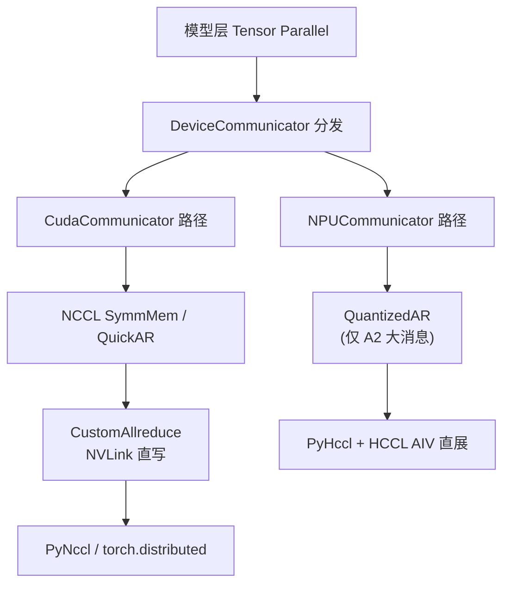

import RingCollectivesExplainer from '../../../../explainers/distributed/RingCollectivesExplainer';

当权重、激活或长序列 KV Cache 跨越单卡显存墙之后，推理时延就不再只由 Tensor Core 或 DaVinci AI Core 的算力屋顶线决定，而受制于跨卡与跨机链路上的**集合通信（Collectives）**开销。

本章从单条点对点传输的 $\alpha\text{-}\beta$ 耗时模型切入，先用 4 卡状态机拆解 Ring AllReduce 的真实分片流转，再沿着 NVIDIA 与华为昇腾的物理互连层级（Scale-Up 对照 Scale-Out），追入 `vllm` 与 `vllm-ascend` 的集合通信分发源码。

## α-β 通信模型与 Ring / Tree 集合通信拆解

在工程估算跨卡传输耗时的时候，一次发送 $S$ 字节消息的墙钟时间通常写成经典两项和：

$$
T(S) = \alpha + \beta \cdot S
$$

其中 $\alpha$ 代表单跳控制面建链、内核发射与协议握手固定时延（通常在几微秒到数十微秒之间），而 $\beta = 1 / BW$ 是链路带宽倒数，代表每增加 1 字节载荷带来的传输代价。

从这组公式立刻能看出 LLM 推理里两类截然不同的压力区：Decode 单步只有几十 KB 小消息，瓶颈几乎被 $\alpha$ 跳数完全吞没；而大 Batch Prefill 动辄一次规约数十 MB 激活，吞吐则由每张卡真正吃满的有效带宽 $\beta$ 决定。

对于最核心的 `AllReduce`（全局求和操作），直接写死 `ReduceScatter + AllGather` 两阶段拆分能同时解释为什么 Ring 算法在大消息上接近理论满带宽：

1. **ReduceScatter 阶段（$P-1$ 步）**：先把每张卡长为 $S$ 的向量切成 $P$ 份，每步各卡沿环发送 $S/P$ 字节到下一跳并原地累加；经 $P-1$ 步后，第 $r$ 张卡恰好握有一个完整规约分片。
2. **AllGather 阶段（$P-1$ 步）**：每张卡把刚算完的那个完整分片继续顺时针传递 $P-1$ 步并直接覆写目标槽位，最终全组都集齐完整的全局求和向量。

<RingCollectivesExplainer
  client:visible
  title="图 1：4 卡 Ring AllReduce（ReduceScatter + AllGather）分步推演"
/>

配合图 1 追踪 4 张卡上的初始向量 `[1,2,0,4]`、`[3,1,2,0]`、`[0,4,1,2]`、`[2,1,3,2]`，可以看到总共经历 $2(P-1)=6$ 跳之后，每张卡都精确收敛到 `[6, 8, 6, 8]`。汇总其总延迟：

$$
T_{\text{Ring}}(P, S) = 2(P - 1)\alpha + 2\frac{P - 1}{P} S \beta
$$

作为对照，如果改走二叉树 `Tree AllReduce`（先向上规约到根节点再向下广播），通信延迟变为：

$$
T_{\text{Tree}}(P, S) = 2(\log_2 P)\alpha + 2(\log_2 P) S \beta
$$

两者取舍极其清晰：当消息极小（$S \to 0$）且卡数较多时，Tree 的跳数 $\log_2 P$ 远小于 $P-1$，可显著压低 $\alpha$ 开销；而一旦消息变大，Ring 的每卡单向收发总量趋近 $2S$（带宽利用率高达 $(P-1)/P$），把需要反复经过根节点发送全量数据的 Tree 甩在身后。

## 物理互连层级：Scale-Up 超节点与 Scale-Out 集群面

算法公式里的 $\alpha$ 与 $\beta$ 最终都锚定在硬件拓扑上。读硬件拓扑图时，最关键的一条准则是不混淆 **Scale-Up 垂直高带宽共享域** 与 **Scale-Out 水平跨机参数网络** 的先后层级，如图 2 所示：


自上而下对照图 2 中的三层物理结构，双栈设计哲学差异一目了然：

- **Tier 1 · 卡内计算与片上存储**：NVIDIA 侧以 Tensor Core 搭配高带宽 HBM3e 与异步 DMA/TMA；华为昇腾以 DaVinci AI Core（Cube 矩阵与 Vector 向量核分离）搭配 HBM、片上 Unified Buffer（UB）以及专职搬运的 SDMA 引擎。
- **Tier 2 · Scale-Up 高速域（机内直连 + 超节点扩展）**：这是单算子张量并行（TP）与高频同步的命脉。NVIDIA 在机内用 NVLink 4/5 配合 NVSwitch 全交叉交换（支持硬件网内规约 NVLS SHARP），并在机柜级以 **GB200 NVL72（MNNVL）** 将 72 张卡拉进统一 NVLink 内存域；昇腾则在 Ascend 910B（A2）提供全连接 HCCS 环与 SDMA 零拷贝直写，并在 910C（A3）/ **CloudMatrix 384** 超节点中通过 **Unified Bus（UB）统一总线**把百卡级 NPU 纳进统一内存编址对等池。
- **Tier 3 · Scale-Out 跨机集群网络**：当集群规模超出单一超节点（如多台 8 卡机通过参数面互联或跨 Pod 扩展），流量才下沉到 `ConnectX-7/8` InfiniBand / RoCEv2 多轨网卡（支撑 GPUDirect RDMA 与 GPU 侧直接发射队列的 IBGDA），或在昇腾侧落到片上集成多轨 RoCE 网卡（配合 `DEVICE_RDMA` / `DEVICE_URMA` 协议栈）。

正因为 Scale-Up 与 Scale-Out 带宽往往相差一个数量级，工程实践中才会强求把 `TP` 严格锁死在机内或超节点 Scale-Up 域内，仅将点对点 KV 搬运或低频 `EP` / `DP` 同步推向 Scale-Out 网络。

## 运行时分发对照：vLLM `CudaCommunicator` vs 昇腾 `NPUCommunicator`

明确了物理链路后，集合通信在推理框架里并非永远直奔底层 `ncclAllReduce` 或 `HcclAllReduce`。为了吃干榨净 Scale-Up 域的微秒级低延迟并规避图捕获瓶颈，`vllm` 与 `vllm-ascend` 在运行时做了精细的后端级联调度（如图 3）。



### NVIDIA GPU 侧多级短路策略

跟踪 `vllm` 的 `CudaCommunicator.all_reduce`[^vllm-cuda-ar]，可以看到一条严谨的优先级瀑布流——每一层都在尝试抢占更低的 $\alpha$ 延迟或硬件级融合收益：

```python
# 源码节选：vllm/distributed/device_communicators/cuda_communicator.py (L389-465)
if (
    self.pynccl_comm is not None
    and not use_fi_ar
    and should_nccl_symm_mem_allreduce(self.pynccl_comm.world_size, input_)
):
    out = torch.ops.vllm.all_reduce_symmetric_with_copy(input_)
    if out is not None:
        return out
# 依次尝试 QuickAllReduce / FlashInfer IPC-AR / AITER / CustomAllreduce
ca_comm = self.ca_comm
if ca_comm is not None and not ca_comm.disabled and ca_comm.should_custom_ar(input_):
    return ca_comm.custom_all_reduce(input_)
if symm_mem_comm is not None and symm_mem_comm.should_use_symm_mem(input_):
    return symm_mem_comm.all_reduce(input_)
return pynccl_comm.all_reduce(input_)
```

在 Decode 等小消息场景下，`CustomAllreduce` 或 PyTorch `SymmMem` / NCCL Symmetric Memory 直接利用 NVLink P2P 与多播硬件映射把数据写入对端寄存器级内存，避免传统标准 NCCL 核启动和主从握手带来的数十微秒 $\alpha$ 损耗；只有大消息或跨机组才顺位兜底到标准 `PyNcclCommunicator`。

### 华为昇腾 NPU 侧量化折中与 `HCCL AIV` 模式

反观 `vllm-ascend` 中的 `NPUCommunicator`[^vllm-npu-ar]：因为 NPU 上不走 CUDA 生态的 `CustomAllreduce` 或 FlashInfer IPC（源码显式置 `self.ca_comm = None` 与 `self.fi_pcie_ipc_ar_comm = None`），它的工程突破口落在三个独具特色的控制开关上：

1. **分代决策的 `QuantizedAllReduce`**[^vllm-ascend-qar]：对于 **Ascend A2（910B）**，当 `world_size <= 8` 且单次 BF16 规约元素量超过默认 32 MiB 阈值时，会先把张量按通道全局绝对最大值量化成 INT8 再做集合通信；为了防止多卡累加溢出 `127`，每卡量化上限严格取 `max_q = 127 // world_size`（例如 8 卡时取 15，$8 \times 15 = 120 \le 127$）。而到了 **Ascend A3（910C）**，因为其 BF16 HCCS 带宽飙升至 A2 的约 2.6 倍，量化与 `amax` 同步的固定代价反超节省的传输时间，源码干脆直接限定 `_VALID_DEVICE_TYPES = (AscendDeviceType.A2,)` 拒绝在 A3 开启。
2. **`HCCL_OP_EXPANSION_MODE="AIV"` 向量核直展**[^vllm-ascend-aiv]：在开启 ACLGraph 图模式捕获（如 MiniMax-M2 配置）时，`vllm-ascend` 会自动强制开启 `HCCL_OP_EXPANSION_MODE=AIV`，将通信搬运展开至 AI Vector 核执行以扩大静态图覆盖形态并降低调度抖动。
3. **精细化 `HCCL_BUFFSIZE` 与 MC2 隔离**[^vllm-ascend-hccl-buf]：`get_hccl_config_for_pg_options` 会按 `"dp"`、`"dynamic_eplb"` 等通信组名精确配给 `hccl_buffer_size`；一旦识别到 `"mc2"` 组则刻意返回 `None`，以免细粒度 `pg_options` 打乱 CANN 核内通算融合算子的静态共享地址布局。

```python
# 源码节选：vllm_ascend/distributed/device_communicators/quantized_all_reduce.py (L75-103)
_VALID_DEVICE_TYPES = (AscendDeviceType.A2,)
_MAX_VALID_WORLD_SIZE = 8

self.supported = self.world_size <= _MAX_VALID_WORLD_SIZE
# 保证 TP 路整数相加绝对不超过 int8 上限 127
self.max_q = 127 // self.world_size if self.supported else 0
```

## PyTorch / NumPy 核心实现与验证

为了把 $\alpha\text{-}\beta$ 公式与 Ring AllReduce 的真实分片行为跑通，下面给出 35 行自洽 NumPy 实现：它精确复现图 1 中的 4 卡分片流转并断言全局数值等价，随后对比 8 卡单机在 Decode（16 KB）与 Prefill（64 MB）载荷下的 Ring 与 Tree 时延拐点。

```python
import numpy as np

def ring_allreduce(x: np.ndarray) -> np.ndarray:
    """4-rank Ring ReduceScatter + AllGather reference."""
    p = x.shape[0]
    buf = x.copy()
    for step in range(p - 1):  # ReduceScatter
        msg = {( (r + 1) % p, (r - step) % p ): buf[r, (r - step) % p].copy() for r in range(p)}
        for (r, c), v in msg.items():
            buf[r, c] += v
    for step in range(p - 1):  # AllGather
        msg = {( (r + 1) % p, (r + 1 - step) % p ): buf[r, (r + 1 - step) % p].copy() for r in range(p)}
        for (r, c), v in msg.items():
            buf[r, c] = v
    return buf

shards = np.array([[1, 2, 0, 4], [3, 1, 2, 0], [0, 4, 1, 2], [2, 1, 3, 2]])
out = ring_allreduce(shards)
assert out.shape == (4, 4) and np.array_equal(out, np.broadcast_to([6, 8, 6, 8], (4, 4)))

p, alpha_us, bw_gbs = 8, 5.0, 400.0
for tag, mb in [("Decode_16KB", 0.016), ("Prefill_64MB", 64.0)]:
    s_bytes = mb * (1024 ** 2)
    beta = 1.0 / (bw_gbs * 1e3)
    t_ring = 2 * (p - 1) * alpha_us + 2 * (p - 1) / p * s_bytes * beta
    t_tree = 2 * np.log2(p) * (alpha_us + s_bytes * beta)
    print(f"{tag}: ring={t_ring:.2f}us, tree={t_tree:.2f}us")
```

使用 `uv run --with numpy python` 执行上述核心验证逻辑，观察输出结果：

```text
Decode_16KB: ring=70.07us, tree=30.25us
Prefill_64MB: ring=363.60us, tree=1036.63us
```

模型结果直观地印证了系统设计铁律：同一套 8 卡 400 GB/s 互连与 5 μs 单跳延迟下，16 KB 小包场景 Tree（`30.25 us`）比 Ring（`70.07 us`）快出一倍以上；但一旦载荷放大到 64 MB 激活，Ring（`363.60 us`）反过来将 Tree（`1036.63 us`）甩开近 3 倍。

## 工程边界与自测问题

1. **小载荷 $\alpha$ 主导与通信组混配陷阱**：如果模型启用了跨机低速网卡却仍按大包公式拍脑袋上 Ring AllReduce，会白白付出 $2(P-1)\alpha$ 的控制面排队时间。
2. **`QuantizedAllReduce` 的精度与硬件代际边界**：INT8 压缩只在大载荷受带宽卡脖子的 A2 上划算，且不能在 `world_size > 8` 的大组启用（否则 `max_q` 过小精度崩塌）。

**自测问题：为什么昇腾 `NPUCommunicator` 在创建 `"mc2"` 通信组时严禁传入非空的 `pg_options`，而在 Decode 小消息下 GPU 却要尽量绕开标准 NCCL 内核？**

<details>
<summary>参考答案</summary>

1. 昇腾 MC2 算子底层依赖全局环境变量 `HCCL_BUFFSIZE` 直接划分核间共享内存偏移；如果在 `get_hccl_config_for_pg_options` 里额外传入细粒度 `hccl_buffer_size` 选项，会造成通信组与融合核内部预设地址边界错位，触发硬件同步异常。
2. 在 GPU 上，Decode 阶段消息往往只有几 KB，如果每次都走标准 NCCL Kernel 启动与主从协调，仅软件发射与轮询延迟 $\alpha$ 就可能吃掉几十微秒，高于实际数据传输耗时；因此 `CudaCommunicator` 会短路到 `CustomAllreduce` 或 `SymmMem` 直接读写对端显存指针。

</details>

---

搞清楚单步集合通信如何受限于 $\alpha\text{-}\beta$ 与物理拓扑之后，下一章我们顺着算子计算图往上走，拆解分布式推理的四维并行切分（TP / SP / CP / DP+EP），并直击 Prefill-Decode 分离池里的异步 KV 传输架构：[02 张量、序列、专家并行与 PD 分离架构](../02-parallelism-and-disaggregation/)。

[^vllm-cuda-ar]: 见 `vllm@bb23c0a8`：`vllm/distributed/device_communicators/cuda_communicator.py` L389–465（`CudaCommunicator.all_reduce` 依次探测 NCCL SymmMem、QuickAR、FlashInfer IPC、CustomAllreduce 与 PyNccl）。

[^vllm-npu-ar]: 见 `vllm-ascend@3649b8ff`：`vllm_ascend/distributed/device_communicators/npu_communicator.py` L46–90（`NPUCommunicator` 关闭 CUDA-only 的 `ca_comm` 并挂载 `QuantizedAllReduce`）。

[^vllm-ascend-qar]: 见 `vllm-ascend@3649b8ff`：`vllm_ascend/distributed/device_communicators/quantized_all_reduce.py` L70–135（仅 A2 且 `world_size <= 8` 启用 INT8 规约，`max_q = 127 // world_size`，A3 因 2.6 倍 HCCS 带宽收益倒挂而禁用）。

[^vllm-ascend-aiv]: 见 `vllm-ascend@3649b8ff`：`vllm_ascend/patch/__init__.py` L418–425（在 ACL Graph 图捕获配置校验时自动开启 `HCCL_OP_EXPANSION_MODE=AIV`）。

[^vllm-ascend-hccl-buf]: 见 `vllm-ascend@3649b8ff`：`vllm_ascend/utils.py` L1252–1264（`get_hccl_config_for_pg_options` 对 `"mc2"` 组返回 `None`，为 `dp` 与 `dynamic_eplb` 组分配隔离的 `hccl_buffer_size`）。
