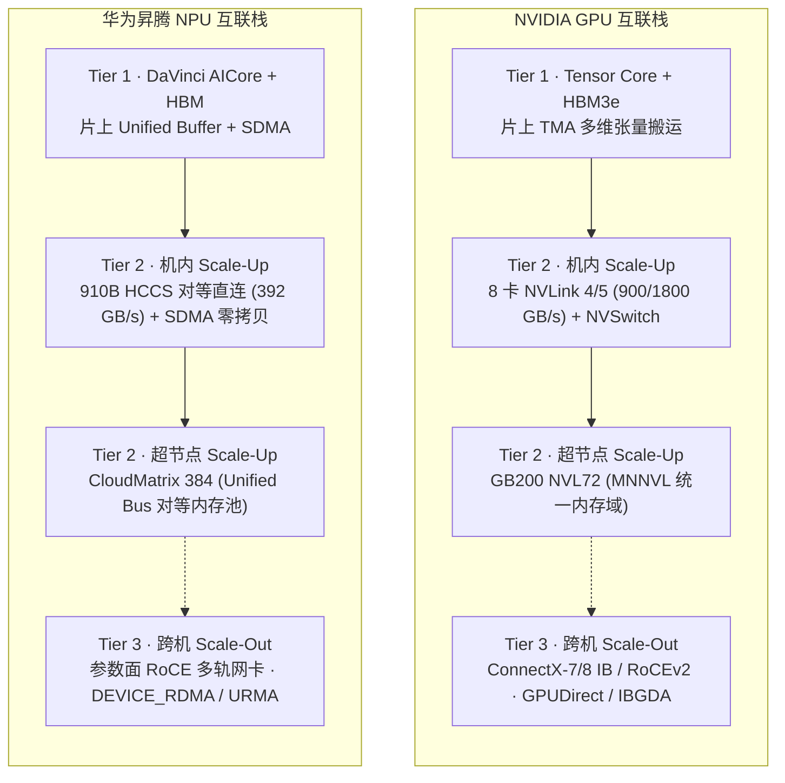
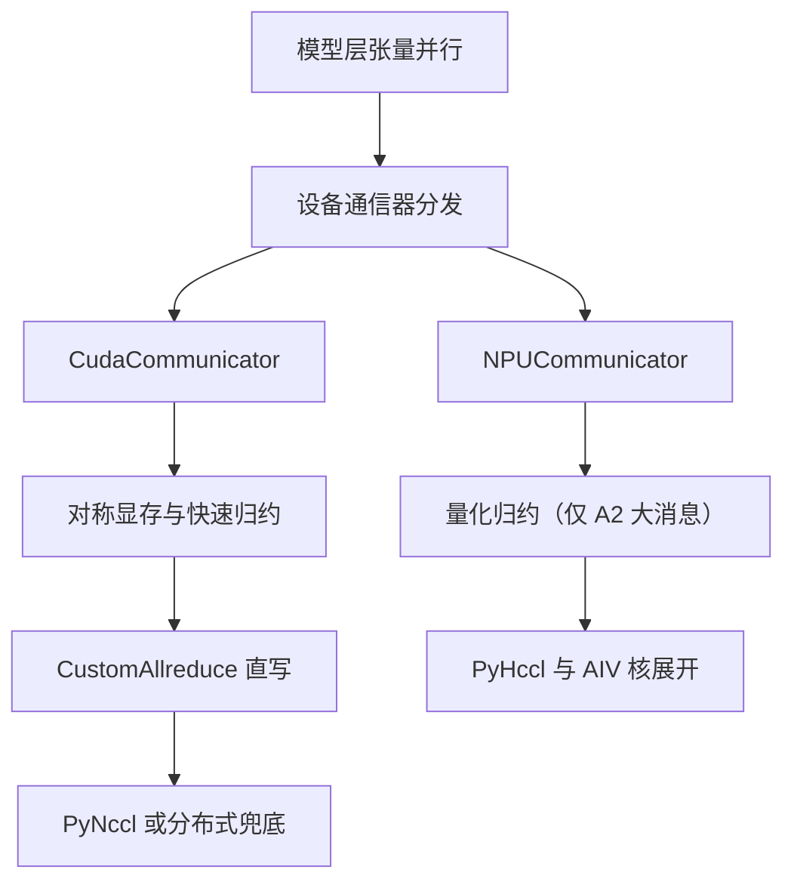

import RingCollectivesExplainer from './explainers/RingCollectivesExplainer';

当模型权重、中间激活或长序列 KV Cache 超出单张加速卡的显存上限，多卡拆分后的推理端到端耗时由单卡计算访存与跨卡、跨机链路上的 **Collectives（集合通信）**开销共同决定。估算一次跨卡传输耗时，需要将其拆解为固定延迟与链路带宽两项物理代价，再看软件栈如何依消息大小与互连拓扑选择最短路径。

## 延迟带宽模型与环形及树形通信

估算多卡通信耗时的时候，单次点对点发送 $S$ 字节消息的端到端耗时通常写为如下两项之和：

$$
T(S) = \alpha + \beta \cdot S
$$

其中 $\alpha$ 表示单跳建链、Kernel 发射与协议握手的固定时延，通常在几微秒到数十微秒之间。而 $\beta = 1 / \text{BW}$ 是链路有效带宽 $\text{BW}$ 的倒数，代表每传输 1 字节载荷的物理耗时，常折算为 $\mu\text{s}/\text{B}$ 或 $\text{ns}/\text{B}$。

这条公式直接划出了推理阶段的两类典型压力区。Decode（解码）阶段每步只传几十 KB 的小消息，总耗时几乎由跳数相关的固定延迟 $\alpha$ 主导。Prefill（预填充）阶段一次需要归约数十 MB 激活张量，耗时则主要由载荷大小与带宽倒数 $\beta$ 决定。

在多卡并行最常用的全局求和归约（`AllReduce`）中，工程上常把 $P$ 张卡的协同拆为 `ReduceScatter` 与 `AllGather` 两个连续阶段。在 `ReduceScatter` 阶段，每张卡把长为 $S$ 字节的向量均分为 $P$ 份，经过 $P - 1$ 步顺时针传递并累加，每步仅发送 $S / P$ 字节。这一阶段结束时，每张卡各自持有其中一个分片的完整全局和。

紧接着进入 `AllGather` 阶段，各卡同样走过 $P - 1$ 步，把刚算得的完整分片继续顺时针传递并直接覆写下游槽位。走完这轮接力后，全组每张卡都集齐了完整的归约向量。

设 4 张卡的初始向量分别为 $[1, 2, 0, 4]$、$[3, 1, 2, 0]$、$[0, 4, 1, 2]$ 与 $[2, 1, 3, 2]$，目标全局求和结果为 $[6, 8, 6, 8]$。可以通过图 1 的步进按钮依次查看各卡在两阶段 6 跳传输中的分片变化与累计耗时。

<RingCollectivesExplainer
  client:visible
  title="图 1：4 卡 Ring AllReduce（ReduceScatter + AllGather）分步推演"
/>

如图 1 所示，4 卡环形归约在每个阶段各走 $P - 1$ 跳，每跳传输 $S / P$ 字节数据，其总延迟为：

$$
T_{\text{Ring}}(P, S) = 2(P - 1)\alpha + 2\frac{P - 1}{P} S \beta
$$

若改用二叉树形归约（`Tree AllReduce`），各卡先沿树形拓扑逐层向上归约到根节点，再从根节点向下广播完整结果，总延迟变为：

$$
T_{\text{Tree}}(P, S) = 2(\log_2 P)\alpha + 2(\log_2 P) S \beta
$$

两者的优劣随消息规模发生反转。当消息极小且卡数较多时，Tree 算法的跳数 $2\log_2 P$ 明显低于 Ring 的 $2(P - 1)$，能大幅压低 $\alpha$ 累积延迟。一旦进入大消息带宽受限区，Ring 每卡累计只收发 $2\frac{P - 1}{P}S$ 字节，带宽利用率接近 $(P - 1)/P$。相比之下，Tree 需要在上层节点反复转发全量数据 $2(\log_2 P)S$，因此大消息下 Ring 的有效带宽更高。

## 物理互连层级与超节点拓扑

公式中的 $\alpha$ 与 $\beta$ 最终都锚定在硬件物理互连的层级结构上。阅读硬件拓扑时，区分 **Scale-Up（纵向扩展域）**与 **Scale-Out（横向扩展域）**的边界至关重要，NVIDIA GPU 与华为昇腾 NPU 的三层物理互联栈如图 2 所示。



从图 2 最顶层往下看，两家的数据搬运通路在单卡内部就已分道扬镳。NVIDIA GPU 围绕 Tensor Core 与 HBM3e（High Bandwidth Memory 3e，高带宽显存）设计存储通路。片上配备 TMA（Tensor Memory Accelerator，异步张量内存加速器），直接完成全局显存与共享内存之间的多维张量块搬运。

华为昇腾 NPU 则在 DaVinci AI Core 内部把矩阵乘 Cube 核与向量 Vector 核拆开，中间以片上 `UB（Unified Buffer）` 暂存数据。卡内外与卡间的数据搬移，交由专职的 SDMA（System Direct Memory Access，系统直接内存访问）引擎异步完成。

走出一张卡的封装边界，便进入决定高频算子切分上限的 Scale-Up 高速域。NVIDIA 在单机 8 卡内以 NVLink 4/5 接入 NVSwitch 全交叉交换网络，支持 NVLS SHARP 网内硬件归约。到了机柜级 GB200 NVL72，系统通过 MNNVL（Multi-Node NVLink，多节点 NVLink）把 72 颗 GPU 拉进统一内存域。

华为昇腾在 Ascend 910B（A2）上利用全连接 HCCS（Huawei Cache Coherence System，华为缓存一致性系统）环与 SDMA 零拷贝直写实现机内对等互联。到了 Ascend 910C（A3）与 CloudMatrix 384 超节点，系统通过 `Unified Bus（灵衢统一总线）` 把百卡级 NPU 纳入统一内存编址池，将高带宽内存语义扩到整机柜。

当集群超出单超节点边界，跨机流量下沉至 Scale-Out 网络。NVIDIA 经 ConnectX-7/8 网卡接入 InfiniBand 或 RoCEv2，利用 GPUDirect RDMA 跨机传输。启用 IBGDA（InfiniBand GPUDirect Async，GPU 侧直接发射队列）后，设备 Kernel 可绕过 CPU 直驱网卡。昇腾依托片上多轨 RoCE 端口走 `DEVICE_RDMA` 或 `DEVICE_URMA` 协议栈。

跨机 Scale-Out 网络的单卡带宽通常比 Scale-Up 总线低一个数量级，还会额外引入交换机转发跳数 $\alpha$。因此每层同步两次的 TP（Tensor Parallelism，张量并行）通常限定在 Scale-Up 域内。跨机 Scale-Out 网络则主要承载低频的 DP（Data Parallelism，数据并行）、KV Cache 点对点迁移或 EP（Expert Parallelism，专家并行）。

## 运行时通信分发策略

确定物理链路之后，推理框架会按消息大小与通信域边界分流归约请求，避免全部落入标准集合通信库。为了在 Scale-Up 域内压低固定延迟并兼容静态图捕获，上游 `vllm` 与 `vllm-ascend` 在运行时各自构建了多级通信分发路径（如图 3 所示）。



### NVIDIA GPU：小消息对称显存短路

跟踪 `vllm` 中 `CudaCommunicator.all_reduce` 的分发逻辑，可以看到一条优先抢占低 $\alpha$ 通道的级联路径[^vllm-cuda-ar]：

```python
# 源码节选：vllm/distributed/device_communicators/cuda_communicator.py (L399-465)
if (
    self.pynccl_comm is not None
    and not use_fi_ar
    and should_nccl_symm_mem_allreduce(self.pynccl_comm.world_size, input_)
):
    out = torch.ops.vllm.all_reduce_symmetric_with_copy(input_)
    if out is not None:
        return out
# 省略 QuickAR / FlashInfer / AITER 探测分支
ca_comm = self.ca_comm
if ca_comm is not None and not ca_comm.disabled and ca_comm.should_custom_ar(input_):
    return ca_comm.custom_all_reduce(input_)
if symm_mem_comm is not None and symm_mem_comm.should_use_symm_mem(input_):
    return symm_mem_comm.all_reduce(input_)
return pynccl_comm.all_reduce(input_)
```

在 Decode 小消息下，常规 NCCL（NVIDIA Collective Communications Library，NVIDIA 集合通信库）通信延迟较高。它的 Kernel 启动与多卡控制面协调本身就要消耗数十微秒。框架因此优先探测对称显存 `SymmMem` 或 `CustomAllreduce` 通路，通过 NVLink 在设备 Kernel 中直写对端缓冲区，绕开标准调度。当消息增大到带宽主导区或超出对等共享域时，再回落到 `PyNcclCommunicator`。

### 华为昇腾 NPU：分代量化归约与向量核展开

与 CUDA 生态不同，`vllm-ascend` 的 `NPUCommunicator` 不使用 `CustomAllreduce` 或 PCIe IPC 通道，在初始化阶段便显式将其置空[^vllm-npu-ar]。针对昇腾硬件的带宽特征与图执行机制，它的通信优化主要落在两处工程策略上。

针对大消息归约，`vllm-ascend` 为 Ascend A2（910B）提供了可选的 INT8 量化归约模块 `QuantizedAllReduce`[^vllm-ascend-qar]。它先统计各通道全局绝对最大值 `amax`，把 BF16 张量量化为 INT8 完成 `AllReduce` 后再反量化还原，使链路传输字节数减半。为避免各卡整型累加溢出 INT8 上限 127，每卡量化上限按卡数向下取整，即 `max_q = 127 // world_size`（例如 8 卡时 `max_q = 15`，$8 \times 15 = 120 \le 127$）。

不过量化流程每次会引入 `amax` 全局归约与量化、反量化共约 0.5 ms 的固定开销，在 910B 上只有单个载荷超过 20–24 MiB 盈亏平衡点（默认阈值 32 MiB）时才净赚时间。到了 Ascend A3（910C），HCCS 的 BF16 带宽提升至 A2 的约 2.6 倍，省下的传输时间不再足以抵消量化开销，源码因此将允许设备限定为 A2 并关闭 910C 的该路径：

```python
# 源码节选：vllm_ascend/distributed/device_communicators/quantized_all_reduce.py (L75-103)
_VALID_DEVICE_TYPES = (AscendDeviceType.A2,)
_MAX_VALID_WORLD_SIZE = 8

self.supported = self.world_size <= _MAX_VALID_WORLD_SIZE
# 保证 TP 路整型相加不超过 INT8 上限 127
self.max_q = 127 // self.world_size if self.supported else 0
```

另一方面，推理服务启用 ACLGraph 等静态图模式时，依赖 AICPU 协管的集合通信调度容易受制于流资源与动态图边界。开启图捕获后，配置校验与启动脚本会设置环境变量 `HCCL_OP_EXPANSION_MODE="AIV"`[^vllm-ascend-aiv]。该模式让 HCCL（Huawei Collective Communication Library，华为集合通信库）将集合通信展开为 AI Vector（AIV）核上的纯设备算子。这既扩大了静态图捕获范围，也压低了主机侧调度抖动。

## 环形分片流转与时延拐点验证

下面的 NumPy 脚本先复现图 1 的 4 卡分片接力，验证环形归约的全局求和等价性。随后按 $\alpha\text{-}\beta$ 模型，对比 8 卡单机在 Decode（16 KB）与 Prefill（64 MB）两种载荷下的 Ring 与 Tree 时延拐点：

```python
import numpy as np


def ring_allreduce(x: np.ndarray) -> np.ndarray:
    """4 卡环形 ReduceScatter + AllGather 参考实现。"""
    p = x.shape[0]
    buf = x.copy()
    for step in range(p - 1):  # ReduceScatter
        msg = {
            ((r + 1) % p, (r - step) % p): buf[r, (r - step) % p].copy()
            for r in range(p)
        }
        for (r, c), v in msg.items():
            buf[r, c] += v
    for step in range(p - 1):  # AllGather
        msg = {
            ((r + 1) % p, (r + 1 - step) % p): buf[r, (r + 1 - step) % p].copy()
            for r in range(p)
        }
        for (r, c), v in msg.items():
            buf[r, c] = v
    return buf


shards = np.array([[1, 2, 0, 4], [3, 1, 2, 0], [0, 4, 1, 2], [2, 1, 3, 2]])
out = ring_allreduce(shards)
assert out.shape == (4, 4) and np.array_equal(out, np.broadcast_to([6, 8, 6, 8], (4, 4)))

p, alpha_us, bw_gbs = 8, 5.0, 400.0
for tag, mb in [("Decode_16KB", 0.016), ("Prefill_64MB", 64.0)]:
    s_bytes = mb * (1024**2)
    beta = 1.0 / (bw_gbs * 1e3)
    t_ring = 2 * (p - 1) * alpha_us + 2 * (p - 1) / p * s_bytes * beta
    t_tree = 2 * np.log2(p) * (alpha_us + s_bytes * beta)
    print(f"{tag}: ring={t_ring:.2f}us, tree={t_tree:.2f}us")
```

运行该脚本可以得到数值断言通过后的理论时延对比结果：

```text
Decode_16KB: ring=70.07us, tree=30.25us
Prefill_64MB: ring=363.60us, tree=1036.63us
```

在 8 卡 400 GB/s 互连与 5 μs 单跳延迟下，16 KB 小消息走 Tree 只需 30.25 μs，比 Ring 的 70.07 μs 快一倍以上。而当载荷来到 64 MB 时，Ring 用时 363.60 μs，反超 Tree 的 1036.63 μs 近 3 倍。

底层通信原语只能压低单次传输的固定延迟与带宽系数，若并行切分把高频归约放到了跨机网络上，总耗时依然会迅速恶化。下一章我们转向计算图内部，分析张量、序列与专家并行如何决定通信频次，以及阶段分离架构如何异步搬运 KV 缓存：[02 张量、序列、专家并行与 PD 分离架构](../02-parallelism-and-disaggregation/)。

[^vllm-cuda-ar]: 见 `vllm@bb23c0a8`：`vllm/distributed/device_communicators/cuda_communicator.py` L389–473（`CudaCommunicator.all_reduce` 依次探测 NCCL SymmMem、QuickAR、FlashInfer IPC、CustomAllreduce 与 PyNccl）。

[^vllm-npu-ar]: 见 `vllm-ascend@3649b8ff`：`vllm_ascend/distributed/device_communicators/npu_communicator.py` L46–90（`NPUCommunicator` 关闭 CUDA 专属路径并挂载 `QuantizedAllReduce`）。

[^vllm-ascend-qar]: 见 `vllm-ascend@3649b8ff`：`vllm_ascend/distributed/device_communicators/quantized_all_reduce.py` L16–151（仅在 Ascend A2 且 `world_size <= 8` 时启用 INT8 归约，`max_q = 127 // world_size`，A3 因 2.6 倍 HCCS 带宽导致收益倒挂而被拒绝）。

[^vllm-ascend-aiv]: 见 `vllm-ascend@3649b8ff`：`vllm_ascend/patch/platform/patch_minimax_m2_config.py` L110–129（图捕获校验自动设置 `HCCL_OP_EXPANSION_MODE = "AIV"`）及 `docs/source/user_guide/feature_guide/graph_mode.md` L344、L363（图模式示例配置 `HCCL_OP_EXPANSION_MODE=AIV`）。
