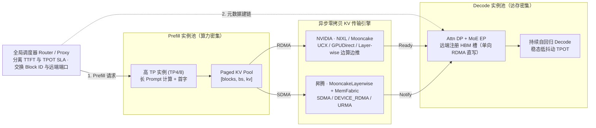

import EpDispatchExplainer from './explainers/EpDispatchExplainer';

分布式推理的显存压力来自两类开销：一类是静态常驻的模型权重，另一类是随序列长度与并发数线性增长的 KV Cache（Key-Value Cache，键值缓存）。第 01 章算清了单次跨卡传输的物理代价，而**并行维度的切分方式**决定了前向过程一共要支付多少次通信，又真正省下了哪一部分显存。

在吞吐与时延的权衡里，推理系统同时盯住两个核心指标。**TTFT（Time to First Token，首字延迟）**决定用户看到首字的等待时间，**TPOT（Time per Output Token，逐 token 生成延迟）**则决定后续吐字间隔。当单卡装不下权重或长上下文缓存时，集群设计沿着三条主线展开：算子与序列切分、注意力与专家混合并行，以及预填充与解码两阶段的池化隔离。

## 张量、序列与环形上下文并行

当单层线性权重超出单卡显存，或超长输入需要多卡协同计算时，集群会沿算子与序列两个维度展开切分。这对应算子级的 **TP（Tensor Parallelism，张量并行）**与去激活冗余的 **SP（Sequence Parallelism，序列并行）**。面对超长文本，还可继续叠加 **Ring CP（Context Parallelism，环形上下文并行）**。三者的张量分片与通信模式对照如图 1 所示。


### 列行切分与 TP 每子层归约

以两层前馈网络 $Y = (X W_1) W_2$ 为例，设输入激活 $X$ 的形状为 $[S, B, D]$（依次为序列长度、批大小与隐藏维），升维矩阵 $W_1 \in \mathbb{R}^{D \times H}$，降维矩阵 $W_2 \in \mathbb{R}^{H \times D}$。

使用 $P$ 张卡做 Megatron 列并行加行并行时，先把 $W_1$ 按列均分为 $[W_{1,:,0}, \dots, W_{1,:,P-1}]$，每卡持有 $[D, H/P]$。各卡读入完整的 $X$ 后各自算出分块激活 $X W_{1,:,i}$，随后的 GeLU 或 SwiGLU 只做逐元素运算，这一步无需跨卡通信。

紧接着把 $W_2$ 按行均分为 $P$ 块 $[W_{2,0,:}; \dots; W_{2,P-1,:}]$（每卡持有 $[H/P, D]$），各卡刚好消费手头的局部隐状态算出部分和，再通过一次 `AllReduce` 相加汇总：

$$
(X W_1) W_2 = \sum_{i=0}^{P-1} (X W_{1,:,i}) W_{2,i,:}
$$

在 `vllm` 的线性层实现中，`ColumnParallelLinear` 默认关闭输出收集以保留分块结果。`RowParallelLinear` 则只在主分片 0 上累加一次偏置，避免全局求和时重复叠加，随后触发一次 `AllReduce`[^vllm-linear]。自注意力层同样采用“列切 QKV 投影 + 行切输出投影”的配对，因此每个 Transformer 层固定触发两次 `AllReduce`（每子层 1 次，如图 1 上段所示）。

由于每层都要同步两次，TP 的并行度数必须限定在单节点或超节点的 Scale-Up 高带宽域内。一旦跨上毫秒级尾延迟的 RoCE 或 InfiniBand 网络，每层两次 `AllReduce` 的累积同步等待就会拖垮吞吐。

### 序列并行去重与环形上下文轮转

即使线性层权重已经切分，如果在 `AllReduce` 之后直接执行 `RMSNorm` 与残差累加，每张卡上仍不得不保存完整形状为 $[S, B, D]$ 的激活副本。以 $S = 8192$、$B = 4$、$D = 5120$ 的 BF16 张量为例，单张卡上的这一份激活副本就占用 320 MiB，在 8 卡间重复存储意味着整机多消耗 2.19 GiB 冗余显存。

SP 利用第 01 章的等价拆分，把一步 `AllReduce` 还原为 `ReduceScatter` 接 `AllGather`（如图 1 中段所示）。行并行矩阵乘算完后，各卡先沿序列维执行 `ReduceScatter`，只保留 $[S/P, B, D]$ 的局部切片并完成归一化与残差相加。等到下一层列并行投影需要完整输入时，再用 `AllGather` 拼回 $[S, B, D]$。总通信字节量不变，但非张量并行算子的激活显存与计算量都均匀压低了 $P$ 倍。

面对数十万 token 的超长输入预填充，扩大 TP 很快会撞上注意力头数上限。例如 GQA（Grouped-Query Attention，分组查询注意力）的 KV 头数常只有 4 或 8 个，继续切分只能重复拷贝 KV 头。此时可以沿序列维开启 Ring CP，把输入切成 $P$ 份 $[S/P, H_q, d]$ 分摊到各卡（如图 1 下段所示）。

前向计算时，每张卡原地固定自己的查询分片 $Q_i$，同时把本地块级键值 $KV_j$ 顺着逻辑环点对点接力传递。每收到一站新分片，记新旧两段的局部行最大值为 $m_0, m_1$、指数和为 $l_0, l_1$、未归一化分子为 $\tilde{O}_0, \tilde{O}_1$，只需通过在线 Softmax 增量重缩放原地合并：

$$
\begin{aligned}
m_{\text{new}} &= \max(m_0, m_1) \\
O_{\text{new}} &= \frac{e^{m_0 - m_{\text{new}}} \tilde{O}_0 + e^{m_1 - m_{\text{new}}} \tilde{O}_1}{e^{m_0 - m_{\text{new}}} l_0 + e^{m_1 - m_{\text{new}}} l_1}
\end{aligned}
$$

只要单个分块的矩阵计算时长能盖过点对点通信耗时，整条环传链路便能被计算掩盖，单卡自始至终无需在显存里凑齐完整的长序列 KV 缓存。

从算术强度看，每张卡在单个环传步上接收的数据量为 $2 \cdot (S / P) \cdot H_{kv} \cdot d$（即 $K_j$ 与 $V_j$），而完成的注意力点积乘加运算量正比于 $(S / P)^2 \cdot H_q \cdot d$。只要切片长度 $S / P$ 足够大，计算耗时就能稳稳盖过点对点环传的固定延迟与带宽开销。

## 注意力数据并行与专家并行混合布局

在稀疏 MoE（Mixture-of-Experts，混合专家架构）与潜变量压缩模型上，单纯扩大 TP 会引发严重的 KV Cache 冗余。以只有 4 个 KV 头的 GQA 模型为例，开启 8 卡 TP8 时每组 KV 头不得不在 2 张卡上各存一份。而在 DeepSeek MLA（Multi-head Latent Attention，多头潜在注意力）这类单潜在头架构上[^vllm-mla-cache]，TP8 会让 8 张卡存出 8 份一模一样的 576 维潜向量。

以 60 层、每层 576 维 BF16 潜向量（每 token 每层 1152 字节）为例，一条 32K token 请求的单份缓存就占约 2.11 GiB。在 TP8 下整机重复保存 8 份会吃掉 16.88 GiB，其中 87.5% 全是冗余拷贝。

为消除这笔冗余开销，现代 MoE 集群普遍改用 **Attention DP + MoE EP** 混合并行架构。在注意力阶段，8 张卡配置为 DP8（8 路数据并行），不同并发请求散落到独立卡上，每卡只存本地请求的分页 KV Cache。这不仅把有效并发缓存空间扩大了 8 倍，还省去了注意力阶段的跨卡通信。

到了 MoE 前馈阶段，每张卡如果都存全套上百个路由专家权重同样会撑爆显存。同一组卡于是切换为 EP8（8 卡专家并行），把路由专家拆散到各卡，只通过跨卡 `All-to-All` 把 token 送去对应卡计算。

下面通过一个 4 卡 Top-2 路由的最小模型，观察激活张量如何在 DP 与 EP 两种布局之间切换。初始每张卡在 Attention DP 阶段各持有 1 个 token，激活形状为 $[1, D]$；可以通过图 2 中的步骤切换按钮依次查看门控计数握手、非对称重分发、局部专家矩阵乘以及加权还原五个阶段。

<EpDispatchExplainer
  client:visible
  title="图 2：Attention DP + MoE EP 跨卡 Dispatch / Combine 全周期推演"
/>

如图 2 所示，混合并行的数据流沿 `DP -> Dispatch -> Expert GEMM -> Combine -> DP` 往返。注意力阶段各卡独立计算，保持规整的 $[1, D]$ 激活分布。进入 MoE 层后，路由器为每个 token 选出 $K$ 个目标专家，再经变长 `AllToAllV`（变长全对全通信）的 Dispatch 阶段将激活副本发往专家所在卡。

一旦多条请求的路由集中命中同一热点专家（如图 2 中均匀分布裂变为 $[2, 4, 2, 0] \times D$），热点卡缓冲区就会面临多对一的突发拥塞写入。随后的 `Grouped GEMM`（分组矩阵乘）也会被拖入木桶效应：冷门卡整轮空转，轻载卡早早算完却只能在同步点干等热点卡消化双倍载荷。

全部局部专家算完后，系统再经逆向的 `All-to-All Combine` 把输出矢量传回各自的源卡，按路由门控权重 $w_1 y_1 + w_2 y_2$ 加权累加，重新对齐成 $[1, D]$ 交还下一层 Attention DP。如何在底层通信栈与微批流水层面掩盖这两段跨卡 `All-to-All` 的等待时间，将在第 03 章专门展开拆解。

## 预填充解码分离与流式 KV 传输栈

即便同一组实例内部已经选定了合理的混合并行布局，将长序列 Prefill 与高并发 Decode 混跑在同一组计算卡上依然会互相拖累。一方面存在时间排队的阻塞冲突：一次数万 token 的 Prefill 会独占算力队列数百毫秒，导致同一机台上正在自回归输出的在线请求 TPOT 出现剧烈毛刺。

另一方面，两者的硬件瓶颈刚好相反。Prefill 处于计算受限区，适合开启 TP4 或 TP8 并行以低并发压低 TTFT。而 Decode 处于访存受限区，需要高并发下的 Attention DP + MoE EP 来换取更大的 KV Cache 空间与稳态吞吐。

将集群物理拆分为独立扩缩容的 Prefill 实例池与 Decode 实例池，是兼顾 TTFT 与 TPOT 的标准做法。这套 **PD（Prefill-Decode Disaggregation，预填充-解码分离）**架构的数据面与控制面分工如图 3 所示。



### 异构布局重映射与逐层流式推送

PD 分离把算力抢占矛盾转化为跨池状态迁移问题，整体执行分为控制面建链与数据面直写两步。调度器先将请求派发给 Prefill 池计算首字并逐块写入本地分页缓冲，同时通过轻量控制面告知 Decode 池请求已分配的 `Block ID` 与远端内存描述符。

远端槽位注册就绪后，KV 张量绕过 CPU 中转，直接由网卡或高速总线异步单向写入 Decode 池的远端 HBM 槽位。一旦就绪通知抵达，Decode 节点就能直接读取这些缓存块进入自回归生成。

这种解耦使两端集群能按各自负载独立扩缩容。遇到大批量长提示词突发流量时，只需水平扩容 Prefill 实例就能稳住 TTFT，不会挤占 Decode 池的算力与显存。面对长输出高并发会话，也只需扩充 Decode 池的 DP 与 EP 节点来容纳更多并发缓存。

但两端常采用不对称的并行拓扑，例如 Prefill 池用 TP8，Decode 池用 DP8 + EP8。对于常规 GQA 模型，每张 Prefill 卡只存 $1/8$ 的 KV 头，而单张 Decode 卡需要该请求的全部 KV 头。传输引擎必须在握手阶段按 TP 比例与块大小比例（`block_size`）建立一对多映射，并约定统一的头排布格式。

相比之下，MLA 模型由于每张 Prefill 卡上都保留了完整的一份单头潜变量，Decode 卡只需从任一对应节点拉取并对齐块粒度即可。

如果等所有层算完才统一触发跨池拷贝，Decode 节点依然会卡在等待 KV 就绪的屏障上。现代传输栈因此引入 **Layer-wise 逐层流式传输**：Prefill 写完第 $\ell$ 层缓存即记录设备事件，由后台发送流异步推送，把传输耗时藏进后续第 $\ell + 1$ 层的计算窗口内。

### 双硬件栈的异步传输抽象

在 NVIDIA 生态中，上游 `vllm` 以 `NixlConnector` 与 `MooncakeConnector` 作为核心数据面抽象。前者在初始化时隔离生产端与消费端角色[^vllm-nixl]，在 GPU 上注册缓存区域，并由底层 NIXL 按拓扑切换机内 UCX `cuda_ipc`、NVLink P2P 或跨机 GPUDirect RDMA。同时它还会校验异构 TP 映射，并限定消费端并发上下文并行与流水线并行的组合边界。

对于非 MLA 模型在异构 TP 下的传输对齐，`MooncakeConnector` 则在注册设备显存的同时强制约定统一的缓存布局，减少跨池拼装时的格式重排开销[^vllm-mooncake]。

在华为昇腾 `vllm-ascend` 生态中，连接器体系已统一收敛至 Mooncake 与 `MemFabric` 传输引擎[^ascend-release]。其中 `MooncakeLayerwiseConnector` 在每一物理层写完 KV 缓存后记录 NPU 事件，并在专门的重排发送流上异步完成异构头分组切分与逐层推送[^ascend-layerwise]。

底层的 `MemfabricBackend` 与 `GlobalMemfabricTE` 把传输协议抽离为配置项，对外暴露统一的缓冲区注册与同步批量读取接口。同一套上层代码由此即可适配超节点内的 `sdma`、跨节点的 `device_rdma` 与新一代互连的 `device_urma` 协议栈，无需按型号写分支[^ascend-memfabric]。

无论用 NVIDIA 还是昇腾栈，开启跨池 Prefix Caching（前缀缓存）远端拉取时，Decode 节点仍需在建链阶段等待未命中的前缀块传完。生产部署通常把热点系统提示词预热在本地或高带宽共享存储池中，以缩短首步生成前的跨池等待。

## 算子切分与在线归并的 NumPy 验证

下面的 NumPy 脚本同时验证两条张量代数等价性。第一，Megatron 列并行接行并行的两步分块矩阵乘（$P = 2$）与全量前馈输出相等。第二，将长序列 $K$、$V$ 沿序列维切为两块并用在线 Softmax 增量归并，结果与单卡全局注意力一致：

```python
import numpy as np

rng = np.random.default_rng(7)
# 1. Megatron Column + Row 张量并行 (P=2)
x = rng.normal(size=(2, 4, 8))
w1, w2 = rng.normal(size=(8, 12)), rng.normal(size=(12, 8))
y_ref = np.maximum(0.0, x @ w1) @ w2

h0, h1 = np.maximum(0.0, x @ w1[:, :6]), np.maximum(0.0, x @ w1[:, 6:])
y_tp = h0 @ w2[:6, :] + h1 @ w2[6:, :]  # Row 并行 AllReduce 求和
assert y_tp.shape == (2, 4, 8) and np.allclose(y_tp, y_ref, atol=1e-12)

# 2. Ring CP 在线 Softmax 增量归并 (2 个 KV 分块)
q = rng.normal(size=(4, 8))
k_all, v_all = rng.normal(size=(6, 8)), rng.normal(size=(6, 8))
logits = (q @ k_all.T) / np.sqrt(8.0)
p_full = np.exp(logits - logits.max(axis=1, keepdims=True))
o_ref = (p_full / p_full.sum(axis=1, keepdims=True)) @ v_all


def chunk_stats(k_blk: np.ndarray, v_blk: np.ndarray):
    s = (q @ k_blk.T) / np.sqrt(8.0)
    m = s.max(axis=1, keepdims=True)
    e = np.exp(s - m)
    return m, e.sum(axis=1, keepdims=True), e @ v_blk


m0, l0, num0 = chunk_stats(k_all[:3], v_all[:3])
m1, l1, num1 = chunk_stats(k_all[3:], v_all[3:])
m_new = np.maximum(m0, m1)
w0, w1_scale = np.exp(m0 - m_new), np.exp(m1 - m_new)
o_cp = (num0 * w0 + num1 * w1_scale) / (l0 * w0 + l1 * w1_scale)
assert o_cp.shape == (4, 8) and np.allclose(o_cp, o_ref, atol=1e-12)
print(
    f"TP max_diff={np.max(np.abs(y_tp - y_ref)):.2e} | "
    f"RingCP max_diff={np.max(np.abs(o_cp - o_ref)):.2e}"
)
```

运行脚本得到两条切分路径与单卡基线的最大绝对误差输出：

```text
TP max_diff=1.78e-15 | RingCP max_diff=2.22e-16
```

两条路径的数值误差均落在双精度浮点机器精度量级（$10^{-15}$ 至 $10^{-16}$），验证了算子切分与上下文分块归并在数值上的等价性。

不过在 `Attention DP + MoE EP` 跑起来之后，每层连续发生的两趟跨卡 `All-to-All` 依然常常占据大半耗时。下一章我们考察 NVIDIA `DeepEP`、昇腾 `HCCL MC2` 与双微批重叠实现，看系统层如何消除通信气泡：[03 MoE 跨卡通信：DeepEP、MC2 与 DBO](../03-moe-comm-and-overlap/)。

[^vllm-linear]: 见 `vllm@bb23c0a8`：`vllm/model_executor/layers/linear.py` L619–637（`ColumnParallelLinear.forward` 条件执行 `tensor_model_parallel_all_gather`）及 L1859–1885（`RowParallelLinear.forward` 仅在 `tp_rank == 0` 叠加 `bias` 并执行 `tensor_model_parallel_all_reduce`）。

[^vllm-mla-cache]: 见 `vllm@bb23c0a8`：`vllm/v1/attention/backends/mla/flashmla.py` L259–351（`FlashMLAImpl` 将联合潜变量与位置缓存以 `.unsqueeze(-2)` 传入单 KV 头布局 `[num_blocks, block_size, 1, 576]`）。

[^vllm-nixl]: 见 `vllm@bb23c0a8`：`vllm/distributed/kv_transfer/kv_connector/v1/nixl/connector.py` L85–156（`NixlBaseConnector.kv_cache_access` 在设备缓冲区模式下声明 `KVCacheAccess.REGISTERS | KVCacheAccess.EXPORTS_FABRIC` 权限掩码，并校验 `kv_producer`/`kv_consumer` 角色与 PCP/PP 约束）及 `nixl/base_worker.py` L186–246（处理异构 `block_size_ratio` 与描述符步长映射）。

[^vllm-mooncake]: 见 `vllm@bb23c0a8`：`vllm/distributed/kv_transfer/kv_connector/v1/mooncake/mooncake_connector.py` L779–845（`MooncakeConnector` 注册设备端 KV 显存并在非 MLA 异构 TP 传输时强制采用 `"LBHNC"` 排布）。

[^ascend-release]: 见 `vllm-ascend@3649b8ff`：`docs/source/user_guide/release_notes.md` L1878–1881（明确标注旧版 `LLMdatadist` KV 连接器已被移除，统一改用 Mooncake 连接器并引入实验性 `MooncakeLayerwiseConnector`）。

[^ascend-layerwise]: 见 `vllm-ascend@3649b8ff`：`vllm_ascend/distributed/kv_transfer/kv_p2p/mooncake_layerwise_connector.py` L1694–1950（`MooncakeLayerwiseConnectorWorker` 在每层缓存写完时记录 NPU 事件，并在 `resharding_stream` 上完成异构头映射与逐层推送）。

[^ascend-memfabric]: 见 `vllm-ascend@3649b8ff`：`vllm_ascend/distributed/kv_transfer/utils/memfabric_transfer_engine.py` L16–109（`MemfabricBackend` 暴露 `register_memory` 与 `batch_transfer_sync_read` 接口，`GlobalMemfabricTE` 统一调度 `sdma`、`device_rdma` 与 `device_urma` 传输协议）。
