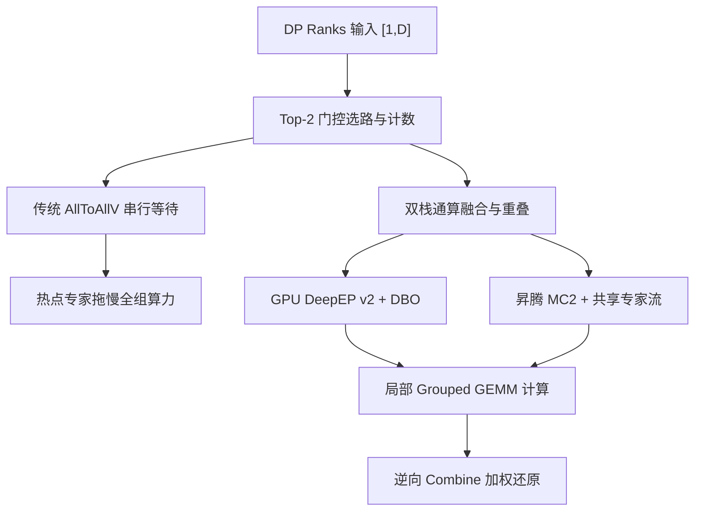

在大型混合专家（MoE）模型中，每 token 的激活前馈计算量经稀疏路由大幅压缩后，把 token 送往目标专家卡、算完再收归原卡的两趟跨卡 `All-to-All` 通信直接成为端到端吞吐与尾延迟的主要瓶颈。同时，单批次内部的算子依赖会让计算核心在网络传输飞行窗口内处于等待空转状态。

## 专家并行 All-to-All 通信的阻塞根源

承接第 02 章对 `Attention DP + MoE EP` 路由轨迹的追踪，当偏斜路由把大批请求集中送往少数热点专家时，通用变长 `All-to-All（AllToAllV）` 原语的控制与数据流向如图 1 所示。两条支路分别对应传统串行等待与双硬件栈的通算融合及流水重叠路径。



沿图 1 左侧的传统路径拆解，通用 `AllToAllV` 的性能损耗主要源自三个系统层面约束。

第一是主机端元数据同步栅栏。在发起变长分发之前，各卡必须先交换彼此准备发送的 token 数量表，确认接收长度后才能为接收缓冲区分配偏移；在每卡只有数个到数十个 token 的 Decode 阶段，CPU 侧发射同步 Kernel 与集合通信栅栏的开销常常高于字节搬运本身，同时也阻断了静态计算图的端到端捕获。

第二是跨机慢网与机内快网混用。当专家并行跨越多个计算节点时，标准集合通信把跨机低带宽 RDMA 与机内高带宽 NVLink 或 HCCS 视为平坦对等网络；如果同一个 token 被路由到对端节点上的多个专家，就会在跨机网卡上重复发送冗余副本，并且整组通信必须等待负载最重的热点卡与跨机尾延迟一同对齐。

第三是单流串行执行造成计算气泡。在单一计算流上，Attention 计算完成前 Dispatch 无法发射，而 Dispatch 与 Combine 在网络飞行期间计算引擎几乎完全空转；随着专家并行规模增大，通信耗时占比持续上升，计算核心的有效利用率随之下降。

## NVIDIA DeepEP 的双模式演进与统一底座

### 高吞吐与低延迟双模式的分化动因

在早期 `vllm` 与 `DeepEP` 的演化中，由于预填充（大批量吞吐受限）和解码（小批量延迟受限）对硬件资源的诉求截然不同，系统曾拆分出高吞吐（HT，High-Throughput）与低延迟（LL，Low-Latency）两套独立通信引擎。

高吞吐模式在 `vllm` 中由 `DeepEPHTPrepareAndFinalize` 封装，面向多机 Prefill 大载荷，核心在于采用非对称两级中继（先跨机 RDMA 中继、后机内 NVLink 扇出）消除跨机冗余流量：跨节点先通过 RDMA 将同一 token 仅发一份到目标机器的对应转发卡，到达目标节点内部后再借由高带宽 NVLink 广播分发给具体驻留专家的目标卡[^deepep-hybrid]。为对齐硬件事务粒度，发送端对隐藏维按 512 字节原子块对齐；但因为每次前向接收到的 token 总数随动态路由实时变化，开启数据并行时该模式无法锁定固定张量形状，编译配置不得不强制禁用 CUDA Graph[^vllm-ht]。

低延迟模式在 `vllm` 中对应 `DeepEPLLPrepareAndFinalize`，针对 Decode 阶段对 $\alpha$ 固定延迟与图捕获的严格要求，完全切换至 **IBGDA（GPU 侧直驱 RDMA）**：GPU 线程束跳过 CPU 调度，直接在设备端拼装 RDMA 工作请求并将 token 写入对端预注册的对称显存槽位。配合 `return_recv_hook=True` 异步发射与在 `dbo_maybe_run_recv_hook` 中触发的接收轮询钩子，系统可以在数据飞行期间把计算控制权先交还其他算子，同时以静态容量上限与定长隐藏层检查保持与 CUDA Graph 兼容[^vllm-ll]。

### 统一 EPBuffer 的双态收敛与显存映射

分别维护 HT 与 LL 两套缓冲区与调度接口，会增加混合批处理和共部署实例的内存与状态管理复杂度。为此新版 `DeepEP` 与 `vllm` 将两条路径收敛进了统一的 `DeepEPV2PrepareAndFinalize` 底座（如图 2 左侧所示）：`DeepEP@f6aa38fe` v2.5 已将统一通信缓冲从 `ElasticBuffer` 重构拆分为 `EPBuffer` 并移除 v1 接口[^deepep-epbuffer]，而当前基线 `vllm@bb23c0a8` 中的 `DeepEPV2All2AllManager` 与 `DeepEPV2PrepareAndFinalize` 仍过渡绑定 `ElasticBuffer` 接口[^vllm-v2-cg]。


统一底座通过四项工程折中将两种运行形态揉入同一套接口。首先，底层发射器依据跨节点数自动选择单机直连或两级中继 Kernel，并根据链路与显存带宽模型推算所需的流式多处理器（SM）与网卡队列对（QP）配额[^deepep-qps]。其次，在编译与调度策略上用动态展开与主机同步开关区分阶段：非图模式下的 Prefill 允许按实际接收量动态展开激活以节省显存，而开启 CUDA Graph 的 Decode 路径关闭一切主机同步，并将每卡最大 token 上限向上取整到 2 的幂，防止输入长度微小波动引发 JIT 重编译抖动[^vllm-v2-cg]。

由于关闭了主机同步，CPU 线程在发射阶段并不知晓本次实际收到了多少有效 token；为此框架在 GPU 上追加一个轻量 Triton Kernel `_globalize_recv_topk_idx`，直接读取设备侧前缀和数组的末尾计数，将越界填充槽位或非本地专家索引原地标记为 `-1`，全程无需回传主机[^vllm-v2-triton]。

此外，分发句柄会缓存目标槽位索引以便在 Combine 阶段跳过通知阶段[^deepep-cached]，尾段拷贝启用可编程依赖启动（PDL）实现核间尾波重叠，而 MXFP8 缩放因子也被紧凑打包进 4 字节整型随 token 一并传输[^vllm-v2-mxfp8]。支撑这一切无 CPU 干预直写能力的底层基石，是基于 CUDA 驱动虚拟内存映射构建的弹性对称显存：通过预留连续虚拟地址并跨进程导出文件描述符句柄，同机多进程无需额外拷贝即可直接向对端物理内存写入数据[^deepep-symm]。

## 华为昇腾 MC2 通算融合与编译期通信消除

### 通信路径分级策略与容量阈值

与 GPU 将通信下沉至用户态 PTX 与网卡直驱不同，华为昇腾 NPU 选择了“核内切片流水”加“编译期融合”的技术路径（如图 2 右侧所示）。在 `vllm-ascend` 中，引擎在框架层显式注册了四档 MoE 通信策略——`AllGather`、`AlltoAll`、`MC2` 与 `FusedMC2`[^ascend-comm-setup]，并在每次前向传播前依据当前批大小、EP 并行规模与硬件特性动态选路[^ascend-select]。

当开启了 LoRA 微调适配器且启用 EP，或者单卡 token 数超过融合算子容量上限时，系统稳妥回退到通用的变长 `All-to-All`（`AlltoAll` 策略）；当 EP 并行规模不大于每 token 激活的专家数时，由于几乎每个 token 都会命中所有卡上的专家，先做一次全量 `AllGather` 反而比离散点对点路由搬运的总字节更少；只有当单卡载荷落在受控容量区间内（标准 `MC2` 与三合一路径上限为每卡 512 个 token，而较新的 CANN `MegaMoe` 路径将上限放宽到 16,384 个 token）[^ascend-limits]，引擎才会切入真正的通算融合算子。

### 核内切片流水与三合一算子融合

MC2（Matmul-Communication Fusion）之所以能够消除大部分通信气泡，关键在于把原本必须首尾相接的整块大算子切碎为细粒度 **Slice（数据块）**。在两步融合的 `MC2` 路径下，调度器先把各序列并行或数据并行分片的输入填充对齐并生成掩码以屏蔽无效占位[^ascend-prep-mc2]，随后依次调用 `npu_moe_distribute_dispatch_v2` 与 `npu_moe_distribute_combine_v2`[^ascend-disp-mc2]。

在 NPU 内部，AICPU 与 HCCL 引擎按 Slice 粒度流水推进：每收满一个 Slice 的数据就立刻送入矩阵或向量单元计算，使跨卡传输、核内 INT8/MXFP 动态量化与矩阵计算逐块接力完成。

更进一步的 `FusedMC2` 路径则调用 `dispatch_ffn_combine` 或 CANN `MegaMoe` 对称缓冲区引擎，将 Dispatch、SwiGLU 专家双次分组矩阵乘与 Combine 乃至共享专家权重一并装进单个融合算子内完成[^ascend-fusedmc2]。

高度集成的核内融合也引入了两项必须严格遵守的缓冲区约束。其一，标准 MC2 算子直接根据环境变量 `HCCL_BUFFSIZE` 划分通信与计算共享内存段，因此通信组创建逻辑在遇到 MC2 组时会刻意跳过独立的组选项配置，以免破坏算子内部的静态地址切分基线[^ascend-hccl-pg]；同理，`MegaMoe` 对称缓冲区也要求所有 EP 卡传入完全一致的编译期容量上限，否则会触发远程一致性错误[^ascend-507057]。

其二，为了防止推理途中临时分配对称缓冲区引发显存溢出，模型启动阶段在正式测算 KV Cache 可用空间前会先检查预热样本规模：只要常规预热步数未能覆盖 `mc2_tokens_capacity`，执行器就会额外补跑一次 `Dummy Run`（空跑预热），提前分配并固定 MC2 所需的峰值对称缓冲区[^ascend-profile]。

### 张量并行侧的矩阵乘与 ReduceScatter 融合

通算融合同样延伸到张量并行与序列并行链路。在 Attention 输出投影或前馈网络行并行收尾处的 `Matmul -> ReduceScatter` 序列中，如果等整张输出矩阵乘完才发起跨卡归约，仍会暴露一段纯通信延迟。

为此 `vllm-ascend` 在 FX 图编译阶段引入了 `MatmulReduceScatterFusionPass`[^ascend-mmrs]：当 TP 规模为 2、4 或 8，数据类型为 `bfloat16` 或 `float16`，且归约维度满足 `256 <= K < 65535` 时，模式匹配器会自动捕获紧接在行并行矩阵乘（含输入填充节点）之后的 `ReduceScatter`，将填充折叠进输入并用融合原语 `npu_mm_reduce_scatter_base`（或量化变体）替换整段子图。算子一边产出输出行分片一边发起 `ReduceScatter` 传输，把 TP 侧通信隐藏在矩阵乘法计算窗口内。

## 双微批重叠与共享专家异步流

即便单个通信 Kernel 的带宽利用率已经逼近硬件链路上限，只要整批请求运行在同一条顺序依赖链上，Attention 计算完成前 Dispatch 依然无法启动，Dispatch 飞行期间后续算子也只能停滞。将整批输入（例如 $B = 1024$ 个 token）对半切分为两个微批 $\mu B_0$ 与 $\mu B_1$（每份 512 个 token），让两个微批在计算流与通信流之间交替错峰推进，便是**双微批重叠（DBO，Dual-Batch Overlap）**的核心机制。图 3 对照了串行基准、GPU 双微批乒乓模式以及昇腾单批 MC2 辅助流流水线。


如图 3 所示，在严格按毫秒比例对齐的泳道中，串行单批完成一层共耗时 8.50 ms（有效计算 4.60 ms，算力利用率 54.1%）；GPU 端对半切分后，$\mu B_1$ 的注意力槽位恰好填满了 $\mu B_0$ 的跨卡分发等待，后续 $\mu B_1$ 分发与 $\mu B_0$ 专家计算交叉推进，将单层耗时降至 5.40 ms，算力活跃度提高到 85.2%；而昇腾端则保留完整单批，在主流执行 MC2 算子内 Slice 流水的同时，由辅助计算流并发执行共享专家。

### NVIDIA 栈的双微批状态机与图边界

在 `vllm` 的执行器实现中，DBO 依靠主控线程交替接力，避免两条主机线程同时向流中并发投放算子导致 Kernel 入队乱序或破坏图捕获。

`UBatchRunner` 固定维护两条微批线程，共享一条计算流与一条通信流[^vllm-ubatch-runner]，但在任意时刻只允许一条 CPU 线程处于活跃发射状态：当微批 A 算完注意力并抵达 `DeepEP` 分发入口时，它先在计算流上记录完成事件，再通过线程同步状态机交出 CPU 控制权并唤醒微批 B；微批 B 随即在计算流推进注意力算子，与通信流上飞行中的微批 A 分发操作真正实现硬件并发[^vllm-ubatch-ctx]。

这套多线程单控状态机在部署时受两项工程约束限制。一方面，当 `DeepEP` 高吞吐模式在通信流执行打包与跨节点中继时会占用一部分 GPU SM，因此运行前需要通过 `VLLM_DBO_COMM_SMS` 静态划出通信专用 SM 配额并等额缩减矩阵乘可用 SM，避免两条流在硬件上互相抢占资源[^vllm-dbo-sm]。

另一方面，因为流切换事件必须完整录进同一份设备重放图中，DBO 与分段捕获模式天然互斥，只能绑定全图捕获模式 `CUDAGraphMode.FULL` 生成双微批孪生图[^vllm-dbo-fullcg]；同时引擎设置了 Prefill 与 Decode 最小 token 阈值，避免在极小批下对半拆分反而拉低矩阵乘效率[^vllm-dbo-thresh]。

### 昇腾栈的共享专家异步重叠路径

与 NVIDIA 路线不同，当前 `vllm-ascend` 在模型状态机中显式禁用了 DBO[^ascend-nodbo]。背后的工程原因十分直接：首先，昇腾 MC2 已经在单一融合核内部按 Slice 粒度把自身的通信与计算重叠完毕；其次，将原本不大的批尺寸对半再切分，容易让单微批滑离 DaVinci Cube 核的高效矩阵分块区间，甚至掉出融合算子的最优工作点。

为此，昇腾路径转而利用现代 MoE 模型自带的**常驻共享专家（Shared Experts）**特性——共享专家不依赖稀疏门控路由，所有 token 一律参与计算。在 `AscendMoERunner` 的调度编排中，一旦路由器输出就绪，引擎立即把共享专家的 Gate-Up 投影投递到专门的辅助计算流上，利用共享专家的计算去填补主流上路由 Top-K 排序与 `Dispatch` 的网络等待时间；待路由计算推进至激活与 Combine 里程碑时，两条流再完成结果汇合，而当 `MegaMoe` 启用核内全融合时则会直接跳过外部辅助流调用[^ascend-shared]。

### 双硬件栈 MoE 通信方案对照

| 工程维度         | NVIDIA 栈（`DeepEP` + `vllm`）   | 昇腾栈（`vllm-ascend` + CANN）     |
| :--------------- | :------------------------------- | :--------------------------------- |
| **核心通信原语** | 统一 `EPBuffer` 与 IBGDA 直驱    | MC2 核内切片与三合一融合算子       |
| **通算重叠粒度** | 线程接力切换双微批计算流与通信流 | 核内切片流水配合共享专家异步流     |
| **显存管理约束** | 虚拟内存对称映射与 2 的幂对齐    | 独占缓冲区与 `Dummy Run` 预占      |
| **量化协同打包** | 缩放因子打包为四字节整型随传     | 核内边传边量化与量化归约融合       |
| **静态图兼容性** | 关闭主机同步后支持全图模式捕获   | 静态填充配掩码入图且禁用双微批     |
| **张量并行融合** | 对称显存直写配合尾波依赖启动     | 编译期融合矩阵乘与 `ReduceScatter` |

## 专家并行等价性与双流流水仿真

下面的自包含 NumPy 脚本同时完成两项验证：第一部分在 4 卡 Top-2 偏斜路由下核对 `Dispatch -> 局部专家计算 -> 加权 Combine` 与单卡参考实现的数值等价性；第二部分基于图 3 的离散时间参数，模拟串行单批与双微批重叠的理论流水线耗时：

```python
import numpy as np

rng = np.random.default_rng(7)
e_num, dim, p_ranks = 4, 8, 4
x_dp = rng.normal(size=(p_ranks, dim))
w_experts = rng.normal(size=(e_num, dim, dim))
routes = [[(0, 0.7), (1, 0.3)], [(1, 0.6), (2, 0.4)], [(1, 0.8), (0, 0.2)], [(1, 0.5), (2, 0.5)]]

# 单卡参考计算
y_ref = np.zeros_like(x_dp)
for t, pairs in enumerate(routes):
    for eid, w in pairs:
        y_ref[t] += w * np.tanh(x_dp[t] @ w_experts[eid])

# 非对称 All-to-All Dispatch -> 局部 Grouped FFN -> Weighted Combine
recv_lists = [[] for _ in range(e_num)]
meta = []
for src_rank, pairs in enumerate(routes):
    for eid, w in pairs:
        pos = len(recv_lists[eid])
        recv_lists[eid].append(x_dp[src_rank])
        meta.append((src_rank, eid, pos, w))
counts = [len(lst) for lst in recv_lists]
expert_outs = [np.tanh(np.stack(lst) @ w_experts[e]) if lst else np.zeros((0, dim)) for e, lst in enumerate(recv_lists)]
y_dist = np.zeros_like(x_dp)
for src_rank, eid, pos, w in meta:
    y_dist[src_rank] += w * expert_outs[eid][pos]
assert y_dist.shape == (4, 8) and np.allclose(y_dist, y_ref, atol=1e-12)
print(f"EP counts={counts} max_diff={np.max(np.abs(y_dist - y_ref)):.2e}")


def sim_stream(attn=2.20, moe=2.40, disp=2.00, comb=1.50, sync=0.20, ev=0.05):
    t_serial = attn + (disp + sync) + moe + (comb + sync)
    comp, comm = 0.0, 0.0
    a0 = comp + attn / 2; comp = a0
    a1 = comp + attn / 2; comp = a1
    d0 = max(a0 + ev, comm) + disp / 2; comm = d0
    m0 = max(comp, d0 + ev) + moe / 2; comp = m0
    d1 = max(a1, comm + ev) + disp / 2; comm = d1
    m1 = max(comp, d1 + ev) + moe / 2; comp = m1
    c0 = max(m0 + ev, comm) + comb / 2; comm = c0
    c1 = max(m1 + ev, comm) + comb / 2; comm = c1
    return t_serial, max(comp, comm), attn + moe


ts, td, tc = sim_stream()
print(f"Serial={ts:.2f}ms ({100 * tc / ts:.1f}%) | DBO={td:.2f}ms ({100 * tc / td:.1f}%)")
```

运行脚本可得数值校验与理论流水线耗时对比：

```text
EP counts=[2, 4, 2, 0] max_diff=3.33e-16
Serial=8.50ms (54.1%) | DBO=5.40ms (85.2%)
```

从仿真结果可以看出，在 Prefill 大批载荷下，双微批交错排程能够有效掩盖中间两段通信气泡并显著拉高算力活跃度；但在 Decode 小批场景下，把原本就很小的矩阵再次拆半会损伤矩阵乘计算核的分块效率，这也是为什么生产系统分别演进出了 GPU 侧的 IBGDA 低延迟 Kernel 以及昇腾侧的核内 Slice 流水与共享专家异步流。同时上线配置时仍需算清两笔账：第一，对称内存与静态缓冲区本质上都在用预占显存换取零同步开销，过度拉大缓冲上限会直接挤压并发 KV Cache 空间；第二，通算重叠只能藏住通信时间，无法消除热点专家引发的计算木桶效应，负载倾斜本身依然要靠无辅助损失偏置和冗余专家负载均衡去缓解。

至此，[《分布式并行与跨卡通信》](../)已从物理互连、多维切分与通算重叠三个层面拆解完毕。但通信层优化无法改变模型激活与路由的固有分布，若要进一步压缩缓存字节体积并从算法源头缓解专家倾斜，请继续阅读[《DeepSeek 架构演进》](../../deepseek/)。

[^deepep-hybrid]: 见 `DeepEP@f6aa38fe`：`csrc/kernels/ep/dispatch.hpp` L31–166（`launch_dispatch` 区分单机 `dispatch_impl` 与多机 `hybrid_dispatch_impl`）及 `csrc/kernels/ep/combine.hpp` L24–146（`hybrid_combine_impl` 两级转发）。

[^vllm-ht]: 见 `vllm@bb23c0a8`：`vllm/model_executor/layers/fused_moe/prepare_finalize/deepep_ht.py` L47–211（`DeepEPHTPrepareAndFinalize` 对齐 `xfer_atom_size = 512` 字节并实现 `_do_dispatch`）；`vllm/config/compilation.py` L1403–1418（`deepep_high_throughput` 与 `data_parallel_size > 1` 组合时强制 `CUDAGraphMode.NONE`）。

[^vllm-ll]: 见 `vllm@bb23c0a8`：`vllm/model_executor/layers/fused_moe/prepare_finalize/deepep_ll.py` L29、L51–58（`DeepEPLLPrepareAndFinalize` 定义 `DEEPEP_QUANT_BLOCK_SIZE = 128` 与 `SUPPORTED_HIDDEN_SIZES` `[2048..8192]`）、L238–335（`prepare_async` 启用 `return_recv_hook=True`）及 L383–421（`_finalize` 触发 `dbo_maybe_run_recv_hook`）。

[^deepep-epbuffer]: 见 `DeepEP@f6aa38fe`：`README.md` L11–32 及 `deep_ep/buffers/ep.py` L208–906（v2.5 将原 `ElasticBuffer` 拆分为 `EPBuffer` 并移除 v1 `Buffer` 接口，统一 `dispatch` 与 `combine`）。

[^vllm-v2-cg]: 见 `vllm@bb23c0a8`：`vllm/distributed/device_communicators/all2all.py` L1191–1273（`DeepEPV2All2AllManager` 仍绑定 `deep_ep.ElasticBuffer`）与 `vllm/model_executor/layers/fused_moe/prepare_finalize/deepep_v2.py` L73–232（`DeepEPV2PrepareAndFinalize` 在图模式下置 `do_expand=False, do_cpu_sync=False`，并按 `1 << max(n - 1, 0).bit_length()` 对齐 `num_max_tokens_per_rank` 防 `cicc` 重编译）。

[^deepep-qps]: 见 `DeepEP@f6aa38fe`：`deep_ep/buffers/ep.py` L431–560（`get_theoretical_num_sms` 与 `get_theoretical_num_qps` 根据 `num_scaleout_ranks` 推导 SM 与 QP 配额，混合模式下 `num_qps = num_sms * 16 + 1`）。

[^vllm-v2-triton]: 见 `vllm@bb23c0a8`：`vllm/model_executor/layers/fused_moe/prepare_finalize/deepep_v2.py` L568–612（`_globalize_recv_topk_idx` Triton 内核读取设备端 `psum_ptr[P - 1]` 就地筛选合法专家索引）。

[^deepep-cached]: 见 `DeepEP@f6aa38fe`：`csrc/kernels/ep/dispatch.hpp` L64–65（`cached_mode` 将 `num_notify_warps` 置为 `0` 并复用 `dst_buffer_slot_idx`）及 L207–214（`.enable_pdl = true` 启用尾波依赖启动）。

[^vllm-v2-mxfp8]: 见 `vllm@bb23c0a8`：`vllm/model_executor/layers/fused_moe/prepare_finalize/deepep_v2.py` L42–70（`_pack_mxfp8_scale` 与 `_unpack_mxfp8_scale` 将 `[M, K/32]` 缩放因子打包为 `[M, K/128]` 的 `int32`）。

[^deepep-symm]: 见 `DeepEP@f6aa38fe`：`csrc/kernels/comm/symmetric.hpp` L139–300（`ElasticSymmetricMemory` 与 `HybridElasticSymmetricMemory` 基于 `cuMemAddressReserve` / `cuMemCreate` / `cuMemMap` 与 `pidfd_open` / `pidfd_getfd` 实现零拷贝跨进程映射）。

[^ascend-comm-setup]: 见 `vllm-ascend@3649b8ff`：`vllm_ascend/ops/fused_moe/moe_comm_method.py` L68–75（`setup_moe_comm_method` 注册四类 MoE 通信实现）。

[^ascend-select]: 见 `vllm-ascend@3649b8ff`：`vllm_ascend/ascend_forward_context.py` L381–445（`select_moe_comm_method` 与 `_MOE_COMM_SELECTORS` 动态选路逻辑）。

[^ascend-limits]: 见 `vllm-ascend@3649b8ff`：`vllm_ascend/ascend_forward_context.py` L51–53（`_MC2_TOKENS_PER_RANK_LIMIT = 512`、`_DISPATCH_FFN_COMBINE_TOKENS_PER_RANK_LIMIT = 512` 与 `_MEGA_MOE_TOKENS_PER_RANK_LIMIT = 16384`）。

[^ascend-prep-mc2]: 见 `vllm-ascend@3649b8ff`：`vllm_ascend/ops/fused_moe/prepare_finalize.py` L239–303（`PrepareAndFinalizeWithMC2` 对齐 `padded_num_tokens` 并生成 `mc2_mask`）。

[^ascend-disp-mc2]: 见 `vllm-ascend@3649b8ff`：`vllm_ascend/ops/fused_moe/token_dispatcher.py` L175–354（`TokenDispatcherWithMC2` 调用 `npu_moe_distribute_dispatch_v2` 支持 `quant_mode=2/4` 及 `npu_moe_distribute_combine_v2`）。

[^ascend-fusedmc2]: 见 `vllm-ascend@3649b8ff`：`vllm_ascend/ops/fused_moe/moe_comm_method.py` L482–695（`FusedMC2CommImpl` 通过 `_apply_cann_mega_moe` 与 `torch.ops._C_ascend.dispatch_ffn_combine` 执行三合一融合）。

[^ascend-hccl-pg]: 见 `vllm-ascend@3649b8ff`：`vllm_ascend/utils.py` L1242–1264（`get_hccl_config_for_pg_options` 识别到 `"mc2"` 组名时返回 `None`，保留 `HCCL_BUFFSIZE` 独立划分）。

[^ascend-507057]: 见 `vllm-ascend@3649b8ff`：`vllm_ascend/ops/fused_moe/moe_comm_method.py` L384–480（`_init_mega_moe_symm_buffer` 统一各卡 `num_max_tokens_per_rank` 以避免 HCCL 错误码 `507057`）。

[^ascend-profile]: 见 `vllm-ascend@3649b8ff`：`vllm_ascend/worker/v2/model_runner.py` L781–815（`NPUModelRunner.profile_run` 执行 `_dummy_run(mc2_tokens_capacity, skip_attn=True)` 预占对称缓冲区）。

[^ascend-mmrs]: 见 `vllm-ascend@3649b8ff`：`vllm_ascend/compilation/passes/mm_reduce_scatter_fusion_pass.py` L24–300（`MatmulReduceScatterFusionPass` 捕获 `unquantized_gemm` 及其 `CatPadded` / `ConstantPadded` 变体并与 `reduce_scatter` 融合为 `npu_mm_reduce_scatter_base` 或量化版本）。

[^vllm-ubatch-runner]: 见 `vllm@bb23c0a8`：`vllm/v1/worker/gpu/ubatch_utils.py` L303–355（`UBatchRunner` 建立 `comm_stream`、`capture_stream` 与 `ready_barrier`）。

[^vllm-ubatch-ctx]: 见 `vllm@bb23c0a8`：`vllm/v1/worker/ubatching.py` L1–254（`UBatchContext` 通过 `_NUM_UBATCHES = 2`、`cpu_wait_event`、`cpu_signal_event`、`gpu_compute_done_event` 与 `gpu_comm_done_event` 实现单活跃线程流切换及 `dbo_yield_and_switch_from_compute_to_comm`）。

[^vllm-dbo-sm]: 见 `vllm@bb23c0a8`：`vllm/v1/worker/ubatch_utils.py` L82–125（`create_sm_control_context` 读取 `VLLM_DBO_COMM_SMS` 为通信保留 SM 配额）。

[^vllm-dbo-fullcg]: 见 `vllm@bb23c0a8`：`vllm/v1/worker/gpu/cudagraph_utils.py` L262–288（`_maybe_ubatch_twin`）及 L791–796（显式断言 `cg_mode != CUDAGraphMode.PIECEWISE`）。

[^vllm-dbo-thresh]: 见 `vllm@bb23c0a8`：`vllm/v1/worker/ubatch_utils.py` L139–148（`check_ubatch_thresholds` 校验 `dbo_decode_token_threshold` 与 `dbo_prefill_token_threshold`）。

[^ascend-nodbo]: 见 `vllm-ascend@3649b8ff`：`vllm_ascend/worker/v2/model_states/default.py` L430–431（`assert ubatch_idx == 0, "DBO is not supported on Ascend"`）。

[^ascend-shared]: 见 `vllm-ascend@3649b8ff`：`vllm_ascend/ops/fused_moe/fused_moe.py` L507–602（`AscendMoERunner._forward_impl` 编排 `router_output_ready`、`shared_activation_overlap_start` 与 `_megamoe_shared_expert_fused`）及 `shared_experts.py` L866–1084（`shared_experts_calculation_stream()` 异步投递 Gate-Up 与汇合）。
