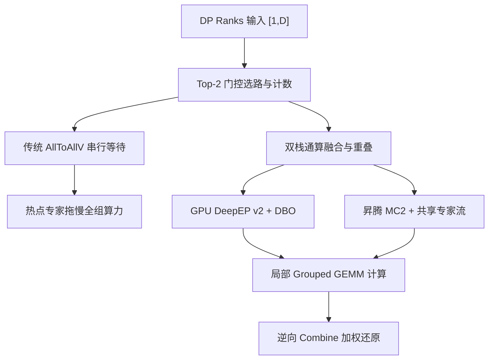

在大型 MoE（Mixture-of-Experts，混合专家架构）模型中，稀疏路由大幅压缩了单 token 的激活计算量。此后，把 token 送往专家卡、算完再收归原卡的两趟跨卡 `All-to-All` 通信，直接成为吞吐与尾延迟的主瓶颈。单批次内部的算子依赖，也会让计算核心在网络传输窗口内长时间空转。

## 专家并行 All-to-All 为何阻塞

承接第 02 章的 `Attention DP + MoE EP` 路由轨迹，当偏斜路由把请求集中送到少数热点专家时，通用变长 `AllToAllV`（变长全对全通信）的流向如图 1 所示。图中两条支路分别对应传统串行等待，以及双硬件栈的通算融合与流水重叠路径。



沿图 1 左侧的传统路径拆解，通用 `AllToAllV` 的性能损耗主要源自三个系统层面约束。

第一是主机端元数据同步栅栏。发起变长分发前，各卡必须先交换准备发送的 token 计数表，确认接收长度后再为接收缓冲区分配偏移。在每卡只有数个到数十个 token 的 Decode 阶段，CPU 发射同步与栅栏的开销常高于字节搬运本身，还阻断了静态计算图的端到端捕获。

第二是跨机慢网与机内快网混用。专家并行跨越多机时，标准集合通信把跨机低带宽 RDMA 与机内高带宽 NVLink 或 HCCS 视为平坦对等网络。同一个 token 若命中对端节点的多个专家，跨机网卡就会重复发送冗余副本，整组通信还必须等待最重的热点卡与跨机尾延迟一起对齐。

第三是单流串行执行造成计算气泡。在单条计算流上，Attention 算完前 Dispatch 无法发射，而网络传输在途期间计算引擎几乎全程空转。随着专家并行规模扩大，通信耗时占比持续上升，计算核心的有效利用率随之走低。

## DeepEP 双模式收敛与统一底座

### 高吞吐与低延迟双模式的分化动因

早期 `vllm` 与 `DeepEP` 针对预填充与解码的相反硬件诉求，拆分出两套独立通信引擎。面向大批量吞吐受限的 Prefill 阶段使用 **HT（High-Throughput，高吞吐）**模式，面向小批量延迟受限的 Decode 阶段则启用 **LL（Low-Latency，低延迟）**模式。

高吞吐模式在 `vllm` 中由 `DeepEPHTPrepareAndFinalize` 封装，专攻多机 Prefill 大载荷。它采用先跨机 RDMA 中继、后机内 NVLink 扇出的非对称两级路由消除跨机冗余：同一 token 跨节点只发一份到目标机转发卡，机内再通过 NVLink 广播给各目标专家卡[^deepep-hybrid]。

为匹配硬件事务粒度，发送端把隐藏维按 512 字节原子块对齐。但由于每步收到的有效 token 总数随路由实时变化，开启数据并行时该模式无法固定张量形状，编译配置只能禁用 CUDA Graph[^vllm-ht]。

低延迟模式对应 `DeepEPLLPrepareAndFinalize`，专攻 Decode 阶段对 $\alpha$ 固定延迟与图捕获的硬性要求。该路径切到 **IBGDA（GPU 侧直驱 RDMA）**模式，让 GPU 线程束跳过 CPU 调度，直接在设备端拼装 RDMA 工作请求并写入对端对称显存槽位。

配合 `return_recv_hook=True` 异步发射与 `dbo_maybe_run_recv_hook` 轮询钩子，系统能在数据传输在途期间把算力交还其他算子。同时它以静态容量上限与定长隐藏层校验保持对 CUDA Graph 的兼容[^vllm-ll]。

### 统一 EPBuffer 的双态收敛与显存映射

分别维护 HT 与 LL 两套缓冲区与调度接口，会推高混合批处理和共部署实例的内存与状态复杂度。新版 `DeepEP` 与 `vllm` 因此把两条路径收拢进统一的 `DeepEPV2PrepareAndFinalize` 底座（如图 2 左侧所示）。

在接口演进上，DeepEP v2.5 已将统一通信缓冲从 `ElasticBuffer` 重构拆分为 `EPBuffer` 并移除 v1 接口[^deepep-epbuffer]。而当前基线 vLLM 中的 `DeepEPV2All2AllManager` 与 `DeepEPV2PrepareAndFinalize` 仍过渡绑定 `ElasticBuffer` 接口[^vllm-v2-cg]。

```mermaid caption="图 2：NVIDIA DeepEP v2 统一 EPBuffer 与华为昇腾 HCCL MC2 通算融合架构对比"
flowchart TD
    subgraph GPU["NVIDIA DeepEP (EPBuffer) + vLLM"]
        G1["Prefill HT 分层转发<br/>RDMA 单份跨机 + NVLink 扇出"] --> G2["Decode LL 纯 RDMA IBGDA<br/>Warp 直写网卡 Doorbell"]
        G2 --> G3["DeepEPV2PrepareAndFinalize<br/>统一 EPBuffer + DBO recv_hook"]
    end
    subgraph NPU["华为昇腾 HCCL MC2 通算融合"]
        A1["Dispatch · distribute_dispatch_v2<br/>AIV 打包 + 窗口化通信量化"] --> A2["AICore GroupedMatmul<br/>收满 Slice 即启动矩阵乘"]
        A2 --> A3["Combine · distribute_combine_v2<br/>回传原地 Top-K 加权归约"]
        A3 --> A4["A2 HCCS / A3 Unified Bus<br/>Dispatch-FFN-Combine 三合一"]
    end
```

统一底座靠四项工程折中把双态能力揉入同一接口。底层按节点数切换单机或两级中继 Kernel，并依带宽推算 **SM（Streaming Multiprocessor，流式多处理器）**与网卡 **QP（Queue Pair，队列对）**配额[^deepep-qps]。

在图捕获策略上，非图模式的 Prefill 按实际接收量动态展开激活以节省显存。开启 CUDA Graph 的 Decode 则关闭一切主机同步，并把每卡 token 上限向上取整到 2 的幂，防止长度微调触发 JIT 重新编译[^vllm-v2-cg]。由于关闭了主机同步，CPU 发射阶段不知道实际收到的有效 token 数。GPU 侧为此追加一个轻量 Triton Kernel，直接读取设备端前缀和末尾计数，把越界填充或非本地专家索引就地标为 -1[^vllm-v2-triton]。

同时，分发句柄会缓存目标槽位索引，在 Combine 阶段跳过通知步骤[^deepep-cached]。尾段拷贝启用 PDL（Programmatic Dependent Launch，可编程依赖启动）实现 Kernel 收尾重叠，MXFP8 缩放因子也打包进 4 字节整型随 token 一并发送[^vllm-v2-mxfp8]。支撑上述无 CPU 干预直写的是 CUDA 虚拟内存弹性对称显存：通过预留连续虚拟地址并跨进程导出描述符句柄，同机多进程即可直接向对端物理内存写入数据[^deepep-symm]。

## 华为昇腾 MC2 通算融合与编译期通信消除

### 通信路径分级策略与容量阈值

与 GPU 把通信下沉到用户态 PTX 与网卡直驱不同，华为昇腾 NPU 走的是“核内切片流水”加“编译期融合”路线（如图 2 右侧所示）。在 `vllm-ascend` 中，框架层显式注册了 `AllGather`、`AlltoAll`、`MC2` 与 `FusedMC2` 四档 MoE 通信策略[^ascend-comm-setup]。每次前向传播前，引擎会按当前批大小、EP 规模与硬件型号动态选路[^ascend-select]。

若同时开启 LoRA 微调适配器与 EP，或单卡 token 数超出融合算子容量上限，系统会回退到通用变长 `AlltoAll` 策略。当 EP 并行度不超过每 token 激活专家数时，几乎每个 token 都会命中所有卡上的专家，此时先做全量 `AllGather` 的总通信字节反而更少。当单卡载荷落在容量上限内时，引擎才切入通算融合算子：标准 `MC2` 与三合一路径限每卡 512 个 token，CANN `MegaMoe` 则放宽到 16,384 个 token[^ascend-limits]。

### 核内切片流水与三合一算子融合

MC2（Matmul-Communication Fusion，矩阵乘通信融合）把原本首尾相接的整块大算子切分为细粒度 **Slice（数据块）**，借此消除大部分通信气泡。在两步融合的 `MC2` 路径下，调度器先把 SP 或 DP 分片输入填充对齐，并生成掩码屏蔽无效占位[^ascend-prep-mc2]。随后引擎依次调用 `npu_moe_distribute_dispatch_v2` 与 `npu_moe_distribute_combine_v2` 完成分发与归还[^ascend-disp-mc2]。

在 NPU 内部，AICPU 与 HCCL 引擎按 Slice 粒度流水推进：每收满一个 Slice 就立刻送入计算单元，使跨卡传输、核内 INT8/MXFP 动态量化与矩阵乘逐块接力完成。

更进一步的 `FusedMC2` 路径调用 `dispatch_ffn_combine` 或 CANN `MegaMoe` 对称缓冲区引擎[^ascend-fusedmc2]。它将 Dispatch、SwiGLU 专家双次分组矩阵乘、Combine 与共享专家一并装进单个融合算子内执行。

高度集成的核内融合引入了两项硬性的缓冲区约束。其一，标准 MC2 算子直接依据环境变量 `HCCL_BUFFSIZE` 划分通信与计算共享内存段，因此建组逻辑遇到 MC2 组时会跳过独立选项配置，避免破坏内部地址切分[^ascend-hccl-pg]。同理，`MegaMoe` 对称缓冲区要求所有 EP 卡传入一致的编译期容量上限，否则会触发远程一致性错误[^ascend-507057]。

其二，为防止推理途中临时分配对称缓冲区导致显存溢出，模型启动阶段会在测算 KV Cache 可用空间前先检查预热样本规模。若常规预热步数未能覆盖 `mc2_tokens_capacity`，执行器会额外补跑一次 `Dummy Run（空跑预热）`，提前分配并固定峰值对称缓冲区[^ascend-profile]。

### 矩阵乘与 ReduceScatter 融合

通算融合同样延伸到张量并行与序列并行链路。在 Attention 输出投影或前馈网络行并行收尾处的 `Matmul -> ReduceScatter` 序列中，如果等整张输出矩阵乘完才发起跨卡归约，仍会暴露一段纯通信延迟。

为此，`vllm-ascend` 在 FX 图编译阶段引入了 `MatmulReduceScatterFusionPass`[^ascend-mmrs]。当 TP 规模为 2、4 或 8、精度为 BF16 或 FP16 且归约维度满足 $256 \le K < 65535$ 时，匹配器会捕获紧跟行并行矩阵乘之后的 `ReduceScatter`。它把填充折叠进输入，并用 `npu_mm_reduce_scatter_base` 融合原语替换整段子图。新算子一边产出输出行分片，一边发起传输，把 TP 通信藏进矩阵乘法窗口内。

## 双微批重叠与共享专家异步流

即便单个通信 Kernel 的带宽跑满链路上限，单条依赖链仍会卡死并发：Attention 算完前 Dispatch 无法启动，通信期间后续算子也只能停滞。把整批输入（例如 $B = 1024$）对半拆为两个微批 $\mu B_0$ 与 $\mu B_1$，让它们在计算流与通信流间交替推进，便是 **DBO（Dual-Batch Overlap，双微批重叠）**的核心思路。图 3 对照了串行基准、GPU 双微批模式以及昇腾单批 MC2 辅助流流水线。


如图 3 所示，在按毫秒比例对齐的泳道中，串行单批完成一层耗时 8.50 ms，有效计算 4.60 ms，算力利用率仅 54.1%。GPU 端对半切分后，$\mu B_1$ 的注意力恰好填满 $\mu B_0$ 的分发等待，后续分发与专家计算交错推进，单层耗时降至 5.40 ms，算力利用率升至 85.2%。昇腾端则保留完整单批，让主流执行 MC2 算子内的 Slice 流水，同时由辅助流并发计算共享专家。

### NVIDIA 栈的双微批状态机与图边界

在 `vllm` 的执行器实现中，DBO 依靠主控线程交替接力，避免两条主机线程同时向流中并发投放算子导致 Kernel 入队乱序或破坏图捕获。

`UBatchRunner` 固定维护两条微批线程，共享一条计算流与一条通信流[^vllm-ubatch-runner]，但任一时刻只允许一条 CPU 线程活跃发射。当微批 A 算完注意力并抵达 `DeepEP` 分发入口时，它先在计算流记录完成事件，随后交出 CPU 控制权并唤醒微批 B。微批 B 随即在计算流推进注意力算子，与通信流上正在传输的微批 A 分发实现硬件并发[^vllm-ubatch-ctx]。

这套单控状态机在部署时受两项工程约束。一方面，`DeepEP` 高吞吐模式在通信流打包与中继时会占用部分 GPU SM。运行前因此需通过 `VLLM_DBO_COMM_SMS` 静态划出通信专用 SM 配额，并等额缩减矩阵乘可用 SM，防止两条流互相抢占[^vllm-dbo-sm]。

另一方面，流切换事件必须完整录进同一份重放图，因此 DBO 与分段捕获互斥，只能绑定全图模式 `CUDAGraphMode.FULL` 生成双微批孪生图[^vllm-dbo-fullcg]。同时引擎设置了 Prefill 与 Decode 的最小 token 阈值，避免在极小批量下对半拆分反而拉低矩阵乘效率[^vllm-dbo-thresh]。

### 昇腾栈的共享专家异步重叠路径

与 NVIDIA 不同，`vllm-ascend` 在模型状态机中显式禁用了 DBO[^ascend-nodbo]。原因有两点：昇腾 MC2 已在单个融合算子内部按 Slice 粒度完成了通算重叠，无需外部再切双流。同时，把原本不大的批对半拆分，容易让单微批滑离 Cube 核的高效矩阵分块区间，甚至掉出融合算子的最优工作点。

为此，昇腾路径转而利用 MoE 模型自带的 **Shared Experts（常驻共享专家）**，它们不依赖稀疏门控，所有 token 一律参与计算。在 `AscendMoERunner` 的调度编排中，路由器输出一旦就绪，引擎就把共享专家的 Gate-Up 投影投递到辅助计算流上，填补主流上 Top-K 排序与 Dispatch 的等待时间。待路由算子推进至激活与 Combine 时两条流汇合，而启用 `MegaMoe` 核内全融合时则直接跳过这条辅助流[^ascend-shared]。

### 双硬件栈 MoE 通信方案对照

| 工程维度         | NVIDIA 栈（`DeepEP` + `vllm`）        | 昇腾栈（`vllm-ascend` + CANN）     |
| :--------------- | :------------------------------------ | :--------------------------------- |
| **核心通信原语** | 统一 `EPBuffer` 与 IBGDA 直驱         | MC2 核内切片与三合一融合算子       |
| **通算重叠粒度** | 线程接力切换双微批计算流与通信流      | 核内切片流水配合共享专家异步流     |
| **显存管理约束** | 虚拟内存对称映射与 2 的幂对齐         | 独占缓冲区与 `Dummy Run` 预占      |
| **量化协同打包** | 缩放因子打包为四字节整型随传          | 核内边传边量化与量化归约融合       |
| **静态图兼容性** | 关闭主机同步后支持全图模式捕获        | 静态填充配掩码入图且禁用双微批     |
| **张量并行融合** | 对称显存直写配合可编程依赖启动（PDL） | 编译期融合矩阵乘与 `ReduceScatter` |

## 专家并行等价性与双流流水仿真

下面的 NumPy 脚本同时做两项验证。第一部分在 4 卡 Top-2 偏斜路由下核对 `Dispatch -> 局部专家计算 -> 加权 Combine` 与单卡基线的等价性。第二部分基于图 3 的离散时间参数，模拟串行单批与双微批重叠的理论流水耗时：

```python
import numpy as np

rng = np.random.default_rng(7)
e_num, dim, p_ranks = 4, 8, 4
x_dp = rng.normal(size=(p_ranks, dim))
w_experts = rng.normal(size=(e_num, dim, dim))
routes = [
    [(0, 0.7), (1, 0.3)],
    [(1, 0.6), (2, 0.4)],
    [(1, 0.8), (0, 0.2)],
    [(1, 0.5), (2, 0.5)],
]

# 单卡参考计算
y_ref = np.zeros_like(x_dp)
for t, pairs in enumerate(routes):
    for eid, w in pairs:
        y_ref[t] += w * np.tanh(x_dp[t] @ w_experts[eid])

# 非对称 All-to-All Dispatch -> 局部 Grouped FFN -> Weighted Combine
recv_lists = [[] for _ in range(e_num)]
meta = []
for src_rank, pairs in enumerate(routes):
    for eid, w in pairs:
        pos = len(recv_lists[eid])
        recv_lists[eid].append(x_dp[src_rank])
        meta.append((src_rank, eid, pos, w))
counts = [len(lst) for lst in recv_lists]
expert_outs = [
    np.tanh(np.stack(lst) @ w_experts[e]) if lst else np.zeros((0, dim))
    for e, lst in enumerate(recv_lists)
]
y_dist = np.zeros_like(x_dp)
for src_rank, eid, pos, w in meta:
    y_dist[src_rank] += w * expert_outs[eid][pos]
assert y_dist.shape == (4, 8) and np.allclose(y_dist, y_ref, atol=1e-12)
print(f"EP counts={counts} max_diff={np.max(np.abs(y_dist - y_ref)):.2e}")


def sim_stream(attn=2.20, moe=2.40, disp=2.00, comb=1.50, sync=0.20, ev=0.05):
    t_serial = attn + (disp + sync) + moe + (comb + sync)
    comp, comm = 0.0, 0.0
    a0 = comp + attn / 2; comp = a0
    a1 = comp + attn / 2; comp = a1
    d0 = max(a0 + ev, comm) + disp / 2; comm = d0
    m0 = max(comp, d0 + ev) + moe / 2; comp = m0
    d1 = max(a1, comm + ev) + disp / 2; comm = d1
    m1 = max(comp, d1 + ev) + moe / 2; comp = m1
    c0 = max(m0 + ev, comm) + comb / 2; comm = c0
    c1 = max(m1 + ev, comm) + comb / 2; comm = c1
    return t_serial, max(comp, comm), attn + moe


ts, td, tc = sim_stream()
print(
    f"Serial={ts:.2f}ms ({100 * tc / ts:.1f}%) | "
    f"DBO={td:.2f}ms ({100 * tc / td:.1f}%)"
)
```

运行脚本可得数值校验与理论流水线耗时对比：

```text
EP counts=[2, 4, 2, 0] max_diff=3.33e-16
Serial=8.50ms (54.1%) | DBO=5.40ms (85.2%)
```

仿真结果印证了大载荷与小载荷的策略分叉。在 Prefill 大批量载荷下，双微批交错排程能掩盖中间两段通信气泡并显著拉高算力活跃度。在 Decode 小批量场景下，把原本很小的矩阵再次拆半反而会损伤计算单元分块效率，生产系统因此各自演进出 GPU 侧 IBGDA 低延迟 Kernel 与昇腾侧 Slice 流水及共享专家流。

上线配置时还需权衡两项实际代价。第一，对称内存与静态缓冲区都在用预占显存换取零同步开销，过度拉大缓冲上限会直接挤压并发 KV Cache 空间。第二，通算重叠只能藏住通信耗时，无法消除热点专家的计算木桶效应，负载倾斜仍要靠无辅助损失偏置与冗余专家负载均衡去缓解。

至此，[《分布式并行与跨卡通信》](../)已从物理互连、多维切分与通算重叠三个层面拆解完毕。但通信层优化无法改变模型激活与路由的固有分布，若要进一步压缩缓存字节体积并从算法源头缓解专家倾斜，请继续阅读[《DeepSeek 架构演进》](../../deepseek/)。

[^deepep-hybrid]: 见 `DeepEP@f6aa38fe`：`csrc/kernels/ep/dispatch.hpp` L31–166（`launch_dispatch` 区分单机 `dispatch_impl` 与多机 `hybrid_dispatch_impl`）及 `csrc/kernels/ep/combine.hpp` L24–146（`hybrid_combine_impl` 两级转发）。

[^vllm-ht]: 见 `vllm@bb23c0a8`：`vllm/model_executor/layers/fused_moe/prepare_finalize/deepep_ht.py` L47–211（`DeepEPHTPrepareAndFinalize` 对齐 `xfer_atom_size = 512` 字节并实现 `_do_dispatch`）；`vllm/config/compilation.py` L1403–1418（`deepep_high_throughput` 与 `data_parallel_size > 1` 组合时强制 `CUDAGraphMode.NONE`）。

[^vllm-ll]: 见 `vllm@bb23c0a8`：`vllm/model_executor/layers/fused_moe/prepare_finalize/deepep_ll.py` L29、L51–58（`DeepEPLLPrepareAndFinalize` 定义 `DEEPEP_QUANT_BLOCK_SIZE = 128` 与 `SUPPORTED_HIDDEN_SIZES` `[2048..8192]`）、L238–335（`prepare_async` 启用 `return_recv_hook=True`）及 L383–421（`_finalize` 触发 `dbo_maybe_run_recv_hook`）。

[^deepep-epbuffer]: 见 `DeepEP@f6aa38fe`：`README.md` L11–32 及 `deep_ep/buffers/ep.py` L208–906（v2.5 将原 `ElasticBuffer` 拆分为 `EPBuffer` 并移除 v1 `Buffer` 接口，统一 `dispatch` 与 `combine`）。

[^vllm-v2-cg]: 见 `vllm@bb23c0a8`：`vllm/distributed/device_communicators/all2all.py` L1191–1273（`DeepEPV2All2AllManager` 仍绑定 `deep_ep.ElasticBuffer`）与 `vllm/model_executor/layers/fused_moe/prepare_finalize/deepep_v2.py` L73–232（`DeepEPV2PrepareAndFinalize` 在图模式下置 `do_expand=False, do_cpu_sync=False`，并按 `1 << max(n - 1, 0).bit_length()` 对齐 `num_max_tokens_per_rank` 防止 `cicc` 重新编译）。

[^deepep-qps]: 见 `DeepEP@f6aa38fe`：`deep_ep/buffers/ep.py` L431–560（`get_theoretical_num_sms` 与 `get_theoretical_num_qps` 根据 `num_scaleout_ranks` 推导 SM 与 QP 配额，混合模式下 `num_qps = num_sms * 16 + 1`）。

[^vllm-v2-triton]: 见 `vllm@bb23c0a8`：`vllm/model_executor/layers/fused_moe/prepare_finalize/deepep_v2.py` L568–612（`_globalize_recv_topk_idx` Triton Kernel 读取设备端 `psum_ptr[P - 1]` 就地筛选合法专家索引）。

[^deepep-cached]: 见 `DeepEP@f6aa38fe`：`csrc/kernels/ep/dispatch.hpp` L64–65（`cached_mode` 将 `num_notify_warps` 置为 0 并复用 `dst_buffer_slot_idx`）及 L207–214（`.enable_pdl = true` 启用可编程依赖启动（PDL））。

[^vllm-v2-mxfp8]: 见 `vllm@bb23c0a8`：`vllm/model_executor/layers/fused_moe/prepare_finalize/deepep_v2.py` L42–70（`_pack_mxfp8_scale` 与 `_unpack_mxfp8_scale` 将 `[M, K/32]` 缩放因子打包为 `[M, K/128]` 的 `int32`）。

[^deepep-symm]: 见 `DeepEP@f6aa38fe`：`csrc/kernels/comm/symmetric.hpp` L139–300（`ElasticSymmetricMemory` 与 `HybridElasticSymmetricMemory` 基于 `cuMemAddressReserve` / `cuMemCreate` / `cuMemMap` 与 `pidfd_open` / `pidfd_getfd` 实现零拷贝跨进程映射）。

[^ascend-comm-setup]: 见 `vllm-ascend@3649b8ff`：`vllm_ascend/ops/fused_moe/moe_comm_method.py` L68–75（`setup_moe_comm_method` 注册四类 MoE 通信实现）。

[^ascend-select]: 见 `vllm-ascend@3649b8ff`：`vllm_ascend/ascend_forward_context.py` L381–445（`select_moe_comm_method` 与 `_MOE_COMM_SELECTORS` 动态选路逻辑）。

[^ascend-limits]: 见 `vllm-ascend@3649b8ff`：`vllm_ascend/ascend_forward_context.py` L51–53（`_MC2_TOKENS_PER_RANK_LIMIT = 512`、`_DISPATCH_FFN_COMBINE_TOKENS_PER_RANK_LIMIT = 512` 与 `_MEGA_MOE_TOKENS_PER_RANK_LIMIT = 16384`）。

[^ascend-prep-mc2]: 见 `vllm-ascend@3649b8ff`：`vllm_ascend/ops/fused_moe/prepare_finalize.py` L239–303（`PrepareAndFinalizeWithMC2` 对齐 `padded_num_tokens` 并生成 `mc2_mask`）。

[^ascend-disp-mc2]: 见 `vllm-ascend@3649b8ff`：`vllm_ascend/ops/fused_moe/token_dispatcher.py` L175–354（`TokenDispatcherWithMC2` 调用 `npu_moe_distribute_dispatch_v2` 支持 `quant_mode=2/4` 及 `npu_moe_distribute_combine_v2`）。

[^ascend-fusedmc2]: 见 `vllm-ascend@3649b8ff`：`vllm_ascend/ops/fused_moe/moe_comm_method.py` L482–695（`FusedMC2CommImpl` 通过 `_apply_cann_mega_moe` 与 `torch.ops._C_ascend.dispatch_ffn_combine` 执行三合一融合）。

[^ascend-hccl-pg]: 见 `vllm-ascend@3649b8ff`：`vllm_ascend/utils.py` L1242–1264（`get_hccl_config_for_pg_options` 识别到 `"mc2"` 组名时返回 `None`，保留 `HCCL_BUFFSIZE` 独立划分）。

[^ascend-507057]: 见 `vllm-ascend@3649b8ff`：`vllm_ascend/ops/fused_moe/moe_comm_method.py` L384–480（`_init_mega_moe_symm_buffer` 统一各卡 `num_max_tokens_per_rank` 以避免 HCCL 错误码 507057）。

[^ascend-profile]: 见 `vllm-ascend@3649b8ff`：`vllm_ascend/worker/v2/model_runner.py` L781–815（`NPUModelRunner.profile_run` 执行 `_dummy_run(mc2_tokens_capacity, skip_attn=True)` 预占对称缓冲区）。

[^ascend-mmrs]: 见 `vllm-ascend@3649b8ff`：`vllm_ascend/compilation/passes/mm_reduce_scatter_fusion_pass.py` L24–300（`MatmulReduceScatterFusionPass` 捕获 `unquantized_gemm` 及其 `CatPadded` / `ConstantPadded` 变体并与 `reduce_scatter` 融合为 `npu_mm_reduce_scatter_base` 或量化版本）。

[^vllm-ubatch-runner]: 见 `vllm@bb23c0a8`：`vllm/v1/worker/gpu/ubatch_utils.py` L303–355（`UBatchRunner` 建立 `comm_stream`、`capture_stream` 与 `ready_barrier`）。

[^vllm-ubatch-ctx]: 见 `vllm@bb23c0a8`：`vllm/v1/worker/ubatching.py` L1–254（`UBatchContext` 通过 `_NUM_UBATCHES = 2`、`cpu_wait_event`、`cpu_signal_event`、`gpu_compute_done_event` 与 `gpu_comm_done_event` 实现单活跃线程流切换及 `dbo_yield_and_switch_from_compute_to_comm`）。

[^vllm-dbo-sm]: 见 `vllm@bb23c0a8`：`vllm/v1/worker/ubatch_utils.py` L82–125（`create_sm_control_context` 读取 `VLLM_DBO_COMM_SMS` 为通信保留 SM 配额）。

[^vllm-dbo-fullcg]: 见 `vllm@bb23c0a8`：`vllm/v1/worker/gpu/cudagraph_utils.py` L262–288（`_maybe_ubatch_twin`）及 L791–796（显式断言 `cg_mode != CUDAGraphMode.PIECEWISE`）。

[^vllm-dbo-thresh]: 见 `vllm@bb23c0a8`：`vllm/v1/worker/ubatch_utils.py` L139–148（`check_ubatch_thresholds` 校验 `dbo_decode_token_threshold` 与 `dbo_prefill_token_threshold`）。

[^ascend-nodbo]: 见 `vllm-ascend@3649b8ff`：`vllm_ascend/worker/v2/model_states/default.py` L430–431（`assert ubatch_idx == 0, "DBO is not supported on Ascend"`）。

[^ascend-shared]: 见 `vllm-ascend@3649b8ff`：`vllm_ascend/ops/fused_moe/fused_moe.py` L507–602（`AscendMoERunner._forward_impl` 编排 `router_output_ready`、`shared_activation_overlap_start` 与 `_megamoe_shared_expert_fused`）及 `shared_experts.py` L866–1084（`shared_experts_calculation_stream()` 异步投递 Gate-Up 与汇合）。
