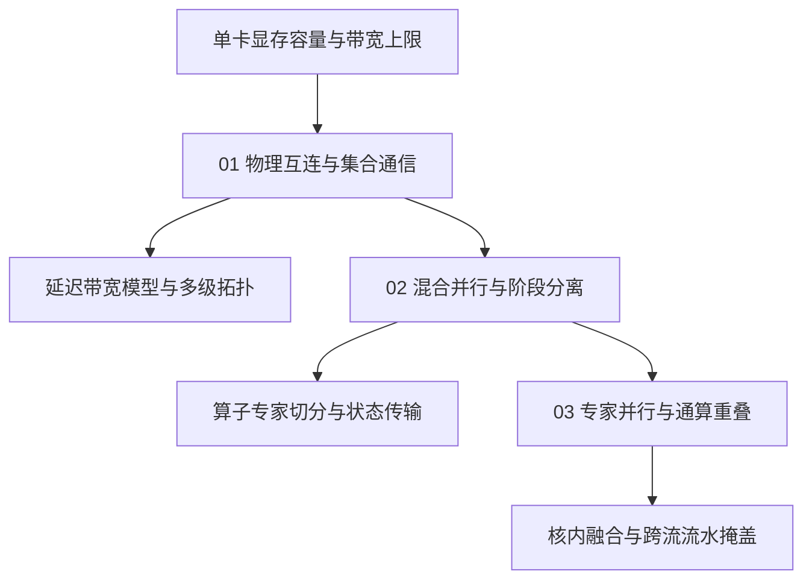

当模型权重或长上下文 KV Cache（Key-Value Cache，键值缓存）超出单张加速卡的显存上限，或者单卡 HBM（High Bandwidth Memory，高带宽显存）的读写速率成为生成瓶颈时，推理系统需要把计算拆分到多卡乃至多机协同执行。分布式切分同时引入三类显式通信代价：小消息下受限于单跳固定延迟 $\alpha$，大消息下受制于带宽倒数 $\beta$，而在动态路由的稀疏模型中还会因为负载倾斜引发全组同步等待。

承接[《推理与异构硬件基础》](../foundations/)对单卡 Roofline 模型与分页缓存的分析，本系列将视角扩展到单机多卡与集群网络，围绕“物理链路底座、多维并行切分、通算流水重叠”三层问题域展开，并在每一层对照上游 `vllm` 与 `vllm-ascend` 的生产实现。三章内容之间的递进关系如图 1 所示。

## 三章核心脉络

全系列三章均配有可在 CPU 上直接运行的 NumPy 数值验证片段，以及 NVIDIA GPU 与华为昇腾 NPU 的双端源码对照，依次解答从链路传输到计算调度的关键取舍：

1. [01 多卡互连、集合通信与 NVIDIA / 昇腾通信栈](./01-interconnects-and-collectives/)：从点对点延迟与带宽模型出发，推导 Ring 与 Tree 两种全归约算法在不同消息尺度下的时延拐点，厘清机内/超节点 Scale-Up（纵向扩展域）与跨机 Scale-Out（横向扩展域）的拓扑差异，并对照 `CudaCommunicator` 与 `NPUCommunicator` 的运行时分发策略。
2. [02 张量、序列、专家并行与 PD 分离架构](./02-parallelism-and-disaggregation/)：拆解 TP（Tensor Parallelism，张量并行）、SP（Sequence Parallelism，序列并行）与 Ring CP（Context Parallelism，环形上下文并行）的矩阵分块与激活去重逻辑，算清注意力 DP（Data Parallelism，数据并行）与 EP（Expert Parallelism，专家并行）在混合布局下的 KV 显存账，并分析 PD（Prefill-Decode，预填充-解码分离）架构中的异步 KV Cache 传输栈。
3. [03 MoE 跨卡通信与通算融合：从 DeepEP 双模式、昇腾 MC2 到 DBO 双微批重叠](./03-moe-comm-and-overlap/)：剖析偏斜路由与变长 `All-to-All`（`AllToAllV`）带来的算力空转根源，对比 NVIDIA `DeepEP` 统一通信底座与华为昇腾 `HCCL MC2` 核内切片流水，并在毫秒级时间轴上拆解 DBO（Dual-Batch Overlap，双微批重叠）与共享专家异步流的工程边界。

如果尚未建立单卡算术强度、HBM 带宽限制或 Paged KV Cache（分页键值缓存）的基本直觉，建议先阅读[《推理与异构硬件基础》](../foundations/)。读完本系列后，可以继续前往[《DeepSeek 架构演进》](../deepseek/)考察低秩注意力压缩与稀疏路由等模型层面的减通信设计，或者进入[《vLLM 与昇腾推理引擎》](../vllm/)跟踪调度器与静态图捕获的执行全貌。
