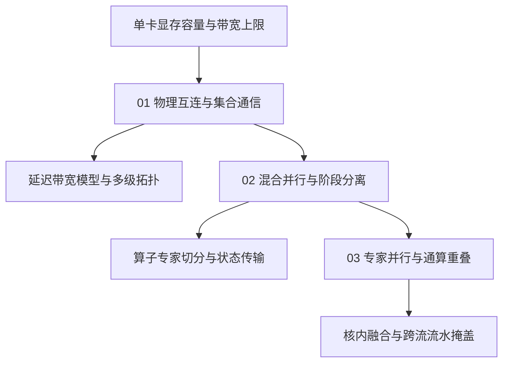

当模型权重或长序列 KV Cache（Key-Value Cache，键值缓存）超出单卡显存上限，推理系统就必须把计算拆到多卡乃至多机。单卡 HBM（High Bandwidth Memory，高带宽显存）带宽见顶时同样需要多卡分担负载，但跨卡切分也会立刻带来三类显式通信代价。小消息场景受限于单跳固定延迟 $\alpha$，大消息传输受制于带宽倒数 $\beta$，动态路由的稀疏模型还会因负载倾斜引发全组同步等待。

承接[《推理与异构硬件基础》](../foundations/)对单卡 Roofline 模型与分页缓存的分析，本系列把视角从单卡推向单机多卡与集群网络。全篇围绕“物理链路底座、多维并行切分、通算流水重叠”三层问题展开，逐层对照上游 `vllm` 与 `vllm-ascend` 的生产代码，三章关系如图 1 所示。

## 三章核心脉络

全系列三章均配有可在 CPU 上直接运行的 NumPy 数值验证片段，以及 NVIDIA GPU 与华为昇腾 NPU 的双端源码对照，依次解答从链路传输到计算调度的关键取舍：

1. [01 多卡互连、集合通信与 NVIDIA / 昇腾通信栈](./01-interconnects-and-collectives/)：推导延迟带宽模型下 Ring 与 Tree 归约的时延拐点，厘清 Scale-Up 与 Scale-Out 物理边界，并对照双端运行时分发策略。
2. [02 张量、序列、专家并行与 PD 分离架构](./02-parallelism-and-disaggregation/)：分析 TP、SP、Ring CP 与混合 DP/EP 如何取舍通信频次和 KV Cache 显存，并拆解 PD 分离的流式 KV 传输栈。
3. [03 MoE 跨卡通信：DeepEP、MC2 与 DBO](./03-moe-comm-and-overlap/)：定位偏斜路由与变长 `All-to-All` 阻塞根源，对比 NVIDIA `DeepEP` 与 DBO、昇腾 `MC2` 融合及共享专家流实现。

如果还不熟悉单卡算术强度、HBM 带宽瓶颈或 Paged KV Cache（分页键值缓存），可以先读[《推理与异构硬件基础》](../foundations/)。读完本系列后，可继续前往[《DeepSeek 架构演进》](../deepseek/)查看低秩压缩与稀疏路由等减通信设计，或进入[《vLLM 推理引擎：架构与核心组件》](../vllm/)跟踪调度与静态图执行链路。
