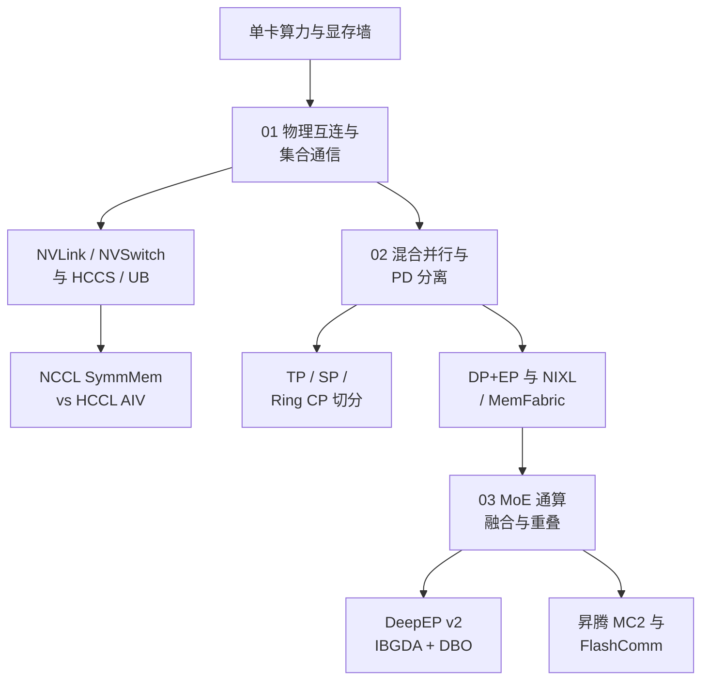

当模型权重与长上下文 KV Cache 远超单卡显存上限，单卡硬件本身的性能分析就必须扩展为跨卡、跨机协作的系统工程。

紧接 [系列一：推理与异构硬件基础](../foundations/) 中对 HBM 带宽、算力屋顶线与 PagedAttention 的单卡分析，本系列将视角抬升至 8 卡单机乃至百卡集群，从物理链路一路追到 `vllm` 与 `vllm-ascend` 的分布式执行代码。

## 本系列章节导航

如图 1 所示，全系列按“物理链路底座 -> 张量与集群切分 -> MoE 极致掩盖”三层递进，每章均提供自洽 NumPy 核心实现与 NVIDIA / 华为昇腾双栈源码对照：

1. [01 多卡互连、集合通信与 NVIDIA / 昇腾通信栈](./01-interconnects-and-collectives/)：从 $\alpha\text{-}\beta$ 通信公式出发，推演 4 卡 Ring AllReduce 两阶段拆分，厘清机内/超节点 Scale-Up（`NVSwitch` / `NVL72`、`HCCS` / `CloudMatrix 384 UB`）与跨机 Scale-Out（`ConnectX` / 参数面 `RoCE`）的拓扑层级，并对照 `CudaCommunicator` 与 `NPUCommunicator` 的分发与 Int8 量化规约。
2. [02 张量、序列、专家并行与 PD 分离架构](./02-parallelism-and-disaggregation/)：拆解 Megatron Column/Row TP、SP 激活去重、Ring CP 在线 Softmax 轮转与 Attention DP + MoE EP 非对称路由，并梳理 Prefill-Decode 分离池中 `NixlConnector`、`Mooncake` 与昇腾 `MooncakeLayerwise / MemFabric`（接替已移除的 `LLMDataDist`）的 KV 传输实现。
3. [03 MoE 跨卡通信与通算融合：从 DeepEP 双模式、昇腾 MC2 到双微批重叠（DBO）](./03-moe-comm-and-overlap/)：解剖偏斜路由引发的 `AllToAllV` 算力空转，深入 `DeepEP` HT/LL 到 `EPBuffer v2`、`HCCL MC2` 核内流水与 `MatmulReduceScatterFusionPass`，并在毫秒级时间轴上对照双微批乒乓（DBO）与昇腾共享专家异步流。

## 阅读建议与先修基础

如果你尚未建立单卡 Arithmetic Intensity、HBM 带宽限制或 Paged KV Block 的物理直觉，建议先快速浏览 [系列一：推理与异构硬件基础](../foundations/)。

完成本系列后，即可顺畅衔接 [系列三：DeepSeek 架构演进](../deepseek/) 中的 MLA 压缩与无辅助损失 MoE 路由算法，或进入 [系列四：vLLM 推理引擎深入](../vllm/) 跟踪调度器与计算图全貌。
