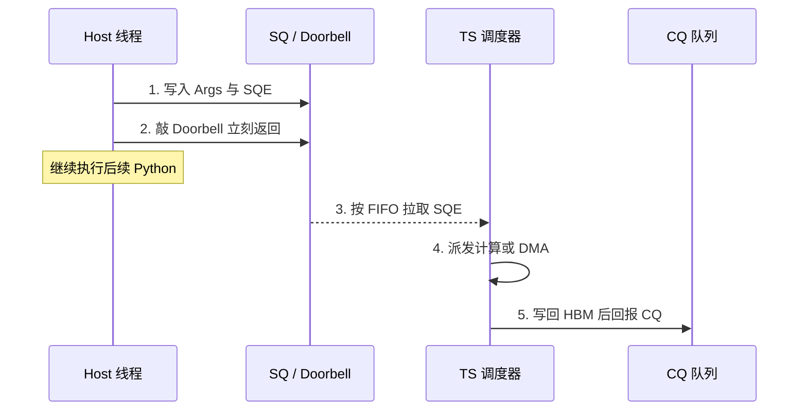
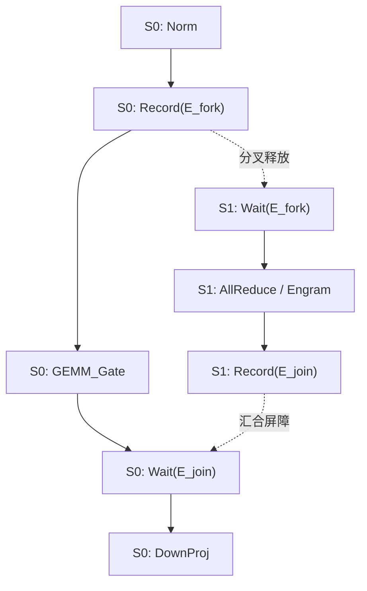
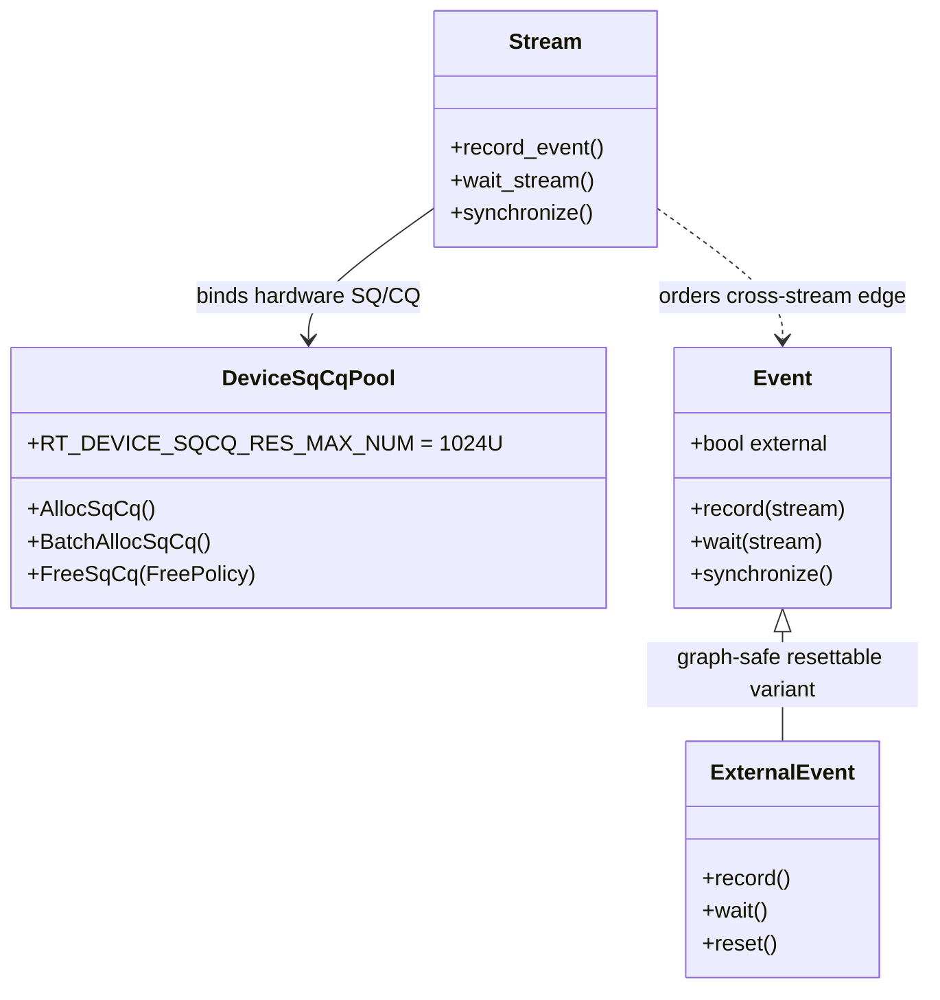

import StreamEventPipelineExplainer from './explainers/stream-event-pipeline';

大模型推理机器中，主机 CPU 负责跑 Python 调度代码。设备侧 GPU（图形处理器）或 NPU（神经网络处理器）负责矩阵运算，两者分居总线两侧，单次跨总线控制往返以微秒计。

若 CPU 每发一个算子都原地等它算完再发下一个，主机和设备就会轮流空转。为解决该问题，异构运行时软件栈普遍采用 **Asynchronous Execution Model（异步执行模型）**。CPU 只需把任务填进队列并敲门铃通知设备，即可立刻返回执行后续 Python 代码。

## 主机敲门铃，设备拉队列：异步通道怎么运转

CUDA Runtime 与 CANN Runtime 在主从两侧各维护一套环形任务通道。整个流程按“主机填单、门铃通知、设备消费、回写回执”四步推进，如图 1 和图 2 所示[^cann-model]。




### 硬件队列里的核心角色

先对齐昇腾生态的三个基础缩写：**CANN** 是昇腾计算软件栈（对应 CUDA），**AICore** 是矩阵计算单元（对应 GPU SM），**HCCL** 是多卡通信库（对应 NCCL）。

在主从硬件通信之间，共有五类关键部件协同运转[^cann-model]：

- **`SQ`（提交队列）与 `SQE`**：主从共享的环形提交队列，`SQE` 是放进去的定长任务描述符。
- **`Doorbell`（门铃寄存器）**：映射到主机地址空间的寄存器；写入新尾指针即可通知设备拉取队列。
- **`TS`（任务调度器）**：昇腾控制核固件，解析 `SQ` 描述符并派发计算，对应 GPU Command Processor。
- **`DMA`（直接内存访问）**：在主存与 **HBM**（高带宽显存）间异步搬运数据，全程不占用计算单元。
- **`CQ`（完成队列）**：设备回报任务完成状态与错误码的环形队列，主机同步时等待其回执。

### Pushbuffer 与 SQ/CQ 硬件路径

在昇腾 NPU 上调用 `aclnnMatMul` 时，驱动先把请求存进宿主侧异步线程队列 **TaskQueue**，并打包成 `SQE` 任务描述符推入物理 `SQ`。CPU 随后写入 **Doorbell** 立刻返回。

设备端 `TS` 固件收到信号后从队列头取出描述符，指挥 `AICore` 算完矩阵写回 **HBM**，再向 `CQ` 写完成状态。NVIDIA GPU 路径几乎对称，只是把任务命令顺序写入主机锁页内存映射的命令缓冲 **Pushbuffer**。只要队列里提前排满待算任务，约十微秒的主机派发就不会打断设备满载运转。

### 队列硬件上限与隐式默认流陷阱

芯片内部的物理队列槽位属于稀缺资源，在 `cann/runtime` 源码与官方手册中有明确的硬性上限[^sqcq-cap][^stream-doc]：

| 硬件平台与层级           | 容量上限与约束                       | 对图捕获与并发调度的影响 |
| :----------------------- | :----------------------------------- | :----------------------- |
| CANN Runtime 池级常量    | `RT_DEVICE_SQCQ_RES_MAX_NUM = 1024U` | 超限触发 207008 资源报错 |
| Atlas A2 / A3 / 950PR/DT | 单卡上限 1984 条逻辑 Stream          | 需控制计算与通信流总数   |
| Atlas 推理 / 200I/500 A2 | 1024 / 512 条 Stream                 | 边缘节点须及时释放闲置流 |

除了控制流的总数，上线代码还必须避开 **Default Stream（隐式默认流）**：

- 多线程共用默认流时，算子先后次序受主机线程调度抢占影响，极易出现偶发竞态。
- 无论是 CUDA Graph 还是 ACL Graph，默认都禁止把全局默认流直接纳入静态图捕获域。
- 工程初始化时应当用 `aclrtCreateStream` 或 `torch.npu.Stream()` 显式创建计算流、通信流与预取流。

## 单流保序与多流竞态：Event 如何接力

为演示多流何时需要手工同步，下文取 4 个连续算子作为微型层：`K1 RMSNorm` 耗时 $4\,\mu\text{s}$、`K2 QKV` 耗时 $6\,\mu\text{s}$、`K3 Attention` 耗时 $8\,\mu\text{s}$、`K4 OutProj` 耗时 $5\,\mu\text{s}$。同时设想一条跑在旁路的通信或预取任务 `S1`，耗时 $26\,\mu\text{s}$。

### 单流天然保序，双流为何读到脏数据

**同一条 Stream 内部严格保证 FIFO（First-In First-Out，先进先出）顺序**。只要 `K1` 到 `K4` 先后投入同一队列 `SQ0`，设备调度器就会等 `K1` 写回显存再启动 `K2`，算子之间无需插入同步屏障。

一旦把计算与通信拆进两条队列，情况就不同了。例如 DeepSeek-V4.1-Flash 在第 1、14 层用副流异步搬运 `Engram` 记忆表，或主干与 `AllReduce` 并行，两条独立 SQ 会按各自空闲状态抢跑[^v41-stream]。若 `K4` 依赖 `S1` 的结果却缺少屏障，`SQ0` 就会在 $44\,\mu\text{s}$ 提前读走未写完的旧显存。

### 四种同步原语取舍与 Fork-Join 拓扑

跨流协调先后关系，不能动辄调用卡死 CPU 线程的 `aclrtSynchronizeStream`，而要选用设备控制面的轻量原语[^event-doc][^notify-doc][^torch-streams]。其中 **`Event`** 面向通用跨流依赖与主机等待，而 **`Notify`** 是昇腾片上更轻量的核间硬件信号字，专供静态图收尾和条件子图唤醒：

| 原语          | 核心 API                                    | 单卡上限           | 同步阻断行为             |
| :------------ | :------------------------------------------ | :----------------- | :----------------------- |
| Stream Sync   | `aclrtSynchronizeStream` / `.synchronize()` | 随 Stream 生命周期 | 阻塞 CPU 线程等 CQ 返回  |
| Event         | `aclrtRecordEvent` / `aclrtStreamWaitEvent` | 65536              | 跨流依赖，仅阻断目标流   |
| Notify        | `aclrtRecordNotify` / `WaitAndResetNotify`  | 8192 / 65535       | 纯设备级轻量任务握手信号 |
| ExternalEvent | `torch_npu.npu.ExternalEvent`               | 捕获绑定后复用     | 跨静态图与外部更新流等待 |

图 3 按 5 步推演了异步入队、单流保序、双流并发竞态以及发射气泡，支持在第 3 步切换“无屏障”与“加 Event 屏障”对照时序差异。

<StreamEventPipelineExplainer
  client:visible
  title="图 3：主机异步入队、单流保序、双流竞态与 Event 跨流协同 5 步推演"
/>

工程上，多流并发几乎都收拢为封闭的 **Fork-Join 有向无环图**，如图 4 所示。主流算出前置结果后发射 `Record(E_fork)` 放行副流，副流收尾前发 `Record(E_join)`，主流 `Wait(E_join)` 汇合后再继续执行 `DownProj`。这种封闭结构也是静态图录制唯一放行的多流形态。



## Host-bound 发射墙与纯 CPU 仿真

Horace He 在性能综述[^horace-brrr]中把深度学习耗时拆成三类约束：算力受限、带宽受限与 **Overhead（发射开销受限）**。

在 **Prefill（预填充）** 阶段，大矩阵乘法动辄运行数百微秒到数毫秒，算子耗时远超 CPU 发射耗时，系统处于算力或带宽主导区间。进入小批量 **Decode（解码）** 后，单算子缩水到 $4$–$8\,\mu\text{s}$，主机每次组装参数并写队列却仍要 $10$–$15\,\mu\text{s}$，系统彻底退化为 Overhead 主导[^pytorch-cg-blog]。

对包含 $K$ 个算子的顺序单流，单步端到端耗时与硬件有效占空比满足：

$$
\begin{aligned}
T_{\text{step}} &\approx T_{\text{launch}} + (K - 1)\max(T_{\text{launch}},\, T_{\text{kernel}}) + T_{\text{kernel}} \\
\eta_{\text{active}} &= \frac{K \cdot T_{\text{kernel}}}{T_{\text{step}}}
\end{aligned}
$$

只要 $T_{\text{launch}} > T_{\text{kernel}}$，硬件跑完一个算子就只能暴露出空闲气泡等下一条指令。放大到 40 层 DeepSeek-V4.1-Flash 单步，整网约 1120 次发射按每次 $10\,\mu\text{s}$ 算，CPU 发射总耗时高达 11.2 毫秒，直接把 4.7 毫秒设备计算淹没在气泡里。

下面的纯 CPU 仿真脚本按事件时钟核算出微型层单流气泡与双流 Fork-Join 的重叠收益：

```python
from dataclasses import dataclass

@dataclass
class Task:
    name: str
    stream: str
    dur_us: float
    wait_event: str | None = None
    record_event: str | None = None

def simulate_streams(tasks: list[Task], launch_us: float = 12.0) -> dict:
    host_clk, stream_avail, event_ready, timeline = 0.0, {}, {}, []
    for t in tasks:
        host_clk += launch_us
        dep_ready = event_ready.get(t.wait_event, 0.0) if t.wait_event else 0.0
        dev_start = max(host_clk, stream_avail.get(t.stream, 0.0), dep_ready)
        dev_end = dev_start + t.dur_us
        stream_avail[t.stream] = dev_end
        if t.record_event:
            event_ready[t.record_event] = dev_end
        timeline.append((t.name, t.stream, host_clk, dev_start, dev_end))
    makespan = max(stream_avail.values())
    active = sum(t.dur_us for t in tasks)
    return {"host": host_clk, "makespan": makespan, "eff": active / makespan, "tl": timeline}

single = [
    Task("K1_Norm", "S0", 4.0), Task("K2_QKV", "S0", 6.0),
    Task("K3_Attn", "S0", 8.0), Task("K4_Proj", "S0", 3.0), Task("K5_Out", "S0", 5.0),
]
dual = [
    Task("K1_Norm", "S0", 4.0, record_event="E_fork"),
    Task("K2_QKV", "S0", 22.0),
    Task("S1_Side", "S1", 26.0, wait_event="E_fork", record_event="E_join"),
    Task("K5_Out", "S0", 12.0, wait_event="E_join"),
]
r1, r2 = simulate_streams(single, 12.0), simulate_streams(dual, 10.0)
print(f"[Single Eager] Host={r1['host']:.1f}us, Makespan={r1['makespan']:.1f}us, Active={r1['eff']:.2%}")
print(f"[Fork-Join]    Host={r2['host']:.1f}us, Makespan={r2['makespan']:.1f}us, Active={r2['eff']:.2%}")
for n, s, enq, st, ed in r2["tl"]:
    print(f"  {n:8s} stream={s} enq={enq:5.1f}us start={st:5.1f}us end={ed:5.1f}us")
```

运行输出给出直观对比：单流有效算力总共 $26.0\,\mu\text{s}$，却被 $12.0\,\mu\text{s}$ 的发射节奏拖到 $65.0\,\mu\text{s}$，有效占空比跌至 40.00%。改为双流 Fork-Join 重叠后占空比回升到 94.12%，且 `K5_Out` 在 `E_join` 屏障下延后至 $56.0\,\mu\text{s}$ 启动：

```text
[Single Eager] Host=60.0us, Makespan=65.0us, Active=40.00%
[Fork-Join]    Host=40.0us, Makespan=68.0us, Active=94.12%
  K1_Norm  stream=S0 enq= 10.0us start= 10.0us end= 14.0us
  K2_QKV   stream=S0 enq= 20.0us start= 20.0us end= 42.0us
  S1_Side  stream=S1 enq= 30.0us start= 30.0us end= 56.0us
  K5_Out   stream=S0 enq= 40.0us start= 56.0us end= 68.0us
```

## 源码锚点：物理队列池与外部事件抽象

在底层源码中，CANN Runtime（提交 `1954820a`）用 `DeviceSqCqPool` 集中管控单卡 1024 组物理 SQ/CQ 槽位，并支持延迟释放复用[^sqcq-cap]。

而在 `Ascend/pytorch`（提交 `d09e29e4`）中，PyTorch 侧区分出普通 `Event` 与可重置的 `ExternalEvent`。在 CANN 9.3.0 起还引入了原生 `Event(external=True)`[^torch-streams]，对象关系如图 5 所示。



异步队列解决了 CPU 原地干等的问题，但算子数量太多时依旧逃不出“发射一次算一小步”的泥潭。很多开发者自然会想：打开 `torch.compile` 把零碎算子编成一张图，是不是就一劳永逸了？[第 2 章：PyTorch 编译栈：分段融合与发射上限](../02-torch-compile-fundamentals/)将拆解编译器的工作流与它的真实极限。

[^cann-model]: 参阅 `cann/runtime`（提交 `1954820a`）官方文档 `docs/zh/quick_start/Runtime_programming_model.md`，描述主机异步入队、Stream 队列 FIFO 保证及 Event/Notify 同步。

[^sqcq-cap]: 参阅 `cann/runtime`（提交 `1954820a`）源码 `src/runtime/core/src/device/device_sq_cq_pool.hpp` 第 23 行常量 `RT_DEVICE_SQCQ_RES_MAX_NUM = 1024U` 及 `DeviceSqCqPool` 类定义。

[^stream-doc]: 参阅 `cann/runtime`（提交 `1954820a`）API 手册 `docs/zh/api_ref/06_stream_management.md`，列出各代昇腾产品的 Stream 创建上限。

[^event-doc]: 参阅 `cann/runtime`（提交 `1954820a`）API 手册 `docs/zh/api_ref/07_event_management.md`，涵盖 `aclrtCreateEvent` 与单卡 65536 上限约束。

[^notify-doc]: 参阅 `cann/runtime`（提交 `1954820a`）API 手册 `docs/zh/api_ref/08_notify_management.md`，定义 `ACL_NOTIFY_DEVICE_USE_ONLY` 标志及单卡 8192（A2/A3）/ 65535（950）上限。

[^torch-streams]: 参阅 `Ascend/pytorch`（提交 `d09e29e4`）源码 `torch_npu/npu/streams.py` 第 179–365 行对 `Event(external=True)` 及 `ExternalEvent.reset()` 复用的说明。

[^v41-stream]: 关于 DeepSeek-V4.1-Flash 在第 1、14 层利用后台预取流与跨流事件注入 Engram 静态记忆的具体时序，见本站[10 串珠成链：V4.1 单步全链路与双硬件协同](../../deepseek/10-architecture-synthesis/)。

[^horace-brrr]: Horace He, [Making Deep Learning Go Brrrr From First Principles](https://horace.io/brrr_intro.html)，提出 Compute、Bandwidth 与 Overhead 三类耗时受限框架。

[^pytorch-cg-blog]: Vinh Nguyen et al., [Accelerating PyTorch with CUDA Graphs](https://pytorch.org/blog/accelerating-pytorch-with-cuda-graphs/)（PyTorch 官方博客，2021-10），剖析小算子 CPU 调度开销与异步流空闲气泡的成因。
