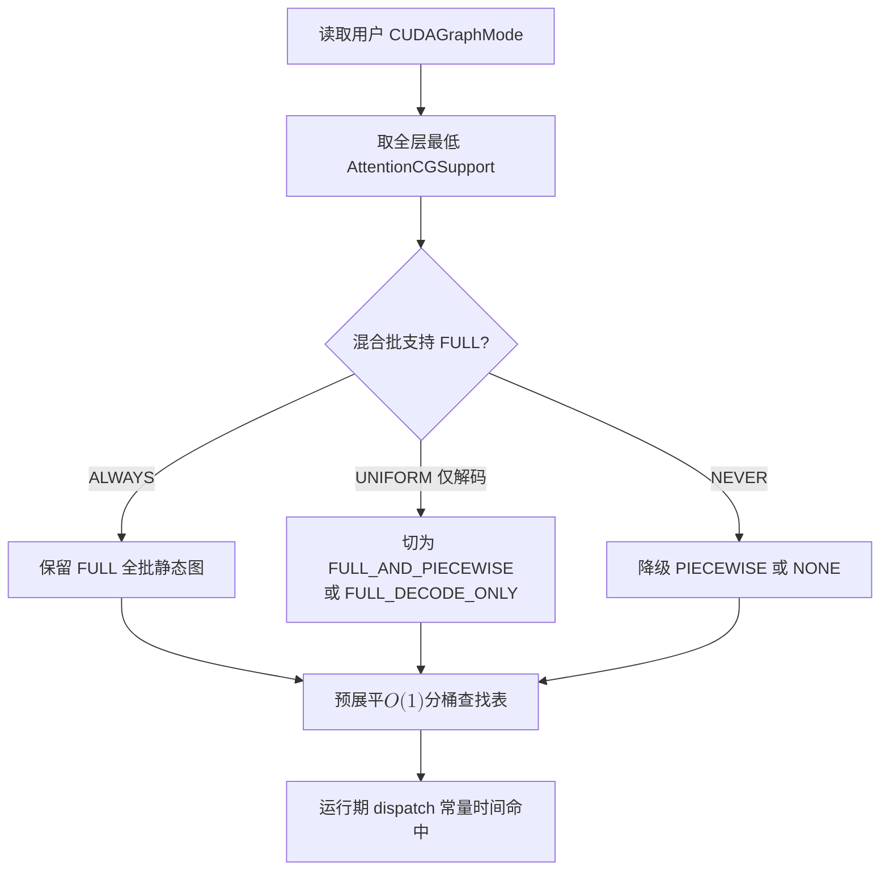

[第 3 章](../03-cuda-graph-fundamentals/)拆解了驱动与 PyTorch 层的纯 CUDA Graph 原理，它要求整张图的输入形状与控制流在捕获时完全锁定。进入真实推理服务后，请求流量并不总是整整齐齐的纯解码。引擎常开启 **`Chunked Prefill`（分块预填充）** 把长提示词切小块与解码混排，或采用 **`PD 分离`** 把预填充实例和解码实例拆开部署[^vllm-cg-doc]。

因此，**`CUDAGraphMode`** 并非 CUDA 驱动的原语，而是 vLLM 为 GPU 执行图设计的一整套上层编排体系。它统一定义了全图、分段与降级规则，再在昇腾后端由 `vllm-ascend` 通过 `NPUPlatform` 复用到 NPU 侧。

## 五种图模式与混合批分流

分派的核心判断叫 **`uniform decode`（均一解码批）**，即批内每条请求的查询长度完全一致（常规解码等于 1，投机解码等于 1 加草稿数）[^vllm-cg-doc]。含预填充切片的混批不满足均一条件，vLLM 上游据此定义了五种图模式并按平台分叉到底层实现（图 1）[^vllm-cg-doc]：

| 模式枚举             | 类型   | 均一解码批路径      | 混合或预填充批路径  | 典型适用场景               |
| :------------------- | :----- | :------------------ | :------------------ | :------------------------- |
| `NONE`               | 关闭   | Eager 逐个发射      | Eager 逐个发射      | 纯调试基线或禁用静态图     |
| `PIECEWISE`          | 单模式 | 分段图 + 动态注意力 | 分段图 + 动态注意力 | 注意力不支持整图捕获时     |
| `FULL`               | 单模式 | 整图重放            | 整图重放（低效）    | 仅限全批次均一致的特定场景 |
| `FULL_DECODE_ONLY`   | 双模式 | 整图重放            | Eager 逐个发射      | PD 分离解码节点，节省显存  |
| `FULL_AND_PIECEWISE` | 双模式 | 整图重放            | 分段图 + 动态注意力 | V1 默认，兼顾混排与低延迟  |

```mermaid caption="图 1：vLLM 上游统一 CUDAGraphMode 编排与 GPU CUDA Graph / NPU ACL Graph 双端分叉架构"
flowchart TD
    M["上层统一模式: CUDAGraphMode 五种模式 + BatchDescriptor"] --> C["AttentionCGSupport 能力探测<br/>取全模型最小级自动降级"]
    C --> D["CudaGraphManager 按 uniform / 批量桶分派"]
    D -->|"GPU 平台 (第 4 章)"| G["ModelCudaGraphManager + CUDAGraphWrapper<br/>三层同心包装 -> cudaGraphLaunch"]
    D -->|"NPU 平台 (第 5–7 章)"| N["NPUPlatform -> ACLGraphWrapper<br/>影子流 + TaskGrp 原地更新"]
```

配置层面，vLLM 将复合模式表示成二元组 `(decode_mode, mixed_mode)`[^vllm-compilation-cfg]。`FULL_DECODE_ONLY` 等价于 `(FULL, NONE)`，`FULL_AND_PIECEWISE` 等价于 `(FULL, PIECEWISE)`。同一套逻辑即可在“只加速纯解码”与“混排也加速”之间无缝切换。

## 注意力能力分级与自动降级

全图 `FULL` 虽快，但并非所有注意力算子都能在变长批次下安全录制。vLLM 将注意力后端对静态图的支持划分为四级枚举 **`AttentionCGSupport`**，优先级从高到低依次为[^vllm-cg-doc][^vllm-attn-backend]：

- **`ALWAYS`**：任意混批与预填充都能录成整图，全模式畅通。
- **`UNIFORM_BATCH`**：仅均一批量可走全图，混批需分段执行或退回 Eager。
- **`UNIFORM_SINGLE_TOKEN_DECODE`**：只允许单 token 均一解码走全图。
- **`NEVER`**：完全不可捕获，必须隔离在图外执行。

只有少数采用统一调度路由的后端能在单张静态图内处理变长预填充与解码[^vllm-cg-doc]。大多数高性能解码后端面向固定步长编写线程网格，遇到混合批查询长度参差不齐时，就必须退回分段或 Eager。GPU 侧主流后端能力分级如下[^vllm-cg-doc]：

| 注意力支持分级                | GPU 典型后端（`vllm@99b0b0b0`）                                  |
| :---------------------------- | :--------------------------------------------------------------- |
| `ALWAYS`                      | FlashAttention v3；Triton Attention（偏好 `FULL_AND_PIECEWISE`） |
| `UNIFORM_BATCH`               | FlashAttention v2、AITER FA、FlashMLA、FlashInferMLA             |
| `UNIFORM_SINGLE_TOKEN_DECODE` | FlashInfer（常规/MLA）、AITER MLA、CUTLASS MLA、Mamba            |

初始化混合模型时，`resolve_cudagraph_mode_and_sizes` 遍历全部注意力与状态空间层取能力最小值[^vllm-compilation-cfg]。

若请求 `FULL` 而后端仅支持 `UNIFORM_BATCH`，开启分段编译时降级为 `FULL_AND_PIECEWISE`，否则降为 `FULL_DECODE_ONLY`。

若最低能力为 `NEVER`，则整模型退回 `PIECEWISE` 或 `NONE`。

为了避免运行期在数百个档位里二分查找，`CudaGraphManager` 会在启动期展开所有档位[^vllm-cg-utils]。它会把完整信息存进 `BatchExecutionDescriptor`，精简运行时描述符为三元组 `BatchDescriptor(num_tokens, num_reqs, uniform)`。

均匀解码批直接按请求数映射进定长数组，混合批按 `num_tokens` 映射到预排候选列表[^vllm-cg-utils]。线上调用 `dispatch()` 只需做一次哈希查找并核对兼容性，即可在 $O(1)$ 时间内取回匹配描述符（图 2）。



## 三层同心包装与可中断捕获

确定安全模式后，单卡模型如何在 `FULL`、`PIECEWISE` 与 `NONE` 之间瞬时切换，而不必在显存里维护多份权重？vLLM 在启动构图期将同一个 Python 模型由外到内套上**三层同心包装结构**[^vllm-cg-utils][^vllm-backends]：

- **外层 `ModelCudaGraphManager`**：持有按批描述符索引的整模型 `FULL` 静态图集合，直接拦截并重放整张前向图。
- **中层 `TorchCompileWithNoGuardsWrapper`**：持有第 2 章切分后的整图，分离纯张量段与注意力模块。
- **内层 `CUDAGraphWrapper`**：包在每段纯张量编译子模块外侧，按 `PIECEWISE` 分段捕获重放，注意力维持原生 Eager。

这三层包装互不冲突，靠一条简洁的透传不变量：`CUDAGraphWrapper` 每次调用都会检查当前上下文模式[^vllm-cg-src]。只要上下文等于 `NONE` 或与自身绑定模式不匹配，包装器就直接原样透传内部 `self.runnable`（图 3 与图 4）。

因此，当运行 `FULL` 整图时（哪怕处于首次整图捕获期），外层管理器会把内层上下文设为 `NONE`[^vllm-cg-utils]。内层分段包装器自动让道透传到融合算子，彻底避免触发嵌套 `Stream Capture` 错误；若退回 `PIECEWISE`，外层跳过拦截，由内层逐段接管投影子图。


工程实践中还有两类细节直接关系到图重放正确性。第一是静态输入区与脏槽位清理：vLLM 通过 `InputBuffers` 在固定地址预分配张量[^vllm-cg-doc]。批缩容时，调度层必须把无效尾部槽位的 `slot_mapping` 刷写为 `PAD_SLOT_ID = -1`，防止新一步覆写其他请求的 KV 缓存。

第二是含主机副作用的局部算子处理（如 PD 分离场景的 `wait_for_layer_load`）与隐式同步排查。为此 vLLM 引入 `BreakableCUDAGraphWrapper` 与 `@eager_break_during_capture`[^vllm-brk]。它在断点截断当前段、回 Python 跑完回调后再续录下一段（图 5）。调试时可用 `VLLM_GPU_SYNC_CHECK` 暴露隐式同步[^vllm-sync-debug]。

```mermaid caption="图 5：vllm@99b0b0b0 中 CUDAGraphWrapper 与 BreakableCUDAGraphWrapper 核心类关系"
classDiagram
    class CUDAGraphWrapper {
        +runtime_mode
        +graph_pool
        +concrete_cudagraph_entries
        +__call__()
    }
    class CUDAGraphEntry {
        +BatchDescriptor batch_descriptor
        +cudagraph
        +input_addresses
    }
    class CUDAGraphOptions {
        +bool debug_log_enable
        +bool gc_disable
        +bool weak_ref_output
    }
    class BreakableCUDAGraphWrapper {
        +BreakableCUDAGraphCapture
        +eager_break_during_capture()
    }
    CUDAGraphWrapper *-- CUDAGraphEntry : caches per descriptor
    CUDAGraphWrapper o-- CUDAGraphOptions : configured by
    BreakableCUDAGraphWrapper ..> CUDAGraphWrapper : splits non-capturable ops
```

## 模式降级与分层透传仿真

下面的纯 CPU Python 脚本同时模拟了 `resolve_cudagraph_mode` 依据注意力最低支持级别自动降级，以及三层同心包装在 `FULL` 与 `PIECEWISE` 下的透传行为：

```python
LEVEL = {"NEVER": 0, "UNIFORM_SINGLE_TOKEN_DECODE": 1, "UNIFORM_BATCH": 2, "ALWAYS": 3}

def resolve_cudagraph_mode(requested: str, layer_supports: list[str], piecewise_enabled: bool = True) -> str:
    min_lvl = min(LEVEL[s] for s in layer_supports)
    if requested != "FULL":
        return "NONE" if min_lvl == 0 and requested == "FULL_DECODE_ONLY" else requested
    if min_lvl == 3:
        return "FULL"
    if min_lvl in (1, 2):
        return "FULL_AND_PIECEWISE" if piecewise_enabled else "FULL_DECODE_ONLY"
    return "PIECEWISE" if piecewise_enabled else "NONE"

def run_three_layer(mode: str, is_uniform: bool) -> list[str]:
    if mode == "FULL" or (mode in ("FULL_DECODE_ONLY", "FULL_AND_PIECEWISE") and is_uniform):
        return ["outer_full(replay)", "inner_pw(ctx=NONE->passthrough)"]
    if mode in ("PIECEWISE", "FULL_AND_PIECEWISE"):
        return ["outer_full(bypass)", "inner_pw(replay_submod_0)", "attn(eager)", "inner_pw(replay_submod_2)"]
    return ["outer_full(bypass)", "inner_pw(ctx=NONE->passthrough)", "eager_all"]

print("[Downgrade FA3]", resolve_cudagraph_mode("FULL", ["ALWAYS", "ALWAYS"]))
print("[Downgrade FlashMLA]", resolve_cudagraph_mode("FULL", ["ALWAYS", "UNIFORM_BATCH"], piecewise_enabled=True))
print("[Downgrade PD-NoPW]", resolve_cudagraph_mode("FULL", ["UNIFORM_BATCH"], piecewise_enabled=False))
print("[Trace FULL uniform]", run_three_layer("FULL_AND_PIECEWISE", is_uniform=True))
print("[Trace Mixed batch]", run_three_layer("FULL_AND_PIECEWISE", is_uniform=False))
```

运行输出验证了从能力降级到分层透传的全过程。混入 FlashMLA 的模型在启用分段编译时落到 `FULL_AND_PIECEWISE`；纯解码批走外层整图且内层透传，混合批则改由内层分段重放：

```text
[Downgrade FA3] FULL
[Downgrade FlashMLA] FULL_AND_PIECEWISE
[Downgrade PD-NoPW] FULL_DECODE_ONLY
[Trace FULL uniform] ['outer_full(replay)', 'inner_pw(ctx=NONE->passthrough)']
[Trace Mixed batch] ['outer_full(bypass)', 'inner_pw(replay_submod_0)', 'attn(eager)', 'inner_pw(replay_submod_2)']
```

在多卡数据并行服务中，各张计算卡的负载可能不同，单卡模式必须先在集群主机端达成一致再交由本篇机制查表，完整多卡协同流程见[vLLM 第 7 章：多卡 DP 协同与 PD 分离 KV 传输](../../vllm/07-dp-coordination-and-kv-transfer/)。

把视角转向华为昇腾 NPU：在沿用同一套 `CUDAGraphMode` 上层编排的前提下，昇腾底层如何构造影子模型流并解决主机侧变长分块问题？[第 5 章：ACL Graph 录制架构：影子流与参数备份](../05-acl-graph-architecture-and-capture/)至[第 7 章：vLLM-Ascend 执行图：NPU 适配与排障](../07-acl-graph-fullstack-and-vllm-ascend/)将逐步展开。

[^vllm-cg-doc]: 参阅 `vllm`（提交 `99b0b0b0`）官方架构文档 `docs/design/cuda_graphs.md`，详细定义 `CUDAGraphMode` 五种模式、`AttentionCGSupport`、`uniform decode` 与静态缓冲契约。

[^vllm-cg-src]: 参阅 `vllm`（提交 `99b0b0b0`）源码 `vllm/compilation/cuda_graph.py`（L127–290 `CUDAGraphEntry`、`CUDAGraphOptions` 与 `CUDAGraphWrapper` 透传逻辑）。

[^vllm-brk]: 参阅 `vllm`（提交 `99b0b0b0`）源码 `vllm/compilation/breakable_cudagraph.py`（L53–260 `eager_break_during_capture` 与 `BreakableCUDAGraphWrapper`）。

[^vllm-compilation-cfg]: 参阅 `vllm`（提交 `99b0b0b0`）源码 `vllm/config/compilation.py`（L129–186, L1536–1645 `CUDAGraphMode` 二元组定义与 `resolve_cudagraph_mode_and_sizes` 自动降级逻辑）。

[^vllm-attn-backend]: 参阅 `vllm`（提交 `99b0b0b0`）源码 `vllm/v1/attention/backend.py`（L567–579 `AttentionCGSupport` 四级能力枚举）。

[^vllm-cg-utils]: 参阅 `vllm`（提交 `99b0b0b0`）源码 `vllm/v1/worker/gpu/cudagraph_utils.py`（L74–427, L531–618 `BatchExecutionDescriptor`、$O(1)$ 查找表预展平与 `ModelCudaGraphManager`）。

[^vllm-backends]: 参阅 `vllm`（提交 `99b0b0b0`）源码 `vllm/compilation/backends.py`（L580–711 `split_graph` 与 `wrap_with_cudagraph_if_needed`）。

[^vllm-sync-debug]: 参阅 `vllm`（提交 `99b0b0b0`）源码 `vllm/utils/gpu_sync_debug.py`（L30–83 `VLLM_GPU_SYNC_CHECK` 主机-设备隐式同步检测）。
