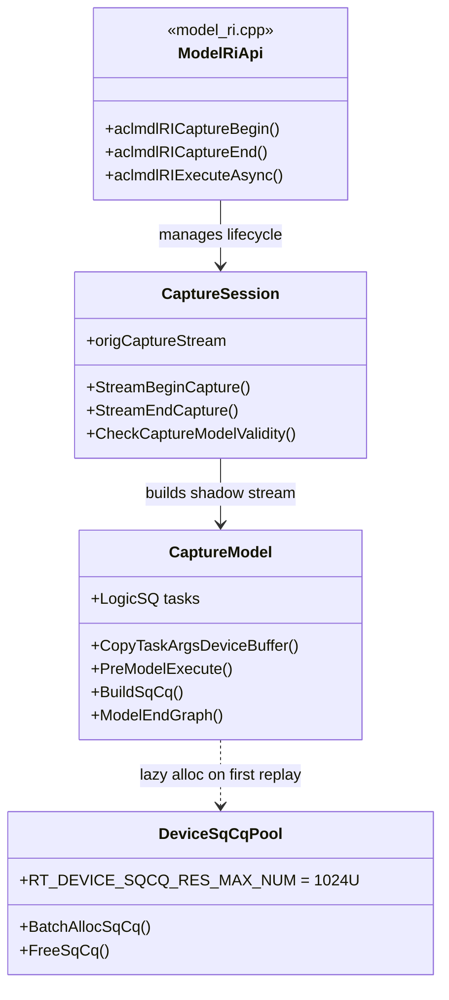

import AclGraphShadowStreamExplainer from './explainers/aclgraph-shadow-stream';

[第 3 章](../03-cuda-graph-fundamentals/)确立了 CUDA Graph 的静态图硬边界，[第 4 章](../04-vllm-cudagraph-modes/)拆解了 vLLM 的 `CUDAGraphMode` 上层模式编排。在华为昇腾 NPU 上，`vllm-ascend` 通过 `NPUPlatform` 沿用同一套上层模式编排，但在底层把执行载体切换为 `torch_npu.npu.NPUGraph`。虽然 Python 接口与 CUDA 几乎一致，昇腾底层却面临三道独特的硬件约束[^cann-acl-api]：

- **TS 固件调度**：任务调度器需要专属模型队列来连续拉取整图描述符。
- **易变参数暂存**：`aclnn` 算子的运行参数结构 `comm.args` 默认落在易被图外覆盖的暂存区。
- **稀缺物理通道**：单卡物理 SQ/CQ 池上限只有 1024 组，不能在建图瞬间盲目占满。

为了跨过这三道门槛，CANN Runtime 引入了 **Shadow Model Stream（影子模型流）** 双流架构。它的核心接口代表是 `aclmdlRI`（模型运行实例）。

## 阶段取舍：Prefill 与 Decode

和 GPU 一样，昇腾生产推理也把静态图严格限制在 Decode 阶段。以 40 层 **DeepSeek-V4.1-Flash** 为例，每层含约 28 个算子，再加上第 1、14 层的异步 Engram 注入，单步共需提交超过 1120 次算子[^v41-cap]。

小批量解码时单算子只跑几微秒，主机下发算子时间远大于设备计算时间。Prefill 阶段长序列计算饱和且长度剧变，保持 Eager 更省 Padding 与图捕获开销。请求进入 Decode 后，框架再按 `CUDAGraphMode` 切入 ACL Graph[^cann-acl-api]。

## Capture 六步与参数备份

ACL Graph 将静态图生命周期拆成隔离的两个阶段。**Capture（图捕获）** 先搭建仅驻留主机内存的 **`LogicSQ`（逻辑提交队列）**；**Replay（图重放）** 再绑定硬件物理通道并激发计算，架构如图 1 所示[^model-ri-impl][^cap-session]。


在 **Capture 阶段**，CANN Runtime 通过 `CaptureSession` 与 `CaptureModel` 完成六项关键动作[^model-ri-impl][^cap-session]：

| 阶段动作 | 底层核心职责               | CANN Runtime 关键函数或结构                            |
| :------- | :------------------------- | :----------------------------------------------------- |
| 动作 1   | 劫持用户流原任务参数体     | `CaptureSession::StreamBeginCapture`                   |
| 动作 2   | 申请持久缓冲并做设备内备份 | `CaptureModel::CopyTaskArgsDeviceBuffer`[^args-backup] |
| 动作 3   | 内存态生成逻辑任务描述符   | 构造 `LogicSQ` 链表条目                                |
| 动作 4   | 闭合校验流依赖与 DAG 合法  | `CheckCaptureModelValidity`（十六进制码 `0x0703001F`） |
| 动作 5   | 严守调用序列与跨流先后关系 | 按原始顺序追加进逻辑流任务表                           |
| 动作 6   | 捕获期不实际下发硬件执行   | `IsSoftwareSqEnable` 只记录不真正下发硬件              |

其中最容易被初学者忽略的是动作 2。昇腾主机发算子时，会把输入地址、张量维度等元数据放进 **`comm.args`** 参数结构体。这类结构体默认落在主机与设备共用的临时缓冲区里，下一轮算子一旦复写这块内存，静态图就会读到错位维度。

因此，`CaptureModel::CopyTaskArgsDeviceBuffer` 会申请持久化设备显存[^args-backup]。随后发出一笔 **D2D（Device-to-Device，设备显存内部高速拷贝）**，把每份参数快照锁进影子流专属副本区，彻底与图外内存隔离。

到了 **Replay 阶段**，流程简化为两步[^cap-model]。初次调用 `aclmdlRIExecuteAsync` 时，`PreModelExecute` 触发 `BuildSqCq` 延迟申请物理队列并分配硬同步信号 **`Notify`（芯片内部硬件同步信号）**。此后日常重放只需向用户流塞一条触发指令，调度器就会顺着影子队列连续跑完上千算子。

## 单流影子流与 EndGraph 握手

很多开发者初次听到“影子流”，会以为硬件另外开了一条神秘算力核心。其实在逻辑上，它是专门承载“静态图内部任务链”的隔离通道，让用户流里图外与图内的算子互不干扰。图 2 用 6 步交互推演了这套重定向与 D2D 防覆盖效果。

<AclGraphShadowStreamExplainer
  client:visible
  title="图 2：ACL Graph 影子模型流重定向、D2D 参数备份与 EndGraph Notify 握手 6 步推演"
/>

单流重放的关键在于收尾同步。调用 `aclmdlRICaptureEnd` 结束捕获时，Runtime 会在影子流末端追加 EndGraph 通知，对应硬件任务 `TS_TASK_TYPE_NOTIFY_RECORD`。随后冻结图句柄 `modelRI`[^cap-model]。

正式推理重放时，用户流 `Stream 1` 会在 `task 3` 之后紧贴写入 `model exe` 与 `notify wait` 两条轻指令，时序见图 3。前者点燃影子流全速执行，后者让硬件在芯片内挂起用户流，直到影子流算完发回 `Notify` 才继续后面的 `task n`。全过程都在设备内部完成，不惊动 CPU。

```mermaid caption="图 3：Replay 阶段用户流下发 model exe 与 notify wait 触发影子流硬件握手时序"
sequenceDiagram
    participant S1 as Stream 1 用户流
    participant M as Shadow Stream 影子流
    S1->>S1: task 3 (Eager 算子)
    S1->>M: model exe (单次 Trigger)
    Note over S1: notify wait (设备内挂起)
    M->>M: memcpy + aclnnMul 连续执行
    M-->>S1: notify record (EndGraph)
    S1->>S1: task n (读取静态图输出)
```

## 多流汇合校验与捕获模式

实际推理常要开启副流做通信或 Engram 异步预取，与主流构成并行的 **Fork-Join** 拓扑。在 CANN Runtime 中，多流捕获必须通过原生 **Event Record / Wait** 形成有始有终的封闭圈，标准写法与官方例程一致[^model-ri-doc]：

```cpp
// 1. 从 stream1 开启全局捕获
CHECK_ERROR(aclmdlRICaptureBegin(stream1, ACL_MODEL_RI_CAPTURE_MODE_GLOBAL));
// 2. 分叉点 (Fork)：处于捕获态的 stream1 记录 event1，未捕获的 stream2 等待它
CHECK_ERROR(aclrtRecordEvent(event1, stream1));
CHECK_ERROR(aclrtStreamWaitEvent(stream2, event1));

// 3. stream2 已被 Runtime 自动吸收并归属同一捕获域，双流并发下发算子
aclnnMul(mulWorkspaceAddr, mulWorkspaceSize, mulExecutor, stream1);
aclnnMul(mulWorkspaceAddr2, mulWorkspaceSize2, mulExecutor2, stream2);
aclnnAdd(mulWorkspaceAddr2, mulWorkspaceSize2, mulExecutor2, stream2);

// 4. 汇合点 (Join)：stream2 记录 event2，捕获原点流 stream1 等待收尾
CHECK_ERROR(aclrtRecordEvent(event2, stream2));
CHECK_ERROR(aclrtStreamWaitEvent(stream1, event2));

// 5. 捕获收尾：Runtime 验明双流完整汇合形成有效有向图后冻结输出 modelRI
CHECK_ERROR(aclmdlRICaptureEnd(stream1, &modelRI));
```

到了 `aclmdlRICaptureEnd`，`CaptureSession::CheckCaptureModelValidity` 会强制核对两条铁律[^cap-session]。只要有任何旁路流没通过反向事件汇回原点流 `origCaptureStream`，或者误用了图间通信用的 `RT_EVENT_EXTERNAL`，系统就会立刻拒绝生成静态图。此时报错 **`RT_ERROR_STREAM_UNJOINED`**，对应十六进制错误码 `0x0703001F` 与日志标记 EE1017。

为了配合多线程调度（如后台监控线程），`aclmdlRICaptureBegin` 提供三种与 CUDA 语义一致的安全模式。捕获期间还可用 `aclmdlRICaptureThreadExchangeMode` 动态切换：

| 捕获安全模式（`aclmdlRICaptureMode`）    | 跨线程与并发隔离规则             | 典型适用场景             |
| :--------------------------------------- | :------------------------------- | :----------------------- |
| `ACL_MODEL_RI_CAPTURE_MODE_GLOBAL`       | 拦截同进程其他线程不安全异步调用 | 单进程单主控、默认保护   |
| `ACL_MODEL_RI_CAPTURE_MODE_THREAD_LOCAL` | 仅拦截发起捕获线程，其余流正常   | 多线程调度与指标统计并行 |
| `ACL_MODEL_RI_CAPTURE_MODE_RELAXED`      | 放开隐式截断，调用方自行保证隔离 | 底层沙箱与定制内存池集成 |

将对外 C 接口、捕获会话管理器与硬件资源池串起来，`cann/runtime`（提交 `1954820a`）的核心类协作用图 4 总结如下：



## 捕获状态机与参数隔离仿真

下面这份纯 CPU Python 状态机复现了 `CaptureSession` 的拓扑录制、D2D 参数备份隔离、未汇合检查与首次重放延迟分配行为：

```python
from dataclasses import dataclass

@dataclass
class LogicSqTask:
    name: str
    args_backup: tuple
    is_notify_record: bool = False

class MockCaptureSession:
    def __init__(self) -> None:
        self.capturing = False
        self.mode: str | None = None
        self.origin_stream: str | None = None
        self.shadow_stream = "shadow_model_s0"
        self.capture_streams: set[str] = set()
        self.recorded_events: dict[str, str] = {}
        self.joined_streams: set[str] = set()
        self.tasks: list[LogicSqTask] = []
        self.sq_bound = False

    def capture_begin(self, stream: str, mode: str = "ACL_MODEL_RI_CAPTURE_MODE_GLOBAL") -> None:
        self.capturing, self.mode, self.origin_stream = True, mode, stream
        self.capture_streams = {stream}
        self.tasks.clear()

    def record_task(self, stream: str, name: str, host_args: list[int]) -> None:
        if stream not in self.capture_streams:
            raise RuntimeError(f"Stream {stream} is not in capture topology")
        self.tasks.append(LogicSqTask(name=name, args_backup=tuple(host_args)))

    def record_event(self, event: str, stream: str) -> None:
        if stream in self.capture_streams:
            self.recorded_events[event] = stream

    def stream_wait_event(self, stream: str, event: str) -> None:
        src = self.recorded_events.get(event)
        if not src:
            return
        if src in self.capture_streams and stream not in self.capture_streams:
            self.capture_streams.add(stream)
        elif stream == self.origin_stream and src in self.capture_streams:
            self.joined_streams.add(src)

    def capture_end(self) -> list[LogicSqTask]:
        unjoined = [s for s in self.capture_streams if s != self.origin_stream and s not in self.joined_streams]
        if unjoined:
            raise RuntimeError(f"RT_ERROR_STREAM_UNJOINED (0x0703001F): unjoined={unjoined}")
        self.tasks.append(LogicSqTask("TS_TASK_TYPE_NOTIFY_RECORD(EndGraph)", ("root_notify",), True))
        self.capturing = False
        return list(self.tasks)

    def execute_async(self, user_stream: str) -> list[str]:
        ops = []
        if not self.sq_bound:
            ops.append(f"PreModelExecute:BuildSqCq(streams={len(self.capture_streams)})")
            self.sq_bound = True
        ops.append(f"{user_stream}<-model_exe(trigger {self.shadow_stream})")
        ops.append(f"{user_stream}<-notify_wait(EndGraph)")
        return ops

sess = MockCaptureSession()
sess.capture_begin("stream_1")
host_dims = [8, 128]
sess.record_task("stream_1", "memcpyAsync", host_dims)
sess.record_event("ev_fork", "stream_1")
sess.stream_wait_event("stream_2", "ev_fork")
sess.record_task("stream_2", "aclnnMul_branch", [8, 128])
host_dims[0] = 999  # 模拟图外临时缓冲区改写，验证备份副本不受影响
sess.record_event("ev_join", "stream_2")
sess.stream_wait_event("stream_1", "ev_join")
model_tasks = sess.capture_end()
print(f"[Captured LogicSQ] count={len(model_tasks)}, args_backup_of_task0={model_tasks[0].args_backup}, tail={model_tasks[-1].name}")
print(f"[Replay #1] {sess.execute_async('stream_1')}")
print(f"[Replay #2] {sess.execute_async('stream_1')}")
```

输出印证了两项机制：图外把 `host_dims[0]` 改为 999 后，图内备份副本仍安全停在 `(8, 128)`。`BuildSqCq` 也只在初次重放时按需分配出 2 条物理流，后续调用直接触发重放：

```text
[Captured LogicSQ] count=3, args_backup_of_task0=(8, 128), tail=TS_TASK_TYPE_NOTIFY_RECORD(EndGraph)
[Replay #1] ['PreModelExecute:BuildSqCq(streams=2)', 'stream_1<-model_exe(trigger shadow_model_s0)', 'stream_1<-notify_wait(EndGraph)']
[Replay #2] ['stream_1<-model_exe(trigger shadow_model_s0)', 'stream_1<-notify_wait(EndGraph)']
```

至此我们掌握了静态图的“静止态”。但长序列 KV 增长会改变 Attention 的 Host Tiling 切分参数，投机解码又需要循环跳出控制流。[第 6 章：ACL Graph 动态更新：参数槽位与条件子图](../06-acl-graph-task-update-and-conditional-subgraph/)将说明如何在静态骨架内部“原地更新参数槽位”并下沉条件跳转。

[^cann-acl-api]: 参阅 `cann/runtime`（提交 `1954820a`）文档 `docs/zh/api_ref/15_model_running_instance_management.md`，完整说明 `aclmdlRICaptureBegin`、`aclmdlRICaptureEnd` 与 `aclmdlRIExecuteAsync` 约束。

[^model-ri-impl]: 参阅 `cann/runtime`（提交 `1954820a`）源码 `src/acl/aclrt_impl/model_ri.cpp` 第 1–466 行。

[^cap-session]: 参阅 `cann/runtime`（提交 `1954820a`）源码 `src/runtime/feature/aclgraph/capture_session.cc` 第 1–1167 行对 `StreamBeginCapture`、`CheckCaptureModelValidity` 及 `RT_ERROR_STREAM_UNJOINED` 的实现。

[^args-backup]: 参阅 `cann/runtime`（提交 `1954820a`）源码 `src/runtime/feature/aclgraph/capture_model_args_backup.cc` 第 16–55 行 `CaptureModel::CopyTaskArgsDeviceBuffer` 的备份实现。

[^cap-model]: 参阅 `cann/runtime`（提交 `1954820a`）源码 `src/runtime/feature/aclgraph/capture_model.cc` 第 497–615、1556–1605 及 2346–2413 行。

[^model-ri-doc]: 参阅 `cann/runtime`（提交 `1954820a`）示例 `example/2_advanced_features/model_ri/0_simple_model/main.cpp` 与多流捕获例程。

[^v41-cap]: DeepSeek-V4.1-Flash 40 层 CED 与异步 Engram 在昇腾生产栈的算子分布见本站[10 串珠成链：V4.1 单步全链路与双硬件协同](../../deepseek/10-architecture-synthesis/)。
