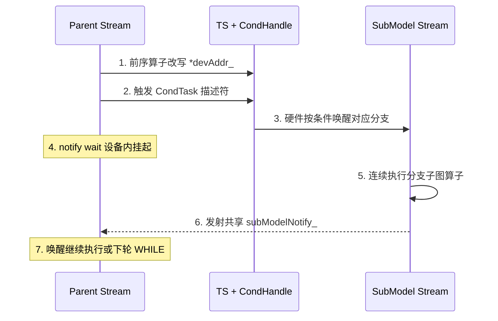

import AclGraphDynamicControlExplainer from './explainers/aclgraph-dynamic-control';

上一章建出的静态 ACL Graph 能把上千个算子打包重放，但生产推理很快会在两处碰到“静态前提破碎”的难题：

- **主机侧动态切片**：`seq_kv` 不断拉长，昇腾算子需在主机重算切片参数 `Tiling`。
- **设备侧动态分支**：投机解码循环校验草稿 token，直到某一层拒绝才跳出[^dspark-sub]。

先把两个昇腾基础词拆清：**`Tiling`（算子分块切片参数）** 告诉硬件核每次搬多大的块、循环几轮算完；**`Workspace`（临时工作区显存）** 则是算子运行期存放中间结果的暂存缓冲。

| 动态变化维度 | 静态图局限与生产瓶颈                    | ACL Graph 原地化解方案                    |
| :----------- | :-------------------------------------- | :---------------------------------------- |
| 算子参数层面 | `seq_kv` 增长使 Host 预计算 Tiling 失效 | `TaskGrp` + `TaskUpdate` 划分可更新槽位   |
| 控制流层面   | 条件跳出与循环依赖 CPU `Synchronize`    | `CondHandle` + 条件子图实现无往返分支循环 |

为了不因为一两处变化就把整张 40 层静态图推倒重录，CANN Runtime 在静态图内部提供了两类动态扩展机制，结构如图 1 所示[^cann-model-ri][^cond-hpp]。


## TaskGrp 槽位原地更新

NVIDIA GPU 注意力算子习惯直接从设备常驻张量读取 `seq_lens`，所以在 `FULL` 模式下不用重算主机描述即可重放。相比之下，昇腾常用的分页注意力 **`PA`** 与融合注意力 **`FIA`** 会提前在主机算好 `Tiling` 与 `Workspace` 尺寸，再写入任务描述符。

只要同批量桶内的 KV 长度一变，注意力描述符就得更新，否则 `FULL` 全图就会算错。为了让 `vllm-ascend` 在开启 `FULL` 或 `FULL_DECODE_ONLY` 时不必推倒整张图重录，CANN Runtime 提供了 **`aclrtTaskGrp`** 局部槽位更新机制[^cann-model-ri][^cap-session-up]：

| 操作时机         | 核心 CANN / torch_npu 接口        | 底层逻辑队列动作                               |
| :--------------- | :-------------------------------- | :--------------------------------------------- |
| 捕获期标注起止   | `aclmdlRICaptureTaskGrpBegin/End` | 插入预取占位并登记可更新 `(stream, task)` 槽位 |
| 重放前切换更新态 | `CaptureTaskUpdateBegin`          | 传入非捕获 `update_stream` 切换至更新状态      |
| 发射新参数描述符 | 重算新 `seq_kv` 下的 FIA/PA 算子  | `isUpdateSinkSqe=1` 一对一覆写原参数描述符     |
| 更新完毕封闭生效 | `CaptureTaskUpdateEnd`            | 结束切片更新作用域，其余图节点维持不变         |

### ExternalEvent 防冲突协议

只做原地覆写还不够安全。想象一下流水线重放的场景：如果第 $t+1$ 步的 `update_stream` 在第 $t$ 步的物理算子还没读完参数槽位时就提前改写，或者主图没等更新落定就冲进了下一轮计算，就会立刻读到脏数据或卡死。

为此，图分发层借用 `ExternalEvent` 构造了可复用的单次触发屏障（图 2）[^torch-graphs][^torch-streams-up]：

- **捕获期预设等待**：先往可更新算子前方写入 `event.wait(stream)`，紧跟一条 `event.reset(stream)`。
- **更新前放行**：重放前在 `update_stream` 重写槽位，并在尾部发 `event.record` 放行。
- **通过后自动复位**：主图流跨过等待点并由硬件自动重设信号，读取最新描述符执行，防止下一轮误放行。

```mermaid caption="图 2：update_stream 与主图通过 ExternalEvent Wait+Reset 协同防冲突时序"
sequenceDiagram
    participant U as update_stream
    participant E as ExternalEvent
    participant M as 主图 CaptureStream
    Note over M: Capture 阶段已在槽位前埋入 Wait+Reset
    U->>U: 1. TaskUpdateBegin 重算 Tiling 描述符
    U->>E: 2. ExternalEvent.record() 触发放行
    E-->>M: 3. 放行图内 Wait 屏障
    M->>M: 4. ExternalEvent.reset() 清标志防误放行
    M->>M: 5. 读取最新 SQE 执行 PA 或 FIA
```

## CondHandle 与条件子图流控

如果说 `TaskGrp` 解决了“算子参数会变”，那么 **`CondHandle`（条件句柄）** 解决的就是“图该往哪走”。图 3 把这两种动态扩展原语并排放在一起，按 6 步推演了槽位原地覆写、漏掉 `reset` 时的跨步读写冲突以及设备侧 3 种动态 `WHILE` 退出情况。

<AclGraphDynamicControlExplainer
  client:visible
  title="图 3：TaskGrp 原地覆写、ExternalEvent 防护与 CondHandle 设备侧条件子图 6 步推演"
/>

### 条件句柄复位与分支参数

调用 `aclmdlRICondHandleCreate` 时，`CondHandle::Setup` 会在设备显存申请 8 字节的 `devAddr_`。主机侧同时保存一份默认值 `defaultValue_`[^cond-hpp]。前序算子能通过 `aclmdlRICondHandleGetCondPtr` 拿到这个地址，直接在芯片里写入 0 或非 0 判断字。这种把跳转判断完全留在芯片侧的思路，与 NVIDIA 在 CUDA 12.4–12.8 引入的 Conditional Nodes 一脉相承[^nv-cond-blog]。

若建句柄时勾选 `ACL_MODEL_RI_COND_HANDLE_ASSIGN_DEFAULT` 标志，`PreModelExecute` 会在每次重放前跑一次 **H2D**（主机内存拷向设备显存）。它把条件地址刷新回默认值，避免上一轮改写的 0 值延续到下一轮[^cond-hpp]。

在父图分叉点，开发者填写 `aclmdlRICondTaskParams` 并调用 `aclmdlRIAddCondTask` 注册跳转节点[^acl-rt-h]：

```cpp
typedef struct tagAclmdlRICondTaskParams {
    aclmdlRICondHandle handle;     // 绑定指向设备 8 B 条件字的硬件句柄
    aclmdlRICondTaskType type;     // IF(0) / WHILE(1) / SWITCH(2) 三种控制类型
    uint32_t size;                 // 子图数量：IF 允许 1 或 2 个，WHILE 固定为 1，SWITCH 大于 0
    aclmdlRI* modelRIArray;        // 输出数组，接收预先分配好的支路子句柄
} aclmdlRICondTaskParams;
```

### 子图录制与共享通知唤醒

拿到 `modelRIArray` 里的子图句柄后，分别用 **`aclmdlRICaptureToModelRIBegin`** 在各支路流录制算子。末尾同样以 `aclmdlRICaptureEnd` 收尾[^cond-hpp][^cond-cc]。同一句柄名下的全部分支子图，在硬件上共用同一枚收尾通知 `subModelNotify_`。

运行期分支判决完全由设备调度器 TS 执行，过程如图 4 所示：TS 读取 HBM 里 `*devAddr_` 的 8 字节条件字，激活对应分支子图流。与此同时，父流紧随其后的 `notify wait` 挂起等待；被选中的子图跑完后发射共享 `Notify`，唤醒父流往下走或再次重入循环，全程不经过 CPU。



## 源码对照：上层框架动态接入

将底层槽位更新与条件节点接入 PyTorch 和推理引擎，主要由两套代码协同。`Ascend/pytorch`（提交 `d09e29e4`）与 `vllm-ascend`（提交 `b776261e`）的类关系见图 5[^torch-graphs][^torch-cond][^vllm-upd]。

```mermaid caption="图 5：torch_npu@d09e29e4 与 vllm-ascend@b776261e 动态图扩展与条件控制流类关系"
classDiagram
    class TorchGraphDispatch {
        <<torch_npu/npu/graphs.py>>
        +graph_dispatch_records
        +update_stream
        +update_capture_record(cpu_update_input)
    }
    class ControlFlowDispatch {
        <<conditional_nodes.py>>
        +if_else_node()
        +while_loop_node()
    }
    class UpdatableGraph {
        <<vllm-ascend updatable_graph.py>>
        +list~GraphUpdateTask~ tasks
        +register_task(operation, kwargs, provider)
        +resolve_tasks(source)
        +update(update_stream, resolved_tasks)
    }
    class GraphUpdateTask {
        +handle
        +ExternalEvent event
        +bind(params)
        +apply(update_stream)
    }
    UpdatableGraph *-- GraphUpdateTask : orchestrates
    TorchGraphDispatch ..> UpdatableGraph : shares TaskGrp + ExternalEvent pattern
```

在 `torch_npu` 中，调度拦截器在捕获时自动为注意力算子套上 `ExternalEvent` 等待与重置，并用 `graph_task_group_begin` 框住算子本体[^torch-graphs]。

另一边的控制流模块把高阶分支算子无缝转译为设备条件节点。其中 `cond` 与 `while_loop` 分别映射到 `begin_capture_to_if_node` 和 `begin_capture_to_while_node`[^torch-cond]。

到了生产引擎层，`vllm-ascend`（提交 `b776261e`）进一步抽象出了继承自 `NPUGraph` 的 `UpdatableGraph`[^vllm-upd]。它把每次注意力元数据的来源解耦为 `ContextSource`（常规步主模型）与 `SharedSource`（草稿头多模型共享），下面这段从源码提炼的写法清晰展示了捕获注册与更新重放的配合：

```python
class GraphUpdateTask:
    def apply(self, update_stream) -> None:
        torch.npu.graph_task_update_begin(update_stream, self.handle)
        self.operation(**self.kwargs)
        torch.npu.graph_task_update_end(update_stream)
        self.event.record(update_stream)

class UpdatableGraph(torch.npu.NPUGraph):
    def register_task(self, operation, kwargs, provider) -> None:
        stream = torch.npu.current_stream()
        event = torch.npu.ExternalEvent()
        event.wait(stream)
        event.reset(stream)
        torch.npu.graph_task_group_begin(stream)
        operation(**kwargs)
        handle = torch.npu.graph_task_group_end(stream)
        self.tasks.append(GraphUpdateTask(operation, weak_ref_tensors(kwargs), provider, handle, event))
```

值得初学者特别留意一行细节：`register_task` 传入的 `kwargs` 会先经过 `weak_ref_tensors` 转成弱引用。这么做是为了避免静态图长期死死拽住一次捕获时的临时张量，触发显存泄漏。下一章会看到，同样这条生命周期法则若处置不当，正是线上报错 507011 的主要诱因之一。

## 参数更新与设备循环仿真

下面的纯 CPU Python 脚本把两套机制组合起来，验证 `seq_kv` 增长时原地更新 Tiling 槽位，以及设备侧根据草稿接受率自循环退出时 CPU 零干预：

```python
class CondHandleSim:
    def __init__(self, default_val: int, assign_default: bool = True) -> None:
        self.default_val = default_val
        self.assign_default = assign_default
        self.dev_addr_val = 0

    def pre_model_reset(self) -> None:
        if self.assign_default:
            self.dev_addr_val = self.default_val

class TaskGrpAndCondModel:
    def __init__(self) -> None:
        self.pa_sqe = {"seq_kv": 0, "tiling_ver": 0, "isUpdateSinkSqe": 1}
        self.ext_ev_reset_done = True
        self.cond_handle = CondHandleSim(default_val=1, assign_default=True)

    def task_update_and_replay(self, seq_kv: int, draft_probs: list[float], threshold: float = 0.65) -> dict:
        if not self.ext_ev_reset_done:
            raise RuntimeError("ExternalEvent must be waited & reset before update")
        self.pa_sqe["seq_kv"] = seq_kv
        self.pa_sqe["tiling_ver"] += 1
        self.cond_handle.pre_model_reset()
        iters = 0
        while self.cond_handle.dev_addr_val != 0 and iters < len(draft_probs):
            if draft_probs[iters] < threshold:
                self.cond_handle.dev_addr_val = 0
            iters += 1
        self.ext_ev_reset_done = True
        return {"seq_kv": seq_kv, "ver": self.pa_sqe["tiling_ver"], "iters": iters, "cpu_rt": 0}

sim = TaskGrpAndCondModel()
for idx, (skv, probs) in enumerate([(128, [0.91, 0.88, 0.52, 0.80]), (512, [0.95, 0.92, 0.90, 0.87]), (2048, [0.40, 0.85, 0.90, 0.88])], 1):
    out = sim.task_update_and_replay(skv, probs)
    print(f"[Step {idx}] PA.seq_kv={out['seq_kv']:4d} (ver={out['ver']}), WHILE_iters={out['iters']}, CPU_roundtrips={out['cpu_rt']}")
```

输出证实 `seq_kv` 从 128 跃迁到 2048 仅原地递增刷新 3 次，同时设备侧分别在 3、4、1 轮后自主退出循环，CPU 往返始终为 0：

```text
[Step 1] PA.seq_kv= 128 (ver=1), WHILE_iters=3, CPU_roundtrips=0
[Step 2] PA.seq_kv= 512 (ver=2), WHILE_iters=4, CPU_roundtrips=0
[Step 3] PA.seq_kv=2048 (ver=3), WHILE_iters=1, CPU_roundtrips=0
```

[第 7 章：vLLM-Ascend 执行图：NPU 适配与排障](../07-acl-graph-fullstack-and-vllm-ascend/)将把全部机制贯通进 `vllm-ascend` 四层生产架构，并给出配额计算公式与线上三大高频报错的排查实战路径。

[^cann-model-ri]: 参阅 `cann/runtime`（提交 `1954820a`）头文件 `include/external/acl/acl_rt.h`（第 830、5230、5240 行）与 API 手册 `15_model_running_instance_management.md`。

[^cap-session-up]: 参阅 `cann/runtime`（提交 `1954820a`）源码 `src/runtime/feature/aclgraph/capture_session.cc` 与 `capture_model.cc` 对 `StreamBeginTaskGrp` 与 `UpdateStreamTask` 的实现。

[^torch-graphs]: 参阅 `Ascend/pytorch`（提交 `d09e29e4`）源码 `torch_npu/npu/graphs.py` 第 420–588 行调度拦截与 `update_capture_record` 实现。

[^torch-streams-up]: 参阅 `Ascend/pytorch`（提交 `d09e29e4`）源码 `torch_npu/npu/streams.py` 第 180–365 行对 `ExternalEvent` 与重置机制的注释。

[^cond-hpp]: 参阅 `cann/runtime`（提交 `1954820a`）源码 `src/runtime/core/inc/cond_handle/cond_handle.hpp` 第 24–77 行与 `src/runtime/feature/aclgraph/cond_handle.cc` 第 1–188 行。

[^cond-cc]: 参阅 `cann/runtime`（提交 `1954820a`）示例 `example/2_advanced_features/model_ri/3_cond_model/main.cpp` 与 `4_model_sync_external/main.cpp`。

[^acl-rt-h]: 参阅 `cann/runtime`（提交 `1954820a`）头文件 `include/external/acl/acl_rt.h` 第 436–454 及 5938–5975 行。

[^torch-cond]: 参阅 `Ascend/pytorch`（提交 `d09e29e4`）源码 `torch_npu/npu` 目录下条件节点分发模块第 1–159 行对 `NPUGraphCaptureControlFlowOpDispatchMode` 的实现。

[^vllm-upd]: 参阅 `vllm-ascend`（提交 `b776261e`）源码 `vllm_ascend/compilation/updatable_graph.py` 第 1–180 行对 `UpdatableGraph` 与 `GraphUpdateTask` 的实现。

[^dspark-sub]: DeepSeek-V4.1-Flash DSpark 3 层 SWA 草稿头细节见本站[09 多 token 预测与 DSpark 动态推测解码](../../deepseek/09-mtp-and-dspark/)。

[^nv-cond-blog]: NVIDIA Technical Blog, [Dynamic Control Flow in CUDA Graphs with Conditional Nodes](https://developer.nvidia.com/blog/dynamic-control-flow-in-cuda-graphs-with-conditional-nodes/)，介绍 CUDA 12.4 至 12.8 图内 `IF`/`WHILE`/`SWITCH` 设备控制流原语。
