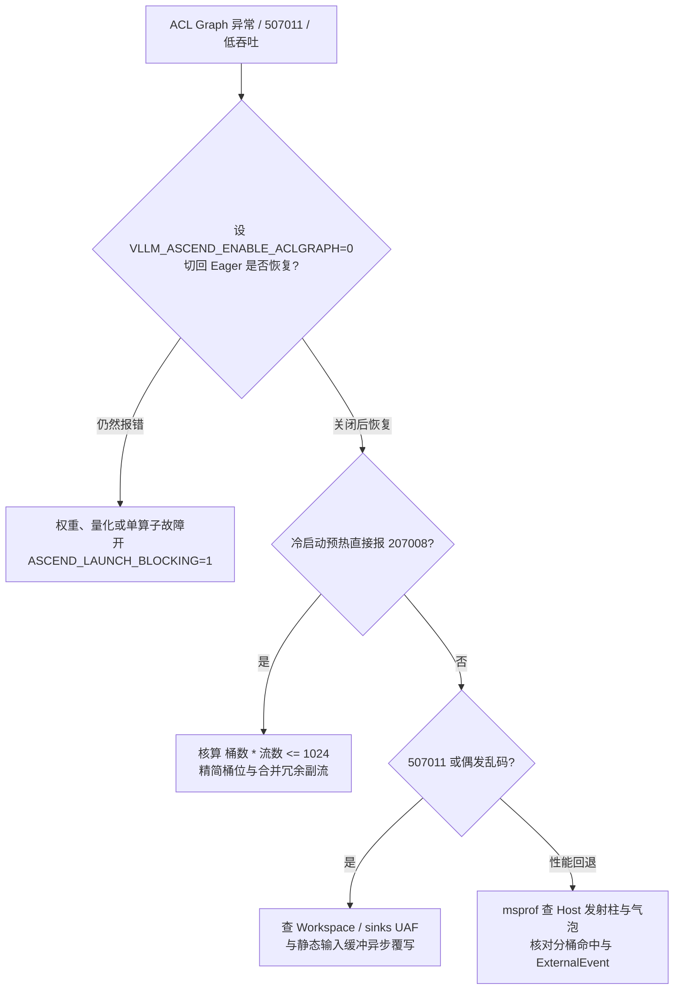

把 ACL Graph 真正推进高并发生产服务后，收益与隐患常常成对出现。模式选型过激可能撞上 NPU 后端限制，分桶太密会在预热阶段当场报 **207008** 退出，工作区或输出张量过早释放又会在运行时炸出异步异常 **507011**。

解决这类线上疑难杂症不能靠盲猜环境变量，而需要先把 `vllm-ascend` 如何承接[第 4 章](../04-vllm-cudagraph-modes/)的 `CUDAGraphMode` 体系摸清，再把四层调用栈、队列配额与生命周期边界算实。

## 四层生产调用栈与源码映射

从顶层引擎调度到底层硬件固件，`vllm-ascend` 静态图生产栈由职责分明的四层协同（图 1 与图 2）[^vllm-ascend-acl][^vllm-ascend-npug]：


```mermaid caption="图 2：ACL Graph 贯穿 vllm-ascend、torch_npu、cann/runtime 与 Ascend HDK 四层调用栈映射"
flowchart TD
    subgraph L1["L1 · vllm-ascend 调度与包装层"]
        L1A["NPUPlatform 模式适配<br/>CUDAGraphMode + MTP 对齐"] --> L1B["ACLGraphWrapper & UpdatableGraph<br/>npugraph_ex + weak_ref"]
    end
    subgraph L2["L2 · PyTorch + torch_npu 桥接层"]
        L2A["NPUGraph 与 Pool 管理<br/>capture_begin / replay"] --> L2B["GraphDispatch & CondDispatch<br/>自动包裹 TaskGrp 与条件流"]
    end
    subgraph L3["L3 · CANN Runtime 模型运行时"]
        L3A["CaptureSession + CaptureModel<br/>拓扑校验与 CopyTaskArgs"] --> L3B["DeviceSqCqPool & Notify<br/>物理 SQ/CQ 上限 1024"]
    end
    subgraph L4["L4 · Ascend HDK 与 NPU 硬件层"]
        L4A["物理 SQ/CQ 队列<br/>超限报 207008"] --> L4B["TS 固件与 AICore<br/>异常报 507011 / UAF"]
    end
    L1B -->|"封装捕获与重放"| L2A
    L2B -->|"下沉逻辑队列"| L3A
    L3B -->|"分配物理队列并提交"| L4A
```

- **L1（`vllm-ascend` 调度层）**：承接 `CUDAGraphMode`，转由 `ACLGraphWrapper` 分派与弱引用回收。
- **L2（`torch_npu` 桥接层）**：对齐 CUDA `NPUGraph` 接口，借调度代理接入 `TaskGrp` 原地更新。
- **L3（`cann/runtime` 原生层）**：`CaptureSession` 校验拓扑，`CaptureModel` 构造影子 `LogicSQ` 并备份参数。
- **L4（`HDK` 硬件驱动层）**：**HDK** 是昇腾底层驱动与固件套件，持有 1024 组物理 SQ/CQ。

### 包装器替换与关键片段

`vllm-ascend` 没有另起炉灶重写调度器，而是直接复用[第 4 章](../04-vllm-cudagraph-modes/)的上层编排，包括 `CUDAGraphMode` 与 `CudaGraphManager`[^vllm-ascend-acl]。

插件层只通过 `NPUPlatform` 接口替换出 `ACLGraphWrapper` 实现[^vllm-acl-src][^vllm-brk-src]。它再配合 `UpdatableGraph` 与可中断包装器协同工作，类协作见图 3。

```mermaid caption="图 3：vllm-ascend@b776261e ACLGraphWrapper、UpdatableGraph 与 BreakableACLGraphWrapper 类关系"
classDiagram
    class ACLGraphWrapper {
        +runtime_mode
        +graph_pool
        +concrete_aclgraph_entries
        +__call__()
        -_updatable_graph_replay()
    }
    class ACLGraphEntry {
        +BatchDescriptor batch_descriptor
        +NPUGraph aclgraph
        +output
        +input_addresses
    }
    class GraphParams {
        +events
        +workspaces
        +handles
        +attn_params
    }
    class BreakableACLGraphWrapper {
        +use_eagle
        +enable_enpu
        -_capture()
        -_replay()
    }
    ACLGraphWrapper *-- ACLGraphEntry : caches per batch
    ACLGraphWrapper ..> GraphParams : weak_ref_workspaces()
    BreakableACLGraphWrapper --|> BreakableCUDAGraphWrapper : inherits split logic
    BreakableACLGraphWrapper ..> GraphParams : shares workspace contract
```

下面这段代码提炼自 `acl_graph.py` 的核心生命周期：捕获完成后，`weak_ref_workspaces` 与 `weak_ref_tensors` 会释放多余的临时强引用。重放阶段，`FULL` 模式在非草稿路径下还须同步当前流，防止乱序[^vllm-acl-src]：

```python
with torch.npu.graph(aclgraph, pool=self.graph_pool):
    with super_kernel_scope("full_model", self.enable_super_kernel):
        output = self.runnable(*args, **kwargs)
    get_offloader().join_after_forward()  # 多流预取必须汇合后再 CaptureEnd

weak_ref_workspaces(_graph_params)
entry.output = weak_ref_tensors(output)
entry.aclgraph = aclgraph

# 重放前若未启用 enpu 统一编排且处于 FULL 主图模式，先同步防止与上轮 update_attn_params 乱序
if not self.enable_enpu and self.runtime_mode == CUDAGraphMode.FULL and not is_draft_eagle:
    torch.npu.current_stream().synchronize()
```

## NPU 模式适配与 SQ/CQ 配额

`vllm-ascend`（提交 `b776261e`）通过 `NPUPlatform` 承接[第 4 章](../04-vllm-cudagraph-modes/)的 `CUDAGraphMode` 体系[^vllm-ascend-acl][^vllm-ascend-graph]。它在编译期显式设置 `use_inductor=False` 关闭 Inductor，按模式转走 `npugraph_ex` 优化栈。

运行时默认走标准 `ACLGraph` 通道。追求更低延迟时，也可选轻量路径 `XliteGraph`，或启用 `SuperKernel` 把多段小算子超融合为单次下发：

| 上层 `CUDAGraphMode` | 编译阶段图配置     | 运行时静态图路径         | `npugraph_ex` 兼容性与特征           |
| :------------------- | :----------------- | :----------------------- | :----------------------------------- |
| `NONE`               | 不启用编译图       | Eager 逐个发射           | 支持全算子动态形状或调试基线         |
| `PIECEWISE`          | `PIECEWISE`        | 分段 ACL Graph           | 支持 `npugraph_ex` FX 融合优化       |
| `FULL`               | `NONE`（关闭编译） | `FULL` 整图重放          | 不兼容 `npugraph_ex`，仅整图静态捕获 |
| `FULL_DECODE_ONLY`   | `NONE`（关闭编译） | 解码走整图重放           | 不触发分段编译，适合 PD 分离节省显存 |
| `FULL_AND_PIECEWISE` | `PIECEWISE`        | 纯解码走整图，混合批分段 | 混合批走 `npugraph_ex`，纯解码走整图 |

在多卡与特型模型上，`NPUPlatform` 还会执行比 GPU 更严格的检查[^vllm-ascend-acl]。编解码模型启用 `FULL` 整图时会自动回退，上下文并行（CP）场景也存在限制。[第 6 章](../06-acl-graph-task-update-and-conditional-subgraph/)的 `update_graph_params()` 也仅向部分注意力后端开放参数原地更新，分级如下[^vllm-ascend-graph]：

| 昇腾注意力后端                    | `AttentionCGSupport` 等级 | 参数更新与模式适配要点                |
| :-------------------------------- | :------------------------ | :------------------------------------ |
| `attention_v1`                    | `ALWAYS`                  | 通用标准注意力，支持全部静态图模式    |
| `mla_v1` / `sfa_v1`               | `UNIFORM_BATCH`           | 仅均一批量走 `FULL`，非均一需分段执行 |
| `mla_cp` / `sfa_cp`（上下文并行） | `UNIFORM_BATCH`           | 上下文并行切分后配合原地更新执行解码  |

启用 **`npugraph_ex`** 编译套件时，还要盯住一条隐藏成本：自定义 Triton Ascend 算子往往会在参数区生成 **`kernel_side_table`** 动态外部地址表。编译器为避免跨进程重启地址失配，会主动跳过这类子图的磁盘缓存，导致每次冷启动重新编译；若触发过慢，可用 `force_eager` 把疑难算子摘回常规通道[^vllm-ascend-npug]。

选定模式之后，必须核算**物理 SQ/CQ 队列预算**。由于单卡硬件池硬限为 `RT_DEVICE_SQCQ_RES_MAX_NUM = 1024U`[^sqcq-6]，多档分桶的总通道消耗绝不能踩线：

$$
N_{\text{SQ/CQ}} = |\text{aligned\_buckets}| \times N_{\text{streams}} \le 1024
$$

一旦盲目配上 1 到 256 的密集桶、且每图挂接 4 条逻辑流（计算、通信、卸载拷贝与辅助更新流），总消耗立刻突破 1024 上限。生产配置应当“前密后疏”。若开启 **`MTP`**（多词元预测）一次校验多个草稿词元，分桶容量还须向上对齐到 `num_spec_tokens + 1` 的整数倍。


## 三大高频故障与二分排障

生产打开 ACL Graph 后遇到异常，记住先看三类经典症状（图 4 下半区与图 5）[^err-codes][^cap-6]：

### 错误码 207008 资源耗尽

冷启动预捕获各档分桶时进程突然退出，常见报错为 `ACL_ERROR_RT_NO_STREAM_RESOURCE`。它对应错误码 **207008**（日志 `EE1023`），提示 `driver error:no stream resource`[^err-codes]。这是因为 `CaptureModel::BuildSqCq` 绑定物理通道时突破了 1024 组上限。由于分配出的物理通道要等 `aclmdlRIDestroy` 才归还，排障只需按预算公式削减细碎分桶或合并冗余副流[^sqcq-6][^cap-6]。

### 错误码 507011 设备内存异常

单请求跑得通，一进高并发抢占或回收内存就突然卡死，设备流抛出 `ACL_ERROR_RT_MODEL_EXECUTE`（错误码 **507011**）[^err-codes]。这类问题多半源于异步 **`UAF`**（释放后重用，内存归还后被覆写却仍被旧图引用）。常见受害地址包括 `sinks` 汇总缓冲、局部 `Workspace` 与弱引用输出。

排查时先设 `ASCEND_LAUNCH_BLOCKING=1` 同步定位报错算子。随后检查图内张量是否已用长生命周期缓冲保活，避免 `weak_ref_outputs` 误伤仍在下游引用的输出。

### 异步读写冲突与性能回退

有时进程不崩，却偶尔吐出乱码 token，或吞吐掉回 Eager 水平。前一种常见于主机连发太快：第 $t$ 步影子流还没读完静态输入，第 $t+1$ 步就覆盖了输入缓冲；后一种往往是隐含动态分支触发静默回退，或 `ExternalEvent` 漏了 `reset` 造成死等。

这时设 `VLLM_ASCEND_ENABLE_ACLGRAPH=0` 做二分隔离（图 5）。关掉后仍报错说明故障在权重或算子；立刻恢复则用 `msprof`（昇腾性能剖析工具）查看 `ACL` 轨，密集发射柱说明已回退，空白则指向事件堵塞。



## 配额核算与内存越界仿真

下面这段纯 CPU 脚本按硬件上限 `RT_DEVICE_SQCQ_RES_MAX_NUM = 1024` 核算通道余量。它同时模拟了 `sinks` 指针提前释放触发 **507011** UAF 告警的过程：

```python
RT_DEVICE_SQCQ_RES_MAX_NUM = 1024

def check_sqcq_budget(buckets: list[int], streams_per_graph: int, mtp_tokens: int = 1) -> dict:
    unit = mtp_tokens + 1
    aligned = sorted({((b + unit - 1) // unit) * unit for b in buckets})
    total_sqcq = len(aligned) * streams_per_graph
    return {
        "num_graphs": len(aligned),
        "total_sqcq": total_sqcq,
        "oom_207008": total_sqcq > RT_DEVICE_SQCQ_RES_MAX_NUM,
        "headroom": RT_DEVICE_SQCQ_RES_MAX_NUM - total_sqcq,
    }

dense_res = check_sqcq_budget(list(range(1, 258)), streams_per_graph=4, mtp_tokens=0)
sparse_res = check_sqcq_budget([8, 16, 24, 32, 48, 64, 96, 128, 192, 256, 384, 512], streams_per_graph=4, mtp_tokens=1)
print(f"[Dense Bucketing] graphs={dense_res['num_graphs']}, total_SQCQ={dense_res['total_sqcq']}/1024, trigger_207008={dense_res['oom_207008']}")
print(f"[Sparse + MTP(k=1)] graphs={sparse_res['num_graphs']}, total_SQCQ={sparse_res['total_sqcq']}/1024, headroom={sparse_res['headroom']}")

class DeviceBufferTracker:
    def __init__(self) -> None:
        self.freed: set[int] = set()
    def free(self, ptr: int) -> None:
        self.freed.add(ptr)
    def check_replay(self, captured_ptrs: list[int]) -> str:
        dangling = [hex(p) for p in captured_ptrs if p in self.freed]
        return f"507011 ACL_ERROR_RT_MODEL_EXECUTE (UAF on {dangling})" if dangling else "EXEC_OK"

trk = DeviceBufferTracker()
sinks_ptr, work_ptr = 0x1200_4000, 0x1200_8000
print(f"[Normal Lifetime] {trk.check_replay([sinks_ptr, work_ptr])}")
trk.free(sinks_ptr)
print(f"[UAF Bug] {trk.check_replay([sinks_ptr, work_ptr])}")
```

输出划出两条红线：257 档密集桶共耗 1028 组通道，直接触发 `trigger_207008=True`。对齐 `MTP(k=1)` 的 12 档稀疏桶仅耗 48 组；而一旦 `sinks_ptr` 提前释放，重放即报 **507011 UAF**：

```text
[Dense Bucketing] graphs=257, total_SQCQ=1028/1024, trigger_207008=True
[Sparse + MTP(k=1)] graphs=12, total_SQCQ=48/1024, headroom=976
[Normal Lifetime] EXEC_OK
[UAF Bug] 507011 ACL_ERROR_RT_MODEL_EXECUTE (UAF on ['0x12004000'])
```

至此，本系列贯通了异步队列、`torch.compile`、CUDA Graph、影子流与 `vllm-ascend` 全栈排障。想了解上层调度与 Profiling 实战，可读[《vLLM 推理引擎》](../../vllm/)、[《vLLM-Ascend 昇腾插件与硬件拓展》](../../vllm-ascend/)与[性能观测与线上故障定位](../../vllm/11-profiling-and-debugging/)。

[^vllm-ascend-acl]: 参阅 `vllm-ascend`（提交 `b776261e`）设计文档 `docs/source/developer_guide/Design_Documents/ACL_Graph.md`。

[^vllm-ascend-npug]: 参阅 `vllm-ascend`（提交 `b776261e`）设计文档 `docs/source/developer_guide/Design_Documents/npugraph_ex.md`，详述 `force_eager` 与 Triton 磁盘缓存约束。

[^vllm-ascend-graph]: 参阅 `vllm-ascend`（提交 `b776261e`）用户指南 `docs/source/user_guide/feature_guide/graph_mode.md`，说明 `cudagraph_mode` 与 `SuperKernel` 配置。

[^vllm-acl-src]: 参阅 `vllm-ascend`（提交 `b776261e`）源码 `vllm_ascend/compilation/acl_graph.py` 第 60–400 行对 `ACLGraphWrapper`、`ACLGraphEntry` 与工作区弱引用的实现。

[^vllm-brk-src]: 参阅 `vllm-ascend`（提交 `b776261e`）源码 `vllm_ascend/compilation/breakable_aclgraph.py` 第 38–91 行 `BreakableACLGraphWrapper`。

[^err-codes]: 参阅 `cann/runtime`（提交 `1954820a`）头文件 `include/external/acl/error_codes/rt_error_codes.h` 第 76、102 行及 `errcode_manage.cc` 错误码映射。

[^sqcq-6]: 参阅 `cann/runtime`（提交 `1954820a`）源码 `src/runtime/core/src/device/device_sq_cq_pool.hpp` 第 23 行常量 `RT_DEVICE_SQCQ_RES_MAX_NUM = 1024U`。

[^cap-6]: 参阅 `cann/runtime`（提交 `1954820a`）源码 `src/runtime/feature/aclgraph/capture_model.cc` 第 1556–1605 行 `BuildSqCq` 校验逻辑。
