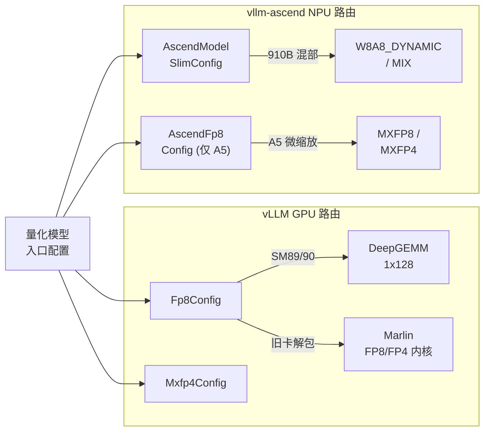

import OutlierQuantExplainer from '../../../../explainers/foundations/OutlierQuantExplainer';

前两章 [03 KV Cache 与头共享妥协](../03-kv-cache-and-gqa/) 与 [04 FlashAttention 与硬件对齐内核](../04-flash-attention/) 算清了历史 KV 的显存带宽账本，并把注意力中间结果从 HBM 往返里解放出来，但线性层权重与压缩后的 KV Cache 仍默认按 `BF16` 每次搬运 `2 B`。

当单卡显存和带宽成为主要约束时，**量化（Quantization）** 用更少比特编码张量，把显存读写体积降到原来的 $1/2$ 到 $1/4$，同时解锁硬件上的低精度矩阵算力单元。

## 为什么必须量化：Roofline 双重收益与手算起步

回顾 [01 硬件与 Roofline](../01-hardware-and-roofline/) 的瓶颈分界，低精度在 LLM 推理的两个阶段同时带来收益，但发力点完全不同：

- **Decode 阶段（访存受限）**：自回归每次只生成一个 token，权重读取占据绝大部分时间；把权重从 `BF16` 压到 8-bit 或 4-bit，HBM 搬运字节数分别降为 $1/2$ 与约 $1/3.76$，生成吞吐几乎同步倍增。
- **Prefill 阶段（算力受限）**：长提示词矩阵乘的算术强度高；NVIDIA Tensor Core 与昇腾 Cube 单元对 `INT8` 或 `FP8` 的峰值 FLOPS/TOPS 通常达到 `BF16` 的 `2x`，直接压缩首字延迟（TTFT）。

先用一个 **4 元素对称量化手算例** 建立直觉。设原向量 $x = [0.42, -1.18, 0.05, 0.89]$，目标整数区间为对称 `[-127, 127]`：

1. **求缩放因子 $s$**：取绝对值最大值 $a_{\max} = \max|x| = 1.18$，得到步长 $s = a_{\max} / 127 \approx 0.009291$。
2. **量化取整 $q$**：按 $q = \text{clip}(\text{round}(x / s), -127, 127)$ 映射，得 $q = [45, -127, 5, 96]$。
3. **反量化重建 $\hat{x}$**：按 $\hat{x} = q \cdot s$ 还原，得 $\hat{x} \approx [0.4181, -1.1800, 0.0465, 0.8920]$，最大绝对误差 $0.003543 \le s/2$。

把一整个张量共用一个 $s$ 称为 **Per-Tensor（逐张量）** 量化；把每个权重输出通道或激活每个 token 切分出来独立求 $s$，分别称为 **Per-Channel** 与 **Per-Token**；进一步沿规约维切成固定子块，则是 **Group-wise / Block-wise（分组/分块）** 量化。

## 数值格式全景：BF16、INT8、FP8 与 MXFP4 微缩放

同样占用 8-bit 或 4-bit，整数均匀网格与浮点对数网格对大动态范围的表达能力截然不同。图 1 把推理栈核心的四种比特排布（BF16、INT8、FP8 E4M3、MXFP4）逐位切开对比：


| 格式           | 位宽布局（S/E/M） | 最大有限值          | 缩放因子粒度                 | 均摊单元素字节 | 典型硬件与角色                  |
| :------------- | :---------------- | :------------------ | :--------------------------- | :------------- | :------------------------------ |
| `INT8`（对称） | 1S + 7 幅值       | `127`（整数步）     | Per-Tensor / Token / Channel | `1.00 B`       | 910B 主力 W8A8、老架构通用      |
| `FP8 E4M3FN`   | 1S + 4E + 3M      | `448`（无 Inf）     | Per-Tensor 或 `128 x 128`    | `1.00 B`       | Ada/Hopper、DeepSeek-V3 前向    |
| `FP8 E5M2`     | 1S + 5E + 2M      | `57344`（含 Inf）   | Per-Tensor / Block           | `1.00 B`       | 训练反向梯度、极宽动态范围      |
| `MXFP4`（OCP） | 1S + 2E + 1M      | `6`（每 32 维共享） | 每 32 元素 1 个 8-bit `E8M0` | `0.53125 B`    | Blackwell SM100、昇腾 A5（950） |

先看同为 8-bit 的 **`E4M3` 与 `E5M2` 分工**[^fp8_e4m3]：前向推理常用的 `float8_e4m3fn` 把 `e=15, m=7` 留给 `NaN` 而舍弃无穷大编码，把上限推到 $448$，且多出的 1 bit 尾数让每个 2 的幂次区间内排满 `8` 个刻度，更贴合大模型权重与激活对局部相对精度的敏感性。

再看 **4-bit 微缩放格式 `MXFP4`**：`E2M1` 去掉符号和零后正半轴仅剩 **7 个离散幅值** $\{0.5, 1, 1.5, 2, 3, 4, 6\}$。一旦全张量出现大数撑开尺度，小值就会瞬间归零。OCP MX 标准[^mx_spec] 让每 `32` 个连续元素共享一个 `8-bit` **`E8M0` 纯指数缩放因子**（严格表示 $2^e$，硬件移位还原），均摊单元素 `4.25 bit`（`0.53125 B`），相对 `BF16` 压缩 **`3.76x`**。

## 离群值陷阱与应对三板斧

真实大模型的隐藏层激活存在少数固定维度——**离群通道（Outlier Channels）**——其幅度持续比常规维度大几十倍。图 2 用一个 `[4, 8]` 活性张量（列 `c3` 达 `+-12.4`，其余 7 列落在 `+-0.02..+-0.49`）交互式追踪了离群通道如何压垮均匀整型刻度，又如何被三条工业路线逐级救回。

<OutlierQuantExplainer
  client:visible
  title="图 2：离群通道零桶坍缩与 SmoothQuant / Hadamard / FP8 / MXFP4 精度恢复"
/>

结合图 2 的 5 个演进步骤，工程界围绕离群值形成三类递进解法：

### 1. 通道平滑迁移（SmoothQuant / AWQ）

核心恒等式只有一行：$Y = X W = (X\,\text{diag}(s)^{-1})(\text{diag}(s)\,W)$。通过离线统计激活列与权重行幅度构造尺度 $s_j = \max(|X_{:,j}|)^\alpha / \max(|W_{j,:}|)^{1-\alpha}$，把激活尖峰按 $\text{diag}(s)$ 缩小并等价迁移进权重，在图 2 中将 `c3` 幅值拉低 `5.083` 倍。

### 2. 正交旋转摊平能量（Hadamard / QuaRot / FlatQuant）

仅靠列缩放难以压制单行内的突发峰值，于是进一步引入正交矩阵 $H$（$H H^\top = I$）：$Y = (X H)(H^\top W)$。把 $H^\top$ 离线融进权重后，在线旋转将单个离群列能量均匀摊平到全部维度。如图 2 第 3 步所示，叠加 `SmoothQuant + Hadamard-8` 后旋转峰值从 `12.4` 降至 `1.354`，28 个正常元素中的零桶坍缩数从 `10` 个降为 **`0` 个**，正常通道 SQNR 从 `20.25 dB` 跃升至 **`39.69 dB`**！

在 `vLLM` 中[^vllm_hadamard]，`input_hadamard.py` 提供归一化 Sylvester Hadamard 矩阵旋转；而在 `vLLM-Ascend` 中[^ascend_flatquant]，`w4a4_flatquant.py` 用 Kronecker 分解旋转调起融合算子 `npu_kronecker_quant`（受 `KRONECKER_QUANT_MAX_BATCH_SIZE = 32768` 上限约束）。

### 3. 细粒度分块与 FP32 累加（DeepSeek-V3 `kernel.py`）

若直接使用带 4-bit 指数的 `FP8 E4M3` 与细粒度块缩放，无需依赖离线校准即可直接罩住离群值（图 2 第 4 步直接稳在 `32.11 dB`）。`DeepSeek-V3/inference/kernel.py`[^ds_kernel] 给出了生产参考：激活按 **`1 x 128`** 动态求 `amax / 448.`，权重配 **`128 x 128`** 二维块缩放，并在矩阵乘内循环外用 **FP32 寄存器乘回块缩放**（`accumulator += tl.dot(a, b) * a_s[:, None] * b_s[None, :]`）。到了 `4-bit` `MXFP4`（图 2 第 5 步），无微缩放的单尺度 FP4 直接跌至 **`0.00 dB`**，而配合分组微缩放与平滑旋转后，真实 `[64, 128]` 矩阵乘输出 SQNR 可从 `15.10 dB` 拉回 **`25.24 dB`**。

## KV Cache 量化：写读对齐与非线性放大

当长文本下 KV Cache 触顶容量时，两条硬件路线各自实现了 8-bit 缓存封装：

- **vLLM NVIDIA 路径**[^vllm_kv]：`Fp8KVCacheMethod` 维护 `k_scale` 与 `v_scale`，写入时由 `reshape_and_cache_flash` 压缩入页，FlashAttention 读取分块时传入 `k_descale`、`v_descale` 即时反量化。
- **vLLM-Ascend 路径**[^ascend_kv]：910B 采用基于 INT8 5D 分形（`NZ_FMT_LAST_DIM = 32`）的 `AscendC8KVCacheAttentionMethod`；支持微缩放的新架构提供 `AscendC8MXFPKVCacheAttentionMethod`（`--kv-cache-dtype mxfp8`），对 **K 动态按组计算 `E8M0` 缩放、对 V 采用静态按通道缩放** 并预先缓存倒数表供读时还原。

KV 量化必须格外小心一条精度铁律：**Key 误差比 Value 误差危险得多**。Key 直接参与指数放大前的内积打分，微弱截断误差可能翻转检索权重；Value 仅参与加权平均，容忍度高出许多。

## NVIDIA 与昇腾量化配置路由与源码对照

图 3 汇总了 **NVIDIA GPU（`vLLM`）** 与 **华为昇腾 NPU（`vllm-ascend`）** 从模型配置入口到底层核函数的完整分发路线：



| 对比维度             | NVIDIA (`vllm@bb23c0a8`)                                      | 昇腾 `910B` (`vllm-ascend@3649b8ff`)                                 | 昇腾新一代 `A5 / 950` (`vllm-ascend@3649b8ff`)                        |
| :------------------- | :------------------------------------------------------------ | :------------------------------------------------------------------- | :-------------------------------------------------------------------- |
| **配置与导出生态**   | `Fp8Config` 与 `Mxfp4Config`                                  | MindStudio `AscendModelSlimConfig` 读 `quant_model_description.json` | 兼容 `ModelSlim`，新增 `AscendFp8Config`、`AscendModelOptMxFp8Config` |
| **原生矩阵算力格式** | SM89/90 原生 `FP8`；SM100 原生 `MXFP4`（`E2M1x2 + g32 E8M0`） | **无原生 FP8 Cube**，主力为 `INT8` 与 `W8A8` / `W4A8` / `W4A4`       | 原生 `FP8`、`HIF8`、`MXFP8`、`MXFP4`                                  |
| **旧代/跨格式兜底**  | 非原生卡退回 `Marlin` 权重解包内核                            | 依赖离线校准+平滑/FlatQuant 保证 `INT8`/`INT4` 精度                  | `fp8_block.py` 将激活 `npu_dynamic_mx_quant` 实时转 `MXFP8` 执行      |
| **PD 混部优化路由**  | 主要通过通用 `FP8` 统一服务                                   | `W8A8_MIX` 按 `layer.is_kv_consumer` 切换动态/静态 W8A8              | 原生微缩放支撑 Prefill/Decode 低精度高吞吐                            |
| **权重量化存储排布** | 标准 ND 行/列主序配合 Tensor Core `ldmatrix`                  | 主力转 `ACL_FORMAT_FRACTAL_NZ (29)`（`W4A4` FlatQuant 暂不支持 NZ）  | 细粒度 `C0` 定制分形（`fp4_packed_nz`、`mxfp8_nz`）                   |

从图 3 可以进一步读出昇腾源码中四项最容易踩坑的硬规则：

1. **910B 无原生 FP8 vs A5 原生微缩放路由**：`AscendModelSlimConfig.get_min_capability()` 直接抛出 `NotImplementedError`，路由依赖 `quant_model_description.json` 而非 CUDA 算力版本号；而 `AscendFp8Config` 会严格检查设备是否为 `A5`，在 A5 上借 `npu_dynamic_mx_quant` 把激活动态转 `group_size=32` 的 `MXFP8`[^ascend_mx]。
2. **PD 分离混部 `W8A8_MIX`**：`AscendW8A8PDMixLinearMethod` 在推理期直接依据 `layer.is_kv_consumer` 为 Prefill 选动态量化（`AscendW8A8DynamicLinearMethod`）、为 Decode 选静态量化（`AscendW8A8LinearMethod`）[^ascend_pdmix]。
3. **`FRACTAL_NZ` 与 4-bit 紧致分形 `NzCastSpec`**：由于每 2 个 4-bit `E2M1` 打包进 1 个字节，`nz.py` 必须区分 `mxfp8_nz`、`fp4_packed_nz` 与 `fp4_semantic_nz` 映射 `C0 = 16 / 32` 跨度[^ascend_nz]。
4. **`div_mode` 缩放因子倒数坑**：`register_custom_ops.py` 明确提示[^ascend_divmode]：独立量化 `npu_quantize`（`div_mode=False`）执行乘法 $x \times \text{scale}$，外部须传倒数 `1/s`；而融合算子 `npu_add_rms_norm_quant`（`div_mode=True`）执行除法 $x / \text{scale}$，须传正向 `s`！

```python
# vllm/model_executor/layers/quantization/fp8.py:256-272 (vllm@bb23c0a8)
self.use_deep_gemm = (
    self.quant_config.use_deep_gemm
    if self.quant_config.use_deep_gemm is not None
    else is_deep_gemm_supported()
)
if self.block_quant:
    self.activation_quant_key = create_fp8_quant_key(
        static=self.act_q_static, group_shape=GroupShape(1, self.weight_block_size[0])
    )

# vllm_ascend/quantization/methods/w8a8/w8a8_pdmix.py:85-88 (vllm-ascend@3649b8ff)
if layer.is_kv_consumer:
    return self._static_method.apply(layer, x, bias, tp_rank)
else:
    return self._dynamic_method.apply(layer, x, bias, tp_rank)
```

## NumPy 核心实现与实测 SQNR 对比

下面的独立 NumPy 脚本复现图 2 中 `[4, 8]` 离群激活矩阵的零桶坍缩与 SmoothQuant + Hadamard-8 修复全过程，并在本地直接输出校验后的信噪比提升：

```python
import math
import numpy as np

X = np.array([
    [0.42, -0.04, 0.31, 12.40, -0.45, 0.03, 0.19, -0.28],
    [-0.03, 0.37, -0.02, -11.80, 0.22, -0.48, -0.04, 0.35],
    [0.25, -0.39, 0.04, 10.90, -0.03, 0.41, 0.46, -0.02],
    [-0.44, 0.02, -0.29, -12.40, 0.33, -0.04, -0.36, 0.49],
])
norm_cols = [0, 1, 2, 4, 5, 6, 7]
sqnr = lambda a, b: float(10.0 * np.log10(np.sum(a**2) / (np.sum((a - b) ** 2) + 1e-12)))

s_pt = np.max(np.abs(X)) / 127.0
q_pt = np.clip(np.round(X / s_pt), -127, 127)
x_pt = q_pt * s_pt
assert int(np.sum(q_pt[:, norm_cols] == 0)) == 10

H8 = np.array([[1.0]])
while H8.shape[0] < 8:
    H8 = np.block([[H8, H8], [H8, -H8]])
H8 = H8 / math.sqrt(8)
sm = np.ones(8); sm[3] = math.sqrt(12.4 / 0.48)
x_sh = (X / sm) @ H8
s_sh = np.max(np.abs(x_sh)) / 127.0
x_sh_rec = (np.clip(np.round(x_sh / s_sh), -127, 127) * s_sh @ H8.T) * sm
print(f"Per-Tensor INT8: zero_bins={int(np.sum(q_pt[:, norm_cols] == 0))}/28, Norm_SQNR={sqnr(X[:, norm_cols], x_pt[:, norm_cols]):.2f} dB")
print(f"Smooth+Hadamard: zero_bins=0/28, Norm_SQNR={sqnr(X[:, norm_cols], x_sh_rec[:, norm_cols]):.2f} dB")
```

实测输出与图 2 及同条件 `[64, 128]` 矩阵乘测试结果对照如下：

```text
Per-Tensor INT8: zero_bins=10/28, Norm_SQNR=20.25 dB
Smooth+Hadamard: zero_bins=0/28, Norm_SQNR=39.69 dB
```

| 实测矩阵与方案配置             | `[4, 8]` 正常通道 SQNR  | `[64, 128]` 真实矩阵乘 GEMM SQNR | 压缩倍比 vs BF16 | 工程结论                           |
| :----------------------------- | :---------------------- | :------------------------------- | :--------------- | :--------------------------------- |
| `Per-Tensor INT8`              | `20.25 dB`（10 格归零） | `34.34 dB`（受离群主导）         | `2.00x`          | 离群通道压垮常规通道分辨率         |
| `SmoothQuant + Hadamard INT8`  | `39.69 dB`（0 格归零）  | `49.24 dB`                       | `2.00x`          | 正交摊平能量后近无损恢复           |
| `FP8 E4M3`（`1x8` / `1x128`）  | `32.11 dB`              | `29.38 dB`（`X_SQNR=34.39 dB`）  | `2.00x`          | 靠对数指数免校准抗离群             |
| `MXFP4 E8M0`（裸分组 / +平滑） | `4.32 dB` / `8.60 dB`   | `15.10 dB` / `25.24 dB`          | `3.76x`          | 4-bit 必须依赖微缩放与平滑旋转保底 |

## 工程选型边界与反面代价

量化从来不是免费的午餐，落地时必须盯着四个现实代价：

- **小矩阵与小 Batch 的动态量化开销**：`act_quant` 或 `npu_dynamic_quant` 每次前向都要扫一遍隐藏维算 `amax`，若 Batch 极小，额外内核 Launch 会吞噬低精度增益。
- **离线校准分布偏移**：SmoothQuant 与静态 KV 缩放高度依赖校准集覆盖面；一旦线上流量切到密集代码或超长 JSON，未见过的新离群峰会被静态裁剪截断引发掉点。
- **硬件原生退化陷阱**：在老卡上强行部署 `FP8` 或 `MXFP4`，若退化为 Marlin 软件解包或昇腾 910B 兼容路径，只能省带宽而拿不到双倍矩阵算力。
- **敏感层保留高精**：多步数学推理与 MoE Router 对微弱对数差异极敏感；工程实践通常将 Embedding、LM Head 与 MoE Router 保留在 `BF16 / FP32`。

## 自测与系列衔接

1. 已知激活向量含离群值 `120.0` 与常规值 `0.8`，为什么全张量对称 `INT8` 下 `0.8` 几乎丧失区分度，而改用同样 8-bit 的 `FP8 E4M3FN` 却能保住较高精度？
2. 计算每 32 个元素共享 1 个 `E8M0`（8-bit）缩放因子的 `MXFP4` 单元素均摊位宽与相对 `BF16` 的理论压缩倍数；为什么直接裸用 `MXFP4 W4A4` 面对离群通道仍不够稳，需要叠加 Hadamard 旋转或切到 `W4A8`？
3. 在 `vllm-ascend` 中，将 `DeepSeek-V3` 风格的 `FP8` 块级权重加载到 `910B` 与加载到 `A5（950）` 时执行结果有何本质差异？为什么调用 `npu_quantize` 与 `npu_add_rms_norm_quant` 时缩放因子必须互为倒数？

<details>
<summary>参考答案</summary>

1. 全张量对称 `INT8` 的全局步长 $s = 120 / 127 \approx 0.945$，此时 `0.8 / s ≈ 0.847` 直接取整成 `1`（相对误差超 18%），更小的值（如 `0.4`）直接归零；而 `FP8 E4M3FN` 的区间是对数划分的，$0.8$ 缩放后仍落在带 `3-bit` 尾数的指数档内，无论最大值如何拉高，各指数档始终保有相对精度。
2. 均摊位宽为 $4 + 8/32 = 4.25\text{ bit}$（`0.53125 B`），相对 `BF16` 压缩比 $2 / 0.53125 \approx 3.76\times$。包含离群列的 32 维分组内小值与离群列共享一个 $2^e$ 缩放且 `E2M1` 只有 7 个非零正档位，极易被压到 0；叠加 Hadamard 可先把尖峰能量分散到全部维度，切到 `W4A8` 则把敏感激活留在高精度 FP8 中。
3. 910B 缺少原生 FP8 Cube 算力单元，对应 `AscendFp8Config` 会直接报错拒绝执行（需改用 ModelSlim `INT8/INT4`）；A5 则先对激活调用 `npu_dynamic_mx_quant` 转为 `MXFP8` 再执行矩阵乘。`div_mode` 差异源于算子约定：`npu_quantize` 设 `div_mode=False` 做乘法 $x \times \text{scale}$，需传 `1/s`；融合算子 `npu_add_rms_norm_quant` 设 `div_mode=True` 做除法 $x / \text{scale}$，需传正向 `s`。

</details>

到这里，第一篇「Foundations 单机推理基础」已完整打通：我们从单卡算力与带宽天花板（01）出发，走过上下文注意力与位置编码（02）、KV 显存账本与头共享妥协（03）、FlashAttention 分块融合（04），最终在量化（05）完成位宽压缩与多芯片适配闭环。下一篇我们将迈入单卡装不下或算不完的临界点，开启 **[系列二：分布式并行与跨卡通信](../../distributed/)**，拆解 TP / PP / EP / SP 切分与跨节点通信掩盖。

[^fp8_e4m3]: NVIDIA / ARM / Intel _FP8 Formats for Deep Learning_ 规范及 `vllm@bb23c0a8` `vllm/model_executor/layers/quantization/fp8.py:245-310`（`Fp8LinearMethod`、`is_deep_gemm_supported` 与块缩放配置）。

[^mx_spec]: OCP Microscaling Formats (MX) v1.0 规范及 `vllm@bb23c0a8` `vllm/model_executor/layers/quantization/mxfp4.py`（`Mxfp4Config` 与 `mxfp4_block=32` 打包 `E2M1` + `E8M0`）。

[^vllm_hadamard]: `vllm@bb23c0a8` `vllm/model_executor/layers/quantization/input_hadamard.py`（`hadamard_matrix`、`block_hadamard_rotate` 与 `InputHadamardLinearMethod`）。

[^ascend_flatquant]: `vllm-ascend@3649b8ff` `vllm_ascend/quantization/methods/w4a4/w4a4_flatquant.py`（`KRONECKER_QUANT_MAX_BATCH_SIZE=32768`、`solve_kronecker_decompose` 与 `AscendW4A4FlatQuantDynamicLinearMethod`，不支持 weight nz）。

[^ds_kernel]: `DeepSeek-V3@9b4e9788` `inference/kernel.py`（`act_quant_kernel`、`weight_dequant_kernel` 与 `fp8_gemm_kernel` 外层 FP32 缩放累加）。

[^vllm_kv]: `vllm@bb23c0a8` `vllm/model_executor/layers/quantization/kv_cache.py`、`fp8.py`（`Fp8KVCacheMethod`）及 `vllm/v1/attention/backends/flash_attn.py:1395-1440`。

[^ascend_kv]: `vllm-ascend@3649b8ff` `vllm_ascend/quantization/methods/kv_cache/kv_c8.py`、`attention/attention_v1.py`（`NZ_FMT_LAST_DIM=32`）及 `mxfp_c8.py`（`AscendC8MXFPKVCacheAttentionMethod`）。

[^ascend_mx]: `vllm-ascend@3649b8ff` `vllm_ascend/device/hardware_profile.py`、`quantization/configs/modelslim_config.py:478-525`（`AscendModelSlimConfig`）、`configs/fp8_config.py`（`AscendFp8Config`）与 `methods/w8a8/fp8_block.py`（`npu_dynamic_mx_quant`）。

[^ascend_pdmix]: `vllm-ascend@3649b8ff` `vllm_ascend/quantization/methods/w8a8/w8a8_pdmix.py:40-93`（`AscendW8A8PDMixLinearMethod` 按 `layer.is_kv_consumer` 切换动态与静态 W8A8）。

[^ascend_nz]: `vllm-ascend@3649b8ff` `vllm_ascend/utils.py:62-63, 370-436`（`maybe_trans_nz`）与 `quantization/nz.py:29-88`（`fp4_packed_nz` / `fp4_semantic_nz` / `mxfp8_nz`）。

[^ascend_divmode]: `vllm-ascend@3649b8ff` `vllm_ascend/ops/register_custom_ops.py:208-224`（`npu_quantize(..., div_mode=False)` 与 `npu_add_rms_norm_quant(..., div_mode=True)`）。
