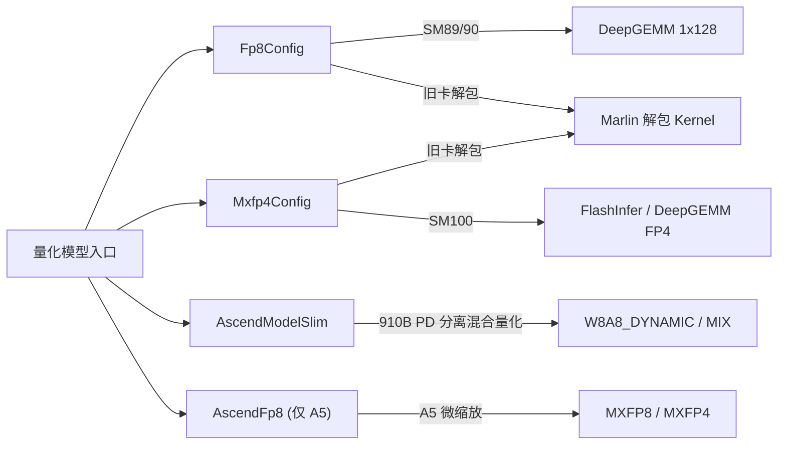

前两章[04 KV Cache 与 MQA / GQA](../04-kv-cache-and-gqa/)与[05 FlashAttention 与硬件对齐 Kernel](../05-flash-attention/)算清了历史 KV 的容量与带宽代价，也把注意力中间矩阵从 HBM 往返里解放出来。不过线性层权重与压缩后的 KV Cache 仍默认按 BF16 每次搬运 2 字节。

当单卡显存和显存带宽成为主要约束时，**Quantization（量化）**用更少比特编码张量，把读写字节数降到原来的 $1/2$ 到 $1/4$，同时解锁[第 02 章](../02-gpu-and-ascend-architecture/)介绍过的硬件低精度矩阵算力单元。

## 量化在 Roofline 上的双重收益

对照[01 Transformer 负载与 Roofline 瓶颈](../01-workload-and-roofline/)中的曲线，低比特量化在推理的两个阶段从不同维度提供加速。在访存受限的 Decode 阶段，矩阵乘主要耗时在读取完整权重，从 BF16 压缩到 8-bit 或 4-bit 可把搬运量缩至 $1/2$ 与约 $1/3.76$，生成吞吐成比例抬升。

在算力受限的长序列 Prefill 阶段，Tensor Core 与昇腾 Cube 对 INT8 或 FP8 的峰值算力往往达到 BF16 的 2 倍，直接压低首字延迟。不过动态量化激活时每次前向都得扫一遍隐藏维求极值，在极小批量（$M=1$）下额外的归约 Kernel 启动开销可能抵消带宽收益，因此后续路由需要区分动静态方案。

先通过一个 4 元素对称整型量化手算建立直觉。设输入向量 $x = [0.42, -1.18, 0.05, 0.89]$，目标整数区间为对称 `[-127, 127]`：取最大绝对值 $a_{\max} = \max|x| = 1.18$，算出缩放步长 $s = a_{\max} / 127 \approx 0.009291$。接着按 $q = \operatorname{clip}(\operatorname{round}(x / s), -127, 127)$ 取整得到 $q = [45, -127, 5, 96]$。最后乘回 $s$ 反量化重建出 $\hat{x} = q \cdot s \approx [0.4181, -1.1800, 0.0465, 0.8920]$，最大绝对误差为 $0.003543 \le s/2$。

整个张量共用一个缩放因子 $s$ 称作 **Per-Tensor（逐张量）**量化。若沿权重输出通道或激活每个 token 各自求尺度，则分别为 **Per-Channel（逐通道）**与 **Per-Token（逐 token）**量化。进一步沿矩阵归约维切出固定长度子块分别定标，则是 Group-wise 或 Block-wise 分组量化。

## 数值格式：INT8、FP8 与 MXFP4

同样占用 8-bit 或 4-bit，整型均匀刻度与浮点指数刻度对宽动态范围的适应能力差异很大。图 1 把推理栈核心的四种比特排布（BF16、INT8、FP8 E4M3、MXFP4）逐位切开对比。


| 格式           | 位域（S/E/M） | 最大有限值      | 缩放粒度            | 均摊字节  | 典型硬件与角色       |
| :------------- | :------------ | :-------------- | :------------------ | :-------- | :------------------- |
| `INT8`（对称） | 1S + 7 幅值   | 127（整数）     | 张量 / Token / 通道 | 1.00 B    | 910B 主力与通用 W8A8 |
| `FP8 E4M3FN`   | 1S + 4E + 3M  | 448（无 Inf）   | Tensor 或 128×128   | 1.00 B    | Ada/Hopper、V3 前向  |
| `FP8 E5M2`     | 1S + 5E + 2M  | 57344（有 Inf） | Tensor / Block      | 1.00 B    | 训练梯度与宽动态域   |
| `MXFP4`（OCP） | 1S + 2E + 1M  | 6（32 维共享）  | 每 32 维 1B E8M0    | 0.53125 B | SM100、昇腾 A5       |

同为 8-bit 浮点，前向推理通常选用 `float8_e4m3fn` 而非 `E5M2`[^fp8_e4m3]。`E4M3FN` 舍弃了无穷大编码，只保留最高码点作为 `NaN`，把有限最大值推高到 448；多出的 1 bit 尾数让每个 2 的幂次区间内排满 8 个相对精度刻度，更贴合激活与权重的分布。

进入 4-bit 微缩放格式 **MXFP4（Microscaling FP4，4 比特微缩放浮点）**时，单元素 `E2M1` 去掉符号和零后正半轴只剩 7 个离散幅值 $\{0.5, 1, 1.5, 2, 3, 4, 6\}$。如果整张矩阵共享同一个缩放因子，少数大数会把小数值大量截断为 0。**OCP（Open Compute Project）**MX 标准[^mx_spec]规定每 32 个连续元素共享一个 8-bit 纯指数缩放因子 `E8M0`，直接表示为 $2^e$，反量化只需硬件移位。均摊下来每元素占 4.25 bit（0.53125 B），相对 BF16 压缩 3.76 倍。

## 离群值陷阱与抑制策略

实际推理时，大模型隐藏层的激活张量经常存在少数固定维度——**Outlier Channels（离群通道）**——其幅度持续比常规维度大几十倍。为了衡量量化后的信号保真度，常用 **SQNR（Signal-to-Quantization-Noise Ratio，信号量化噪声比）**作为量化指标：

$$
\text{SQNR} = 10 \log_{10}\!\left(\frac{\sum X^2}{\sum (X - \hat{X})^2}\right) \quad (\text{单位：dB})
$$

每增加 1 比特有效精度，量化步长减半、均方误差降为原来的 $1/4$，对应 $10 \log_{10} 4 \approx 6.02\text{ dB}$。因此可以建立一个直观换算：**SQNR 每高出约 6 dB，大约等价于多保住 1 比特的有效精度**。

图 2 用一个 `[4, 8]` 激活张量（离群列 `c3` 处于 $\pm 12.4$，其余 7 个正常列集中在 $\pm 0.02$ 至 $\pm 0.49$）对比了量化失真与修复效果。直接做 Per-Tensor INT8 时，全张量被迫按 $12.4 / 127 \approx 0.0976$ 放缩，28 个正常元素里有 10 个落入 0 桶，正常通道 SQNR 跌至 20.25 dB。


围绕这类离群值，工程界依次演化出三条抑制路径。

### SmoothQuant（通道平滑迁移）

核心代数恒等式写成 $Y = X W = (X\,\operatorname{diag}(s)^{-1})(\operatorname{diag}(s)\,W)$。离线在校准集上统计激活列最大值与权重行最大值，按均衡指数 $\alpha$ 构造逐列缩放因子 $s_j = \max(|X_{:,j}|)^\alpha / \max(|W_{j,:}|)^{1-\alpha}$，把激活通道除以 $s_j$ 的同时把权重对应行乘以 $s_j$，从而将激活尖峰平滑迁移给通常更好量化的权重。在图 2 的 `[4, 8]` 示例中，取均衡指数 $\alpha = 0.5$、离群激活峰值 $\max(|X_{:,3}|) = 12.4$ 以及对应权重幅值 $\max(|W_{3,:}|) = 0.48$，即可心算出迁移系数：

$$
s_3 = \frac{12.4^{0.5}}{0.48^{0.5}} = \sqrt{\frac{12.4}{0.48}} \approx 5.083
$$

这样离线就能把 `c3` 列的激活幅值压低 5.083 倍。离线平滑和后文的静态 KV 缩放都高度依赖校准集分布：一旦线上请求切换到未覆盖的代码片段或超长 JSON 引发新的离群尖峰，静态阈值就会产生硬截断掉点。

### Hadamard 与正交旋转

单靠逐列缩放仍无法平抑同一行内动态出现的突发尖峰，因此进一步引入正交矩阵 $H$（满足 $H H^\top = I$）执行等价变换：$Y = (X H)(H^\top W)$。把 $H^\top$ 离线融进权重后，在线只对激活乘一次正交矩阵，就能把离群能量均匀摊平到全部特征维上。

如图 2 所示，在 SmoothQuant 上叠加 8 维 Sylvester Hadamard 旋转后，激活峰值从 12.4 降至 1.354。28 个正常元素里的零桶截断数从 10 个降为 0 个，正常通道 SQNR 从 20.25 dB 跃升至 39.69 dB，等价多保住超过 3 比特精度。

上游 `vLLM` 通过 `InputHadamardLinearMethod` 提供归一化块 Hadamard 旋转[^vllm_hadamard]。`vllm-ascend` 则利用 Kronecker 分解，调用 `npu_kronecker_quant` 完成正交旋转量化[^ascend_flatquant]。

### 细粒度分块与 FP32 累加

如果直接用带 4-bit 指数的 FP8 E4M3 配合细粒度块缩放，不做离线旋转也能靠浮点对数刻度同时包住 $\pm 12.4$ 与 $\pm 0.02$，图 2 中的 FP8 方案借此恢复到 32.11 dB。`DeepSeek-V3` 提供了代表性的原生块缩放实现[^ds_kernel]：激活按 1×128 切片动态求 `amax / 448.0`，权重配 128×128 块缩放。矩阵乘内循环外层用 FP32 寄存器乘回双侧缩放因子累加，防止低精度截断。

在 4-bit 精度下，单尺度 FP4 会将正常通道大量置零，SQNR 降至 0.00 dB。必须结合 OCP `MXFP4` 的 32 元素 `E8M0` 微缩放块与平滑旋转，才能把 `[4, 8]` 恢复到 8.60 dB。同时把 `[64, 128]` 矩阵乘输出从 15.10 dB 拉升到 25.24 dB。

此外，词嵌入层、末层 **LM Head（词表输出头）**与 **MoE（Mixture-of-Experts，混合专家）Router** 对 `Logits` 细微差异高度敏感。因此生产配置通常把这几层保留在 BF16 或 FP32。

## KV Cache 量化与写读精度不对称

当长文本下的 KV Cache 逼近显存上限时，两条硬件路线各自封装了 8-bit 缓存方案。在 vLLM NVIDIA 路径上，`Fp8KVCacheMethod` 维护 `k_scale` 与 `v_scale`。写入物理页时由 `reshape_and_cache_flash` 把键值压成 FP8，读取时则向 FlashAttention 传入 `k_descale` 与 `v_descale` 即时反量化[^vllm_kv]。

在 `vllm-ascend` 路径上，910B 采用基于 INT8 五维分形的 `AscendC8KVCacheAttentionMethod`。支持微缩放的新架构则通过 `--kv-cache-dtype mxfp8` 启用 `AscendC8MXFPKVCacheAttentionMethod`[^ascend_kv]。其中 Key 在写入时动态计算每组 `E8M0` 缩放因子，Value 采用静态按通道缩放并预先缓存倒数表供读时还原。

KV Cache 量化存在一项显著的精度不对称性：**Key 的量化误差比 Value 危险得多**。Key 直接参与 Softmax 之前的点积打分，轻微截断误差经指数函数放大后可能翻转长上下文里的注意力排序。而 Value 只在概率归一化后参与线性加权平均，对轻微截断噪声的容忍度高出不少。

## 双端量化路由与昇腾适配逻辑

图 3 汇总了 NVIDIA GPU（`vLLM`）与华为昇腾 NPU（`vllm-ascend`）从量化配置入口到底层计算 Kernel 的分发路径。



| 对比维度     | `vLLM` GPU（`bb23c0a8`）   | 昇腾 910B（`3649b8ff`）  | 昇腾 A5（`3649b8ff`）     |
| :----------- | :------------------------- | :----------------------- | :------------------------ |
| 配置入口     | `Fp8Config`、`Mxfp4Config` | `AscendModelSlimConfig`  | 兼容 ModelSlim 与原生 FP8 |
| 原生算力格式 | SM89/90 FP8；SM100 MXFP4   | INT8（W8A8/W4A8/W4A4）   | FP8、HIF8、MXFP8、MXFP4   |
| 兜底路径     | 旧卡退回 Marlin 软件解包   | 拒收块 FP8，依赖离线校准 | `npu_dynamic_mx_quant`    |
| 权重排布     | 标准行/列主序 ND 布局      | 线性权重转 `FRACTAL_NZ`  | 细粒度 C0 定制分形排布    |

实际部署与读码时，硬件指令代差主导了双端的路由逻辑。首先是 **910B 与 A5 的硬件分水岭**：缺乏原生 FP8/FP4 Tensor Core 的较老 NVIDIA GPU 会退回 Marlin 权重量化解包 Kernel，只省显存而拿不到双倍算力。昇腾 910B 同样没有原生 FP8 Cube 指令，因此 `vllm-ascend` 主推 `ModelSlim` 整型配置，并在校验阶段直接拒绝把分块 FP8 静默反量化回 BF16[^ascend_mx]。

直到新一代 A5 具备原生微缩放单元后，`AscendFp8Config` 才放行块量化 FP8 检查点。前向时它通过 `npu_dynamic_mx_quant` 把激活实时转为分组大小 32 的 `MXFP8`，再送入原生 `npu_quant_matmul` 计算[^ascend_mx]。

其次是 **PD（Prefill-Decode Disaggregation，预填充-解码分离）架构下的 `W8A8_MIX` 动静态混合量化**[^ascend_pdmix]。Prefill 节点处理长提示词批处理时，激活分布波动明显，需要按 token 动态求缩放因子以兜住离群值。而作为 KV 消费者的 Decode 节点（即源码中 `layer.is_kv_consumer` 为真）批大小较小、对 Kernel 启动延迟敏感，若在线归约求 `amax` 反而拖慢生成。

为此 `AscendW8A8PDMixLinearMethod` 在 Prefill 走动态量化执行器，而在 Decode 自动切换为静态校准尺度路径。同时，权重向 `FRACTAL_NZ` 分形格式的转换统一留在加载期完成[^ascend_nz]。

最后是一处容易引发静默精度异常的 **`div_mode` 缩放因子符号约定**[^ascend_divmode]。独立量化算子 `npu_quantize`（`div_mode=False`）在硬件内部执行乘法 $x \times \text{scale}$，调用方必须传入倒数 $1/s$。融合算子 `npu_add_rms_norm_quant`（`div_mode=True`）在内部执行除法 $x / \text{scale}$，则必须传入正向 $s$；若方向传反，输出激活会被错误缩放 $s^2$ 倍且无任何形状报错。

```python
# vllm/model_executor/layers/quantization/fp8.py:256-272 (vllm@bb23c0a8)
self.use_deep_gemm = (
    self.quant_config.use_deep_gemm
    if self.quant_config.use_deep_gemm is not None
    else is_deep_gemm_supported()
)
if self.block_quant:
    self.activation_quant_key = create_fp8_quant_key(
        static=self.act_q_static, group_shape=GroupShape(1, self.weight_block_size[0])
    )

# vllm_ascend/quantization/methods/w8a8/w8a8_pdmix.py:85-88 (vllm-ascend@3649b8ff)
if layer.is_kv_consumer:
    return self._static_method.apply(layer, x, bias, tp_rank)
else:
    return self._dynamic_method.apply(layer, x, bias, tp_rank)
```

## NumPy 数值仿真与格式对照

下面的自包含 NumPy 脚本完整复现图 2 中 `[4, 8]` 离群激活矩阵的仿真对比。脚本依次核对 Per-Tensor INT8、`SmoothQuant + Hadamard`、FP8 E4M3，以及每 4 元素配一组 `E8M0` 的 MXFP4 正常通道 SQNR：

```python
import math
import numpy as np

X = np.array([
    [0.42, -0.04, 0.31, 12.40, -0.45, 0.03, 0.19, -0.28],
    [-0.03, 0.37, -0.02, -11.80, 0.22, -0.48, -0.04, 0.35],
    [0.25, -0.39, 0.04, 10.90, -0.03, 0.41, 0.46, -0.02],
    [-0.44, 0.02, -0.29, -12.40, 0.33, -0.04, -0.36, 0.49],
])
nc = [0, 1, 2, 4, 5, 6, 7]
sqnr = lambda a, b: float(
    10.0 * np.log10(np.sum(a**2) / (np.sum((a - b) ** 2) + 1e-12))
)

def snap(v, g):
    i = np.searchsorted(g, v)
    lo, hi = np.clip(i - 1, 0, len(g) - 1), np.clip(i, 0, len(g) - 1)
    return np.where(np.abs(v - g[lo]) <= np.abs(g[hi] - v), g[lo], g[hi])

e4m3_p = [m / 512.0 for m in range(1, 8)] + [
    (2.0 ** (e - 7)) * (1.0 + m / 8.0)
    for e in range(1, 16)
    for m in range(8)
    if not (e == 15 and m == 7)
]
E4M3 = np.array(sorted([-v for v in e4m3_p] + [0.0] + e4m3_p))
E2M1 = np.array(
    [-6, -4, -3, -2, -1.5, -1, -0.5, 0, 0.5, 1, 1.5, 2, 3, 4, 6],
    dtype=float,
)

def q_mx4(a):
    amax = np.maximum(np.max(np.abs(a), axis=-1, keepdims=True), 1e-12)
    s = np.exp2(np.ceil(np.log2(amax / 6.0)))
    return snap(a / s, E2M1) * s

s_pt = np.max(np.abs(X)) / 127.0
q_pt = np.clip(np.round(X / s_pt), -127, 127)
x_pt = q_pt * s_pt
assert int(np.sum(q_pt[:, nc] == 0)) == 10

H8 = np.array([[1.0]])
while H8.shape[0] < 8:
    H8 = np.block([[H8, H8], [H8, -H8]])
H8 = H8 / math.sqrt(8)
sm = np.ones(8); sm[3] = math.sqrt(12.4 / 0.48)
x_sh = (X / sm) @ H8
s_sh = np.max(np.abs(x_sh)) / 127.0
x_sh_rec = (np.clip(np.round(x_sh / s_sh), -127, 127) * s_sh @ H8.T) * sm

s_fp8 = np.max(np.abs(X), axis=1, keepdims=True) / 448.0
x_fp8 = snap(X / s_fp8, E4M3) * s_fp8
x_mx_raw = q_mx4(X.reshape(8, 4)).reshape(4, 8)
x_mx_sh = (q_mx4(x_sh.reshape(8, 4)).reshape(4, 8) @ H8.T) * sm

z_pt = int(np.sum(q_pt[:, nc] == 0))
s_raw = sqnr(X[:, nc], x_mx_raw[:, nc])
s_msh = sqnr(X[:, nc], x_mx_sh[:, nc])
print(
    f"Per-Tensor INT8 : zero_bins={z_pt:2d}/28, "
    f"Norm_SQNR={sqnr(X[:, nc], x_pt[:, nc]):5.2f} dB"
)
print(
    f"Smooth+Hadamard : zero_bins= 0/28, "
    f"Norm_SQNR={sqnr(X[:, nc], x_sh_rec[:, nc]):5.2f} dB"
)
print(
    f"FP8 E4M3 (1x8)  : zero_bins= 0/28, "
    f"Norm_SQNR={sqnr(X[:, nc], x_fp8[:, nc]):5.2f} dB"
)
print(
    f"MXFP4 E8M0 (raw): Norm_SQNR={s_raw:5.2f} dB "
    f"-> +Smooth+Had={s_msh:5.2f} dB"
)
```

脚本运行输出如下：

```text
Per-Tensor INT8 : zero_bins=10/28, Norm_SQNR=20.25 dB
Smooth+Hadamard : zero_bins= 0/28, Norm_SQNR=39.69 dB
FP8 E4M3 (1x8)  : zero_bins= 0/28, Norm_SQNR=32.11 dB
MXFP4 E8M0 (raw): Norm_SQNR= 4.32 dB -> +Smooth+Had= 8.60 dB
```

下表把 `[4, 8]` 脚本算出的正常通道信噪比，与同套仿真中的 `[64, 128]` 矩阵乘扩展评测并排对照，两者测试口径不同。`[4, 8]` 列只统计激活张量 7 个正常列的重建保真度。`[64, 128]` 列则评测含离群激活 `[64, 128]` 乘以常规权重 `[128, 128]` 后整张输出矩阵 $Y = XW$ 的全局 SQNR。

在 `[64, 128]` 扩展评测中，FP8 按 1×128 激活与 128×128 权重分块，MXFP4 按 32 元素 `E8M0` 微缩放。因为输出 $Y$ 包含大离群内积项并叠加权重噪声，`Per-Tensor INT8` 在整张输出上呈现 34.34 dB 的高位，掩盖了正常通道的零桶截断。而 FP8 叠加激活（`X_SQNR = 34.39 dB`）与权重噪声后稳定在 29.38 dB：

| 数值仿真配置                  | `[4, 8]` 正常 SQNR  | `[64, 128]` 输出 SQNR  | vs BF16 | 工程结论               |
| :---------------------------- | :------------------ | :--------------------- | :------ | :--------------------- |
| `Per-Tensor INT8`             | 20.25 dB（10 归零） | 34.34 dB（离群主导）   | 2.00 倍 | 离群通道挤压正常分辨率 |
| `SmoothQuant + Hadamard INT8` | 39.69 dB（0 归零）  | 49.24 dB               | 2.00 倍 | 正交摊平后近无损恢复   |
| `FP8 E4M3`（1×8 / 1×128）     | 32.11 dB            | 29.38 dB（X 34.39 dB） | 2.00 倍 | 对数指数免校准抗离群   |
| `MXFP4 E8M0`（原始 / 加平滑） | 4.32 / 8.60 dB      | 15.10 / 25.24 dB       | 3.76 倍 | 依赖微缩放与平滑保底   |

到这里，《推理与异构硬件基础》的全部六章已经走通。我们从单卡算力带宽天花板与双硬件微架构出发，依次经过因果注意力与 RoPE、KV Cache 与头共享、FlashAttention 分块融合，最终在量化处压缩权重与缓存体积。当模型体积或上下文继续越过单卡上限时，就需要进入[《分布式并行与跨卡通信》](../../distributed/)，拆解多卡切分、集合通信与跨节点掩盖流水线。

[^fp8_e4m3]: NVIDIA / ARM / Intel，《FP8 Formats for Deep Learning》规范；`vLLM` 项目，[`vllm/model_executor/layers/quantization/fp8.py`](https://github.com/vllm-project/vllm/blob/bb23c0a81779ba733923a7dab9b840b4e533f6a5/vllm/model_executor/layers/quantization/fp8.py#L245-L310)，commit `bb23c0a8`（Apache-2.0）。

[^mx_spec]: OCP Microscaling Formats (MX) v1.0 规范；`vLLM` 项目，[`vllm/model_executor/layers/quantization/mxfp4.py`](https://github.com/vllm-project/vllm/blob/bb23c0a81779ba733923a7dab9b840b4e533f6a5/vllm/model_executor/layers/quantization/mxfp4.py)，commit `bb23c0a8`（Apache-2.0）。

[^vllm_hadamard]: vLLM 项目，[`vllm/model_executor/layers/quantization/input_hadamard.py`](https://github.com/vllm-project/vllm/blob/bb23c0a81779ba733923a7dab9b840b4e533f6a5/vllm/model_executor/layers/quantization/input_hadamard.py)，commit `bb23c0a8`（Apache-2.0）。

[^ascend_flatquant]: vLLM Ascend 项目，[`vllm_ascend/quantization/methods/w4a4/w4a4_flatquant.py`](https://github.com/vllm-project/vllm-ascend/blob/3649b8ff7fd69e707db2c634073d2b4c40eadf15/vllm_ascend/quantization/methods/w4a4/w4a4_flatquant.py)，commit `3649b8ff`（Apache-2.0）。调用 `npu_kronecker_quant`，受常量 `KRONECKER_QUANT_MAX_BATCH_SIZE = 32768` 上限约束且暂不支持权重 NZ 重排。

[^ds_kernel]: DeepSeek-AI 项目，[`inference/kernel.py`](https://github.com/deepseek-ai/DeepSeek-V3/blob/9b4e9788e4a3a731f7567338ed15d3ec549ce03b/inference/kernel.py#L9-L140)，commit `9b4e9788`（MIT）。包含 `act_quant_kernel`、`weight_dequant_kernel` 与外层 FP32 缩放累加 `fp8_gemm_kernel`。

[^vllm_kv]: vLLM 项目，[`vllm/model_executor/layers/quantization/fp8.py`](https://github.com/vllm-project/vllm/blob/bb23c0a81779ba733923a7dab9b840b4e533f6a5/vllm/model_executor/layers/quantization/fp8.py#L862) 与 [`flash_attn.py`](https://github.com/vllm-project/vllm/blob/bb23c0a81779ba733923a7dab9b840b4e533f6a5/vllm/v1/attention/backends/flash_attn.py#L1395-L1440)，commit `bb23c0a8`（Apache-2.0）。

[^ascend_kv]: vLLM Ascend 项目，[`kv_c8.py`](https://github.com/vllm-project/vllm-ascend/blob/3649b8ff7fd69e707db2c634073d2b4c40eadf15/vllm_ascend/quantization/methods/kv_cache/kv_c8.py#L108)（INT8 5D 分形取常量 `NZ_FMT_LAST_DIM = 32`）与 [`mxfp_c8.py`](https://github.com/vllm-project/vllm-ascend/blob/3649b8ff7fd69e707db2c634073d2b4c40eadf15/vllm_ascend/quantization/methods/kv_cache/mxfp_c8.py#L51-L100)，commit `3649b8ff`（Apache-2.0）。

[^ascend_mx]: vLLM Ascend 项目，[`modelslim_config.py`](https://github.com/vllm-project/vllm-ascend/blob/3649b8ff7fd69e707db2c634073d2b4c40eadf15/vllm_ascend/quantization/configs/modelslim_config.py#L478-L525)（`get_min_capability()` 显式抛出 `NotImplementedError`）、[`fp8_config.py`](https://github.com/vllm-project/vllm-ascend/blob/3649b8ff7fd69e707db2c634073d2b4c40eadf15/vllm_ascend/quantization/configs/fp8_config.py#L27-L60) 与 [`fp8_block.py`](https://github.com/vllm-project/vllm-ascend/blob/3649b8ff7fd69e707db2c634073d2b4c40eadf15/vllm_ascend/quantization/methods/w8a8/fp8_block.py#L17-L38)，commit `3649b8ff`（Apache-2.0）。

[^ascend_pdmix]: vLLM Ascend 项目，[`vllm_ascend/quantization/methods/w8a8/w8a8_pdmix.py`](https://github.com/vllm-project/vllm-ascend/blob/3649b8ff7fd69e707db2c634073d2b4c40eadf15/vllm_ascend/quantization/methods/w8a8/w8a8_pdmix.py#L36-L93)，commit `3649b8ff`（Apache-2.0）。依据 `layer.is_kv_consumer` 切换静态与动态 W8A8。

[^ascend_nz]: vLLM Ascend 项目，[`vllm_ascend/quantization/nz.py`](https://github.com/vllm-project/vllm-ascend/blob/3649b8ff7fd69e707db2c634073d2b4c40eadf15/vllm_ascend/quantization/nz.py#L29-L88) 与 [`utils.py`](https://github.com/vllm-project/vllm-ascend/blob/3649b8ff7fd69e707db2c634073d2b4c40eadf15/vllm_ascend/utils.py#L62-L63)，commit `3649b8ff`（Apache-2.0）。通过 `NzCastSpec` 区分 `mxfp8_nz`、`fp4_packed_nz` 与 `fp4_semantic_nz` 的 `C0 = 16 / 32` 跨度，对应格式枚举常量 `ACL_FORMAT_FRACTAL_NZ = 29`。

[^ascend_divmode]: vLLM Ascend 项目，[`vllm_ascend/ops/register_custom_ops.py`](https://github.com/vllm-project/vllm-ascend/blob/3649b8ff7fd69e707db2c634073d2b4c40eadf15/vllm_ascend/ops/register_custom_ops.py#L208-L224)，commit `3649b8ff`（Apache-2.0）。注释写明 `npu_quantize(..., div_mode=False)` 需传 `input_scale_reciprocal`，而 `npu_add_rms_norm_quant(..., div_mode=True)` 需传正向 `input_scale`。
