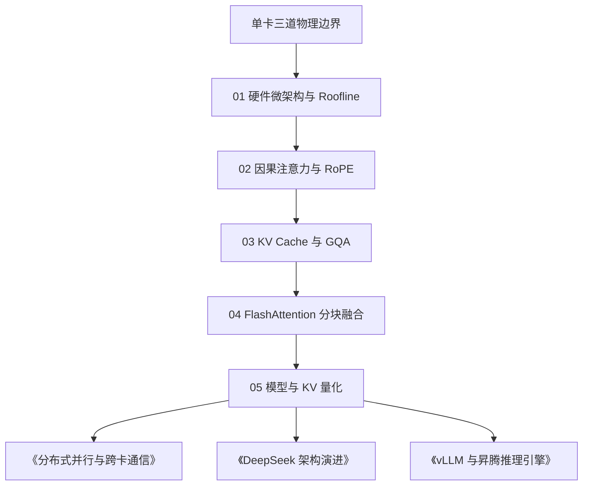

初读大模型推理引擎源码时，开发者往往会被调度状态机、跨卡通信切分和底层定制算子分散注意力。追根溯源，推理系统的绝大多数工程取舍都围绕单张加速卡上的三道物理边界展开：算力峰值、高带宽显存（HBM）的读写带宽，以及片上暂存容量。

本系列对应全站[《推理与异构硬件基础》](./)，把跨模型、跨框架共用的单卡底座从上层系统里拆解出来。内容面向熟悉基本 Python 与数组计算的开发者，行文中并排对照 NVIDIA GPU（`vllm`）与华为昇腾 NPU（`vllm-ascend`）两条硬件路线。图 1 展示了五章的递进主线，以及单卡底座如何向其余三个系列延伸。

## 单卡推理的共同约束

不论上层采用哪种模型结构或部署多少张加速卡，回到单张芯片内部，每一步前向计算都受制于同一组物理规律。首先是 Prefill（预填充）与 Decode（解码）在访存模式上的显著分化：前者一次性送入整段提示词，同一份权重矩阵会被成百上千个 token 充分复用；后者每次只向前推进一个新 token，整份权重与历史键值都得从片外显存搬进核心算一次就丢掉。其次是异构硬件的调度方式不同：NVIDIA 流式多处理器（SM）把矩阵核、标量核与硬件自动缓存组织在统一的线程束调度之下；华为昇腾达芬奇架构（DaVinci AI Core）则把矩阵单元（Cube）与向量单元（Vector）解耦成独立的异步流水线，由软件显式编排片上暂存搬运与分形矩阵排布。

当上下文拉长或参数规模继续扩大时，除了写好单层矩阵乘法，还必须把注意力头的键值读取量压下来、靠片上分块规避中间打分矩阵带来的 HBM 访存带宽压力，并用低比特数值格式缩减每份权重与缓存的字节体积。把这几道底层约束串联起来之后，再去读跨卡并行、模型架构压缩或运行时调度代码时，就能看清它们如何在不同层级应对同一个硬件瓶颈。

## 全系列五章导读

建议按顺序阅读以下五章：

1. [01 异构硬件底座与单层前向](./01-hardware-and-roofline/)：追踪单层解码器从归一化、线性投影到门控前馈的张量形状与计算分布，对照 NVIDIA SM 与昇腾 AI Core 的微架构及设备分发机制，并用 Roofline 模型划分计算受限与访存受限工况。
2. [02 自注意力与旋转位置编码（RoPE）](./02-attention-and-rope/)：从检索直观推导因果多头自注意力与缩放因子，用二维旋转解释 RoPE 如何将绝对坐标折叠为相对距离，并展开旋转通道布局等价性与 YaRN 长上下文分频外推。
3. [03 KV Cache 与头共享妥协](./03-kv-cache-and-gqa/)：算清自回归解码为何必须缓存历史键和值，量化分析 64 层标准多头注意力的显存与带宽账本，解释多查询与分组查询注意力（MQA / GQA）如何以表达力换取带宽和算术强度，并对照双端分页缓存排布。
4. [04 FlashAttention 与硬件对齐 Kernel](./04-flash-attention/)：通过最小分块例子推导在线 Softmax 如何在片上就地重缩放而免去完整分数矩阵写回 HBM，梳理硬件算力失衡推动的 Kernel 演进、解码阶段的键值切分归并，以及昇腾在向量缓存上完成在线归并的设计。
5. [05 模型与 KV 量化](./05-quantization/)：从离群通道造成的整型量化零桶截断讲起，对比平滑缩放与正交旋转恢复、块缩放浮点与微缩放格式，以及 KV 缓存量化和 NVIDIA 与昇腾在硬件指令与配置路由上的差异。

## 后续延伸

完成《推理与异构硬件基础》后，三条进阶路线分别从不同维度承接这里的单卡账本与硬件直觉：

- 想打通单卡装不下或带宽仍不足时的多卡扩展方案，继续阅读[《分布式并行与跨卡通信》](../distributed/)，理解机内与跨机互连拓扑、集合通信代价、多维模型切分与预填充解码分离架构。
- 想剖析前沿模型如何在架构层面压低缓存体积与激活计算量，进入[《DeepSeek 架构演进》](../deepseek/)，跟踪低秩键值压缩、硬件对齐稀疏注意力、细粒度混合专家与多步投机解码等设计。
- 想把底层算子放回真实的并发请求调度流里通盘审视，前往[《vLLM 与昇腾推理引擎》](../vllm/)，学习连续批处理、分块预填充、前缀缓存以及编译器分段与设备静态图捕获机制。
