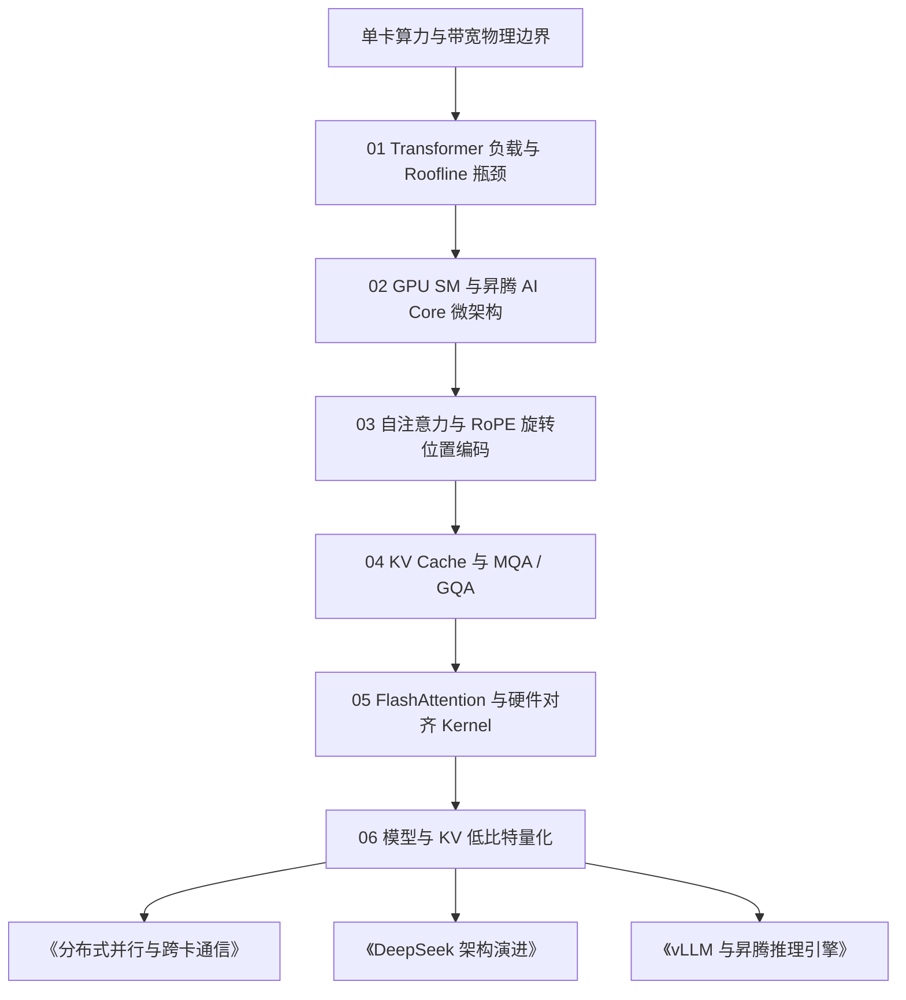

初读大模型推理引擎源码时，开发者往往会被调度状态机、跨卡通信切分和底层定制算子分散注意力。追根溯源，推理系统的绝大多数工程取舍都围绕单张加速卡上的三道物理边界展开：算力峰值、**HBM（High Bandwidth Memory，高带宽显存）**的读写带宽，以及片上暂存容量。

本系列对应全站[《推理与异构硬件基础》](./)，把跨模型、跨框架共用的单卡底座从上层系统里拆解出来。内容面向熟悉基本 Python 与数组计算的开发者，同时对照两条芯片路线。一条线追踪 NVIDIA **GPU（Graphics Processing Unit，图形处理器）**，工程实现落在 `vLLM` 仓库。另一条线追踪华为昇腾 **NPU（Neural Processing Unit，神经网络处理器）**，对应 `vllm-ascend` 仓库。图 1 展示了六章的递进主线及后续延伸方向。

## 单卡推理的共同约束

单张芯片内部，Transformer 每层前向都混合着两类负载：计算密集的 **GEMM（General Matrix Multiply，通用稠密矩阵乘法）**，以及受限于访存的向量归约。这使 Prefill（预填充）与 Decode（解码）两阶段在 Roofline 模型上表现出完全不同的瓶颈。前者一次性送入整段提示词，同一份权重矩阵会被成百上千个 token 充分复用；后者每次只推进一个新 token，整份权重与历史键值都得从片外显存搬进核心算一次就丢掉。

面对同一条 Roofline 约束，NVIDIA 与华为昇腾走出了两条差异鲜明的微架构路线。NVIDIA **SM（Streaming Multiprocessor，流式多处理器）**把并行计算组织为线程、Warp、Thread Block 与 Grid 四级层次。硬件依靠海量常驻寄存器的 Warp 零开销切换来掩盖访存延迟，并用 **SMEM（Shared Memory，片上共享内存）**与自动管理的 L1/L2 Cache 构成存储金字塔。

华为昇腾 DaVinci AI Core 则取消了硬件 **SIMT（Single Instruction, Multiple Threads，单指令多线程）**线程束池。它在 `1C2V` 核组内把 Scalar 标量核、Cube 矩阵单元与两个独立 Vector 长向量核解耦为异步流水线，由软件显式编排数据搬运与计算重叠。

具体到片上搬运通路，昇腾由软件调度 **MTE（Memory Transfer Engine，数据搬运引擎）**双缓冲乒乓。同时在 L1/L0 缓存与 **UB（Unified Buffer，片上统一缓存）**之间显式管理分块，配合权重 `FRACTAL_NZ` 分形排布喂饱矩阵单元。

建立负载与微架构标尺后，第 03 至 04 章聚焦序列维度的计算与显存开销。我们先推导因果自注意力、**RoPE（Rotary Position Embedding，旋转位置编码）**与 **YaRN（Yet another RoPE extensioN，长上下文分频外推）**。随后从显存与带宽开销出发，剖析头共享折中方案 **MQA（Multi-Query Attention，多查询注意力）**与 GQA。

第 05 至 06 章进一步把注意力搬运与数据位宽压到硬件极限。第 05 章展示 Online Softmax 片上分块如何绕开 $O(N^2)$ 显存往返。第 06 章对比 INT8、FP8 E4M3 与 **OCP（Open Compute Project）MXFP4（4 比特微缩放浮点）**，拆解如何压缩每次搬运的字节数。

## 全系列六章导读

建议按顺序阅读以下六章：

1. [01 Transformer 负载与 Roofline 瓶颈](./01-workload-and-roofline/)：提炼单层三类计算负载，看清算子融合如何压缩 HBM 往返，并用 Roofline 模型划分 Prefill 与 Decode 拐点。
2. [02 GPU SM 与昇腾 AI Core 微架构](./02-gpu-and-ascend-architecture/)：解耦执行模型与物理核组，对比 Warp 调度与昇腾双缓冲、访存合并、矩阵硬件契约及 `PrivateUse1` 分发。
3. [03 自注意力与 RoPE 旋转位置编码](./03-attention-and-rope/)：从检索直觉推导因果自注意力，用二维旋转解释 RoPE 相对不变性，并展开布局等价性与 YaRN 分频外推。
4. [04 KV Cache 与 MQA / GQA](./04-kv-cache-and-gqa/)：解释增量解码为何必须缓存历史键值，量化分析 64 层多头显存与带宽压力，并对比 MQA、GQA 与双端分页排布。
5. [05 FlashAttention 与硬件对齐 Kernel](./05-flash-attention/)：用最小分块例子推导在线 Softmax，梳理 FA-2 到 FA-4 演进、Split-KV 归并，以及昇腾 `UB` 在线归并。
6. [06 模型与 KV 低比特量化](./06-quantization/)：从离群通道零桶截断讲起，对比平滑旋转恢复、块缩放与微缩放格式，以及 KV 量化与双端路由差异。

## 后续延伸

完成《推理与异构硬件基础》后，四条进阶路线分别从不同方向承接这里的单卡开销分析与硬件直觉：

- 想打通单卡装不下或带宽仍不足时的多卡扩展方案，继续阅读[《分布式并行与跨卡通信》](../distributed/)，理解机内与跨机互连拓扑、集合通信代价、多维模型切分与预填充解码分离架构。
- 想剖析前沿模型如何在架构层面压低缓存体积与激活计算量，进入[《DeepSeek 架构演进》](../deepseek/)，跟踪低秩键值压缩、硬件对齐稀疏注意力、细粒度混合专家与多步投机解码等设计。
- 想把底层算子放回真实的并发请求调度流里审视，前往[《vLLM 与 vLLM-Ascend 推理引擎》](../vllm/)，学习连续批处理、跨步异步调度、多卡 DP 图模式共识与故障轨迹定位。
- 想深入算力队列、编译静态化、CUDA Graph 与昇腾 ACL Graph，查阅[《推理执行图：CUDA Graph 与 ACL Graph》](../execgraph/)，贯通通用 `CUDAGraphMode` 编排与 GPU / NPU 双端静态图实现。
