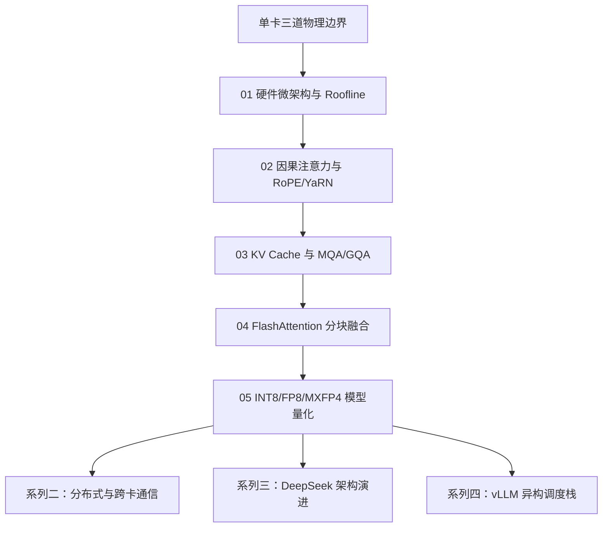

过去读大模型推理代码时，很多人一上来就陷入 `PagedAttention`、张量并行、MLA 与各种定制 CUDA/CANN 算子的细节里，越看越觉得每一层都在造新轮子。追根溯源，推理引擎的一切工程权衡，都围绕单张加速卡上的三道物理边界展开：**算力峰值、HBM 显存带宽与片上暂存容量**。

本系列把跨模型、跨框架共用的底层能力从上层系统拆解出来，作为全站 **AI Infra 知识库的第一站**。全篇从零假定前置背景，同时并排对照 **NVIDIA GPU（`vllm`）** 与 **华为昇腾 NPU（`vllm-ascend`）** 两条硬件路线，帮你先立起统一的第一性原理坐标系。图 1 展示了本系列五章的递进主线，以及它如何向分布式通信、DeepSeek 架构与调度引擎三个系列延伸。

## 为何先立「公共底座」

不论模型是常规 GQA（如 Qwen3、Llama 系列），还是带潜在压缩的 MLA，抑或部署在千卡集群上，只要退回单卡内部，每一个计算步骤都逃不开相同的物理约束：

- **预填充（Prefill）与解码（Decode）的两副面孔**：前者一次性喂入上千个词元，矩阵乘法充分复用权重；后者每次只推进一个新词元，整份权重与历史缓存从 HBM 读进核心只用一次。
- **两套硬件微架构的底层分野**：NVIDIA SM 依托 Tensor Core、CUDA Core、TMA 引擎与硬件 Cache 协同调度；昇腾 DaVinci AI Core 则把 Cube 矩阵单元与 Vector 向量单元解耦成异步流水线，并要求显式管理片上暂存区与 `FRACTAL_NZ` 分形排布。
- **内存墙的逐级突围**：当序列拉长或模型变大时，只靠算子融合不够，还需要用 KV 头共享减少读取、用在线 Softmax 绕开 $O(N^2)$ 中间矩阵落地、再用低比特量化压缩每份权重与缓存的字节体积。

把这几件事一次吃透后，后面再去读跨卡通信、模型特化或调度引擎时，你看到的就不再是一堆孤立技巧，而是同一个瓶颈在不同层级的必然延伸。

## 全系列五章导读

建议按顺序逐章阅读，每一章均配有交互式步骤演进图解、可在 CPU 上独立运行的 NumPy 数值验证片段，以及 `vllm` 与 `vllm-ascend` 的真实上游源码对照：

1. [01 · 异构硬件底座与单层前向：从词元、Roofline 到 NVIDIA SM 与昇腾 AI Core](./01-hardware-and-roofline/)：用张量剖面走通 `RMSNorm -> QKV -> Attention -> SwiGLU -> Residual` 全链路；系统对比 NVIDIA SM 与昇腾 DaVinci AI Core 的微架构及 `PrivateUse1` 分派机制；建立 Roofline 模型区分计算受限与访存受限。
2. [02 · 自注意力与旋转位置编码（RoPE）：词元之间如何交换上下文](./02-attention-and-rope/)：从检索直觉推导因果多头注意力与 $1/\sqrt{d_k}$ 缩放；用二维旋转解释 RoPE 如何把绝对位置编码成相对距离，并拆解 NeoX/GPT-J 内存布局、YaRN 外推与昇腾交错向量查表优化。
3. [03 · KV Cache 与头共享妥协：从显存带宽账本到 MQA 与 GQA](./03-kv-cache-and-gqa/)：算清自回归解码为何必须缓存历史 Key/Value，以及它如何成为主导 HBM 容量与带宽的第一账本；推导 MQA 与 GQA 把算术强度提升 $g$ 倍的物理逻辑，并对照 `vllm` 与 `vllm-ascend` 的分页缓存布局。
4. [04 · FlashAttention 与硬件对齐内核：从在线 Softmax 到 FA-4、FlashMLA 与昇腾融合注意力](./04-flash-attention/)：用两组 4 个数字推导在线 Softmax 片上单一累加器就地重缩放；追踪 FA-2/FA-3/FA-4、Split-KV 归并、FlashMLA 矩阵吸收核与昇腾 `1C2V` 融合算子的工程演化。
5. [05 · 模型与 KV 量化：如何用更少比特守住精度并突破带宽墙](./05-quantization/)：讲清离群通道导致的零桶坍缩、SmoothQuant 与 Hadamard 旋转修复、W8A8/FP8/MXFP4 微缩放格式与 KV Cache 量化，看低比特表示如何把算力墙与带宽墙同时向外推一步。

## 如何衔接后续三个系列

学完本系列后，三条进阶路线均可在对应场景直接复用这里的工具与直觉：

- **想打通多卡扩展与通信开销**：继续进入[系列二：分布式并行与跨卡通信](../distributed/)，理解当单卡装不下权重或带宽仍不足时，TP、PP、DP、EP 与 CP 如何用通信换显存与吞吐。
- **想剖析稀疏注意力与 MoE 架构前沿**：进入[系列三：DeepSeek 架构与系统](../deepseek/)，看 MLA 如何用低秩潜在投影打破 GQA 妥协，以及 NSA 与 DeepSeekMoE 的工程实现。
- **想深入推理引擎调度与异构运行时**：进入[系列四：vLLM 调度与异构后端](../vllm/)，把底层核函数放回 Continuous Batching、Chunked Prefill、Prefix Caching 与双后端图捕获流水线中通盘审视。
