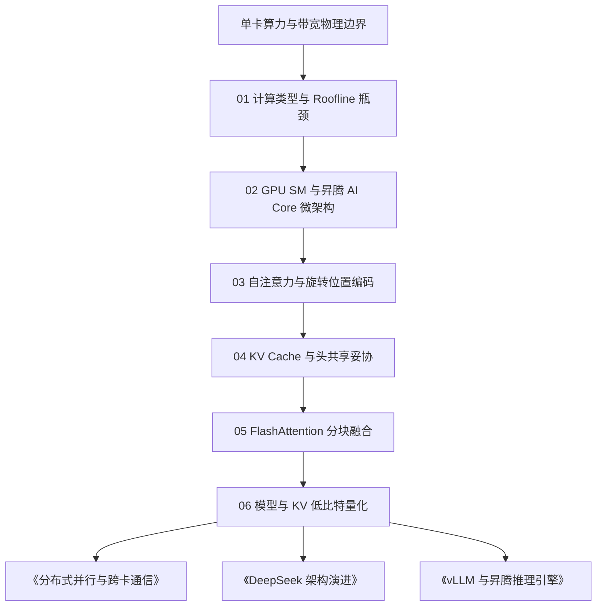

初读大模型推理引擎源码时，开发者往往会被调度状态机、跨卡通信切分和底层定制算子分散注意力。追根溯源，推理系统的绝大多数工程取舍都围绕单张加速卡上的三道物理边界展开：算力峰值、**HBM（High Bandwidth Memory，高带宽显存）**的读写带宽，以及片上暂存容量。

本系列对应全站[《推理与异构硬件基础》](./)，把跨模型、跨框架共用的单卡底座从上层系统里拆解出来。内容面向熟悉基本 Python 与数组计算的开发者，行文中并排对照 NVIDIA **GPU（Graphics Processing Unit，图形处理器，`vLLM`）**与华为昇腾 **NPU（Neural Processing Unit，神经网络处理器，`vllm-ascend`）**两条硬件路线。图 1 展示了六章的递进主线，以及单卡底座如何向其余进阶系列延伸。

## 单卡推理的共同约束

回到单张芯片内部，每一步 Transformer 前向计算都同时混合着 **GEMM（General Matrix Multiply，通用稠密矩阵乘法）**与低计算强度的向量归约两类截然相反的工作负载，从而在 Prefill（预填充）与 Decode（解码）两个阶段展现出截然不同的 Roofline 行为。前者一次性送入整段提示词，同一份权重矩阵会被成百上千个 token 充分复用；后者每次只向前推进一个新 token，整份权重与历史键值都得从片外显存搬进核心算一次就丢掉。

面对同一张 Roofline 约束，NVIDIA 与华为昇腾在微架构上选择了两条对照鲜明的实现路线。NVIDIA **SM（Streaming Multiprocessor，流式多处理器）**把软件抽象为“Thread（线程） → Warp（线程束） → Thread Block（线程块） → Grid（网格）”四级层次，依赖数百个常驻寄存器的硬件 Warp 零开销切换来掩盖 HBM 访存延迟，并用 **SMEM（Shared Memory，片上共享内存）**与硬件自动管理 L1/L2 Cache 构成存储金字塔。华为昇腾 **DaVinci AI Core（达芬奇架构算力核心）**取消了硬件 **SIMT（Single Instruction, Multiple Threads，单指令多线程）**线程束池，在 **`1C2V` 核组**（1 个 Cube 矩阵核配 2 个 Vector 向量核）内部将 Scalar 标量核、Cube 脉动矩阵单元与两个独立 Vector 长向量核解耦为异步流水线，由软件显式编排 **MTE（Memory Transfer Engine，数据搬运引擎，含 `MTE2`/`MTE1`/`MTE3`）**双缓冲乒乓、L1/L0/**UB（Unified Buffer，片上统一缓存）**暂存分块及 `FRACTAL_NZ` 分形布局来持续喂饱算力引擎。

建立计算负载与双硬件微架构的底层标尺之后，第 03 至 06 章聚焦单层最消耗带宽与算力的序列交互核心：先推导因果自注意力与 **RoPE（Rotary Position Embedding，旋转位置编码）**及 **YaRN（Yet another RoPE extensioN，长上下文分频外推）**，再沿着 KV Cache（键值缓存）显存账本剖析 **MQA（Multi-Query Attention，多查询注意力）**与 **GQA（Grouped-Query Attention，分组查询注意力）**的头共享妥协、Online Softmax 片上分块如何消灭 $O(N^2)$ 显存往返，最终以 INT8、FP8 E4M3 与 **OCP（Open Compute Project）MXFP4（4 比特微缩放浮点）**等低比特量化方案压缩每次搬运的字节体积。

## 全系列六章导读

建议按顺序阅读以下六章：

1. [01 Transformer 计算类型与 Roofline 瓶颈](./01-workload-and-roofline/)：从 Transformer 解码器单层前向提炼稠密矩阵乘、向量归约与序列交互三类计算负载，展示算子融合如何将 HBM 往返次数压低 3 倍，并用 Roofline 模型定量划分 Prefill 与 Decode 性能拐点。
2. [02 GPU SM 与昇腾 AI Core 微架构](./02-gpu-and-ascend-architecture/)：将“Thread / Warp / Thread Block / Grid”执行模型与物理 SM / AI Core 芯片映射解耦讲透，对比 Warp 调度 Occupancy（占用率）权衡与昇腾双缓冲 Cube/Vector 流水重叠、GPU 32 字节 Sector（缓存扇区）访存合并与昇腾 **BIU（Bus Interface Unit，总线接口单元）**双端连续约束、Tensor Core 与 Cube 阵列的硬件激活契约，以及 PyTorch `PrivateUse1` 算子分发。
3. [03 自注意力与 RoPE 旋转位置编码](./03-attention-and-rope/)：从检索直观推导因果多头自注意力与缩放因子，用二维旋转解释 RoPE 如何将绝对坐标折叠为相对距离，并展开通道布局等价性与 YaRN 长上下文分频外推。
4. [04 KV Cache 与头共享妥协](./04-kv-cache-and-gqa/)：算清自回归解码为何必须缓存历史键和值，量化分析 64 层标准多头注意力的显存与带宽账本，解释 MQA / GQA 如何以表达力换取带宽和算术强度，并对照双端分页缓存排布。
5. [05 FlashAttention 与硬件对齐 Kernel](./05-flash-attention/)：通过最小分块例子推导在线 Softmax 如何在片上就地重缩放而免去完整分数矩阵写回 HBM，梳理硬件算力失衡推动的 FlashAttention-2/3/4 演进、Split-KV 归并，以及昇腾在 192 KB `UB` 上完成在线归并的设计。
6. [06 模型与 KV 量化](./06-quantization/)：从离群通道造成的整型量化零桶截断讲起，对比平滑缩放与正交旋转恢复、块缩放浮点与微缩放格式，以及 KV 缓存量化与 NVIDIA / 昇腾双端配置路由差异。

## 后续延伸

完成《推理与异构硬件基础》后，四条进阶路线分别从不同维度承接这里的单卡账本与硬件直觉：

- 想打通单卡装不下或带宽仍不足时的多卡扩展方案，继续阅读[《分布式并行与跨卡通信》](../distributed/)，理解机内与跨机互连拓扑、集合通信代价、多维模型切分与预填充解码分离架构。
- 想剖析前沿模型如何在架构层面压低缓存体积与激活计算量，进入[《DeepSeek 架构演进》](../deepseek/)，跟踪低秩键值压缩、硬件对齐稀疏注意力、细粒度混合专家与多步投机解码等设计。
- 想把底层算子放回真实的并发请求调度流里通盘审视，前往[《vLLM 与昇腾推理引擎》](../vllm/)，学习连续批处理、分块预填充、前缀缓存以及编译器分段与设备静态图捕获机制。
- 想专门深入算力队列同步与设备侧静态执行图机制，查阅[《执行图与昇腾 ACL Graph》](../aclgraph/)，拆解 CUDA Pushbuffer 与 **CANN（Compute Architecture for Neural Networks，昇腾异构计算架构）`SQ/CQ`（Submission/Completion Queue，硬件提交与完成队列）**、影子模型流以及 `TaskUpdate` 条件子图。
