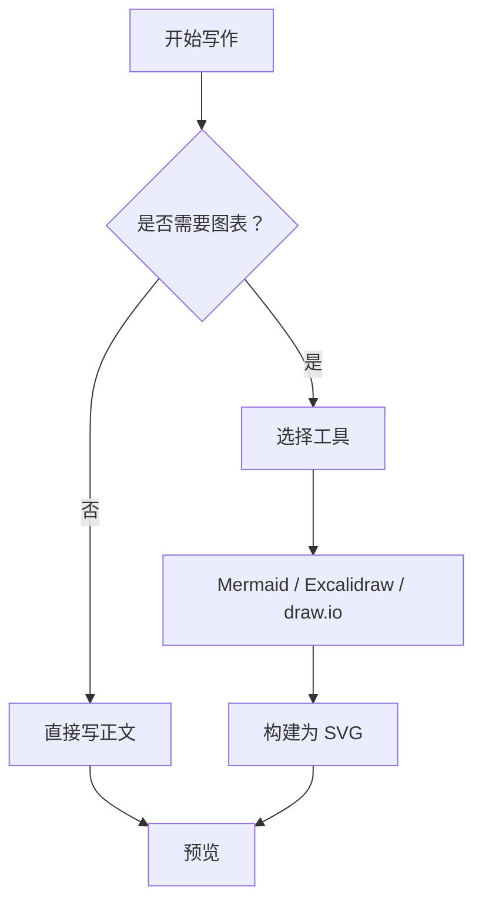
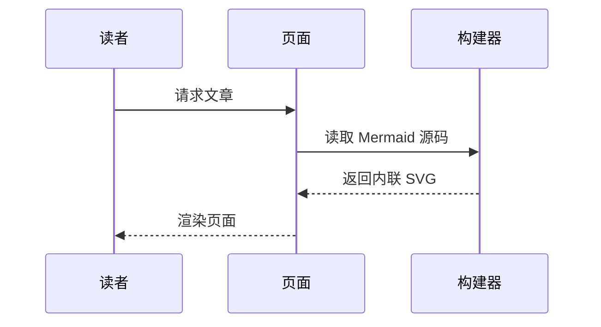
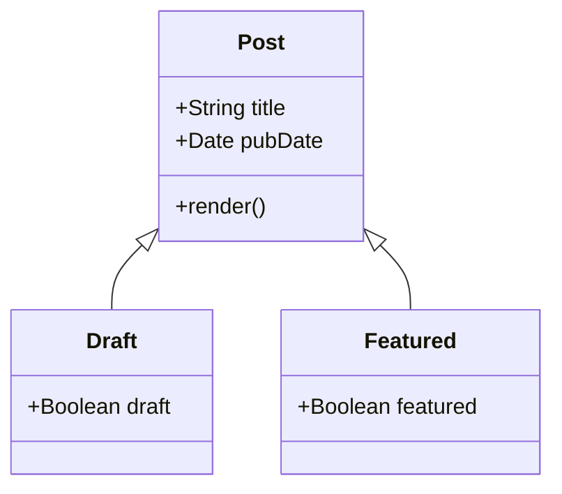
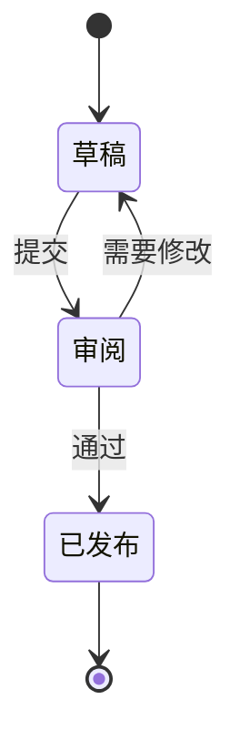
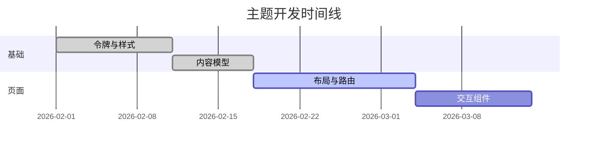
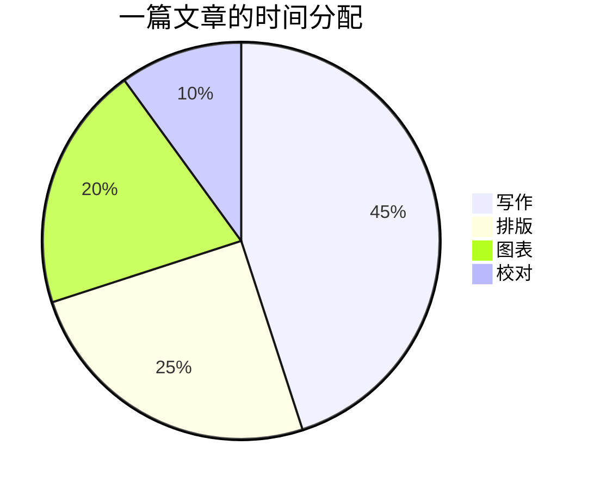

import MatMul from '@/explainers/react/MatMul';

这篇文章把 Wisp 支持的元素放在一起，用来检查排版和样式。正文中的强调、链接、列表和表格都会出现，图表和交互组件的引用以注释形式保留，等对应的组件启用后再打开。

## 标题与文字

### 第三级标题

#### 第四级标题

正文中的**粗体**用于强调关键词，中文强调使用 *强调*，它不会变成斜体。西文强调如 *emphasis* 会保持斜体。这里有一个[链接示例](https://astro.build)，行内代码是 `npm run build`。

段间距为一行，不做首行缩进。中英文之间不需要手动加空格，浏览器会自动处理 Astro 与中文之间的间距。

---

## 列表

有序列表：

1. 安装依赖
2. 配置站点
3. 写第一篇文章

无序列表，包含嵌套：

- 内容
  - 文章
    - 正文
    - 脚注
  - 页面
- 样式
  - 令牌
  - 组件

任务列表：

- [x] 排版规则
- [x] 代码高亮
- [ ] 图片支持（暂缓）

## 表格

| 语言 | 类型系统 | 内存管理 | 典型场景 |
|---|---|---|---|
| TypeScript | 结构化、可选 | 垃圾回收 | 前端与全栈应用 |
| Rust | 静态、强类型 | 所有权 | 系统编程、高性能服务 |
| Python | 动态（可选类型注解） | 引用计数加垃圾回收 | 数据处理、科学计算 |

## 引用

> 排版的目标不是让页面更显眼，而是让读者更快地到达他们想去的地方。

> 引用块内可以有多段文字。
>
> 第二段使用同样的左边框，颜色为 muted，不用斜体。

## 脚注

脚注用于补充说明，不打断正文的阅读节奏。[^a] 也可以在一段话中引用多个脚注。[^b]

[^a]: 这是第一个脚注的内容，它会在页面底部显示。
[^b]: 第二个脚注的内容可以稍长一些，包含对前面论述的限定条件。

## 代码

行内代码：`const x = 1;`，以及 `git rebase -i HEAD~3`。

Python：

```python
from dataclasses import dataclass


@dataclass
class Document:
    title: str
    words: int

    def reading_minutes(self) -> int:
        return max(1, round(self.words / 350))
```

TypeScript：

```typescript
export function groupByYear<T extends { pubDate: Date }>(items: T[]): Map<number, T[]> {
  const groups = new Map<number, T[]>();
  for (const item of items) {
    const year = item.pubDate.getFullYear();
    groups.set(year, [...(groups.get(year) ?? []), item]);
  }
  return groups;
}
```

Diff：

```diff
- const title = post.data.title;
+ const title = post.data.title.trim();
  const description = post.data.description;
- return <Card title={title} />;
+ return <Card title={title} lang={post.data.lang ?? "zh-CN"} />;
```

JSON：

```json
{
  "site": { "title": "Wisp", "lang": "zh-CN" },
  "features": { "codeCopy": true, "lineNumbers": true }
}
```

Shell，包含一行很长的命令，用于检查横向滚动：

```bash
pnpm diagram export src/content/posts/kitchen-sink/diagrams/attention-flow.excalidraw --png --theme dark --scale 2 -o src/content/posts/kitchen-sink/diagrams/attention-flow.dark@2x.png
```

超过 24 行的长代码块默认折叠（需要 JS）：

```ts
export const step1 = (input: number): number => input * 1 + 1;
export const step2 = (input: number): number => input * 2 + 2;
export const step3 = (input: number): number => input * 3 + 3;
export const step4 = (input: number): number => input * 4 + 4;
export const step5 = (input: number): number => input * 5 + 5;
export const step6 = (input: number): number => input * 6 + 6;
export const step7 = (input: number): number => input * 7 + 0;
export const step8 = (input: number): number => input * 8 + 1;
export const step9 = (input: number): number => input * 9 + 2;
export const step10 = (input: number): number => input * 10 + 3;
export const step11 = (input: number): number => input * 11 + 4;
export const step12 = (input: number): number => input * 12 + 5;
export const step13 = (input: number): number => input * 13 + 6;
export const step14 = (input: number): number => input * 14 + 0;
export const step15 = (input: number): number => input * 15 + 1;
export const step16 = (input: number): number => input * 16 + 2;
export const step17 = (input: number): number => input * 17 + 3;
export const step18 = (input: number): number => input * 18 + 4;
export const step19 = (input: number): number => input * 19 + 5;
export const step20 = (input: number): number => input * 20 + 6;
export const step21 = (input: number): number => input * 21 + 0;
export const step22 = (input: number): number => input * 22 + 1;
export const step23 = (input: number): number => input * 23 + 2;
export const step24 = (input: number): number => input * 24 + 3;
export const step25 = (input: number): number => input * 25 + 4;
export const step26 = (input: number): number => input * 26 + 5;
export const step27 = (input: number): number => input * 27 + 6;
export const step28 = (input: number): number => input * 28 + 0;
export const step29 = (input: number): number => input * 29 + 1;
export const step30 = (input: number): number => input * 30 + 2;
export const step31 = (input: number): number => input * 31 + 3;
export const step32 = (input: number): number => input * 32 + 4;
export const step33 = (input: number): number => input * 33 + 5;
export const step34 = (input: number): number => input * 34 + 6;
export const step35 = (input: number): number => input * 35 + 0;
export const step36 = (input: number): number => input * 36 + 1;
export const step37 = (input: number): number => input * 37 + 2;
export const step38 = (input: number): number => input * 38 + 3;
export const step39 = (input: number): number => input * 39 + 4;
export const step40 = (input: number): number => input * 40 + 5;
```

用 `nofold` 关闭折叠：

```ts nofold
export const step1 = (input: number): number => input * 1 + 1;
export const step2 = (input: number): number => input * 2 + 2;
export const step3 = (input: number): number => input * 3 + 3;
export const step4 = (input: number): number => input * 4 + 4;
export const step5 = (input: number): number => input * 5 + 5;
export const step6 = (input: number): number => input * 6 + 6;
export const step7 = (input: number): number => input * 7 + 0;
export const step8 = (input: number): number => input * 8 + 1;
export const step9 = (input: number): number => input * 9 + 2;
export const step10 = (input: number): number => input * 10 + 3;
export const step11 = (input: number): number => input * 11 + 4;
export const step12 = (input: number): number => input * 12 + 5;
export const step13 = (input: number): number => input * 13 + 6;
export const step14 = (input: number): number => input * 14 + 0;
export const step15 = (input: number): number => input * 15 + 1;
export const step16 = (input: number): number => input * 16 + 2;
export const step17 = (input: number): number => input * 17 + 3;
export const step18 = (input: number): number => input * 18 + 4;
export const step19 = (input: number): number => input * 19 + 5;
export const step20 = (input: number): number => input * 20 + 6;
export const step21 = (input: number): number => input * 21 + 0;
export const step22 = (input: number): number => input * 22 + 1;
export const step23 = (input: number): number => input * 23 + 2;
export const step24 = (input: number): number => input * 24 + 3;
export const step25 = (input: number): number => input * 25 + 4;
export const step26 = (input: number): number => input * 26 + 5;
export const step27 = (input: number): number => input * 27 + 6;
export const step28 = (input: number): number => input * 28 + 0;
export const step29 = (input: number): number => input * 29 + 1;
export const step30 = (input: number): number => input * 30 + 2;
export const step31 = (input: number): number => input * 31 + 3;
export const step32 = (input: number): number => input * 32 + 4;
export const step33 = (input: number): number => input * 33 + 5;
export const step34 = (input: number): number => input * 34 + 6;
export const step35 = (input: number): number => input * 35 + 0;
export const step36 = (input: number): number => input * 36 + 1;
export const step37 = (input: number): number => input * 37 + 2;
export const step38 = (input: number): number => input * 38 + 3;
export const step39 = (input: number): number => input * 39 + 4;
export const step40 = (input: number): number => input * 40 + 5;
```

## 公式

行内公式：质能关系 $E = mc^2$，以及归一化项 $\frac{1}{\sqrt{d_k}}$。

块级公式：

$$
\int_{a}^{b} f(x)\,dx = F(b) - F(a)
$$

矩阵：

$$
A = \begin{pmatrix} a_{11} & a_{12} \\ a_{21} & a_{22} \end{pmatrix}, \quad
\det A = a_{11} a_{22} - a_{12} a_{21}
$$

## Mermaid 图

流程图：



时序图：



类图：



状态图：



甘特图：



饼图：



## 图表与交互组件

图表引用在图表导出流程完成后启用，写法见 diagrams.md §5.1：


交互讲解组件的引用写法见 explainers.md：

<MatMul client:visible a={[[1,2],[3,4]]} b={[[5,6],[7,8]]} />

## 结语

以上就是全部元素。如果某个元素在页面上显示异常，它很可能是需要修正的样式问题，可以对照 design-system.md 中对应的规则检查。
