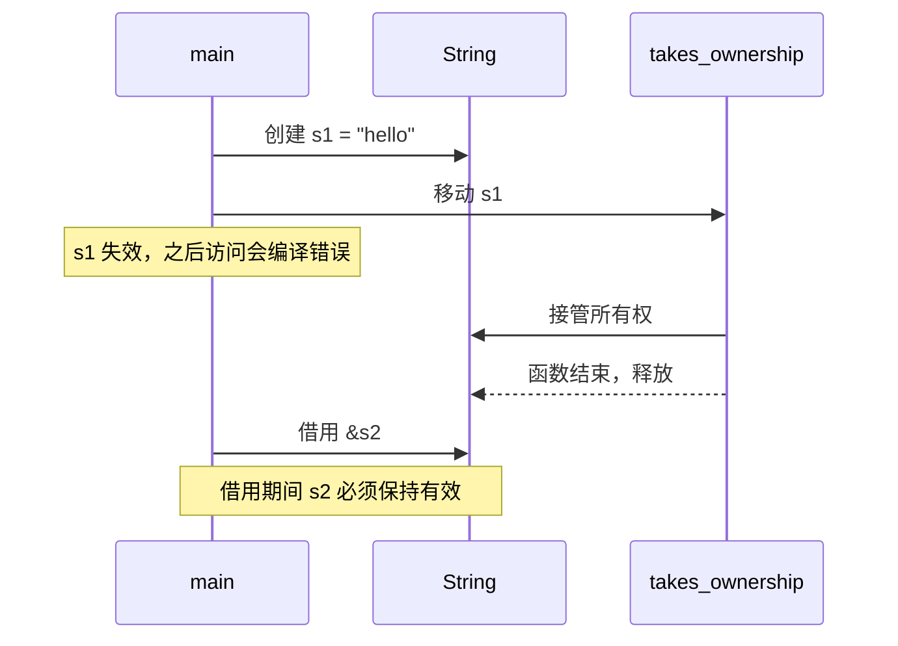

写 TypeScript 的人通常不需要关心内存什么时候释放，垃圾回收器会处理这件事。Rust 没有垃圾回收器，但它也不要求程序员手动 `free`。它靠的是所有权（ownership）系统，在编译期决定每个值的生命周期。

## 三条规则

Rust 官方文档里的所有权规则可以概括为三条：

1. 每个值都有一个所有者（owner）。
2. 同一时刻只能有一个所有者。
3. 所有者离开作用域时，值被释放。

这三条看起来简单，但它们组合起来会产生很多后果。下面用一段代码说明：

```rust
fn main() {
    let s1 = String::from("hello");
    let s2 = s1;          // 所有权从 s1 移动到 s2
    // println!("{}", s1); // 编译错误：s1 已经失效
    println!("{}", s2);
} // s2 离开作用域，字符串在这里被释放
```

在 TypeScript 中，`const s2 = s1` 只是复制了一个指向同一对象的引用，两个变量都可以继续使用。Rust 的 `let s2 = s1` 则是**移动**（move），`s1` 不再可用。这样编译器就知道，字符串只会被释放一次。

## 复制与移动

只在栈上存储、大小固定的类型（如整数、布尔值、`f64`）实现了 `Copy` trait，赋值时会按位复制，原变量仍然可用。`String`、`Vec<T>` 这类拥有堆内存的类型则默认是移动语义。

如果确实需要两份独立的数据，可以显式调用 `clone()`：

```rust
let s1 = String::from("hello");
let s2 = s1.clone(); // 深拷贝，两个变量各自拥有一份数据
println!("{} {}", s1, s2);
```

`clone()` 的开销是可见的，这正是设计上的意图：拷贝堆数据是一件需要被注意到的事情。

## 借用

如果只是想临时读取一个值，而不想拿走它的所有权，可以借用（borrow）。借用分为两种：

- 不可变借用 `&T`：可以同时存在多个。
- 可变借用 `&mut T`：同一时刻只能存在一个，并且此时不能有任何不可变借用。

```rust
fn total_length(names: &Vec<String>) -> usize {
    names.iter().map(|n| n.len()).sum()
}

fn main() {
    let names = vec![String::from("Ada"), String::from("Linus")];
    let total = total_length(&names); // 借用，names 仍然属于 main
    println!("{} 个字符，共 {} 人", total, names.len());
}
```

这条规则就是 Rust 防止数据竞争的方式。一个值如果同时被多处读写，就会出现不可预期的结果。编译器在编译期检查借用关系，不符合规则的代码根本不会通过编译。

## 一个更长的例子

下面的代码展示了在真实项目中经常遇到的情况：从一组记录中筛选、标准化，并保留一份配置的引用。第一行故意写得很长，用来观察代码块在窄屏下的滚动表现：

```rust
let processed: Vec<String> = raw_records.iter().filter(|r| r.is_valid()).map(|r| normalize_record(r, &config, &cache_registry)).collect();
```

这一行在可读性上确实不理想。改写时，可以把闭包拆成具名函数，并且让每个中间结果有一个名字，代码的意图会清楚很多。

## 对照 TypeScript

下面是同一个逻辑的 TypeScript 版本。注意其中没有任何关于释放的代码：

```typescript
interface Record {
  id: string;
  value: string;
}

function isValid(r: Record): boolean {
  return r.value.trim().length > 0;
}

function normalizeRecord(r: Record, config: { upper: boolean }): string {
  return config.upper ? r.value.toUpperCase() : r.value;
}

const config = { upper: true };
const rawRecords: Record[] = [{ id: "1", value: " ada " }, { id: "2", value: "" }];

// 数组和对象都是共享的引用，map 之后原数组仍然可以用
const processed: string[] = rawRecords.filter(isValid).map((r) => normalizeRecord(r, config));
console.log(processed, rawRecords.length);
```

两种语言解决的是同一类问题，只是方式不同。TypeScript 的运行时负责追踪引用，代价是运行时开销和不确定的释放时间。Rust 把这份工作交给了编译器，代价是学习曲线和在编译期被拒绝的代码。

## 时序上的直观理解

下面的时序图展示了一次移动和一次借用的过程。箭头表示调用或传递，虚线表示返回：



## 小结

所有权系统的核心是：**每一块内存在任何时候都有明确的责任人**。这让 Rust 在不依赖垃圾回收的情况下，依然能保证内存安全和线程安全。习惯之后，很多 TypeScript 中需要靠运行时才能发现的问题，会在 Rust 中直接变成编译错误。[^ownership]

[^ownership]: 本文中的示例基于 Rust 2021 版本和 TypeScript 5.x。Rust 的借用检查器在近年的版本中持续改进，部分代码在更新的编译器上可能有更精确的错误信息。
