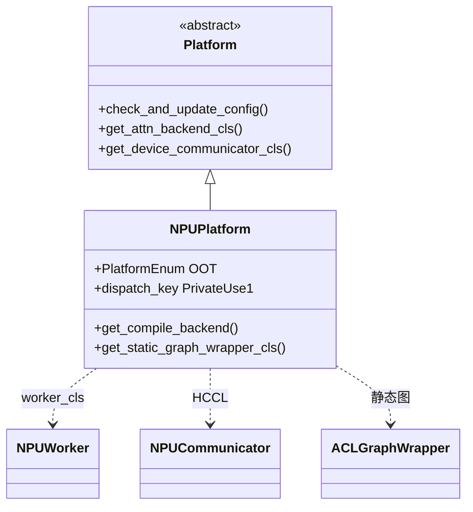
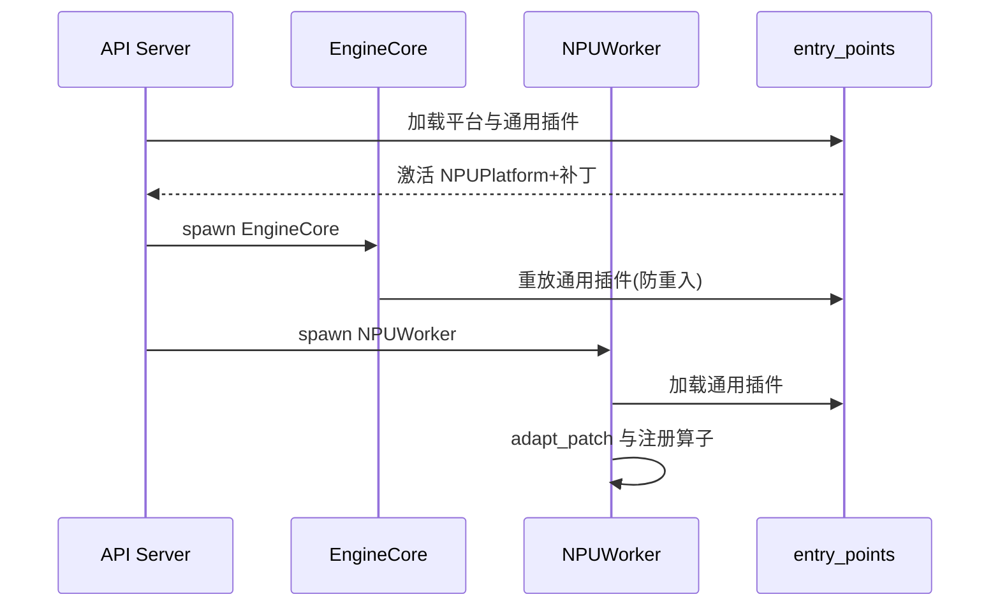
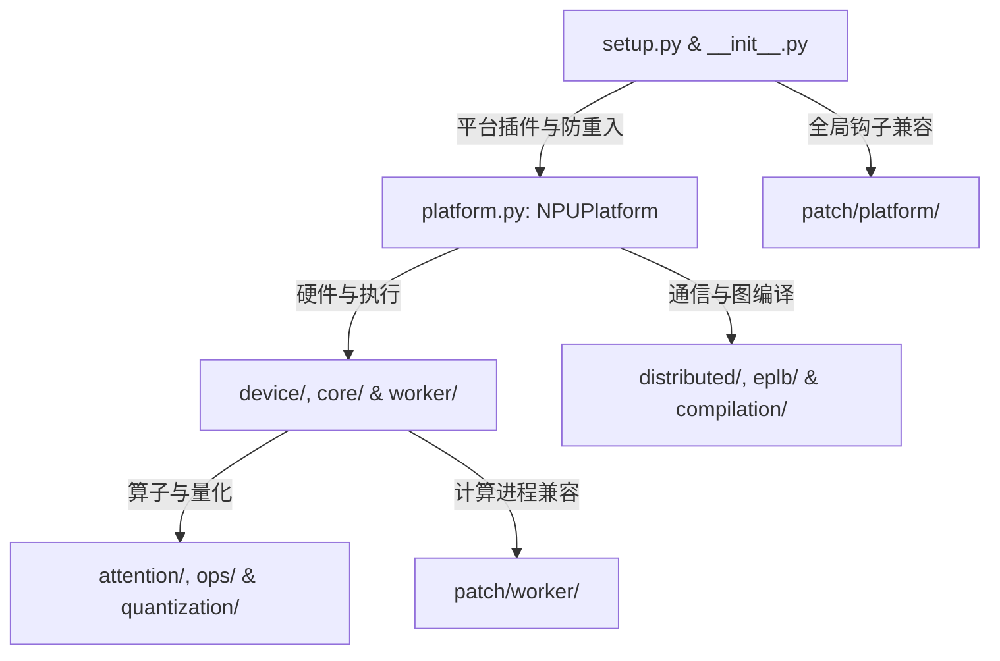

直接分叉修改 vLLM 源码并在热点路径硬编码设备判断分支，在短期内看似省事，一旦面对 vLLM V1 架构的高频重构便会陷入无休止的合并冲突。

上游的调度器、模型执行器与 **MoE（Mixture of Experts，混合专家）** 接口仍在快速演进。例如 MoE 工厂函数已重构为 `FusedMoEFactory`，旧版注意力枚举与开关参数也已退场[^vllm-doc]。为此，华为昇腾选择了 **OOT（Out-of-Tree，树外扩展）** 硬件插件路线，在不改动上游 `vllm` 仓库的前提下接管全链路推理。

## 从四进程拓扑看插件自动发现

我们以 TP=2 启动 MoE 推理为例：系统拉起 Main API、`EngineCore` 与两个工作子进程共 4 个进程。它们借助 Python `entry_points` 自动发现昇腾扩展[^vllm-plugin][^ascend-setup]：平台组返回 `NPUPlatform`[^ascend-init][^vllm-platform-init]，通用组注册 4 个模块。

`NPUPlatform` 将设备设为 `"npu"` 并指定分发键 `PrivateUse1`[^ascend-platform-meta]。这样 `torch_npu` 与自定义算子库无需改动上层即可命中昇腾算子[^vllm-direct-op]。继承与六大挂载接口如图 1 所示，底层 **CANN（Compute Architecture for Neural Networks，异构计算架构）** 软硬件协同层次如图 2 所示[^ascend-docs-stack]。




按照图 2 的分层职责，`vllm-ascend` 之下由四层昇腾基础设施共同支撑：

- **PyTorch 与 `torch_npu`**：承接上层模型执行，将算子派发经 `PrivateUse1` 接入底层运行时。
- **Triton Ascend**：将 Python 算子经 `bishengir` 编译至 Cube 与 Vector 单元。
- **CANN 与 NNAL**：包含基础算子库 Ops、开发工具链 Toolkit 与大模型加速库 NNAL，统一管理图优化与通信原语。
- **Ascend HDK**：包含芯片 Kernel 态驱动与设备固件，直接管理物理队列、HBM 显存页表与硬件中断。

## 六大树外接口如何接管推理链路

在插件发现与算子路由的基础上，`vllm-ascend` 通过六组官方 OOT 接口接管推理全链路，并在官方接口尚未覆盖的场景划出补丁边界，如图 3 所示。


### 配置改写与计算节点注入

配置初始化阶段，vLLM 调用 `NPUPlatform.check_and_update_config` 校验并改写运行参数[^ascend-platform-cfg]。该方法会加载昇腾专属配置、校验并行与量化参数，并将所有可启用算子标记为开启状态。

最关键的一步发生在计算工作类的注入上。当用户保持默认 `worker_cls = "auto"` 时，平台插件根据当前芯片画像写入 `"vllm_ascend.worker.worker.NPUWorker"`[^ascend-worker-sel]。若运行在 310P 或 Xlite 模式下，该字段会切换为对应子类，把设备初始化与前向执行权交给昇腾侧实现。

### 注意力后端路由

不同模型与稀疏策略需要不同的注意力实现。`NPUPlatform.get_attn_backend_cls` 根据多头潜注意力、稀疏注意力、压缩索引以及长序列上下文并行标志，经内部查找表路由到对应后端[^ascend-attn-sel]。

标准芯片默认在常规注意力、MLA、SFA 与 DSA 后端之间切换，兼容性硬件档案则回落到 310P 专用后端。选定后端类后，平台接口还会复核其声明的 KV Cache 数据类型集合，提前拦截不匹配的缓存精度配置。

### 算子分发与图模式注册

底层算子接管分为模块级重写与图模式算子注册两条路径，分别应对 `nn.Module` 层与纯张量算子。

针对基础算子层，`NPUWorker` 初始化时调用 `register_ascend_customop` 注册 `RMSNorm`、`SiluAndMul` 与 `RotaryEmbedding` 等子类[^ascend-reg-ops]。

这些子类批量写入 `CustomOp` 的树外注册表 `op_registry_oot`；当上游实例化层对象时，基类自动返回昇腾子类[^vllm-customop]。前向绑定阶段只要检测到 `is_out_of_tree()` 为真，便路由到 `forward_oot`。

对于 `quantize` 与 `npu_rotary_embedding` 等纯张量算子，插件使用 `direct_register_custom_op` 注册到 `vllm` 算子库[^ascend-direct-reg]。调用时显式传入 `dispatch_key="PrivateUse1"`，同时提供元信息推导函数供 `torch.compile` 推演输出形状。

### 整层替换与类名边界

`CustomOp` 保留了上游父类的构造方法，仅替换前向函数；对于包含复杂子模块、状态参数与多流调度逻辑的层，这种局部替换并不足够。

`PluggableLayer` 提供了整层类替换机制。它在 `nn.Module` 构造最早期直接按类名查找 `op_registry_oot` 并实例化插件子类[^vllm-pluggable]。

借由该机制，`vllm-ascend` 将 `MoERunner` 与 `RoutedExperts` 整体替换为 `AscendMoERunner` 与 `AscendRoutedExperts`[^ascend-moe-runner]。替换后的类完全掌控路由器调用、多张量合并与流水线状态。

需要注意一个工程边界：`PluggableLayer` 严格按类名字面量精确匹配[^vllm-doc]。当模型显式传入自定义子类 `GptOssRoutedExperts` 时，基类注册条目不会自动命中该子类。同样，对于工厂创建的 `FusedTopKRouter`，也需要通过昇腾路由工厂或显式派生组合补齐替换[^ascend-router-fac]。

### 设备通信器与图编译器

分布式跨卡通信与静态图执行构成了最后两处 OOT 接入点，让硬件通信库与图编译器无感接入并行调度。

在通信侧，`NPUPlatform.get_device_communicator_cls` 返回 `NPUCommunicator`[^ascend-platform-meta]。它承接张量并行与专家并行的 `AllReduce`、`AllGather`、`ReduceScatter` 与 `All-to-All` 集合通信。这些通信最终统一交由 **HCCL（Huawei Collective Communication Library，华为集合通信库）** 执行。

在编译与静态图侧，`get_compile_backend` 返回 `AscendCompiler`，`get_static_graph_wrapper_cls` 返回 `ACLGraphWrapper`[^ascend-platform-meta]。配置阶段插件会关闭 Inductor 后端，并把注意力与线性层自定义算子加入图切分列表。

随后系统便能开启分段 **ACL Graph（Ascend Computing Language Graph，昇腾计算语言静态图）** 捕获与回放。关于分段图捕获与重放的底层机制，见[05 ACL Graph 架构与图捕获](../../execgraph/05-acl-graph-architecture-and-capture/)。

## 为什么仍需双进程补丁兼容

六大 OOT 接口覆盖了主流扩展需求，但上游 `vllm` 的发版节奏往往快于官方扩展点的补齐速度。例如上游曾将显存查询切到 `torch.accelerator` 命名空间，却未将该接口接入 NPU 后端；部分调度器分块逻辑、混合缓存协调器或并行校验也尚未留出平台回调钩子[^ascend-patch-doc]。

针对这些暂缺接口的场景，`vllm-ascend` 在源码中划分了严格的进程隔离补丁目录 `platform/` 与 `worker/`。如图 4 所示，这套机制之所以不能只靠一个入口函数打完所有补丁，根源在于 vLLM V1 的三进程隔离模型。



通过观察图 4 的加载时序，可以看到两层补丁的生效边界与防重入设计[^ascend-worker-init]：

- **Main 与 EngineCore 边界**：子进程由 `spawn` 拉起，不会重跑主进程参数解析钩子[^ascend-init]。
- **全局补丁防重入**：3 个通用插件入口均先调防重入保护函数，确保单进程只执行 1 次 `platform/` 补丁。
- **Worker 独立隔离**：`NPUWorker` 初始化时调用 `adapt_patch`，仅在计算子进程注入 `worker/` 补丁[^ascend-worker-init]。

回到开头 `TP = 2` 的 4 进程案例：主进程在参数解析阶段会先加载 4 个通用插件，再执行 `pre_register_and_update`。若缺少模块级幂等标记，这 4 次入口调用会重复改写同一个上游函数，引发包装函数多层套娃。加上全局防重入标记后，4 个进程各自恰好只应用 1 次 `platform/` 补丁，而 `worker/` 补丁仅在 2 个计算子进程中各加载 1 次。

面对不得不写的运行时补丁，设计文档确立了三条工程守则[^ascend-patch-doc]：

1. 少即是多，凡能通过 OOT 接口或向上游提 PR 解决的问题绝不打补丁。
2. 每个补丁必须在总清单中写清目标模块、原因、关联上游 PR 与未来移除计划[^ascend-patch-index]。
3. 一旦上游合入对应扩展钩子便立刻清理，例如 `v0.32.0` 新增预填充后端接口后便移除了旧的 `patch_mla_prefill_backend`。

## 昇腾插件仓源码目录与模块边界

从仓库组织看，`vllm-ascend@b776261` 按“平台入口、硬件与执行器、算子与量化、并行通信、图编译、补丁隔离”六条模块树平铺在 `vllm_ascend/` 之下。各个子目录几乎与本系列后续五章一一对应：

```text
vllm-ascend/
├── setup.py                       # 声明 vllm.platform_plugins 与 general_plugins 入口
└── vllm_ascend/
    ├── __init__.py                # register()、全局防重入标记与通用插件入口函数
    ├── platform.py                # NPUPlatform 元数据与六大 OOT 钩子派发中枢
    ├── device/                    # 芯片档案（A2/A3/A5/310P）、设备配置与操作抽象
    ├── core/                      # 昇腾侧调度器变体与 KV Cache 配置辅助
    ├── worker/                    # NPUWorker、MRV2 适配与 NPU 计算执行主干
    ├── _310p/ & xlite/            # 310P 与 XLite 轻量运行时专用执行后端
    ├── attention/ & ops/          # Ascend 注意力后端、CustomOp 与融合算子实现
    ├── quantization/              # ModelSlim 量化配置解析与量化线性层适配
    ├── distributed/ & eplb/       # HCCL/MC2 通信组、Mooncake PD 与动态 EPLB
    ├── compilation/               # ACL Graph 图捕获后端、阴影流与融合 Pass
    └── patch/
        ├── platform/              # Main 与 EngineCore 共用的全局平台补丁
        └── worker/                # NPUWorker 计算子进程专用补丁
```

如图 5 所示，阅读 `vllm-ascend` 源码无需从全仓扫起，直接以 `setup.py`、`__init__.py` 和 `platform.py` 为总索引，就能按需跳转到对应扩展目录：



这种分目录边界设计让绝大多数上游升级只需核对 `platform.py` 的契约返回值与 `patch/` 下的补丁清单，就能判断变更波及范围，而不会把平台适配逻辑散落进模型的每一个分支里。

插件与双进程补丁框架搭建好之后，真正落到硬件执行前还必须回答三个底座问题。同一套插件如何屏蔽昇腾 A2、A3、A5 与 310P 的芯片差异，多路 ARM CPU 上如何设置 NUMA 亲和性，以及 NPU 显存池如何协同管理。我们将在[02 昇腾芯片抽象、CPU 亲和性与显存](../02-hardware-abstraction-cpu-binding-and-memory/)中继续拆解。

[^vllm-doc]: `vllm@99b0b0b0`：`docs/design/plugin_system.md:1-198`（Apache-2.0），完整定义 `vllm.general_plugins`、`vllm.platform_plugins`、`CustomOp`、`PluggableLayer` 与接口演进弃用说明。

[^vllm-plugin]: `vllm@99b0b0b0`：`vllm/plugins/__init__.py:16-91`（Apache-2.0），通过 `importlib.metadata.entry_points` 发现插件并由 `load_general_plugins` 分别在 Main（`vllm/engine/arg_utils.py:919, 3283`）、`EngineCore`（`vllm/v1/engine/core.py:149-151`）与 Worker（`vllm/v1/worker/worker_base.py:317-319`）进程执行。

[^ascend-setup]: `vllm-ascend@b776261`：`setup.py:506-516`（Apache-2.0），声明 `vllm.platform_plugins`（`ascend = vllm_ascend:register`）与 4 个 `vllm.general_plugins`。

[^ascend-init]: `vllm-ascend@b776261`：`vllm_ascend/__init__.py:52-119`（Apache-2.0），定义 `register()`、`_ensure_global_patch()`（通过 `_GLOBAL_PATCH_APPLIED` 防重入）及在 `EngineCore` 子进程重放全局补丁的 3 个通用插件入口。

[^vllm-platform-init]: `vllm@99b0b0b0`：`vllm/platforms/__init__.py:240-320`（Apache-2.0），`resolve_current_platform_cls_qualname` 探测唯一 OOT 平台插件并借助模块 `__getattr__` 延迟实例化 `current_platform`。

[^ascend-platform-meta]: `vllm-ascend@b776261`：`vllm_ascend/platform.py:108-118, 223-256`（Apache-2.0），定义 `NPUPlatform` 元数据（`_enum = PlatformEnum.OOT`、`dispatch_key = "PrivateUse1"`）及 `get_compile_backend`、`get_device_communicator_cls`、`get_static_graph_wrapper_cls` 等扩展钩子。

[^vllm-direct-op]: `vllm@99b0b0b0`：`vllm/utils/torch_utils.py:1009-1046`（Apache-2.0），`direct_register_custom_op` 向 `Library("vllm", "FRAGMENT")` 注册算子并默认读取 `current_platform.dispatch_key`。

[^ascend-platform-cfg]: `vllm-ascend@b776261`：`vllm_ascend/platform.py:398-441, 621-716, 1460-1594`（Apache-2.0），`pre_register_and_update` 与 `check_and_update_config` 完成全局补丁注入、配置校验及编译模式设置。

[^ascend-worker-sel]: `vllm-ascend@b776261`：`vllm_ascend/platform.py:1596-1636` 与 `vllm_ascend/device/hardware_profile.py:417, 478`（Apache-2.0），`_setup_worker_and_scheduler` 按硬件档案选择 `NPUWorker`、`NPUWorker310` 或 `XliteWorker`。

[^ascend-attn-sel]: `vllm-ascend@b776261`：`vllm_ascend/platform.py:281-379`（Apache-2.0），`get_attn_backend_cls` 与 `_select_attn_backend_cls` 根据稀疏/MLA/PCP/芯片类型路由并校验 `supported_kv_cache_dtypes`。

[^ascend-reg-ops]: `vllm-ascend@b776261`：`vllm_ascend/utils.py:886-1023`（Apache-2.0），`register_ascend_customop` 构建 `REGISTERED_ASCEND_OPS` 映射表并通过 `CustomOp.register_oot` 注册算子与部分替换层。

[^vllm-customop]: `vllm@99b0b0b0`：`vllm/model_executor/custom_op.py:102-206, 335-356`（Apache-2.0），`CustomOp.__new__` 查询 `op_registry_oot` 并由 `dispatch_forward` 在 `is_out_of_tree()` 时绑定 `forward_oot`。

[^ascend-direct-reg]: `vllm-ascend@b776261`：`vllm_ascend/ops/register_custom_ops.py:252-300`（Apache-2.0），以 `dispatch_key="PrivateUse1"` 注册 `quantize`、`npu_rotary_embedding` 及通信辅助算子并附带 `fake_impl`。

[^vllm-pluggable]: `vllm@99b0b0b0`：`vllm/model_executor/custom_op.py:32-99`（Apache-2.0），`PluggableLayer.__new__` 在实例化阶段按 `cls.__name__` 整层替换包含子模块与状态的类。

[^ascend-moe-runner]: `vllm-ascend@b776261`：`vllm_ascend/ops/fused_moe/fused_moe.py:86-249` 与 `vllm_ascend/patch/platform/patch_fused_moe.py:64-73`（Apache-2.0），`AscendMoERunner` 通过 `PluggableLayer` 接管 `MoERunner`，并对 `GptOssRoutedExperts` 等显式子类作 MRO 组合适配。

[^ascend-router-fac]: `vllm-ascend@b776261`：`vllm_ascend/ops/fused_moe/router/router_factory.py:36-117` 与 `vllm_ascend/ops/fused_moe/router/fused_topk_router.py:81`（Apache-2.0），`create_ascend_fused_moe_router` 分发 `AscendFusedTopKRouter` 替代上游 `FusedTopKRouter`（`vllm/model_executor/layers/fused_moe/router/fused_topk_router.py:210`）。

[^ascend-patch-doc]: `vllm-ascend@b776261`：`docs/source/developer_guide/Design_Documents/patch.md:1-75`（Apache-2.0），定义 `platform/` 与 `worker/` 双层补丁结构、Less is more 原则及三进程限制。

[^ascend-worker-init]: `vllm-ascend@b776261`：`vllm_ascend/worker/worker.py:175-215` 与 `vllm_ascend/utils.py:750-754`（Apache-2.0），`NPUWorker.__init__` 调用 `adapt_patch()` 导入 `vllm_ascend/patch/worker/` 并执行 `register_ascend_customop`。

[^ascend-patch-index]: `vllm-ascend@b776261`：`vllm_ascend/patch/__init__.py:17-27, 414-419, 666-684`（Apache-2.0），登记 `patch_torch_accelerator.py` 等补丁的 Target/Why/How/Future Plan，以及已因上游提供接口而删除的 `patch_mla_prefill_backend.py`。

[^ascend-docs-stack]: [vLLM Ascend 安装与软件栈总览](https://vllm-ascend.readthedocs.io/en/latest/installation.html) 与 [华为昇腾 CANN 文档](https://www.hiascend.com/)。
