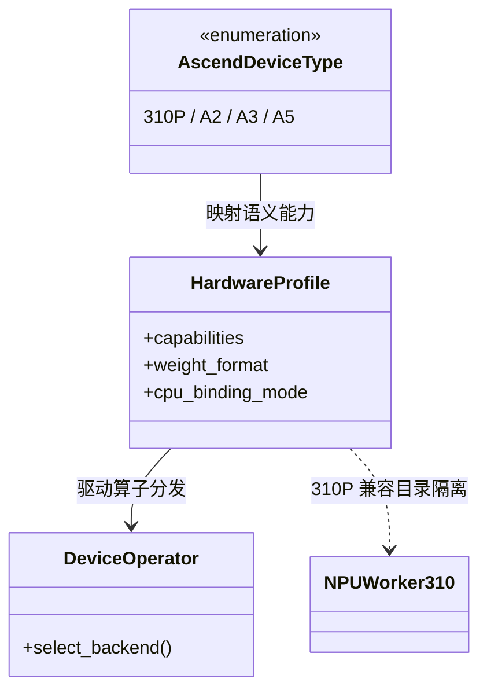
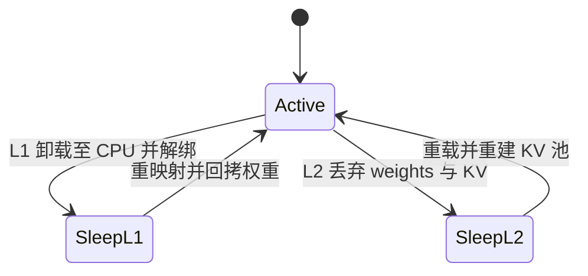

通过 **OOT（Out-of-Tree，树外扩展）** 接口接入调度与执行流后，把 vLLM 部署到真实的昇腾服务器上，还会面对三类硬件层难题。

机箱内可能部署着指令集与显存层级各异的四代昇腾卡。多路 ARM 处理器上的进程调度迁移会引发跨节点访存抖动。同时，**NPU（Neural Processing Unit，神经网络处理器）** 显存管理在休眠、通信缓冲与加载上也有独特规则。

若把这三件事硬编码进业务算子，维护成本会迅速失控。`vllm-ascend` 的做法是把芯片差异、CPU 核心池切分与显存生命周期收敛为三套独立机制，让上层引擎只面向语义契约与确定性预算工作。

## 四代昇腾芯片规格与能力抽象

现网运行的昇腾卡跨越四代微架构，覆盖中心推理标卡、单机多卡服务器到大型超节点系统[^hiascend-hw][^hc2025-roadmap]。表 1 汇总了昇腾官方公开的四代代表产品与芯片硬件规格，用于解释插件层为何采取分层语义抽象：

| 代表产品与芯片               | 芯片/整机内存与带宽                                                             | 理论峰值算力                                      | 互联拓扑与推理精度边界                                                                                 |
| :--------------------------- | :------------------------------------------------------------------------------ | :------------------------------------------------ | :----------------------------------------------------------------------------------------------------- |
| Atlas 300I Duo（310P 双芯）  | LPDDR4X $48\text{–}96\text{ GB}$ / ~$408\text{ GB/s}$                           | $140\text{ TFLOPS}$ FP16 / $280\text{ TOPS}$ INT8 | PCIe 4.0 x16（$150\text{ W}$）；**不支持原生 BF16**，须设 `--dtype float16`[^hiascend-300i]            |
| Atlas A2（910B，如 800I A2） | HBM2e $32\text{–}64\text{ GB}$ / 整机最高 $512\text{ GB}$                       | 单卡约 $313\text{–}350\text{ TFLOPS}$ FP16        | 4U 8 模组 + 4 路鲲鹏 920；机内 HCCS $392\text{ GB/s}$；$8 \times 200\text{GE}$ RoCE[^hiascend-800i-a2] |
| Atlas A3（910C，如 800I A3） | 双 Die 模组 HBM3 $128\text{ GB}$ / ~$3.2\text{ TB/s}$                           | 8 模组整机 $4.48\text{ PFLOPS}$ FP16              | 双向 D2D $784\text{ GB/s}$，最大 384 卡超节点；$8 \times 400\text{GE}$ RoCE[^hiascend-800i-a3]         |
| Atlas A5（950PR / 950DT）    | PR $128\text{ GB}$ ($1.6\text{ TB/s}$) · DT $144\text{ GB}$ ($4.0\text{ TB/s}$) | $1\text{ PFLOPS}$ FP8 · $2\text{ PFLOPS}$ MXFP4   | Scale-up $2.0\text{ TB/s}$；支持 `HiF8` / `MXFP8` / `MXFP4`；超节点最高 $8192$ 卡[^hc2025-roadmap]     |

针对这些差异巨大的物理芯片，插件把硬件识别拆为构建期识别 `AscendDeviceType` 与运行期 **SoC（System on Chip，片上系统）** 校对两步[^ascend-hw-id][^ascend-dev-cfg]。上层业务不准直接判断型号名，统一查询不可变的 `HardwareProfile` 语义画像（如图 1 所示）[^ascend-hw-profile][^ascend-dev-op][^ascend-310p]。



对照源码 `vllm_ascend/device/hardware_profile.py`，四代硬件画像的原生格式、调度策略与核心契约如下表所示[^ascend-hw-profile][^ascend-supported]：

| 芯片代际（SoC 编号）     | 原生权重格式                         | CPU 亲和与寻址模式                | 专属语义契约与执行栈路由                                                 |
| :----------------------- | :----------------------------------- | :-------------------------------- | :----------------------------------------------------------------------- |
| 310P（$200\text{–}205$） | `BF16`, `FP16`, `INT8`               | `TOPO_AFFINITY` / `DIRECT`        | 强制 `FRACTAL_NZ` 与 `ALLGATHER`，转入 `NPUWorker310` 兼容栈             |
| A2（$220\text{–}225$）   | 在上表基础上增加 `INT4`              | `TOPO_AFFINITY` / `DIRECT`        | 支持 `FLASH_ATTN_NPU_3` 与 `CANN_MEGAMOE`（W4A8 等整数路径）             |
| A3（$250\text{–}256$）   | 支持 `BF16`, `FP16`, `INT8`, `INT4`  | `GLOBAL_SLICE` / `DUAL_CHIP_CARD` | 启用 `MC2_FULLMESH_V2_COMM` 与共享专家融合，支持主机 VMM                 |
| A5（$260$）              | 再增 `FP8`, `HIF8`, `MXFP8`, `MXFP4` | `TOPO_AFFINITY` / 集群拓扑感知    | `device_adaptor_family = FP8_OPTIMIZED`，原生支持 FP8 注意力与微缩放格式 |

算子层仅询问 `FP8_ATTENTION` 或 `CANN_MEGAMOE_MXFP` 布尔能力契约即可决定计算后端[^ascend-hw-profile]，而 `310P` 专属实现统一隔离在 `vllm_ascend._310p` 兼容子目录中。

## ARM 多路服务器的 CPU 亲和性绑定

在多路 ARM 服务器上，跨 **NUMA（Non-Uniform Memory Access，非统一内存访问）** 节点的线程迁移与中断抢占会推高尾延迟。所谓 **CPU 亲和性绑定（CPU Affinity，又称 CPU Pinning，即通过系统调用把工作进程、硬件中断与辅助线程固定到指定物理 CPU 核心上运行）**，正是为了消除这种跨节点迁移开销。

因此，上游面向 x86 的 `--numa-bind-nodes` 与 `--numa-bind-cpus` 参数在昇腾平台会被忽略。主机侧改由 `cpu_binding.py` 接管，并从 `v0.18.0rc1` 起仅在 ARM 宿主默认启用[^ascend-cpu-doc]。

决定如何切分 CPU 核心池的依据，正是硬件画像里的 `cpu_binding_mode`。A3 采用 `global_slice` 全局切片，而 A2、310P 与 Ascend 950 采用 `topo_affinity` 拓扑亲和策略[^ascend-cpu-bind]。

先看一个可手算的 A3 例子。假设一台 A3 服务器拥有 $640$ 个逻辑 CPU 核与 $16$ 个逻辑 NPU 设备，可用核心列表为 `allowed_cpus`（`[0..639]`）。HCCS 高速互联让每个 NPU 到各 NUMA 节点的访问延迟相近，拓扑亲和信号不再明显。

于是系统按全局逻辑设备编号切分 CPU 核心池：$640 / 16 = 40$ 核/设备，余数 $0$ 核[^ascend-cpu-doc]。最终设备 $0$ 分得 `[0..39]`，设备 $15$ 分得 `[600..639]`。

拿到单设备 $40$ 核切片后，默认角色划分要求每个 NPU 至少拥有 $5$ 个核心（`MIN_CPUS_PER_NPU = 5`）[^ascend-cpu-roles]。系统把 **SQ/CQ（Submission / Completion Queue，提交与完成队列）** 中断亲和到前两核。末尾两核则分别留给 **ACL（Ascend Computing Language，昇腾计算语言）** 与释放线程：

- **硬件中断核心（2 核）**：取 `pool[0..1]`（`c0–c1`）写入中断亲和文件，承接 NPU 硬件中断。
- **主工作线程（36 核）**：取 `pool[2:-2]`（`c2–c37`）约束主进程与常规计算线程。
- **ACL 运行时（1 核）**：取 `pool[-2]`（`c38`）专供 `acl_thread` 运行时调度线程。
- **内存释放（1 核）**：取 `pool[-1]`（`c39`）专供异步内存释放线程 `release_thread`。

再看 A2 上的资源抢占难题。假设某台 A2 上设备 $0$ 与设备 $2$ 的 `npu-smi info -t topo` 亲和区间同为 `144–167`，位于同一 NUMA 节点。运维人员随后通过 `ASCEND_RT_VISIBLE_DEVICES` 启动两个隔离的单卡进程 A 与 B。

进程 A 仅见设备 $0$，进程 B 仅见设备 $2$，但两者共享同一段 `allowed_cpus`（`[144..191]`）。若每个进程只统计自己可见的设备，两套进程就会争抢同一批 CPU 核心。

`CpuAlloc` 构建候选集合时，会把拓扑亲和与当前 CPU 核心池重叠的隐藏 NPU 也纳入计算[^ascend-cpu-topo]。系统先调用 `extend_numa` 把单 NUMA 区间扩展到相邻节点，得到 `[144..191]` 共 $48$ 核共享池。

接着，调度器对共享该核心池的 `[0, 2]` 调用 `average_distribute` 均分，再剔除不可见设备[^ascend-cpu-doc]。最终进程 A 保留 `144–167`，进程 B 保留 `168–191`，两者完全错开。


针对不同代际与宿主环境，亲和性配置还包含三处条件细节。A3 属于双芯模组（`DUAL_CHIP_CARD`），配置中断亲和时需把逻辑设备 ID 换算为板卡编号 `npu // 2` 与芯片编号 `npu % 2`[^ascend-cpu-irq]。

Ascend 950 跳过中断亲和与独立 ACL 核心切分，改为把 `uvb_poll_window_thread` 固定到 NUMA 0（容器需 `--pid=host`）。同时它按每集群 $8$ 核乘超线程数分配整块集群[^ascend-cpu-950]。线程绑定完成后，若宿主存在 `migratepages` 且未开启 Engram 跨节点卸载，系统还会把内存页迁至目标 NUMA 节点[^ascend-cpu-migrate]。

## CaMemAllocator 与睡眠唤醒生命周期

进入 **RL（Reinforcement Learning，强化学习）** 后训练阶段，同一组 NPU 需要交替运行推理生成与训练反向传播。PyTorch 默认分配器不会归还物理显存页。为此 `CaMemAllocator` 封装 AscendCL 虚拟内存接口，按 `"weights"` 与 `"kv_cache"` 隔离页管理[^ascend-camem][^ascend-camem-cpp]。

调用 `NPUWorker.sleep(level)` 与 `wake_up(tags)` 时的两级休眠与分阶段唤醒流转如图 3 所示[^ascend-worker-sleep][^ascend-sleep-doc]。



开启 `sleep_mode_extra_cleanup` 后，`SleepWakeupManager` 先建立临时锚点组[^ascend-sleep-mgr]。随后它清理 ACL 图工作区与 **HCCL（Huawei Collective Communication Library，华为集合通信库）**通信组，唤醒后再重建恢复。

## MC2 显存预留与快速权重加载

即便在常规在线推理中，冷启动阶段的显存核算也隐藏着一个容易触发 **OOM（Out of Memory，显存溢出）** 的陷阱。

运行 MoE 模型时，**MC2（Matmul-Communication Fusion，矩阵乘通信融合）** 与 `FusedMC2` 算子会在首次执行时向驱动申请内部 HCCL 通信缓冲区。这部分开销不走 PyTorch 分配器，在显存探测时归入 `non_torch_increase`[^ascend-worker-profile]。

矛盾在于，框架只允许输入 token 数不超过 `mc2_tokens_capacity` 时走 MC2 路径，超过该上限则退回普通 `AlltoAll`[^ascend-mc2-cap]。冷启动默认按 `max_num_tokens` 执行标准 `profile_run()` 显存峰值探测，此时输入往往超过该上限，导致探测阶段没有触发 MC2 算子。

结果就是标准探测误以为这块数 GiB 的缓冲区属于空闲显存，把它划进了 KV 缓存池。一旦上线出现中小批量请求触发 MC2，驱动临时申请缓冲区便会立刻显存溢出。

为此，`NPUModelRunner.profile_run` 在正式探测前会插入一次 `Dummy Run（空跑预热）`[^ascend-mr-profile]。若 `profile_tokens > mc2_tokens_capacity` 且选中 MC2，系统会先关闭图编译。接着它按 `mc2_tokens_capacity` 空跑前向，锁定缓冲区后再测真实 KV 池上限。


除了控制显存峰值，大模型在多节点扩容或反复重启时，磁盘反序列化与量化权重格式转换耗时往往超过数分钟。`vllm-ascend` 通过插件入口 `ascend_model_loader` 向 vLLM 注册了三类高速权重加载器[^ascend-setup-loader]。

大张量快照加载器（`bigtensorloader`）在首次加载后把 `FRACTAL_NZ` 格式（ID 为 $29$）权重与缩放因子去重写入单节点 `.snapshot` 文件，重启时通过内存映射实现秒级恢复[^ascend-bigtensor]。

弹性网络加载器（`netloader`）绕过磁盘，由健康节点作为 `ElasticServer` 经 HCCL 建立 **P2P（Peer-to-Peer，点对点）** 通道同步权重。具体握手与拉取流程如图 5 所示[^ascend-netloader]。快速分支加载器（`rfork`）则基于 `TransferEngine` 直接从种子实例拉取 HBM 权重内存块并校验结构摘要[^ascend-rfork]。


## 核心池切分与显存预算参考实现

下面这段纯 Python 标准库参考实现，复现了 A3 `global_slice` 640 核四角色切分与 A2 `topo_affinity` 隐藏设备防冲突均分。最后一部分也展示了预留 MC2 缓冲前后的 KV 显存预算差异。

```python
from collections import defaultdict


def a3_global_slice(allowed_cpus: list[int], total_npus: int, running_npus: list[int]):
    cpus = sorted(set(allowed_cpus))
    base, extra = divmod(len(cpus), total_npus)
    assert base >= 5, f"Need >= 5 CPUs per NPU, got {base}"
    roles = {}
    for npu in running_npus:
        start = npu * base + min(npu, extra)
        take = base + (1 if npu < extra else 0)
        pool = cpus[start : start + take]
        roles[npu] = {
            "irq": pool[:2],
            "main": pool[2:-2],
            "acl": [pool[-2]],
            "release": [pool[-1]],
        }
    return roles


def a2_topo_affinity(
    all_npus: list[int],
    running_npus: list[int],
    topo: dict[int, list[int]],
    allowed_cpus: list[int],
    numa_map: dict[int, list[int]],
):
    allowed = set(allowed_cpus)
    cpu_node = {c: n for n, cs in numa_map.items() for c in cs}
    candidates = [
        n for n in all_npus if n in running_npus or any(c in allowed for c in topo[n])
    ]
    raw_pools = {}
    for npu in candidates:
        base = [c for c in topo[npu] if c in allowed]
        nodes = {cpu_node[c] for c in base}
        if len(nodes) == 1:
            keys = sorted(numa_map)
            nxt = keys[(keys.index(next(iter(nodes))) + 1) % len(keys)]
            base = sorted(set(base + [c for c in numa_map[nxt] if c in allowed]))
        raw_pools[npu] = base
    groups = defaultdict(list)
    for npu, cs in raw_pools.items():
        groups[tuple(cs)].append(npu)
    split = {}
    for cs, npus in groups.items():
        per = len(cs) // len(npus)
        for i, npu in enumerate(sorted(npus)):
            end = (i + 1) * per if i < len(npus) - 1 else len(cs)
            split[npu] = list(cs[i * per : end])
    return {npu: split[npu] for npu in running_npus}


a3_roles = a3_global_slice(list(range(640)), 16, [0, 1, 15])
assert len(a3_roles[0]["irq"]) == 2 and len(a3_roles[0]["main"]) == 36
for n in (0, 1, 15):
    r = a3_roles[n]
    print(f"A3 NPU{n:2d}: irq={r['irq'][0]}-{r['irq'][-1]} main={r['main'][0]}-{r['main'][-1]} acl={r['acl']} rel={r['release']}")

numa = {2: list(range(144, 168)), 3: list(range(168, 192))}
topo = {0: list(range(144, 168)), 2: list(range(144, 168))}
proc_a = a2_topo_affinity([0, 2], [0], topo, list(range(144, 192)), numa)
proc_b = a2_topo_affinity([0, 2], [2], topo, list(range(144, 192)), numa)
assert set(proc_a[0]).isdisjoint(proc_b[2])
print(f"A2 ProcA NPU0: {proc_a[0][0]}-{proc_a[0][-1]} ({len(proc_a[0])} CPUs)")
print(f"A2 ProcB NPU2: {proc_b[2][0]}-{proc_b[2][-1]} ({len(proc_b[2])} CPUs)")

req_gib, weights_gib, mc2_hccl_gib, peak_act_gib, graph_gib = 57.6, 32.0, 1.5, 4.2, 0.9
kv_safe = req_gib - (weights_gib + mc2_hccl_gib + peak_act_gib + graph_gib)
kv_naive = req_gib - (weights_gib + peak_act_gib + graph_gib)
assert kv_safe < kv_naive
print(f"KV budget: with MC2={kv_safe:.1f} GiB (safe) vs without MC2={kv_naive:.1f} GiB (risk OOM)")
```

```text
A3 NPU 0: irq=0-1 main=2-37 acl=[38] rel=[39]
A3 NPU 1: irq=40-41 main=42-77 acl=[78] rel=[79]
A3 NPU15: irq=600-601 main=602-637 acl=[638] rel=[639]
A2 ProcA NPU0: 144-167 (24 CPUs)
A2 ProcB NPU2: 168-191 (24 CPUs)
KV budget: with MC2=19.0 GiB (safe) vs without MC2=20.5 GiB (risk OOM)
```

把多代昇腾芯片抽象为语义画像、为每张卡锁定专属 CPU 集合并在 HBM 中留出确定性边界后，硬件层的准备工作已经就绪。接下来，`NPUWorker` 与 `NPUModelRunner` 如何接管前向执行、对齐算子查询边界并把 KV 缓存重排为 `PA_NZ` 分形排布？我们将在[03 NPUWorker、分形缓存与 KV 层并行](../03-npu-worker-runner-and-kv-layout/)中继续拆解。

[^ascend-hw-id]: 源码 `vllm-ascend@b776261`：`setup.py#L74-L166` 与 `vllm_ascend/device/hardware.py#L16-L76`。

[^ascend-dev-cfg]: 源码 `vllm-ascend@b776261`：`vllm_ascend/device/device_config.py#L22-L77`。

[^ascend-hw-profile]: 源码 `vllm-ascend@b776261`：`vllm_ascend/device/hardware_profile.py#L40-L586`。

[^ascend-dev-op]: 源码 `vllm-ascend@b776261`：`vllm_ascend/device/device_op.py#L2266-L2275`。

[^ascend-310p]: 源码 `vllm-ascend@b776261`：`vllm_ascend/_310p/worker_310p.py#L35-L80` 与 `vllm_ascend/platform.py#L148-L151`。

[^ascend-cpu-doc]: 设计文档 `vllm-ascend@b776261`：`docs/source/developer_guide/Design_Documents/cpu_binding.md#L1-L234`。

[^ascend-cpu-bind]: 源码 `vllm-ascend@b776261`：`vllm_ascend/cpu_binding.py#L31-L42` 与 `L535-L551`。

[^ascend-cpu-roles]: 源码 `vllm-ascend@b776261`：`vllm_ascend/cpu_binding.py#L21-L22`、`L442-L515` 与 `L603-L620`。

[^ascend-cpu-topo]: 源码 `vllm-ascend@b776261`：`vllm_ascend/cpu_binding.py#L257-L280` 与 `L553-L590`。

[^ascend-cpu-irq]: 源码 `vllm-ascend@b776261`：`vllm_ascend/cpu_binding.py#L693-L782`。

[^ascend-cpu-950]: 源码 `vllm-ascend@b776261`：`vllm_ascend/cpu_binding.py#L317-L440` 与 `L598-L601`。

[^ascend-cpu-migrate]: 源码 `vllm-ascend@b776261`：`vllm_ascend/cpu_binding.py#L639-L671` 与 `vllm_ascend/worker/worker.py#L1141-L1148`。

[^ascend-camem]: 源码 `vllm-ascend@b776261`：`vllm_ascend/device_allocator/camem.py#L78-L319` 与 `vllm_ascend/device_allocator/sleep_mode_backend.py#L28-L59`。

[^ascend-camem-cpp]: 源码 `vllm-ascend@b776261`：`csrc/camem_allocator.cpp#L49-L98`。

[^ascend-worker-sleep]: 源码 `vllm-ascend@b776261`：`vllm_ascend/worker/worker.py#L412-L479`、`L1019-L1039` 与 `L1309-L1312`。

[^ascend-sleep-doc]: 用户指南 `vllm-ascend@b776261`：`docs/source/user_guide/feature_guide/sleep_mode.md#L11-L73`。

[^ascend-sleep-mgr]: 源码 `vllm-ascend@b776261`：`vllm_ascend/device_allocator/sleep_mem_optimized.py#L35-L302`。

[^ascend-worker-profile]: 源码 `vllm-ascend@b776261`：`vllm_ascend/worker/worker.py#L728-L828`。

[^ascend-mc2-cap]: 源码 `vllm-ascend@b776261`：`vllm_ascend/ascend_forward_context.py#L260-L320` 与 `L448-L482`。

[^ascend-mr-profile]: 源码 `vllm-ascend@b776261`：`vllm_ascend/worker/v2/model_runner.py#L304-L308` 与 `L859-L892`。

[^ascend-setup-loader]: 源码 `vllm-ascend@b776261`：`setup.py#L506-L513` 与 `vllm_ascend/__init__.py#L96-L105`。

[^ascend-bigtensor]: 源码 `vllm-ascend@b776261`：`vllm_ascend/model_loader/bigtensorloader/bigtensorloader.py#L30-L270`。

[^ascend-netloader]: 源码 `vllm-ascend@b776261`：`vllm_ascend/model_loader/netloader/netloader.py#L103-L522` 与 `vllm_ascend/model_loader/netloader/load.py#L25-L89`。

[^ascend-rfork]: 源码 `vllm-ascend@b776261`：`vllm_ascend/model_loader/rfork/rfork_loader.py#L641-L830` 与 `vllm_ascend/model_loader/rfork/transfer_backend.py#L198-L250`。

[^hiascend-hw]: 华为昇腾产品中心 [Atlas 硬件产品家族](https://www.hiascend.com/hardware/product) 与官方文档。

[^hc2025-roadmap]: 华为全联接大会 2025 公开路线图：Ascend 950PR（`128 GB` HiBL 1.0、`1.6 TB/s`）、950DT（`144 GB` HiZQ 2.0、`4.0 TB/s`、`1 PFLOPS` FP8 / `2 PFLOPS` MXFP4）及 Atlas 950 SuperPoD（`Unified Bus` 灵衢总线、$8192$ 卡）。

[^hiascend-300i]: 华为官方规格与 [vllm-ascend 310P 支持说明](https://vllm-ascend.readthedocs.io/)：`Atlas 300I Duo` 配备双芯 310P、48/96 GB LPDDR4X（约 408 GB/s），140 TFLOPS FP16 / 280 TOPS INT8，150W PCIe 4.0 x16。

[^hiascend-800i-a2]: 华为产品文档：`Atlas 800I A2` 搭载 4 路鲲鹏 920 与 8 模组昇腾 910B（单卡 32/64 GB HBM2e，机内全互联 392 GB/s，8×200GE RoCE）。

[^hiascend-800i-a3]: 华为产品规格：`Atlas 800I A3` 10U 超节点（8 模组 128 GB HBM3、单机 4.48 PFLOPS FP16 / 8.96 POPS INT8、节点内双向 784 GB/s，最高 384 卡互联）。

[^ascend-supported]: `vllm-ascend@b776261`：`docs/source/getting_started/installation/supported_hardware.inc.md#L1-L6`（四类昇腾产品线对应列表）。
