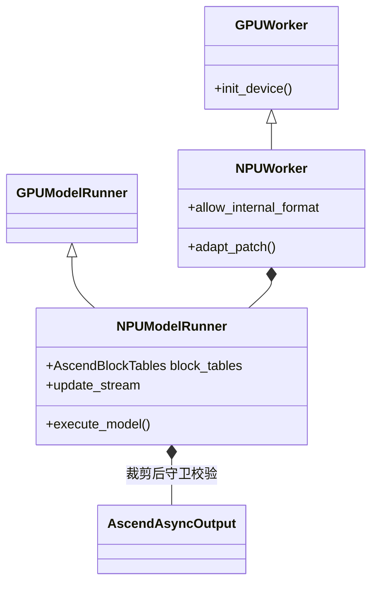
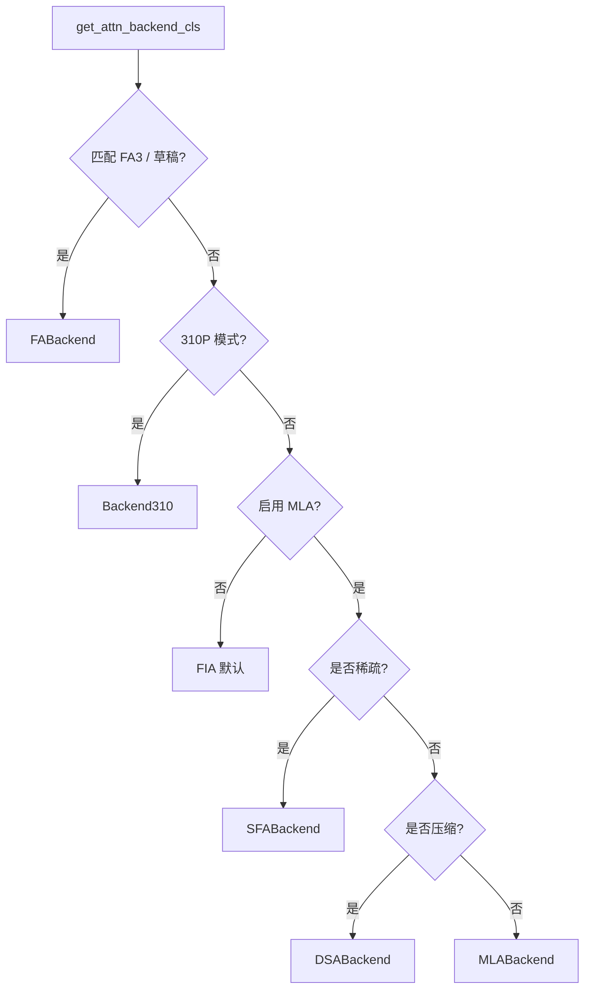
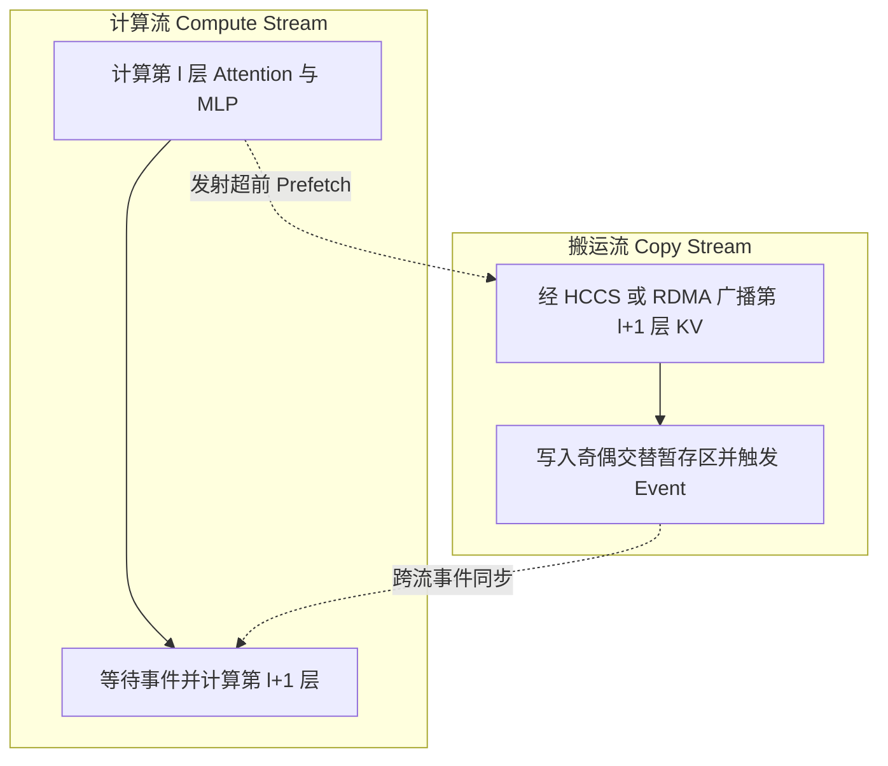

在 `vllm-ascend` 中，`NPUWorker` 继承自 `GPUWorker`[^npu-worker-init]。`NPUModelRunner` 则继承自 `GPUModelRunner`[^npu-mr-init]，直接复用了上万行 V1 调度与 MRV2 状态逻辑。

把这套 GPU 执行栈部署到 **NPU（Neural Processing Unit，神经网络处理器）** 上运行时，会遇到三道硬件约束。算子的 `TND` 查询布局要求长度对齐，计算单元偏爱更细物理块与五维分形缓存，多卡下的潜变量缓存又存在重复存储问题。

- **查询边界对齐**：`TND` 布局算子要求输入首维等于末位查询累积长度[^fia-tnd-pad]。
- **块粒度与分形排布**：融合算子依赖更细物理块与五维 `PA_NZ` 视图，以贴合 Cube 阵列。
- **跨卡缓存冗余**：`MLA` 与 `SFA` 在多个并行卡上重复保存相同历史缓存[^kvpp-doc]。

## 数据通路示例：块展开、分形排布与 KVPP

下面用同一组数据通路示例串联全章三条主线。设一条请求持有逻辑块 `[3, 7]`，调度器逻辑块尺寸为 $128$，底层注意力 Kernel 物理块尺寸为 $64$。

此时切分比例为 $128 / 64 = 2$。每个逻辑块展开为 $2$ 个连续物理块，物理块表变成 `[6, 7, 14, 15]`。若 token 位置为 `[0, 63, 64, 129, 255]`，由块表索引和块内偏移即可算出 `int32` 槽位为 `[384, 447, 448, 897, 1023]`。

接着看分形排布。设 **MLA（Multi-Head Latent Attention，多头潜在注意力）** 潜变量维度为 $512$，块内 token 数 $B_s = 64$，头数 $N_{\text{kv}} = 1$ 且分形尾维 $z = 16$。

标准四维缓存形状为 `(2, 1, 64, 512)`，五维 **PA_NZ（Paged Attention FRACTAL_NZ，分形页式注意力格式）** 则重排为 `(2, 1, 32, 64, 16)`。坐标 `(b=1, n=0, s=5, d=35)` 映射到 `(1, 0, 2, 5, 3)`，同一分块内相邻 token 的地址跨度从 $512$ 缩窄为 $16$。

最后看跨卡层并行收益。设每块每层占用 $73728\text{ B}$，$8$ 层目标注意力加 $1$ 层本地草稿在 $256\text{ MiB}$ 显存预算下全卡复制时，单块消耗 $663552\text{ B}$，可容纳 $404$ 块。开启 $4$ 卡 **KVPP（KV Cache Layer Parallelism，键值缓存层并行）** 后，每卡仅持久存 $2$ 层并复用 $2$ 块暂存缓冲，单块降至 $368640\text{ B}$，可用块数增至 $728$ 块。

图 1 把块表展开、`PA_NZ` 五维排布与 `KVPP` 分层存储结构放在同一张图中对照。


## NPUWorker 与 MRV2 适配

`NPUWorker` 与 `NPUModelRunner` 分别继承上游 `GPUWorker` 与 `GPUModelRunner`，类扩展与核心适配点如图 2 所示[^npu-worker-init][^npu-mr-init]。



进程启动时 `worker.py` 开启 `allow_internal_format = True` 允许内部分形格式，重打 MRV2 配置补丁并临时放行无 Triton 设备的执行器校验[^npu-internal-fmt][^npu-worker-triton]。运行期适配聚焦四处硬件约束：

- **查询边界填充**：`FIA` 算子要求首维等于累积查询长，`query_start_loc` 补齐 0 号块 Padding 槽位，写回限有效切片[^fia-tnd-pad][^fia-pad-loc]。
- **块表与槽位分离**：`AscendBlockTables` 维持调度块粒度并把槽位设为 `int32`，按硬件跨度换算物理块[^ascend-block-table][^block-table-310p][^attn-utils-ratio]。
- **专用参数更新流**：ACLGraph 重放前在独立 `update_stream` 同步更新变长分块参数[^aclgraph-update-stream]。
- **异步守卫延迟**：`AscendAsyncOutput` 拦截 `get_output()`，待裁剪填充后再校验采样异常[^ascend-async-output]。

## 注意力后端路由与分形缓存

昇腾线上支持 **GQA（Grouped-Query Attention，分组查询注意力）** 与 `MLA` 等多种结构。它同时兼容 **SFA（Sparse Flash Attention，稀疏 FlashAttention）** 及 DeepSeek V4 系列变体，并在平台层集中完成静态路由，决策树如图 3 所示。



路由首先判断无 **PCP（Prefill Context Parallelism，预填充上下文并行）** 下的强化学习 `FA3` 与本地草稿 FlashAttention 路径[^platform-select-backend]。若硬件属于 `310P` 兼容家族，则转入 `AscendAttentionBackend310`，采用对齐 $16$ 的五维缓存与 `[128, 64]` 块尺寸[^backend-310p]。

其余主流 NPU 依据三元组 `(use_mla, use_sparse, use_compress)` 查表分发[^platform-select-backend]。默认 GQA 走 **FIA（Fused Infer Attention，融合推理注意力）** 后端。

标准与稀疏潜变量分别进入 `AscendMLABackend` 与 `AscendSFABackend`。压缩缓存则进入 `AscendDSABackend` 及 `AscendDSAV41Impl`[^dsa-v41-impl]。对于 DeepSeek V4 与 V4.1，`update_block_size_for_backend` 会保留已协商的物理页尺寸，避免被逻辑块大小覆盖[^platform-block-size]。

路由确定后，解码阶段的访存效率由 `PA_NZ` 分形排布保障。标准四维 `PA` 按 `(num_blocks, num_kv_heads, block_size, D)` 存储，每个 token 的 $D$ 维向量连续摆放。昇腾 Cube 单元按 $16 \times 16$ 或 $16 \times 32$ 分形小块取数，沿 `block_size` 方向读取多个 token 时会跨越大步长 $D$。

为此，`vllm-ascend` 将隐藏维 $D$ 拆分为外层分块 $D / z$ 与内层尾维 $z$，构成五维 `PA_NZ` 视图：

$$(B_n,\; N_{\text{kv}},\; B_s,\; D) \;\longrightarrow\; \left(B_n,\; N_{\text{kv}},\; \frac{D}{z},\; B_s,\; z\right)$$

其中 $B_n$ 为物理块数，$N_{\text{kv}}$ 为 KV 头数，$B_s$ 为单块 token 数[^mla-nz-view][^attn-nz-view]。非稀疏 `MLA` 默认取尾维 $z = 16$，量化层下 `k_nope` 取 $32$[^mla-nz-view]；`GQA` 静态 INT8 缓存同样取 $z = 32$[^attn-nz-view]。

写入阶段，`MLA` 调用融合算子 `npu_kv_rmsnorm_rope_cache` 配合 `"PA_NZ"` 模式一次完成归一、位置编码与写入[^mla-kv-write]。`GQA` 则先构造五维视图，再经 `npu_scatter_pa_kv_cache` 按槽位离散写入缓存[^attn-nz-write]。

解码读取时，`MLA` 将输入布局从 `"BNSD_NBSD"` 切为 `"BSND_NBSD"`，并在 `mla_prolog` 中启用 `"PA_NZ"` 模式[^mla-nz-read]。

在适用边界上，配置校验限定 `enable_kv_nz` 目前仅用于非稀疏 `MLA` 模型的 PD 分离 Decode 节点（`is_kv_consumer`）[^ascend-config-nz]。这样可避免 Prefill 节点与跨机传输前增加额外格式转换。

## KVPP 与上下文并行

解决单卡布局效率后，长序列与多卡部署还面临显存容量与 TTFT 压力。`vllm-ascend` 一方面通过 **CP（Context Parallelism，上下文并行）** 拆分序列计算，另一方面通过 `KVPP` 分层消除多卡潜变量冗余。

在长文本 **Prefill（预填充）** 阶段，因果注意力计算量随前缀深度递增。`vllm-ascend` 通过 **PCP（Prefill Context Parallel，预填充上下文并行）** 按头尾交错分块切分序列。该策略将长度为 $L$ 的查询分成 $2P$ 块，并把第 $r$ 块与第 $2P-1-r$ 块配对给同一设备[^cp-doc]。

进入 **Decode（解码）** 阶段，**DCP（Decode Context Parallel，解码上下文并行）** 则沿序列维将 KV 交错切分到多个进程复用已有设备，如图 4 所示[^cp-doc]。GQA 目前仅支持 `PCP`，而 MLA 与 SFA 支持堆叠 `PCP + DCP` 以同时缩短 TTFT 并扩充显存容量[^cp-doc]。


除了序列分片，在 `TP` 与 `PCP` 部署下，`MLA` 与 `SFA` 只有 $1$ 个潜变量头，无法按头切分，全组只能重复保存相同的历史缓存[^kvpp-doc]。

**KVPP** 用片间通信换取持久化显存空间。系统在每个流水线阶段内按 `kvpp_size = PCP * TP` 将目标层均匀分配给各卡持有[^kvpp-placement]。遇到非本卡持有的层时，源卡通过 **HCCS（Huawei Cache Coherence System，华为高速片间互联）** 广播缓存。跨机部署则改走 **RDMA（Remote Direct Memory Access，远程直接内存访问）** 执行全层广播[^kvpp-doc]。

运行时通过三项机制把通信延迟隐藏在计算流水内，双流重叠泳道如图 5 所示[^kvpp-placement][^kvpp-cache][^kvpp-runtime][^kvpp-transport]：



- **层打包归属**：同层主 KV、索引与量化因子打包广播，Draft 与 MTP 缓存独立本地保留[^kvpp-placement]。
- **双暂存缓冲交替**：每卡仅划出 $2$ 块最大目标层尺寸的暂存区，按层序奇偶交替复用[^kvpp-cache]。
- **单层超前 Prefetch**：后台传输流在算第 $i$ 层时提前广播第 $i+1$ 层，Dummy Run 与显存探测跳过广播[^kvpp-runtime][^kvpp-transport]。

根据上述分配结构，`KVPPPhysicalCachePlan.get_num_blocks` 精确核算每卡单块消耗的物理字节数与可容纳块数上限[^kvpp-budget]：

$$B_{\text{kvpp}} = B_{\text{owned}} + B_{\text{draft}} + 2 \cdot B_{\max}, \quad N_{\text{blocks}} = \left\lfloor \frac{M_{\text{avail}}}{B_{\text{kvpp}}} \right\rfloor$$

其中 $B_{\text{owned}}$ 为本卡持有层之和，$B_{\text{draft}}$ 为本地草稿层字节，$B_{\max}$ 为单层最大包字节。`NPUWorker` 算出 $N_{\text{blocks}}$ 后，再乘以全模型逻辑单块字节返还给调度规划器，使上层块管理器无需感知分片[^worker-kvpp-budget]。需注意 `KVPP` 当前支持 Eager 与 `PIECEWISE` 模式，暂不支持 `FULL` 全图模式，且广播流量随已分配块数线性增长[^kvpp-doc]。

## 块展开、分形坐标与 KVPP 验证

下面这段 $53$ 行纯 Python 脚本复现了上述数据通路示例的全部计算。它涵盖 1 对 $2$ 块展开与 `int32` 槽位映射、`PA_NZ` 五维坐标及跨 token 步长校验，以及 $4$ 卡 `KVPP` 下的显存块数对比。

```python
def expand_kernel_blocks(logical_blocks: list[int], sched_bs: int, kernel_bs: int) -> list[int]:
    ratio = sched_bs // kernel_bs
    return [bid * ratio + off for bid in logical_blocks for off in range(ratio)]

def compute_slot_mapping(positions: list[int], kernel_blocks: list[int], kernel_bs: int) -> list[int]:
    return [kernel_blocks[p // kernel_bs] * kernel_bs + (p % kernel_bs) for p in positions]

def pa_nd_to_nz_coords(b: int, n: int, s: int, d: int, bs: int, dim: int, nz: int = 16) -> tuple[tuple[int, ...], tuple[int, ...], int, int]:
    d_outer, d_inner = d // nz, d % nz
    nz_shape = (2, 1, dim // nz, bs, nz)
    nd_idx = ((b * 1 + n) * bs + s) * dim + d
    nz_idx = ((((b * 1 + n) * (dim // nz) + d_outer) * bs + s) * nz) + d_inner
    return (b, n, d_outer, s, d_inner), nz_shape, nd_idx, nz_idx

def kvpp_budget(
    num_layers: int,
    target_bytes_per_block: int,
    draft_bytes_per_block: int,
    kvpp_size: int,
    avail_bytes: int,
) -> dict[str, tuple[int, int, int]]:
    base, rem = divmod(num_layers, kvpp_size)
    rep_per_block = num_layers * target_bytes_per_block + draft_bytes_per_block
    result = {"replicated": (rep_per_block, 0, avail_bytes // rep_per_block)}
    for rank in range(kvpp_size):
        owned = base + int(rank < rem)
        persistent = owned * target_bytes_per_block + draft_bytes_per_block
        scratch = 2 * target_bytes_per_block
        result[f"kvpp_rank_{rank}"] = (persistent, scratch, avail_bytes // (persistent + scratch))
    return result

logical_blocks = [3, 7]
kernel_blocks = expand_kernel_blocks(logical_blocks, sched_bs=128, kernel_bs=64)
positions = [0, 63, 64, 129, 255]
slots = compute_slot_mapping(positions, kernel_blocks, kernel_bs=64)
print(f"logical={logical_blocks} -> kernel_blocks={kernel_blocks}")
print(f"positions={positions} -> int32_slots={slots}")
assert slots == [384, 447, 448, 897, 1023]

coords, nz_shape, nd_idx, nz_idx = pa_nd_to_nz_coords(b=1, n=0, s=5, d=35, bs=64, dim=512, nz=16)
_, _, _, nz_idx_next = pa_nd_to_nz_coords(b=1, n=0, s=6, d=35, bs=64, dim=512, nz=16)
print(f"PA_NZ shape={nz_shape}, (b=1,n=0,s=5,d=35) -> 5D={coords}")
print(f"nd_flat={nd_idx}, nz_flat(s=5)={nz_idx}, nz_flat(s=6)={nz_idx_next}, stride_s={nz_idx_next - nz_idx}")
assert nz_idx_next - nz_idx == 16

avail = 256 * 1024 * 1024
target_blk = 64 * 576 * 2
stats = kvpp_budget(num_layers=8, target_bytes_per_block=target_blk, draft_bytes_per_block=target_blk, kvpp_size=4, avail_bytes=avail)
rep_blk_bytes, _, rep_blocks = stats["replicated"]
kvpp_pers, kvpp_scr, kvpp_blocks = stats["kvpp_rank_0"]
print(f"replicated: bytes_per_block={rep_blk_bytes}, available_blocks={rep_blocks}")
print(f"kvpp_rank_0: persistent={kvpp_pers}, 2x_scratch={kvpp_scr}, total_per_block={kvpp_pers + kvpp_scr}, available_blocks={kvpp_blocks}")
assert kvpp_blocks > rep_blocks
```

执行上述脚本的真实标准输出如下：

```text
logical=[3, 7] -> kernel_blocks=[6, 7, 14, 15]
positions=[0, 63, 64, 129, 255] -> int32_slots=[384, 447, 448, 897, 1023]
PA_NZ shape=(2, 1, 32, 64, 16), (b=1,n=0,s=5,d=35) -> 5D=(1, 0, 2, 5, 3)
nd_flat=35363, nz_flat(s=5)=34899, nz_flat(s=6)=34915, stride_s=16
replicated: bytes_per_block=663552, available_blocks=404
kvpp_rank_0: persistent=221184, 2x_scratch=147456, total_per_block=368640, available_blocks=728
```

当单卡分形布局与跨卡层并行就绪之后，集群上混合专家路由通信与矩阵计算仍会形成流水瓶颈。下一章 [04 昇腾通信组、MC2 通算融合与 EPLB](../04-hccl-mc2-and-dynamic-eplb/) 将解析通信域划分、All-to-All 通算融合及热点专家在线均衡。

[^npu-worker-init]: `vllm-ascend@b776261`, `vllm_ascend/worker/worker.py:175-238`, `NPUWorker.__init__` (Apache-2.0).

[^cp-doc]: `vllm-ascend@b776261`, `docs/source/developer_guide/Design_Documents/context_parallel.md:5-90`, PCP 头尾交错预填充与 DCP 解码序列交错缓存设计 (Apache-2.0).

[^npu-mr-init]: `vllm-ascend@b776261`, `vllm_ascend/worker/v2/model_runner.py:153-332`, `NPUModelRunner.__init__` (Apache-2.0).

[^fia-tnd-pad]: `vllm-ascend@b776261`, `vllm_ascend/attention/attention_v1.py:338-390`, `actual_seq_lengths_q` 与虚拟请求填充防 561002 报错 (Apache-2.0).

[^kvpp-doc]: `vllm-ascend@b776261`, `docs/source/developer_guide/Design_Documents/kvpp.md:1-80`, KVPP 架构设计、广播 Prefetch 与支持范围说明 (Apache-2.0).

[^npu-internal-fmt]: `vllm-ascend@b776261`, `vllm_ascend/worker/worker.py:151-152`, `torch.npu.config.allow_internal_format = True` (Apache-2.0).

[^npu-worker-triton]: `vllm-ascend@b776261`, `vllm_ascend/worker/worker.py:158-173,226-237`, `allow_v2_model_runner_without_triton` (Apache-2.0).

[^ascend-block-table]: `vllm-ascend@b776261`, `vllm_ascend/worker/v2/block_table.py:29-127`, `AscendBlockTables` 与 `_compute_slot_mappings_kernel` (`TRITON_BLOCK_SIZE = 1024`, `int32` `slot_mappings`) (Apache-2.0).

[^aclgraph-update-stream]: `vllm-ascend@b776261`, `vllm_ascend/worker/v2/model_runner.py:247-249,281,728-729` 与 `vllm_ascend/worker/v2/aclgraph_utils.py:156-199`, `update_stream` 参数更新流同步 (Apache-2.0).

[^ascend-async-output]: `vllm-ascend@b776261`, `vllm_ascend/observability/runtime_guard/hooks.py:319-350`, `AscendAsyncOutput.get_output` 延迟检查 (Apache-2.0).

[^fia-pad-loc]: `vllm-ascend@b776261`, `vllm_ascend/worker/v2/model_runner.py:1010-1027,1571-1624`, `_pad_query_start_loc_for_fia` (Apache-2.0).

[^block-table-310p]: `vllm-ascend@b776261`, `vllm_ascend/_310p/worker/v2/block_table.py:63-70,114-120`, `blocks_per_kv_block` 直接展开逻辑 (Apache-2.0).

[^attn-utils-ratio]: `vllm-ascend@b776261`, `vllm_ascend/worker/v2/attn_utils.py:696-768,2036-2037`, `num_blocks_per_kv_block` 页跨度视图换算 (Apache-2.0).

[^platform-select-backend]: `vllm-ascend@b776261`, `vllm_ascend/platform.py:281-380,1827-2027`, `NPUPlatform._select_attn_backend_cls` 与各分支校验 (Apache-2.0).

[^backend-310p]: `vllm-ascend@b776261`, `vllm_ascend/_310p/attention/attention_v1.py:48-107`, `AscendAttentionBackend310` 五维形状与块大小 (Apache-2.0).

[^dsa-v41-impl]: `vllm-ascend@b776261`, `vllm_ascend/attention/dsa_v41.py:351-415`, `AscendDSAV41Impl` 与融合算子执行边界 (Apache-2.0).

[^platform-block-size]: `vllm-ascend@b776261`, `vllm_ascend/platform.py:523-551`, `update_block_size_for_backend` 保留 DeepSeek V4/V4.1 物理页尺寸 (Apache-2.0).

[^mla-nz-view]: `vllm-ascend@b776261`, `vllm_ascend/attention/mla_v1.py:2886-2907`, `nz_fmt_last_dim = 16` 五维分形视图构造 (Apache-2.0).

[^attn-nz-view]: `vllm-ascend@b776261`, `vllm_ascend/attention/attention_v1.py:1527-1530`, `_nz_5d_view` (`NZ_FMT_LAST_DIM = 32`) (Apache-2.0).

[^mla-kv-write]: `vllm-ascend@b776261`, `vllm_ascend/attention/mla_v1.py:1940-1959`, `npu_kv_rmsnorm_rope_cache` 写入 `"PA_NZ"` (Apache-2.0).

[^attn-nz-write]: `vllm-ascend@b776261`, `vllm_ascend/attention/attention_v1.py:1861-1873`, `npu_scatter_pa_kv_cache` 离散写入五维缓存 (Apache-2.0).

[^mla-nz-read]: `vllm-ascend@b776261`, `vllm_ascend/attention/mla_v1.py:2982-2989,3199`, `BSND_NBSD` 输入布局与 `mla_prolog` `"PA_NZ"` 模式 (Apache-2.0).

[^ascend-config-nz]: `vllm-ascend@b776261`, `vllm_ascend/ascend_config.py:1009-1021`, `enable_kv_nz` 前置校验 (Apache-2.0).

[^kvpp-placement]: `vllm-ascend@b776261`, `vllm_ascend/core/kv_cache_placement.py:48-61,99-112,155-186`, `map_kvpp_layers_to_owners` 与层打包布局 (Apache-2.0).

[^kvpp-cache]: `vllm-ascend@b776261`, `vllm_ascend/worker/kvpp_cache.py:30-57`, `allocate_kvpp_cache` 双暂存缓冲复用 (Apache-2.0).

[^kvpp-runtime]: `vllm-ascend@b776261`, `vllm_ascend/worker/v2/kvpp.py:33-139` 与 `vllm_ascend/worker/v2/model_states/default.py:503-512`, `KVPPRuntime` 与 `KVPPScheduler` 超前 Prefetch (Apache-2.0).

[^kvpp-transport]: `vllm-ascend@b776261`, `vllm_ascend/distributed/kvpp.py:9-36`, `BroadcastKVPPTransport.prefetch` 跨卡广播流同步 (Apache-2.0).

[^kvpp-budget]: `vllm-ascend@b776261`, `vllm_ascend/core/kv_cache_placement.py:21,34-45`, `KVPPPhysicalCachePlan.get_num_blocks` 预算公式 (Apache-2.0).

[^worker-kvpp-budget]: `vllm-ascend@b776261`, `vllm_ascend/worker/worker.py:719-725,1219-1245`, `_apply_kvpp_memory_budget` 物理块转逻辑预算 (Apache-2.0).
