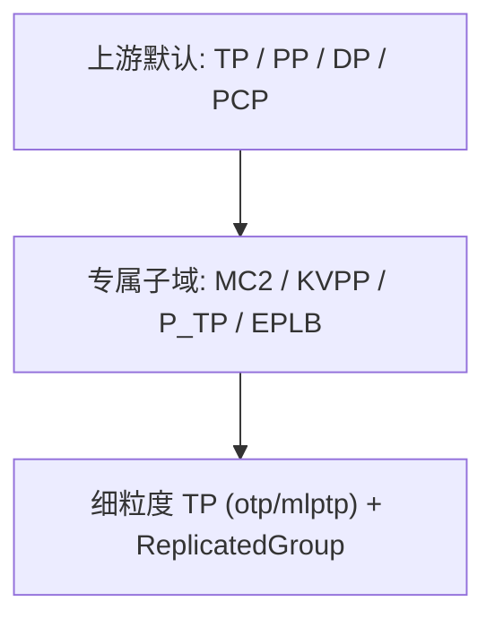
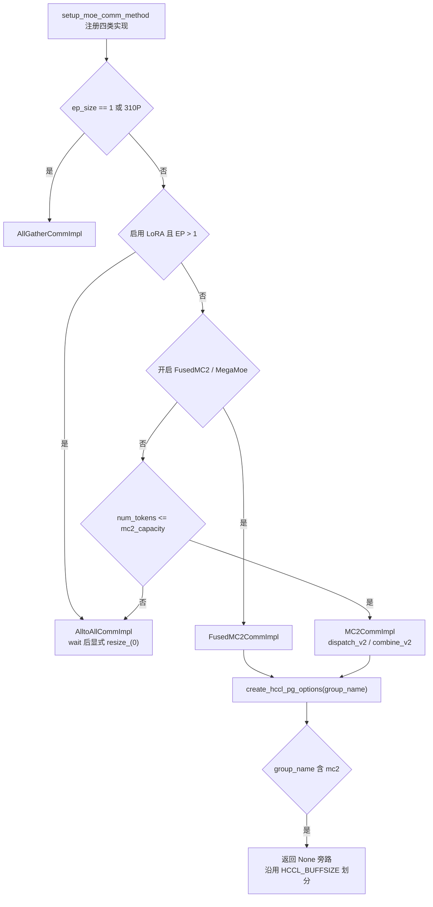
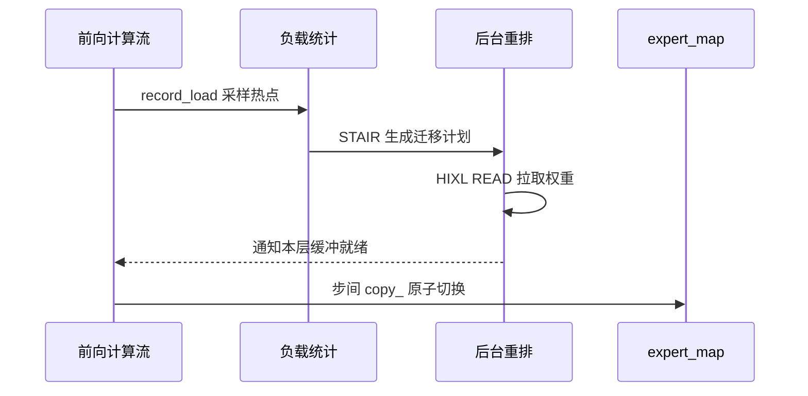

上一章完成了单卡分形布局与跨卡 KV 层并行，但把 MoE（Mixture of Experts，混合专家）大模型推向 $8$ 至 $64$ 卡昇腾集群时，通信与负载会立刻成为新瓶颈。主流推理引擎默认的 `TP`、`DP`、`PP` 与 `EP` 组无法直接满足硬件融合算子的排布约束。

具体矛盾集中在三处。第一，通算融合算子与非对称 PD 预填充需要专属的通信拓扑与缓冲规则。第二，路由分发在不同批大小与芯片代际下需要切换通信策略；第三，热点专家倾斜会拖慢分组矩阵乘，而在线迁移权重又不能阻塞前向集合通信。

## 为什么默认并行组不够用

在物理互联层，昇腾集群采用分级通信底座[^hiascend-hccl]。节点内依托 **HCCS（Huawei Cache Coherence System，华为高速片间互联）** 实现高带宽全互联。跨机参数面采用 200G/400G **RoCE（RDMA over Converged Ethernet，融合以太网无损转发）** 组网。A5 超节点则进一步引入 **Unified Bus（灵衢统一总线）** 统一编址。

在此之上，`init_ascend_model_parallel` 先将 `world_size` 塑形为五维网格 `[-1, DP, PP, PCP, TP]`[^parallel-state]。随后它切分出专属 **HCCL（Huawei Collective Communication Library，华为集合通信库）** 组与细粒度域，分组对照如图 1 所示[^kvpp-pg][^p-tp-pg][^fine-tp]。



- **专属子域**：覆盖 `DP × PCP × TP` 通算融合、KV 层广播、`pd_tp_ratio` 预填充与动态均衡队列[^parallel-state][^kvpp-pg][^p-tp-pg]。
- **细粒度与单卡**：细粒度域按模块在 `DP` 维切分[^fine-tp]；`ReplicatedGroup` 免除未开 TP 层的句柄开销[^replicated-group]。

## 通信后端与缓冲区陷阱

在设备通信器层，`NPUCommunicator` 继承了 vLLM 的通信基类，并挂入空实现的门面管理器以跳过仅适用于 CUDA 的容错检查[^npu-comm]。开启量化归约且组规模大于 $1$ 时，它的 `all_reduce` 会根据硬件代际自动分流到 INT8 的 `QuantizedAllReduce` 或 MXFP8 的 `Mxfp8AllReduce`。

当需要脱离 PyTorch `c10d` 进程组执行集合操作时，`PyHcclCommunicator` 通过 `ctypes` 直接封装底层动态库[^pyhccl]。

它在主节点生成唯一标识并广播给同组卡，随后调用 `hcclCommInitRank` 建立原生通信器。完成一次单元素 `all_reduce` 预热后，即可把原生 `hcclAllReduce` 与 `hcclBroadcast` 直接下发到 `aclrtStream_t`。

初始化这些 HCCL 通信组时，插件会通过 `create_hccl_pg_options` 注入缓冲大小配置[^hccl-pg-options]。然而 `get_hccl_config_for_pg_options` 藏着一条极其关键的旁路规则：

| 通信组名称               | 缓冲配置来源                  | 配置字节数              | 工程原因             |
| :----------------------- | :---------------------------- | :---------------------- | :------------------- |
| 默认通信组               | `get_default_buffer_config()` | $200\text{ MB}$         | 满足常规集合通信窗口 |
| `dp`                     | `calculate_dp_buffer_size()`  | 至少 $50\text{ MB}$     | 仅传批大小与状态标志 |
| `dynamic_eplb`           | 固定常量配置                  | $100\text{ MB}$         | 隔离点对点权重搬运   |
| `sleep_lifecycle_anchor` | 生命周期锚点配置              | $1\text{ MB}$           | 仅用于休眠唤醒同步   |
| 含 `mc2` 的组            | 显式返回 `None`               | 由 `HCCL_BUFFSIZE` 决定 | 避免通信空间对齐冲突 |

当组名包含 `"mc2"` 时，`get_hccl_config_for_pg_options` 必须返回 `None`[^mc2-bypass]。当前昇腾 `MC2（Matrix Computation and Communication，通算融合）` 算子内部直接依据环境变量 `HCCL_BUFFSIZE` 切分通信窗。如果再通过 `pg_options` 覆写缓冲大小，算子内部偏移会与实际分配产生内存错位，直接触发运行时错误。

## 四路 MoE 通信路径与通算融合

理解四路 MoE 通信实现之前，先看一个可手算的 $4$ 卡最小集群样例。设 `EP = 4`，全局共 $8$ 个逻辑专家，每张卡持有 $2$ 个本地专家。每个 token 选 `top_k = 2` 个专家，每卡当前输入 $B = 8$ 个 token，即每卡产生 $16$ 条路由激活。

若走 `AllGather` 路径，每张卡先把本卡 $8$ 个 token 广播并聚合成 $4 \times 8 = 32$ 个 token 的全量激活。本地算子再过滤出属于本卡 $2$ 个专家的条目参与计算，通信量随卡数线性放大。

若走 `AllToAllV` 或 `MC2` 点对点分发，每张卡只把路由目标在远程卡上的激活发送出去。在均衡负载下，每卡仅收发约 $16$ 条激活，彻底消除全集结带来的冗余数据。

`setup_moe_comm_method` 在初始化阶段注册了最多四套通信实现[^moe-comm-setup]，在执行期按数据规模与硬件代际切换。

全集结路径 `AllGatherCommImpl` 面向单卡 EP 或昇腾 310P 等兼容硬件。它调用 `npu_moe_init_routing` 完成重排与可选量化，计算后经 `npu_moe_token_unpermute` 恢复形状与加权[^ag-dispatcher]。

异步分发路径 `AlltoAllCommImpl` 面向超出融合算子容量的大批量或开启 LoRA 的场景。它借助锁页内存异步拷出 `input_splits` 与 `output_splits`，再通过 `async_all_to_all` 交换激活。每次 `wait()` 完成后，算子立刻调用 `.untyped_storage().resize_(0)` 释放临时显存[^a2a-dispatcher]。

通算重叠路径 `MC2CommImpl` 通过 `npu_moe_distribute_dispatch_v2` 与 `combine_v2` 重叠点对点通信与计算[^mc2-dispatcher]。跳过 DP 全归约时，调度器把 `global_bs` 设为上限容量并关闭掩码；否则保持 `global_bs = 0` 并传入掩码跳过空位。

单算子通算融合路径 `FusedMC2CommImpl` 在开启 `enable_fused_mc2 == 1` 时进一步把前向全链路融合进同一算子[^fused-mc2]。它底层对应 `dispatch_ffn_combine` 或 CANN `MegaMoe`，还能将共享专家一并内联到同一个 Kernel 内。

使用 CANN `MegaMoe` 时，所有 EP 卡必须在编译期使用完全一致的单卡上限 `num_max_tokens_per_rank` 申请对称缓冲[^mega-moe-symm]。一旦某张卡读取了动态批大小导致尺寸不一致，就会触发错误码 507057 并中止通信。休眠与恢复阶段还需先标记状态失效，待重建 MC2 组后重新绑定通道名并执行屏障同步[^mega-moe-refresh]。

上述四条 MoE 数据通路的阶段划分，以及后台 `EPLB（Expert Parallelism Load Balancer，专家并行负载均衡器）` 如何避开前向通信队列完成异步切换，如图 2 所示。


### 通信路径路由与缓冲区旁路

每次前向进入模型上下文时，`select_moe_comm_method` 会依据芯片画像 `HardwareProfile` 中的 `moe_comm_policy` 决策本步路径[^moe-selector]：

- **A2 策略**：未开融合且单卡专家不大于 $24$、EP 不小于 $16$、不超容量时选 `MC2`，否则回退 `AllGather`[^moe-policies]。
- **A3 策略**：优先走 `FusedMC2`（EP 不大于 $32$ 时），否则在容量上限内选 `MC2`，超限切入 `AllToAll`。
- **A5 策略**：先校验量化 `FusedMC2`，超限后依单卡专家与 `top_k` 分流[^moe-policies]。
- **310P 与 LoRA**：310P 固定走 `AllGather`；启用 `LoRA` 且 `EP > 1` 时强制走 `AllToAll`。

图 3 将上述路由选择逻辑与前文 `get_hccl_config_for_pg_options` 的缓冲区旁路判断串联起来，展示从调度选择到底层组配置的分支路径。



### 矩阵乘与 ReduceScatter 融合

除了 MoE 专家分发，行并行投影后紧跟序列并行 `ReduceScatter` 同样是通信热点。`MatmulReduceScatterFusionPass` 在 FX 阶段匹配裸矩阵乘以及末尾带 `cat` 或 `constant_pad_nd` 补零的模式[^mmrs-pass]。完整序列并行 MoE 图改写流如图 4 所示。


原生计算图先把大尺寸矩阵乘算完，再给输出拼接全零行。融合 Pass 则把零填充挪到无偏置矩阵乘的输入侧，仅对更窄的激活做 `constant_pad_nd`，然后统一替换为 `npu_mm_reduce_scatter_base`。

这一替换要求 `TP` 规模属于 `{2, 4, 8}` 且归约维度位于 `[256, 65535)`。

针对 Kimi 等模型的 `o_proj` 投影，`KimiOProjMMReduceScatterOp` 则直接调用 `npu_quant_mm_reduce_scatter`[^kimi-mmrs]。该算子支持 BF16 无量化输入并指定 `comm_mode="ai_cpu"`，可将融合的 `TP` 尺度扩展至 $64$ 卡。

## 异步动态 EPLB 与原子切换

回到 $4$ 卡 $8$ 专家例子：热点专家 $0$ 与 $1$ 集中在 `Rank 0` 承载 $90$ 个 token，最大均值比高达 $3.000$。`AscendEplbState` 将动态均衡拆成控制面、数据面与迁移面三条并行链路，官方双进程异步架构与步间原子切换时序分别如图 5 与图 6 所示[^mrv2-eplb-doc][^ascend-eplb-state]。




初始化阶段，补丁先把冗余副本按轮询交错铺到各卡防止初始倾斜[^eplb-init-map]。迁移线程经 `HIXL（Huawei Interconnect Xfer Library，华为跨卡单边传输库）` 或 Gloo 拉取权重大块[^explicit-transfer][^hixl-comm][^gloo-comm]。某层就绪后主线程在步间调用 `refresh_model_routing_tables` 以原地 `copy_` 刷新路由张量，保证 ACL Graph 指针有效[^eplb-commit]。

## 参考实现与负载均衡验证

下面一段纯 Python 参考脚本模拟了两条核心机制。前段对照不同昇腾芯片与批大小下的路由选择；后段复现前文 $4$ 卡 $8$ 专家的 $3$ 倍热点倾斜，在增加 $4$ 个冗余物理槽位（每卡 $3$ 槽且禁止同卡重复）后运行重排，打印重排前后的最大均值负载比。

```python
def select_moe_comm_method(policy, ep_size, num_tokens, mc2_cap, fused_mc2=False, lora=False, num_experts=64, topk=8):
    if ep_size <= 1 or policy == "ALLGATHER":
        return "ALLGATHER"
    if lora:
        return "ALLTOALL"
    if policy == "CAPACITY_AND_EXPERT_DENSITY":
        if fused_mc2 and ep_size <= 32:
            return "FUSED_MC2"
        if (num_experts // ep_size) <= 24 and ep_size >= 16 and num_tokens <= mc2_cap:
            return "MC2"
        return "ALLGATHER"
    if policy == "FUSED_OR_CAPACITY":
        if fused_mc2 and ep_size <= 32:
            return "FUSED_MC2"
        return "MC2" if num_tokens <= mc2_cap else "ALLTOALL"
    if policy == "CAPACITY_AND_WORLD_SIZE":
        if fused_mc2:
            return "FUSED_MC2"
        if num_tokens <= mc2_cap and ep_size > 1:
            return "MC2"
        return "ALLGATHER" if ep_size <= topk else "ALLTOALL"
    raise ValueError(f"Unknown policy: {policy}")

def rebalance_eplb(logical_loads, num_ranks, num_redundant):
    num_experts = len(logical_loads)
    total_slots = num_experts + num_redundant
    assert total_slots % num_ranks == 0
    slots_per_rank = total_slots // num_ranks
    replicas = [1] * num_experts
    for _ in range(num_redundant):
        hottest = max((e for e in range(num_experts) if replicas[e] < num_ranks), key=lambda e: logical_loads[e] / replicas[e])
        replicas[hottest] += 1
    items = [(logical_loads[eid] / rep, eid) for eid, rep in enumerate(replicas) for _ in range(rep)]
    items.sort(key=lambda x: x[0], reverse=True)
    rank_loads, rank_slots = [0.0] * num_ranks, [[] for _ in range(num_ranks)]
    for load, eid in items:
        cand = [r for r in range(num_ranks) if len(rank_slots[r]) < slots_per_rank and eid not in rank_slots[r]]
        dst = min(cand, key=lambda r: rank_loads[r])
        rank_slots[dst].append(eid)
        rank_loads[dst] += load
    return replicas, rank_slots, rank_loads

cases = [
    ("A2", "CAPACITY_AND_EXPERT_DENSITY", 16, 128, 512, False, False),
    ("A3", "FUSED_OR_CAPACITY", 16, 256, 512, True, False),
    ("A3-Large", "FUSED_OR_CAPACITY", 16, 1024, 512, False, False),
    ("A5-LoRA", "CAPACITY_AND_WORLD_SIZE", 16, 128, 512, True, True),
    ("310P", "ALLGATHER", 4, 64, 512, False, False),
]
for name, pol, ep, tok, cap, fused, lora in cases:
    print(f"{name}: {select_moe_comm_method(pol, ep, tok, cap, fused, lora)}")

loads = [72, 18, 5, 5, 5, 5, 5, 5]
before = [loads[0] + loads[1], loads[2] + loads[3], loads[4] + loads[5], loads[6] + loads[7]]
mean_load = sum(loads) / 4
ratio_before = max(before) / mean_load
replicas, slots, after = rebalance_eplb(loads, num_ranks=4, num_redundant=4)
ratio_after = max(after) / mean_load
print(f"before_ranks={before}, max_to_mean={ratio_before:.3f}")
print(f"replicas={replicas}")
print(f"after_slots={slots}, after_loads={[int(x) for x in after]}, max_to_mean={ratio_after:.3f}")
assert ratio_before == 3.0 and ratio_after < 1.1
```

执行上述脚本的真实标准输出如下：

```text
A2: MC2
A3: FUSED_MC2
A3-Large: ALLTOALL
A5-LoRA: ALLTOALL
310P: ALLGATHER
before_ranks=[90, 10, 10, 10], max_to_mean=3.000
replicas=[4, 2, 1, 1, 1, 1, 1, 1]
after_slots=[[0, 1, 6], [0, 1, 7], [0, 2, 4], [0, 3, 5]], after_loads=[32, 32, 28, 28], max_to_mean=1.067
```

从输出可以看到，为专家 $0$ 扩充到 $4$ 副本、为专家 $1$ 扩充到 $2$ 副本并错开铺到 $4$ 张卡后，单卡最高负载从 $90$ 降到 $32$，最大均值比从 $3.000$ 收敛至 $1.067$。

当实例内部的 HCCL 通信域、四路 MoE 调度与动态 EPLB 均衡全部理顺后，集群扩张的下一道关卡会转向 Prefill 与 Decode 池之间的跨节点状态搬运。下一章 [05 昇腾 PD 分离传输与分层 KV 缓存池](../05-mooncake-pd-and-kv-pool/) 将解析如何基于 Mooncake 与多级缓存池高效地跨节点迁移 KV Cache。

[^parallel-state]: `vllm-ascend@b776261`, `vllm_ascend/distributed/parallel_state.py:18-30,63-201`, `_MC2`, `_KVPP`, `_P_TP`, `_DYNAMIC_EPLB` 与 `init_ascend_model_parallel` (Apache-2.0).

[^kvpp-pg]: `vllm-ascend@b776261`, `vllm_ascend/distributed/parallel_state.py:138-151,298-300`, `_KVPP` 与 `get_kvpp_group` (Apache-2.0).

[^p-tp-pg]: `vllm-ascend@b776261`, `vllm_ascend/distributed/parallel_state.py:153-181,288-290`, `_P_TP` 与 `get_p_tp_group` (Apache-2.0).

[^fine-tp]: `vllm-ascend@b776261`, `vllm_ascend/distributed/parallel_state.py:203-247`, 五类细粒度模块 TP 组划分 (`otp` / `lmheadtp` / `emtp` / `mlptp` / `qkv_iproj_tp`) (Apache-2.0).

[^replicated-group]: `vllm-ascend@b776261`, `vllm_ascend/distributed/parallel_state.py:33-60,284-285`, `ReplicatedGroup` 规避 `hcclCommInitRootInfoConfig` 通信开销 (Apache-2.0).

[^npu-comm]: `vllm-ascend@b776261`, `vllm_ascend/distributed/device_communicators/npu_communicator.py:30-103`, `_NpuAll2AllManager` 与 `NPUCommunicator` 量化归约分发 (Apache-2.0).

[^pyhccl]: `vllm-ascend@b776261`, `vllm_ascend/distributed/device_communicators/pyhccl.py:37-185`, `PyHcclCommunicator` 基于 `hcclGetUniqueId` 与 `hcclCommInitRank` 的直接流发射 (Apache-2.0).

[^hccl-pg-options]: `vllm-ascend@b776261`, `vllm_ascend/utils.py:73-77,1294-1341` 与 `vllm_ascend/patch/worker/patch_distributed.py:160-170`, `create_hccl_pg_options` 缓冲大小策略 (Apache-2.0).

[^mc2-bypass]: `vllm-ascend@b776261`, `vllm_ascend/utils.py:1312-1316`, `get_hccl_config_for_pg_options` 对 `"mc2"` 组返回 `None` 以沿用 `HCCL_BUFFSIZE` 划分 (Apache-2.0).

[^moe-comm-setup]: `vllm-ascend@b776261`, `vllm_ascend/ops/fused_moe/moe_comm_method.py:68-75,201-274`, `setup_moe_comm_method` 与四路通信封装注册 (Apache-2.0).

[^ag-dispatcher]: `vllm-ascend@b776261`, `vllm_ascend/ops/fused_moe/token_dispatcher.py:357-470`, `TokenDispatcherWithAllGather` 与 `npu_moe_init_routing` / `npu_moe_token_unpermute` (Apache-2.0).

[^a2a-dispatcher]: `vllm-ascend@b776261`, `vllm_ascend/ops/fused_moe/token_dispatcher.py:473-639` 与 `vllm_ascend/ops/fused_moe/moe_utils.py:63-99`, `TokenDispatcherWithAll2AllV`、`async_all_to_all` 与 `.untyped_storage().resize_(0)` 显存释放 (Apache-2.0).

[^mc2-dispatcher]: `vllm-ascend@b776261`, `vllm_ascend/ops/fused_moe/token_dispatcher.py:110-355`, `TokenDispatcherWithMC2`、`global_bs` 分支与 `npu_moe_distribute_dispatch_v2` / `combine_v2` (Apache-2.0).

[^fused-mc2]: `vllm-ascend@b776261`, `vllm_ascend/ops/fused_moe/moe_comm_method.py:275-331,554-697`, `FusedMC2CommImpl`、`dispatch_ffn_combine` 与 `MegaMoe` 共享专家融合 (Apache-2.0).

[^mega-moe-symm]: `vllm-ascend@b776261`, `vllm_ascend/ops/fused_moe/moe_comm_method.py:384-480`, `_init_mega_moe_symm_buffer` 编译期秩不变容量约束 (Apache-2.0).

[^mega-moe-refresh]: `vllm-ascend@b776261`, `vllm_ascend/ops/fused_moe/moe_comm_method.py:333-382`, `prepare_hccl_teardown` 与 `refresh_hccl_runtime_state` (Apache-2.0).

[^moe-selector]: `vllm-ascend@b776261`, `vllm_ascend/ascend_forward_context.py:430-482`, `select_moe_comm_method` 路由入口与 LoRA 强制 `ALLTOALL` 分支 (Apache-2.0).

[^moe-policies]: `vllm-ascend@b776261`, `vllm_ascend/ascend_forward_context.py:342-427` 与 `vllm_ascend/device/hardware_profile.py:420-530`, `A2`/`A3`/`310P`/`A5` 的 `MoECommPolicy` 阈值分支 (Apache-2.0).

[^mmrs-pass]: `vllm-ascend@b776261`, `vllm_ascend/compilation/passes/mm_reduce_scatter_fusion_pass.py:24-300`, `MatmulReduceScatterFusionPass` 与三种融合模式替换 (Apache-2.0).

[^kimi-mmrs]: `vllm-ascend@b776261`, `vllm_ascend/ops/linear_op.py:175-236`, `KimiOProjMMReduceScatterOp` 与 `npu_quant_mm_reduce_scatter` (Apache-2.0).

[^mrv2-eplb-doc]: `vllm-ascend@b776261`, `docs/source/developer_guide/Design_Documents/model_runner_v2_eplb.md:1-210`, Model Runner V2 EPLB 控制面、数据面与迁移面架构设计 (Apache-2.0).

[^ascend-eplb-state]: `vllm-ascend@b776261`, `vllm_ascend/distributed/eplb/eplb_state.py:73-250,265-665`, `AscendEplbLayerState`、`AscendEplbState` 与物理到逻辑统计映射 (Apache-2.0).

[^eplb-init-map]: `vllm-ascend@b776261`, `vllm_ascend/patch/platform/patch_eplb.py:376-400`, `_build_distributed_initial_expert_map` 轮询分散冗余副本 (Apache-2.0).

[^explicit-transfer]: `vllm-ascend@b776261`, `vllm_ascend/distributed/eplb/explicit_transfer.py:15-144`, `stage_explicit_layer_transfer` 显式迁移计划暂存 (Apache-2.0).

[^hixl-comm]: `vllm-ascend@b776261`, `vllm_ascend/distributed/eplb/eplb_communicator.py:231-419,537-749`, `_HixlSession` 与 `AscendHixlEplbCommunicator` 单边 READ 传输 (Apache-2.0).

[^gloo-comm]: `vllm-ascend@b776261`, `vllm_ascend/distributed/eplb/eplb_communicator.py:108-228` 与 `vllm_ascend/patch/platform/patch_eplb.py:124-239`, `AscendGlooEplbCommunicator` 共识回退与 `FRACTAL_NZ` 重建 (Apache-2.0).

[^eplb-commit]: `vllm-ascend@b776261`, `vllm_ascend/patch/platform/patch_eplb.py:736-896`, `_move_changed_layer_to_workspace`、`_commit_ascend_maps_for_layer` 与 `_DeferredConsumedEvent` 原子提交边界 (Apache-2.0).

[^hiascend-hccl]: [华为昇腾 HCCL 开发指南](https://www.hiascend.com/)：基于 HCCS 节点内高速全互联与 RoCE 无损以太网的集合通信架构。
