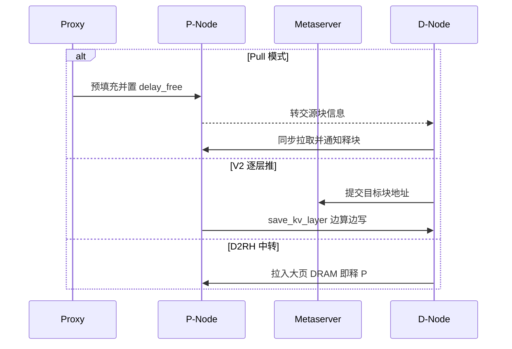
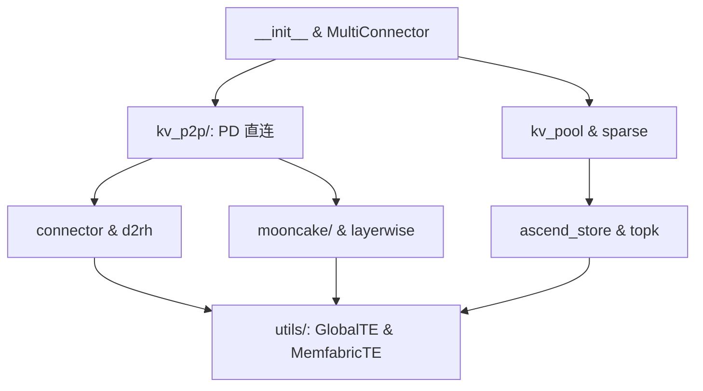

import MooncakePdFlowExplainer from './explainers/mooncake-pd-flow';

在[《vLLM 推理引擎》第 7 章](../../vllm/07-dp-coordination-and-kv-transfer/)中，通用 `KVConnectorBase_V1` 通过双角色钩子把 **PD（Prefill-Decode，预填充与解码）** 分离嵌入主循环。当这套抽象落地到大规模昇腾集群时，机间带宽、显存容量与异构拓扑会集中暴露出三道工程障碍。

首先是预填充节点的显存驻留过长。默认拉取路径下，Prefill 节点算完后必须锁定 **HBM（High Bandwidth Memory，高带宽显存）** 物理块，直到 Decode 节点完成排队并拉完数据才能释放，直接拉低并发上限。

其次是非对称并行切分与跨介质卸载。线上常给计算密集的 Prefill 分配更大 **TP（Tensor Parallelism，张量并行）**，这就要求跨机写入时精确对齐切片偏移。

同时，长上下文与抢占请求还需下沉至主机 **DRAM（Dynamic Random-Access Memory，动态随机存取内存）** 与 **SSD（Solid State Drive，固态硬盘）**。

这种跨介质分级才能在显存受限时保住 **TTFT（Time To First Token，首字延迟）** 与 **TPOT（Time Per Output Token，每输出 token 耗时）**。

## 从四层请求看三类传输模式

我们用同一条 $4$ 层请求对比三种昇腾 PD 传输方案。设一个请求经过 $4$ 层模型，每层 Prefill 计算耗时 $t_{\text{comp}} = 2.0\text{ ms}$，全层计算共 $8.0\text{ ms}$。

跨节点单层网络传输耗时 $t_{\text{net}} = 1.5\text{ ms}$，整批 $4$ 层传输为 $6.0\text{ ms}$。Decode 节点控制面路由耗时 $t_{\text{route}} = 0.5\text{ ms}$，主机到显存拷贝每层 $t_{\text{h2d}} = 1.0\text{ ms}$，首字解码耗时 $1.0\text{ ms}$。

- **常规拉取模式**：P 节点算完锁定 HBM，待 D 节点拉完 $6.0\text{ ms}$ 才解锁，P 端持块 $14.5\text{ ms}$。
- **逐层推送模式**：D 节点先预分配，P 节点每算完一层即推写，与后续计算重叠，P 端持块降至 $9.5\text{ ms}$。
- **远端主机中转**：若 D 端 HBM 排队拥堵 $3.0\text{ ms}$，第一跳入驻 D 端内存后即解锁 P 端，持块守在 $14.5\text{ ms}$。

若后续请求命中 D 端主机缓存，整个 P 节点计算与跨机拉取都会被跳过，仅剩 $4.0\text{ ms}$ 本地加载与 $1.0\text{ ms}$ 解码。图 1 以同一条 $4$ 层请求为例，按时间步对比三类模式在代理、源显存、主机内存与目标显存之间的流转。

<MooncakePdFlowExplainer client:visible title="图 1：Mooncake PD 分离四模式时序对比" />

## Mooncake 三种 PD 传输机制

`vllm-ascend` 在 KV 传输入口挂接了三套 Mooncake 连接器，在调度方向、释放时机与适用前提上各不相同[^ascend-pd-design][^ascend-kv-register]。控制面与数据面握手时序如图 2 所示。



| 连接器类名                | 传输方向与粒度            | P 端 HBM 释放条件             | 关键约束与工程收益                                    |
| :------------------------ | :------------------------ | :---------------------------- | :---------------------------------------------------- |
| `MooncakeConnector`       | D 端按请求拉取            | 收到 `DONE_RECVING_MSG` 通知  | 默认稳健路径，P 无需预知 D 地址[^mooncake-pull-sched] |
| `MooncakeConnectorV2`     | P 端逐层推送              | 步末 `wait_for_save` 排空即释 | 传输计算重叠，需启用分段图[^mooncake-v2-push]         |
| `MooncakeD2RHConnectorV1` | 两跳 `P HBM→D DRAM→D HBM` | 第一跳入驻 D 端 DRAM 即释放   | 隔离 D 端显存拥堵并支持主机前缀命中[^mooncake-d2rh]   |

`MooncakeConnector` 在 D 端阻塞等待直到同步读取完成再解锁 P 端[^mooncake-pull-sched][^mooncake-pull-worker]。`MooncakeConnectorV2` 则先由 D 端提交目标地址至元服务器，P 端逐层写出后立刻释块[^mooncake-v2-push]。面对 D 端拥堵，D2RH 的 10 步两跳流转如图 3 所示：先拉入大页内存并按 `HostCacheKey` 复用前缀，释放 P 端后再回写 HBM[^mooncake-d2rh]。


## 非对称 TP 映射与底层传输引擎

集群部署常将 Prefill 并行度设得高于 Decode，以用更大算力组压低首字延迟。昇腾配置校验规定 `P_tp >= D_tp` 且满足整除约束 $P_{\text{tp}} \bmod D_{\text{tp}} = 0$，并据此推导出三项拓扑参数[^ascend-pd-design][^ascend-pd-ratio]：

$$\text{pd\_tp\_ratio} = \frac{P_{\text{tp}}}{D_{\text{tp}}}, \quad \text{num\_head\_replica} = \max\left(1,\; \left\lfloor \frac{P_{\text{tp}}}{H_{\text{kv}}} \right\rfloor\right), \quad \text{pd\_head\_ratio} = \frac{\min(P_{\text{tp}}, H_{\text{kv}})}{\min(D_{\text{tp}}, H_{\text{kv}})}$$

其中 $H_{\text{kv}}$ 为模型 KV 头总数[^ascend-pd-ratio]。以 $P_{\text{tp}} = 8$ 对 $D_{\text{tp}} = 4$ 为例，两种典型注意力架构对应截然不同的切片路由逻辑，如图 4 上半部分所示。


在 **GQA（Grouped-Query Attention，分组查询注意力）** 场景下，设 $H_{\text{kv}} = 8$，此时每张 P 卡独占 $1$ 个 KV 头且无冗余副本。切分比例 $\text{pd\_head\_ratio} = 2$，D 端第 $i$ 号卡会同时对接 P 端第 $2i$ 与 $2i + 1$ 号卡，将两路切片按头偏移拼进同一物理块[^mooncake-layerwise][^mooncake-pull-worker]。

而在 **MLA（Multi-Head Latent Attention，多头潜在注意力）** 或稀疏注意力场景下，潜在缓存仅 $1$ 个头，P 端 $8$ 张卡保存完全相同的副本[^mooncake-pull-worker]。调度路由按请求哈希在冗余副本组中抽样选出 $4$ 张源 P 卡，令每张 D 卡仅拉取 $1$ 份，既消除冗余流量又避免单卡带宽瓶颈[^mooncake-pull-worker]。

在底层数据搬运层面，`vllm-ascend` 同时维护两套进程级传输引擎单例[^transfer-engines]。`GlobalTE` 负责注册 `ascend` 通道，在超节点与跨机场景下承载 **HCCS** 与 **RDMA** 读写。

另一条路径由 `GlobalMemfabricTE` 显式选路，不再依赖运行期探测硬件家族[^transfer-engines]。A3 集群通过配置走 **SDMA（System Direct Memory Access，系统直接内存访问）** 或设备 RDMA。950PR 与 950DT 机型则走 **URMA（Unified Remote Memory Access，灵衢统一远端内存访问）**。

`MemFabric` 要求 PD 双方保持协议一致，从而稳定支撑后续稀疏远程直传等新型数据面[^ascend-sparse-doc][^transfer-engines]。

## 分层 KV 缓存池与稀疏卸载

仅靠节点间 P2P 传输无法复用历史会话或承接溢出请求，因此 `vllm-ascend` 在 HBM 之下构建了面向主机 DRAM 与分布式存储池的三层分层体系，如图 4 下半部分与图 5 所示。

首先是全局共享池 `AscendStoreConnector`，它在早期的 `MooncakeStore` 接入之上扩展出多后端与逐层缓存复用[^ascend-kv-pool-doc][^ascend-store]。启用逐层卸载后，`LayerwiseCachePlanner` 把 $N$ 个逻辑层映射到 $I$ 个独立驻留层与 $B$ 块共享物理缓冲上[^ascend-sparse-doc][^ascend-store]：

$$N_{\text{buf}} = I + \min(B,\; N - I)$$

Prefill 阶段只需保留少量物理页轮转使用，计算第 $l$ 层时异步把第 $l-1$ 层存入 `Memcache` 池并 Prefetch 第 $l+1$ 层（图 5）[^ascend-sparse-doc]。当 `AscendStore` 通过 `AscendMultiConnector` 与远程 D2H 混用时，物理槽位必须等待存储写入与远端读取两项完成事件均就绪后才能覆写[^ascend-sparse-doc][^mooncake-v2-push]。


其次是面向单机突发拥塞的 `PreemptOffloadConnectorV1`[^preempt-offload]。传统调度在显存不足时直接驱逐抢占请求并丢弃缓存，恢复时只能重算整段提示词；该连接器在抢占发生前截留物理块，按每卡配额异步批量卸载至本机固定 CPU 内存，并支持可选的卸载前缀复用[^preempt-offload]。

最后针对超长序列的 **SFA（Sparse Flash Attention，稀疏 FlashAttention）** 与 MLA 解码阶段，全层同步加载会拖垮低计算密度的解码步[^ascend-sparse-doc]。为此，`sparse_kv_offload` 将全量 BF16 主键值历史留在已注册的 Host DRAM，仅在 NPU HBM 保留量化索引缓存与每层热 `Top-k` 槽位缓冲[^ascend-sparse-doc][^sparse-kv-offload]。

解码前向中，索引器选出重要位置后由 **LRU（Least Recently Used，最近最少使用淘汰策略）** 驻留表筛选未命中槽位，仅把缺失行拷贝回显存并交由融合算子完成读取[^ascend-sparse-doc]。`copy_sfa_topk_slots` 则以单调递增代际编号管理请求独占槽位，防止流水线并发复用时读到前任请求的残留数据[^sparse-kv-offload]。

## PD 传输与缓存池源码目录结构

`vllm-ascend@b776261` 将所有昇腾侧 KV 传输、主机缓存池与稀疏卸载实现统一收拢在 `vllm_ascend/distributed/kv_transfer/` 目录下。所有连接器由入口函数 `register_connector` 统一注册，并在外层通过 `ascend_multi_connector.py` 组合多路后端[^ascend-kv-register][^ascend-kv-pool-doc]：

```text
vllm_ascend/distributed/kv_transfer/
├── __init__.py                        # register_connector 统一注册 PD 与缓存池连接器
├── ascend_multi_connector.py          # MultiConnector 组合 PD 与 Host 存储池
├── utils/                             # 公共 RDMA / 大页传输引擎封装
│   ├── mooncake_transfer_engine.py    # GlobalTE（Mooncake TransferEngine 单例封装）
│   └── memfabric_transfer_engine.py   # GlobalMemfabricTE 与 TransDataOpType
├── kv_p2p/                            # PD 分离实例间点对点传输
│   ├── mooncake_connector.py          # Pull 模式主实现与非对称 TP 源卡映射
│   ├── mooncake_layerwise_connector.py# 逐层前向异步推写与字节偏移路由
│   ├── mooncake_d2rh_connector.py     # 先拉入 2 MiB 大页 DRAM 的两跳中转与前缀复用
│   ├── mooncake/                      # V2 Push 架构（base / pull / push_scheduler & worker）
│   └── sfa_pd_rd2h/                   # 稀疏注意力专用 RD2H 点对点传输通道
├── kv_pool/                           # 节点外与抢占分层缓存池
│   ├── ascend_store/                  # L1/L2/L3 分层存储池调度与层并行规划
│   └── kv_offload/preempt_offload/    # 抢占前拦截卸载至本机 DRAM 的连接器
└── sparse_kv_offload/                 # 超长序列 SFA/MLA 解码的热槽按需回迁
    ├── copy_sfa_topk_slots.py         # 带代际隔离的 Top-k 槽位拷贝状态管理
    └── sparse_kv_offload_manager.py   # 主机全量历史与 NPU 热缓冲协同管理
```

图 6 展示了该目录下四层模块的组合与底座复用关系：



按实际部署诉求排查或扩展连接器时，只需沿三组定位入口查找。`kv_p2p/` 负责 P 节点与 D 节点之间的直连或大页中转。其中的非对称 TP 计算集中在 `mooncake_connector.py` 与 `mooncake_layerwise_connector.py`。`kv_pool/` 解决跨请求多级前缀池与抢占卸载，底层网卡注册与 RDMA 单例则全部沉在 `utils/` 内[^transfer-engines]。

贯通集群级跨机通信、PD 分离传输与分层缓存池之后，下一层工程瓶颈落回模型算子与运行态精度上。如何在昇腾上落地 `ModelSlim` 低比特量化、用 Triton 或 AscendC 编写自定义融合算子，以及如何定位设备异步报错，下一篇[06 量化、自定义算子开发与昇腾排障](../06-quantization-custom-ops-and-tuning/)将展开这部分实践。

[^ascend-pd-design]: `vllm-ascend@b776261` 设计文档 `docs/source/developer_guide/Design_Documents/disaggregated_prefill.md`（L17–L189，L240–L242，Apache-2.0 协议）及 [vLLM Ascend PD 分离指南](https://vllm-ascend.readthedocs.io/en/latest/user_guide/feature_guide/epd_disaggregation.html)。

[^ascend-kv-register]: `vllm-ascend@b776261` 文件 `vllm_ascend/distributed/kv_transfer/__init__.py`（L57–L162，`register_connector` 统一注册全部 PD 与缓存池连接器）。

[^mooncake-pull-sched]: `vllm-ascend@b776261` 文件 `vllm_ascend/distributed/kv_transfer/kv_p2p/mooncake_connector.py`（L1953–L2100，`get_num_new_matched_tokens` 与 `request_finished`）及 `kv_p2p/mooncake/pull_scheduler.py`（L605–L645）。

[^mooncake-pull-worker]: `vllm-ascend@b776261` 文件 `vllm_ascend/distributed/kv_transfer/kv_p2p/mooncake_connector.py`（L1020–L1073，`batch_transfer_sync_read`；L4173–L4338，`_get_remote_ranks_for_req` 与 `_get_remote_tp_ranks` 非对称 TP 路由）。

[^mooncake-v2-push]: `vllm-ascend@b776261` 文件 `vllm_ascend/distributed/kv_transfer/kv_p2p/mooncake/connector.py`（L260–L337，`MooncakePushConnector` 与 `MooncakeConnectorV2`）、`push_scheduler.py`（L81–L238，`metaserver_client` 与 `request_finished`）及 `push_worker.py`（L871–L949，`save_kv_layer` 与 `wait_for_save`）。

[^mooncake-d2rh]: `vllm-ascend@b776261` 文件 `vllm_ascend/distributed/kv_transfer/kv_p2p/mooncake_d2rh_connector.py`（L79–L86，`HUGEPAGE_SIZE_2M` 与 `HostCacheKey`；L1666–L1736，两跳释放与 H2D 锁；L1815–L1881，`_d2rh_prefix_fingerprint`）。

[^ascend-pd-ratio]: `vllm-ascend@b776261` 文件 `vllm_ascend/ascend_config.py`（L988–L1007，`pd_tp_ratio`、`num_head_replica` 与 `pd_head_ratio` 推导）。

[^mooncake-layerwise]: `vllm-ascend@b776261` 文件 `vllm_ascend/distributed/kv_transfer/kv_p2p/mooncake_layerwise_connector.py`（L473–L560，非对称 TP 字节偏移公式与写出流水）。

[^transfer-engines]: `vllm-ascend@b776261` 文件 `vllm_ascend/distributed/kv_transfer/utils/mooncake_transfer_engine.py`（L4–L90，`GlobalTE`）及 `utils/memfabric_transfer_engine.py`（L16–L160，`GlobalMemfabricTE` 与 `TransDataOpType`）。

[^ascend-sparse-doc]: `vllm-ascend@b776261` 设计文档 `docs/source/developer_guide/Design_Documents/layerwise_and_sparse_kv_cache_offloading.md`（L19–L320，逐层预填充复用与稀疏解码卸载设计）。

[^ascend-kv-pool-doc]: `vllm-ascend@b776261` 设计文档 `docs/source/developer_guide/Design_Documents/KV_Cache_Pool_Guide.md`（L11–L91，`KV Cache Pool` 与 `MultiConnector` 协同架构）。

[^ascend-store]: `vllm-ascend@b776261` 文件 `vllm_ascend/distributed/kv_transfer/kv_pool/ascend_store/ascend_store_connector.py`（L157–L248）及 `layerwise/cache_planner.py`（L83–L180，`LayerwiseCachePlanner`）。

[^preempt-offload]: `vllm-ascend@b776261` 文件 `vllm_ascend/distributed/kv_transfer/kv_pool/kv_offload/preempt_offload/preempt_offload_connector.py`（L41–L200）及 `manager.py`（L61–L100）。

[^sparse-kv-offload]: `vllm-ascend@b776261` 文件 `vllm_ascend/distributed/kv_transfer/sparse_kv_offload/copy_sfa_topk_slots.py`（L15–L160，`CopySfaRequestStates`）及 `sparse_kv_offload_manager.py`（L37–L159）。
