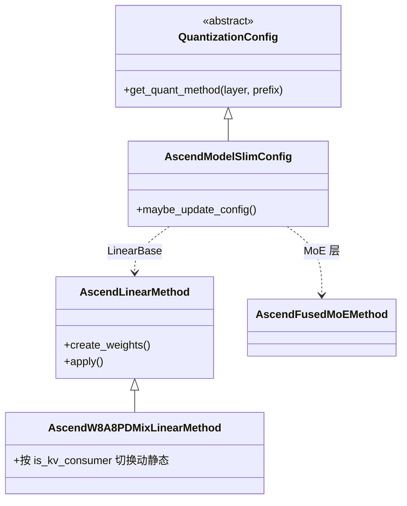
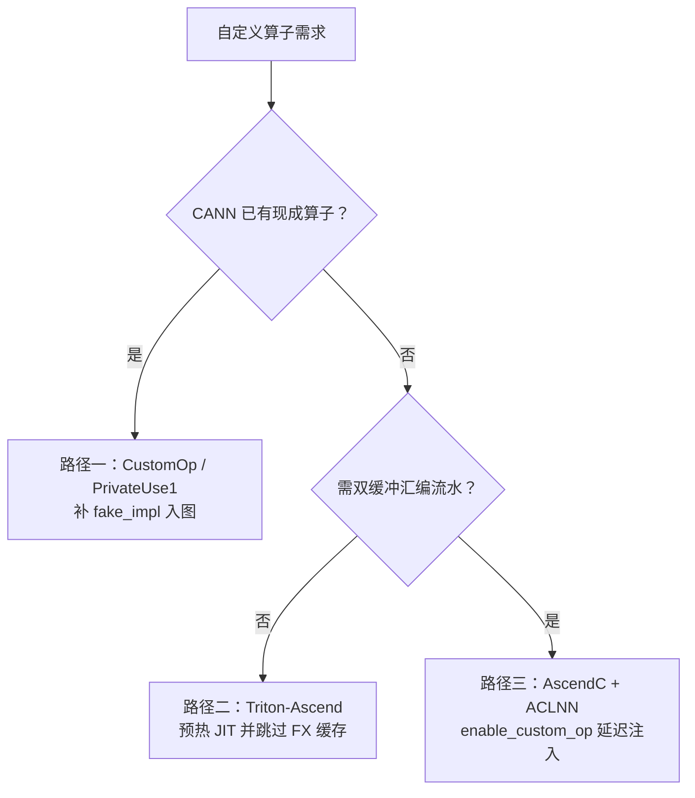
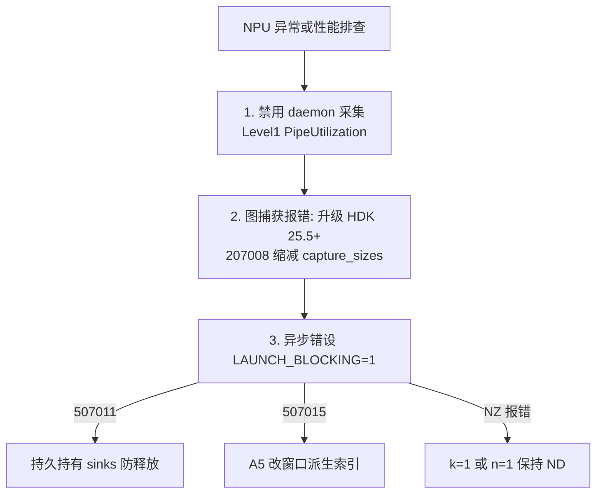

把全新模型或刚完成量化的权重部署到华为昇腾 NPU 生产环境时，工程团队很快会遇到三类实际阻滞。ModelSlim 权重文件里的融合分片名称一旦对不上就会加载报错，新增融合算子若不按规矩注册就会把计算图切碎。

运行期冒出的 207008、507011 等异步错误码，在默认执行流下也很难直接回溯到出错算子。本篇把量化适配、自定义算子开发与生产排障三条落地路径串起来。

我们先用一组 $4$ 维小向量算清量化路由与数值收益。随后拆解自定义算子接入静态计算图 **ACLGraph（Ascend Compute Language Graph，昇腾静态计算图）** 的三条路径，并给出性能采集与故障定位方案。

## 一个微型案例：从量化点积到算子分级

我们用同一个 $4$ 维向量点积案例，把 ModelSlim 动静态切换收益与三层算子路由固定下来。设某一线性层输入激活为 $x = [1.2, -0.8, 0.5, -1.5]$，单行权重为 $w = [0.6, -0.4, 0.2, 0.8]$，浮点精确点积为 $-0.06$。

把权重按 `Per-Channel` 对称量化到 `int8`，最大绝对值 $0.8$ 对应缩放因子 $s_w = 0.8 / 127 \approx 0.006299$。由此得到整数权重 $w_q = [95, -63, 32, 127]$。

若走静态 `W8A8`，激活沿用离线校准尺度 $s_{x,\text{static}} = 0.0157$，量化后为 $x_q = [76, -51, 32, -96]$。按整数点积反量化后，静态路径输出为 $(-735) \times 0.0157 \times s_w \approx -0.072690$。

若把同一输入切到动态 per-token 量化，当前 token 现算尺度为 $s_{x,\text{dyn}} = 1.5 / 127 \approx 0.011811$。整数向量变为 $[102, -68, 42, -127]$，反量化结果收敛到 $-0.060339$。

以 **SQNR（Signal-to-Quantization-Noise Ratio，信号量化噪声比）** 衡量，$10\log_{10}(\sum r^2 / \sum (r-\hat{r})^2)$ 从静态 $13.49\text{ dB}$ 跃升至动态 $44.97\text{ dB}$。这就是 `W8A8_MIX` 在 Prefill 保留动态、Decode 切回静态的数值依据。

图 1 上半部分展示自定义算子进入 `PrivateUse1` 分发与静态图捕获的三条路径，下半部分展示 `AscendModelSlimConfig` 如何完成层级路由。


## ModelSlim 量化配置与层级路由

传入量化参数后，`AscendModelSlimConfig` 读取目录下的 `quant_model_description.json` 接管配置[^modelslim-cfg][^modelslim-doc]。官方支持的七类量化算法与对应实现类映射如图 2 所示，类层次设计如图 3 所示。




构造每层时，`get_quant_method` 先用 `apply_vllm_mapper()` 映射层名并展开分片校验一致性。随后它经 `@register_scheme` 派发方法，并按序执行创建、后处理与前向三个钩子[^modelslim-cfg][^quant-registry]。

| 方案标识          | 权重与激活精度  | 缩放粒度                       | 工程取舍与适用阶段                                                                                        |
| :---------------- | :-------------- | :----------------------------- | :-------------------------------------------------------------------------------------------------------- |
| `W8A8`            | `INT8` / `INT8` | Per-Channel + 静态 Per-Tensor  | 免除在线激活归约，适合高并发低时延稳态服务[^w8a8-schemes]                                                 |
| `W8A8_DYNAMIC`    | `INT8` / `INT8` | Per-Channel + 动态 Per-Token   | 逐 token 现场计算极大值与尺度，适合激活离群波动大的模型[^w8a8-schemes]                                    |
| `W8A8_MIX`        | `INT8` / `INT8` | Prefill 动态 + Decode 静态     | **PD 分离混合量化**：P 节点动态保精度，D 节点（`is_kv_consumer`）复用静态参数降开销[^w8a8-schemes]        |
| `MXFP8` / `MXFP4` | `FP8` / `FP4`   | 每 $32$ 元素共享 `E8M0` 块尺度 | 仅限昇腾 A5（Ascend 950）硬件执行，由 `require_mx_weight_format()` 在加载期拦截 A2/A3 误配[^mxfp-schemes] |

在 `W8A8_MIX` 中，`AscendW8A8PDMixLinearMethod` 同时持有两套线性方案[^w8a8-schemes]。它统一按静态权重声明参数，并在前向 `apply()` 时按 `layer.is_kv_consumer` 切换路径。

## 昇腾自定义算子开发的三条路径

当模型引入上游未覆盖的融合计算时，三条开发路径按开发成本与硬件控制粒度自轻向重排列，路由决策如图 4 所示：



- **路径一：封装现有算子**。通过 `CustomOp.register_oot` 或 `direct_register_custom_op` 绑定 `PrivateUse1` 与 `fake_impl` 入图[^oot-ops]。
- **路径二：Triton-Ascend**。用 `AscendTritonJitKernel` 预热变体并留 UB 余量；含 Triton 包装节点时跳过 FX 缓存[^triton-warmup][^fx-cache-skip]，详见[执行图第 7 章](../../execgraph/07-acl-graph-fullstack-and-vllm-ascend/)。
- **路径三：AscendC + ACLNN**。在 `csrc/` 绑定 `torch::kPrivateUse1` 与 `Meta` 推导，调 `enable_custom_op()` 延迟注入路径防锁死可见设备[^aclnn-custom][^enable-custom-op][^hiascend-ascendc]。

## 昇腾性能剖析与常见陷阱排障

算子与量化链路就绪后，线上调优与排错依赖三件核心工具：`TorchNPUProfilerWrapper` 性能采样器、`AscendAsyncOutput` 异步守卫，以及配合阻塞开关的错误码二分排查法[^hiascend-msprof]。

性能采样方面，`TorchNPUProfilerWrapper` 默认开启 `ProfilerLevel.Level1` 与 `AiCMetrics.PipeUtilization`[^npu-profiler]。它用于导出 Cube、Vector 与 **MTE（Memory Transfer Engine，数据搬运引擎）** 利用率，从而区分算力瓶颈与搬运瓶颈[^npu-profiler]。

配置采样器有两处常见陷阱。第一，`additional_config.msmonitor_use_daemon` 不能与 `torch` 分析器同时开启，源码会直接抛出运行时异常[^npu-profiler]。第二，`torch_profiler_with_stack` 在底层映射为 `with_modules`，开启后会引入显著主机开销并扭曲耗时分布[^npu-profiler]。

运行观测方面，异步调度下采样张量在拷贝回主机前带有填充占位。`AscendAsyncOutput` 会包住原始 `AsyncOutput`，将 `check_after_sample` 推迟到 `get_output()` 裁剪完成之后执行[^async-guard-print]。

若要在静态图捕获与重放期间打印设备侧张量，可调用 `register_device_print()` 与 `device_print(tensor)`[^async-guard-print]。该工具将打印注册为有序副作用算子并保留载荷指针以适配重放，但切忌在高频热循环中使用或传入主机格式化字符串[^async-guard-print]。

遇到底层报错时，可按图 5 的决策树先区分采集失真、静态图捕获失败与运行期异步崩溃三类场景。



下表汇总了 `vllm-ascend` 源码中显式拦截的五大高频报错签名与对应解法：

| 错误码 / 签名              | 触发根因                                                                                    | 源码定位与处置方式                                                                        |
| :------------------------- | :------------------------------------------------------------------------------------------ | :---------------------------------------------------------------------------------------- |
| `alloc sq cq fail`         | 旧版 Ascend HDK 驱动或 CANN 栈不兼容新图捕获接口                                            | `acl_graph.py` 明确拦截并提示升级 HDK 至 `25.5.1` 及以上匹配版本[^acl-graph-errs]         |
| 207008                     | 静态图分桶过多，超出硬件物理 **SQ/CQ（Submission / Completion Queue，提交/完成队列）** 配额 | 减少 `cudagraph_capture_sizes` 档位数量或缩小最大捕获批量[^acl-graph-errs]                |
| 507011                     | 算子内分配临时张量，ACLGraph 捕获后重放读取已释放地址（UAF）                                | 如 `SparseFlashMla` 强制要求调用方持久持有 `sinks` 张量[^sfa-mla-traps]                   |
| 507015                     | A5 上 DSpark Draft 解码传入物理 `ori_sparse_indices` 或向量指令未对齐                       | 解码借用模式丢弃冗余索引并由窗口推导；排错时加 `ASCEND_LAUNCH_BLOCKING=1`[^sfa-mla-traps] |
| `aclnnMatmulWeightNZ` 失败 | 矩阵归约维或输出维退化为单元素（$k = 1$ 或 $n = 1$）                                        | 工具函数主动跳过 `FRACTAL_NZ` 转换，保留 `ND` 格式走通用矩阵路径[^nz-singleton]           |

## 参考实现：ModelSlim 路由与算子能力解析

下面这段仅依赖 Python 标准库的参考实现，同时复现了本章开头的量化点积 SQNR 对比、`W8A8_MIX` 动静态前缀路由校验，以及三级自定义算子的能力分发逻辑。

```python
import math


def quantize_sym_int8(vec, scale=None):
    if scale is None:
        max_abs = max(abs(v) for v in vec)
        scale = max_abs / 127.0 if max_abs > 0 else 1.0
    q = [max(-128, min(127, round(v / scale))) for v in vec]
    return q, scale


def sqnr_db(ref, approx):
    sig = sum(r * r for r in ref)
    err = sum((r - a) ** 2 for r, a in zip(ref, approx))
    return 10.0 * math.log10(sig / err) if err > 0 else float("inf")


def route_modelslim(prefix, quant_desc, packed_map, is_kv_consumer):
    proj = prefix.rsplit(".", 1)[-1]
    if proj in packed_map:
        base = prefix[: -len(proj)]
        shards = {quant_desc[f"{base}{s}"] for s in packed_map[proj]}
        if len(shards) != 1:
            raise ValueError(f"Mixed quant types in {prefix}: {shards}")
        qtype = next(iter(shards))
    else:
        qtype = quant_desc.get(prefix, "FLOAT")
    if qtype == "FLOAT":
        return "Unquantized"
    if qtype == "W8A8_MIX":
        return "W8A8_Static(Decode)" if is_kv_consumer else "W8A8_Dynamic(Prefill)"
    return qtype


def resolve_custom_op(op_name, npu_ops, triton_ops, ascendc_ops, eager_mode):
    if op_name in npu_ops:
        return ("Path1:torch_npu", "PrivateUse1+Graph")
    if op_name in triton_ops:
        mode = "Warmup+Eager" if eager_mode else "Warmup+NoFXCache"
        return ("Path2:Triton-bishengir", mode)
    if op_name in ascendc_ops:
        return ("Path3:AscendC(_C_ascend)", "ASCEND_CUSTOM_OPP_PATH+Meta")
    return ("Fallback:PyTorch", "Eager")


x = [1.2, -0.8, 0.5, -1.5]
w = [0.6, -0.4, 0.2, 0.8]
ref_dot = sum(a * b for a, b in zip(x, w))
wq, sw = quantize_sym_int8(w)
xq_st, sx_st = quantize_sym_int8(x, scale=0.0157)
xq_dy, sx_dy = quantize_sym_int8(x)
dot_st = sum(a * b for a, b in zip(xq_st, wq)) * sx_st * sw
dot_dy = sum(a * b for a, b in zip(xq_dy, wq)) * sx_dy * sw
print(f"xq_st={xq_st} xq_dy={xq_dy} wq={wq}")
print(f"ref={ref_dot:.6f} static={dot_st:.6f} dynamic={dot_dy:.6f}")
print(f"sqnr_static={sqnr_db([ref_dot], [dot_st]):.2f}dB sqnr_dynamic={sqnr_db([ref_dot], [dot_dy]):.2f}dB")

qdesc = {
    "model.layers.0.self_attn.q_proj": "W8A8_MIX",
    "model.layers.0.self_attn.k_proj": "W8A8_MIX",
    "model.layers.0.self_attn.v_proj": "W8A8_MIX",
    "model.layers.0.mlp.gate": "FLOAT",
    "model.layers.0.mlp.experts": "W4A4_MXFP4",
}
packed = {"qkv_proj": ["q_proj", "k_proj", "v_proj"]}
for p in ["model.layers.0.self_attn.qkv_proj", "model.layers.0.mlp.gate", "model.layers.0.mlp.experts"]:
    print(f"{p}: P->{route_modelslim(p, qdesc, packed, False)} | D->{route_modelslim(p, qdesc, packed, True)}")

for op in ["npu_rms_norm", "triton_q_rms", "npu_swiglu_group_quant"]:
    print(f"{op} -> {resolve_custom_op(op, {'npu_rms_norm'}, {'triton_q_rms'}, {'npu_swiglu_group_quant'}, False)}")
```

实际运行上述脚本，标准输出如下：

```text
xq_st=[76, -51, 32, -96] xq_dy=[102, -68, 42, -127] wq=[95, -63, 32, 127]
ref=-0.060000 static=-0.072690 dynamic=-0.060339
sqnr_static=13.49dB sqnr_dynamic=44.97dB
model.layers.0.self_attn.qkv_proj: P->W8A8_Dynamic(Prefill) | D->W8A8_Static(Decode)
model.layers.0.mlp.gate: P->Unquantized | D->Unquantized
model.layers.0.mlp.experts: P->W4A4_MXFP4 | D->W4A4_MXFP4
npu_rms_norm -> ('Path1:torch_npu', 'PrivateUse1+Graph')
triton_q_rms -> ('Path2:Triton-bishengir', 'Warmup+NoFXCache')
npu_swiglu_group_quant -> ('Path3:AscendC(_C_ascend)', 'ASCEND_CUSTOM_OPP_PATH+Meta')
```

前六章从 OOT 插件边界、硬件抽象、分形缓存、通算融合、Mooncake PD 一直梳理到量化与自定义算子排障。真正上线时，这些硬件特性究竟要靠哪些 `--additional-config` 开关与底层环境变量启动？终章[07 昇腾启动配置、扩展参数与环境变量](../07-ascend-launch-config-and-env/)将给出完整参数表与部署模板。

如需继续追踪通用引擎调度逻辑或底层图运行时捕获机制，可对照[《vLLM 推理引擎：架构与核心组件》](../../vllm/)与[《推理执行图：CUDA Graph 与 ACL Graph》](../../execgraph/)。

[^modelslim-cfg]: `vllm-project/vllm-ascend@b776261`（Apache-2.0），`vllm_ascend/quantization/configs/modelslim_config.py:169-235, 382-496, 817-941, 1048-1088`（`AscendModelSlimConfig`、`UPDATED_PACKED_MODULES_MAPPING`、`get_quant_type_for_layer` 与 `get_quant_method`）。

[^modelslim-doc]: `vllm-project/vllm-ascend@b776261`，`docs/source/developer_guide/Design_Documents/quantization.md:9-91`（ModelSlim 接入流程与 `quant_model_description.json` 规范）。

[^quant-registry]: `vllm-project/vllm-ascend@b776261`，`vllm_ascend/quantization/methods/registry.py:24-62`（`register_scheme` 装饰器与方案查表）。

[^w8a8-schemes]: `vllm-project/vllm-ascend@b776261`，`vllm_ascend/quantization/methods/w8a8/w8a8_static.py:33-40`、`w8a8_dynamic.py:60` 与 `w8a8_pdmix.py:36-89`（`AscendW8A8PDMixLinearMethod`）。

[^mxfp-schemes]: `vllm-project/vllm-ascend@b776261`，`vllm_ascend/quantization/quant_parser.py:5-31`、`methods/base.py:78-94`、`w8a8_mxfp8.py:57-80` 与 `w4a4_mxfp4.py:74-80`（`require_mx_weight_format` 与 A5 微缩放格式）。

[^oot-ops]: `vllm-project/vllm-ascend@b776261`，`vllm_ascend/ops/fused_rms_norm_gated.py:20-37`、`vllm_ascend/ops/activation.py:37-40` 与 `vllm_ascend/ops/register_custom_ops.py:252-306`（`CustomOp.register_oot` 与 `direct_register_custom_op`）。

[^triton-warmup]: `vllm-project/vllm-ascend@b776261`，`docs/source/developer_guide/Design_Documents/triton_jit_warmup.md:19-86`、`vllm_ascend/ops/triton/ascend_jit_warmup.py:25-34` 与 `vllm_ascend/ops/triton/rms_norm.py:51-116`（`AscendTritonJitKernel` 与 `TritonQRmsKernel`）。

[^fx-cache-skip]: `vllm-project/vllm-ascend@b776261`，`vllm_ascend/compilation/compiler_interface.py:242-258`（检测到 `triton_kernel_wrapper` 时跳过 `npugraph_ex` 磁盘缓存）。

[^aclnn-custom]: `vllm-project/vllm-ascend@b776261`，`docs/source/developer_guide/Design_Documents/add_custom_aclnn_op.md:7-33`、`CMakeLists.txt:54-103`、`csrc/torch_binding.cpp:3590-3682` 与 `csrc/torch_binding_meta.cpp:10-35`（`vllm_ascend_C`、`TORCH_LIBRARY` 与 `Meta` 注册）。

[^enable-custom-op]: `vllm-project/vllm-ascend@b776261`，`vllm_ascend/utils.py:516-534, 614-660`（`bootstrap_custom_op_env` 与 `enable_custom_op` 延迟环境变量注入）。

[^npu-profiler]: `vllm-project/vllm-ascend@b776261`，`vllm_ascend/profiler/torch_npu_profiler.py:29-78`（`TorchNPUProfilerWrapper`、`PipeUtilization`、`msmonitor_use_daemon` 互斥与 `with_modules` 映射）。

[^async-guard-print]: `vllm-project/vllm-ascend@b776261`，`vllm_ascend/observability/runtime_guard/hooks.py:319-347`（`AscendAsyncOutput`）与 `vllm_ascend/utils.py:332-401`（`register_device_print` 与 `device_print`）。

[^acl-graph-errs]: `vllm-project/vllm-ascend@b776261`，`vllm_ascend/compilation/acl_graph.py:39-58, 241-258`（`alloc sq cq fail` 与错误码 207008 队列配额拦截）。

[^sfa-mla-traps]: `vllm-project/vllm-ascend@b776261`，`vllm_ascend/attention/sparse_flash_mla.py:63-122`（错误码 507011 `sinks` 生命周期与错误码 507015 DSpark 索引陷阱）。

[^nz-singleton]: `vllm-project/vllm-ascend@b776261`，`vllm_ascend/utils.py:404-425`（`SINGLETON_DIM_SIZE` 与 `_should_trans_nz` 拦截 `k=1`/`n=1` 转 `FRACTAL_NZ`）。

[^hiascend-ascendc]: [华为昇腾 AscendC 算子开发指南](https://www.hiascend.com/)：AI Core 片上缓冲编排与矢量流水并行规范。

[^hiascend-msprof]: [华为昇腾 CANN 性能调优指南](https://www.hiascend.com/)：`msprof` 与 `torch_npu.profiler` 计算/通信时间线采集规范。
