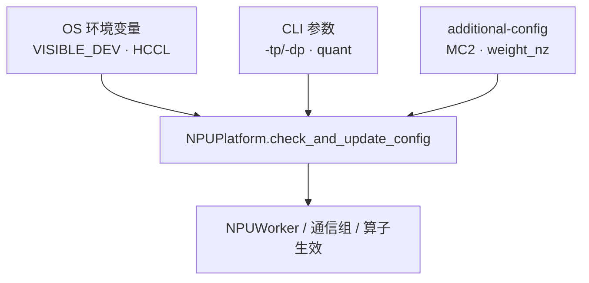
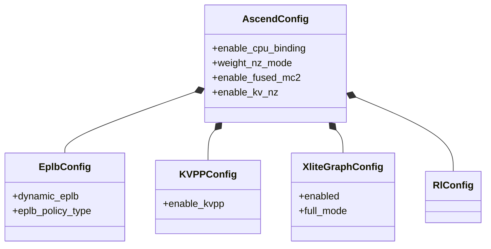
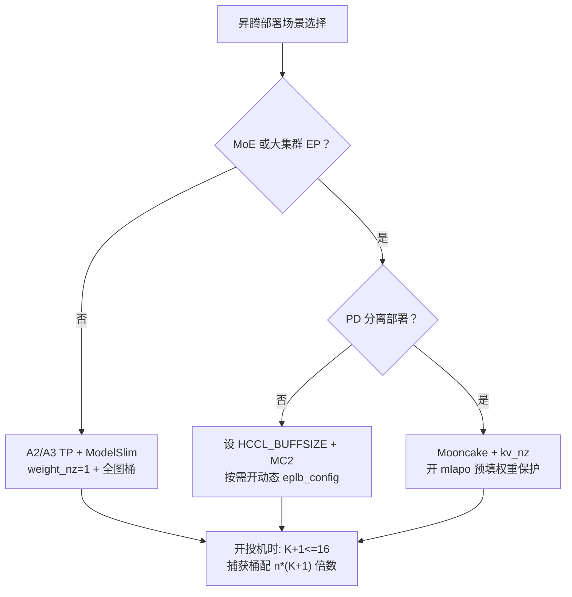
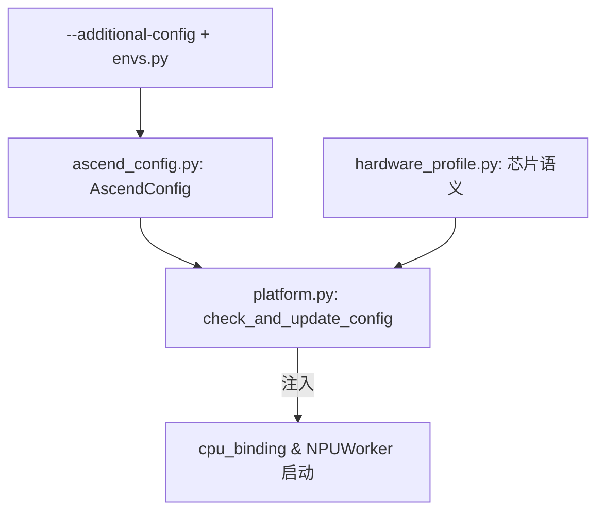

前六章依次拆解了 OOT 插件挂载、CPU 亲和性绑定、`PA_NZ` 分形缓存、MC2 通算融合、Mooncake PD 传输与自定义算子开发。要在昇腾 NPU 上稳定部署生产服务，最后一步是理清三层配置的边界。

许多部署问题源于三者边界混淆。例如把 `HCCL_BUFFSIZE` 遗漏而去修改上层通信选项，会直接导致 MC2 算子地址错位；而继续沿用已废弃的 `VLLM_ASCEND_*` 旧环境变量，在新版本里则会失效或触发冲突。

## 三层配置边界与环境变量迁移趋势

`vllm-ascend` 的运行时配置按生效层级分为三道边界，自外向内依次接管[^ascend-add-doc][^ascend-env-doc]：

1. **驱动与通信环境变量**：进程启动前由 Shell 注入，控制可见 NPU、HCCL 缓冲池及同步调试。
2. **上游 `vllm serve` 参数**：与 GPU 共享的 `-tp` / `-dp` / `--quantization` 等标志，汇总入全局 `VllmConfig`。
3. **插件扩展 JSON 配置**：经 `--additional-config` 传入 `AscendConfig`[^ascend-cfg-cls]，统一管理亲和性、分形布局、通算融合与均衡开关。

自 `vllm-ascend` PR #9064 起，官方正把原先零散的 `VLLM_ASCEND_*` 插件环境变量全面迁移进 `--additional-config`[^ascend-add-doc][^ascend-env-doc]。新部署应一律优先使用 `--additional-config`，旧环境变量将在未来版本移除。

图 1 展示了进程初始化时三层配置如何汇总到 `NPUPlatform.check_and_update_config` 完成验证：



## AscendConfig 核心扩展参数域

在线通过 `--additional-config='{...}'` 传入的 JSON 由 `vllm_ascend/ascend_config.py` 解析为强类型配置树[^ascend-cfg-cls]。如图 2 所示，`AscendConfig` 在顶层平铺开关之外，还组合了六套专职子配置对象：



按照硬件布局、分布式通信与执行图守卫三大维度，生产环境最高频的 `--additional-config` 参数如下[^ascend-add-doc][^ascend-cfg-cls]：

| 参数路径                      | 默认值                    | 核心作用与生效边界                                                              |
| :---------------------------- | :------------------------ | :------------------------------------------------------------------------------ |
| `enable_cpu_binding`          | `True`                    | ARM 宿主下自动启用第 2 章 CPU 亲和性绑定与防重叠分配                            |
| `weight_nz_mode`              | $1$                       | $0$ 关闭 NZ，$1$ 仅量化权重转 `FRACTAL_NZ`，$2$ 兼顾浮点权重                    |
| `enable_kv_nz`                | `False`                   | 仅对 MLA 模型生效，开启解码侧五维 `PA_NZ` 分形 KV 布局                          |
| `enable_kvpp`                 | `False`                   | 跨越 `PCP * TP` 切分目标层 KV，用片间广播换取显存容量                           |
| `enable_fused_mc2`            | $0$                       | $0$ 关闭，$1$ 走 `dispatch_ffn_combine`，$2$ 启用 CANN `MegaMoe`                |
| `mc2_comm_alg`                | `""`                      | 指定融合通信算法为 `"fullmesh"`、`"hierarchy"`（A2/A3）或 `"fullmesh_v2"`（A3） |
| `enable_prefill_mc2`          | `False`                   | 按 `max_num_batched_tokens` 预留 MC2 容量，建议不超过 `tp * 512`                |
| `mega_moe_max_tokens`         | $65536$                   | 融合 MC2 每卡接收 token 缓冲上限，超限会引发精度退化                            |
| `eplb_config`                 | `dynamic_eplb: false`     | 开启动态专家均衡与 `eplb_policy_type`（$0\text{–}3$）重排策略[^ascend-eplb-cfg] |
| `enable_flashcomm1`           | `False`                   | 开启 MoE 序列并行通信，配细粒度 `finegrained_tp_config` 使用                    |
| `xlite_graph_config`          | `enabled: false`          | 切换 Xlite 轻量执行图，`full_mode` 控制预填充与解码 token 上限                  |
| `mlapo_keep_prefill_weights`  | `False`                   | D 节点保留 MLAPO 预填充权重，防局部重算或抢占回退崩溃                           |
| `runtime_config` / `kv_trace` | `None` / `enabled: false` | 配置在线守卫阈值与 MRV2 越界转储追踪目录                                        |
| `msmonitor_use_daemon`        | `False`                   | 开启常驻监控；与 `torch_npu.profiler` 互斥，严禁并行开启                        |

此外要特别避开 `enable_force_eplb: True`。它用固定轮询覆盖真实路由结果以测算理论通信上限，模型精度完全失效，绝对禁止用于在线业务[^ascend-add-doc]。

## 驱动层与构建期关键环境变量

尽管插件自身开关已迁入 JSON，`ASCEND_RT_VISIBLE_DEVICES`、底层驱动通信库以及 `vllm_ascend/envs.py` 中声明的构建与兼容环境变量依然直接影响运行时行为[^ascend-env-doc][^ascend-envs]：

| 环境变量                           | 默认或典型值               | 适用阶段与核心作用                                                   |
| :--------------------------------- | :------------------------- | :------------------------------------------------------------------- |
| `ASCEND_RT_VISIBLE_DEVICES`        | 如 `0,1,2,3`               | 运行期隔离可见 NPU 设备编号，与 `--device-ids` 协同[^ascend-env-doc] |
| `HCCL_BUFFSIZE`                    | 如 $200$ 或更大（MB）      | 决定 `mc2` 通信组缓冲窗；组配置主动旁路让位于它                      |
| `ASCEND_LAUNCH_BLOCKING`           | $0$（排障设 $1$）          | 强迫同步发射算子，定位 $507011$ / $507015$ 首出错算子                |
| `VLLM_ASCEND_ENABLE_BATCH_MEMCPY`  | `None`（布尔 $0$/$1$）     | 控制 KV 卸载批量异步拷贝路径，由布尔解析器校验[^ascend-envs]         |
| `SOC_VERSION` / `ASCEND_HOME_PATH` | `npu-smi` 探测 / CANN 路径 | 编译安装期指定芯片家族（如 910B/910C）与工具链位置[^ascend-envs]     |
| `COMPILE_CUSTOM_KERNELS`           | `True`（$1$/$0$）          | 控制是否编译 `csrc/` 下 AscendC 与 ACLNN 扩展算子[^ascend-envs]      |
| `HCCL_SO_PATH`                     | `libhccl.so`               | 指定 `PyHcclCommunicator` 动态加载的底层通信库路径[^ascend-envs]     |

其中布尔型变量（如 `COMPILE_CUSTOM_KERNELS`）内部只接受字符串 `"0"` 或 `"1"`（留空退回默认值）[^ascend-envs]。若误填 true 或 yes 等字符串，模块导入阶段会直接抛出 `ValueError`。

## 四类昇腾典型启动模板与卡型选型

在不同代际的昇腾服务器上线推理服务时，需先按第 2 章的硬件代际对齐必选约束与推荐开关，下表给出了四代芯片的上线配置基线[^ascend-rtd-cfg]：

| 昇腾硬件代际 | 必选约束与兼容开关               | 推荐开启的关键性能选项                                    |
| :----------- | :------------------------------- | :-------------------------------------------------------- |
| Atlas 310P   | `--dtype float16`（无原生 BF16） | 自动走 `NPUWorker310`，默认启用 `FRACTAL_NZ` 权重布局     |
| Atlas A2     | 默认 `topo_affinity` 防重叠调度  | `"weight_nz_mode":1`、`"enable_cpu_binding":true`         |
| Atlas A3     | 调高 `HCCL_BUFFSIZE` 与双芯寻址  | `"mc2_comm_alg":"hierarchy"` 或 `"fullmesh_v2"`           |
| Atlas A5     | 匹配 `FP8` / `MXFP4` 权重格式    | `"enable_fused_mc2":1`、按集群开 `CANN_MEGAMOE_MXFP` 路径 |

围绕图 3 的四条场景分支，可快速组合各代硬件的在线服务参数：



结合图 3，以下三组启动骨架覆盖了单机量化、大规模 MoE 以及 PD 分离加投机解码的主流上线场景。模板一面向 A2/A3 单机四卡量化在线服务（开启量化权重 NZ 格式并让插件自动绑定 ARM 核心）：

```bash
ASCEND_RT_VISIBLE_DEVICES=0,1,2,3 \
vllm serve /models/Qwen3-32B-W8A8 \
  -tp 4 \
  --quantization ascend \
  --gpu-memory-utilization 0.90 \
  --additional-config '{"weight_nz_mode":1,"enable_cpu_binding":true}'
```

模板二面向 `DP + EP` 大规模 MoE 集群服务（调高 `HCCL_BUFFSIZE`，启用融合 MC2 与动态 EPLB）：

```bash
HCCL_BUFFSIZE=1024 \
vllm serve /models/DeepSeek-V3-W8A8 \
  -dp 2 -tp 8 \
  --enable-expert-parallel \
  --quantization ascend \
  --additional-config '{"enable_fused_mc2":1,"mc2_comm_alg":"hierarchy","eplb_config":{"dynamic_eplb":true,"eplb_policy_type":2}}'
```

模板三面向 Mooncake PD 分离 Decode 节点叠开 MTP 投机解码（开启五维 `PA_NZ` 分形 KV、保留本地预填充权重防回退崩溃，并将静态图捕获桶对齐至 `K + 1` 倍数[^ascend-spec-align]）：

```bash
HCCL_BUFFSIZE=1024 \
vllm serve /models/DeepSeek-V3-W8A8 \
  -tp 8 \
  --quantization ascend \
  --kv-transfer-config '{"kv_connector":"MooncakeConnectorV2","kv_role":"kv_consumer"}' \
  --speculative-config '{"method":"mtp","num_speculative_tokens":1}' \
  --compilation-config '{"cudagraph_mode":"FULL_DECODE_ONLY","cudagraph_capture_sizes":[2,4,8,16]}' \
  --additional-config '{"enable_kv_nz":true,"mlapo_keep_prefill_weights":true}'
```

## 配置源码目录与系列总结

昇腾侧全部扩展开关解析与硬件约束校验集中在 `ascend_config.py`、`envs.py` 与 `platform.py` 中：

```text
vllm_ascend/
├── envs.py                     # 编译期与运行时底层布尔环境变量精确解析
├── ascend_config.py            # AscendConfig 及 EPLB/KVPP/RL/MC2 六大子配置树
├── platform.py                 # check_and_update_config 注入 Worker 与静态图模式
├── cpu_binding.py              # enable_cpu_binding 驱动 ARM global_slice / topo 亲和性绑定
└── device/
    └── hardware_profile.py     # 四代芯片语义契约校验（310P / A2 / A3 / A5）
```

图 4 概括了昇腾配置从解析构建配置树到最终驱动工作进程的校验流水线：



至此，[《vLLM-Ascend 昇腾插件与硬件扩展》](../)全系列七章全部完结。前六章依次剖析了 OOT 插件、芯片与 CPU 亲和性、分形缓存、MC2 通算融合、Mooncake PD 传输及自定义算子开发。本终章则落地为生产集群的启动配置与参数实战。

需要回顾上游通用引擎调度与配置体系时，可随时查阅[《vLLM 推理引擎：架构与核心组件》](../../vllm/)及其[第 10 章](../../vllm/10-launch-config-and-tuning/)。若想继续深挖影子流、可更新槽位与静态图捕获机制，欢迎前往[《推理执行图：CUDA Graph 与 ACL Graph》](../../execgraph/)第 5 至第 7 章。

[^ascend-add-doc]: `vllm-ascend`（commit `b776261`），`docs/source/user_guide/configuration/additional_config.md:5-116`（PR #9064 迁移说明及全部 `--additional-config` 默认值与约束），Apache-2.0。

[^ascend-env-doc]: `vllm-ascend`（commit `b776261`），`docs/source/user_guide/configuration/env_vars.md:1-11`（`ASCEND_RT_VISIBLE_DEVICES` 保留及迁移公告），Apache-2.0。

[^ascend-cfg-cls]: `vllm-ascend`（commit `b776261`），`vllm_ascend/ascend_config.py:70-605`（`KVPPConfig`、`AscendCompilationConfig`、`EplbConfig`、`RlConfig`、`XliteGraphConfig` 与 `AscendConfig` 汇总校验），Apache-2.0。

[^ascend-eplb-cfg]: `vllm-ascend`（commit `b776261`），`vllm_ascend/ascend_config.py:288-346`（`EplbConfig` `dynamic_eplb` 与 `eplb_policy_type` $0\text{–}3$ 校验），Apache-2.0。

[^ascend-envs]: `vllm-ascend`（commit `b776261`），`vllm_ascend/envs.py:26-97`（布尔环境变量 $0$/$1$ 解析与全部构建/运行时环境变量表），Apache-2.0。

[^ascend-spec-align]: `vllm-ascend`（commit `b776261`），`docs/source/user_guide/feature_guide/speculative_decoding.md:64, 154-158`（`FIA` 算子 `K + 1 <= 16` 上限与捕获档位 `n * (K + 1)` 对齐要求），Apache-2.0。

[^ascend-rtd-cfg]: 参考 [vLLM Ascend 配置参考指南](https://vllm-ascend.readthedocs.io/en/latest/user_guide/configuration/additional_config.html) 与硬件支持矩阵。
