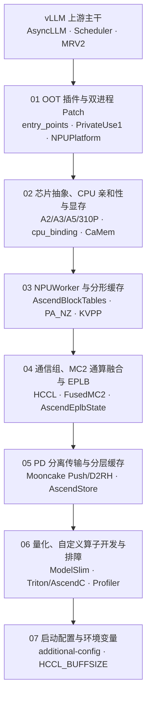

把通用大模型推理引擎部署到华为昇腾 NPU 时，工程团队面对的第一个选择不是算子怎么写，而是代码仓库怎么接。如果直接拷贝上游 `vLLM` 主仓修改维护分叉分支，每次上游重构调度器或 Model Runner V2 都会引发大规模合并冲突。

为此，`vllm-ascend` 选择了一条 **Out-of-Tree（OOT，独立硬件插件）**路线[^ascend-repo][^ascend-docs]。它不改动上游安装源码，而是借助 Python `entry_points`、PyTorch `PrivateUse1` 分发键以及可控的进程级补丁完成挂载。四代昇腾硬件、多路 ARM 主机资源调度、分形显存布局、集合通信与量化算子由此整套接入通用推理引擎之下。

## vllm-ascend 七大核心模块

在学习本系列之前，建议先在[《vLLM 推理引擎：架构与核心组件》](../vllm/)中掌握通用的进程拓扑、PagedAttention、连续批调度与 ModelRunner V2。本系列在此基础上展开昇腾栈专属的七章扩展与落地能力，如图 1 所示。

前两章理清“插件如何接入主干”以及“主机 CPU 亲和性、昇腾四代芯片规格与 HBM 显存如何分配”。中间两章深入单卡与集群的数据通路，解析 `PA_NZ` 分形排布、KV 层并行以及昇腾特有的通算融合与动态专家均衡。

后三章面向生产落地。第 5 至 6 章涵盖 Mooncake 与 MemFabric 的 PD 传输池、ModelSlim 量化及算子排障；终章汇总 `--additional-config` 与环境变量参数。

## 七章目录与跨系列衔接

本系列聚焦硬件插件架构、通信扩展、传输存储、算子开发与部署配置。至于 ACL Graph 影子流、可更新槽位 `TaskUpdate` 与条件子图，可衔接阅读[《推理执行图：CUDA Graph 与 ACL Graph》](../execgraph/)第 5 至第 7 章。全系列共七章：

| 章节                                                                                   | 核心机制                                | 解决痛点                   |
| -------------------------------------------------------------------------------------- | --------------------------------------- | -------------------------- |
| [01 OOT 插件机制与双进程 Patch 体系](./01-oot-plugin-and-patch-architecture/)          | `entry_points`、六大钩子、双进程补丁    | 零分叉接入与上游兼容       |
| [02 昇腾芯片抽象、CPU 亲和性与显存](./02-hardware-abstraction-cpu-binding-and-memory/) | 四代芯片规格、`cpu_binding`、`CaMem`    | 跨 NUMA 抖动与显存预留     |
| [03 NPUWorker、分形缓存与 KV 层并行](./03-npu-worker-runner-and-kv-layout/)            | `AscendBlockTables`、`PA_NZ`、`KVPP`    | 块倍率对齐与多卡 KV 冗余   |
| [04 昇腾通信组、MC2 通算融合与 EPLB](./04-hccl-mc2-and-dynamic-eplb/)                  | 专属通信组、`FusedMC2`、`AscendEplb`    | MoE 通信开销与热点不均     |
| [05 昇腾 PD 分离传输与分层 KV 缓存池](./05-mooncake-pd-and-kv-pool/)                   | `Mooncake` Push/D2RH、`AscendStore`     | 异构 PD 传输与长上下文卸载 |
| [06 量化、自定义算子开发与昇腾排障](./06-quantization-custom-ops-and-tuning/)          | `ModelSlim`、Triton/AscendC、异步错误码 | 模型量化部署与算子开发排障 |
| [07 昇腾启动配置、扩展参数与环境变量](./07-ascend-launch-config-and-env/)              | `AscendConfig`、HCCL 与驱动环境变量     | 参数迁移冲突与生产模板落地 |

请从[01 OOT 插件机制与双进程 Patch 体系](./01-oot-plugin-and-patch-architecture/)开始顺序阅读。需要对照通用调度与 GPU 基准时，可随时查阅[《vLLM 推理引擎：架构与核心组件》](../vllm/)。

[^ascend-repo]: 华为昇腾插件仓库 `vllm-project/vllm-ascend`，本系列源码路径与行号核验自提交 `b776261`（Apache-2.0 协议）。

[^ascend-docs]: 参考官方 [vLLM Ascend 文档站](https://vllm-ascend.readthedocs.io/) 与 [华为昇腾社区文档中心](https://www.hiascend.com/) 硬件与 CANN 架构资料。
