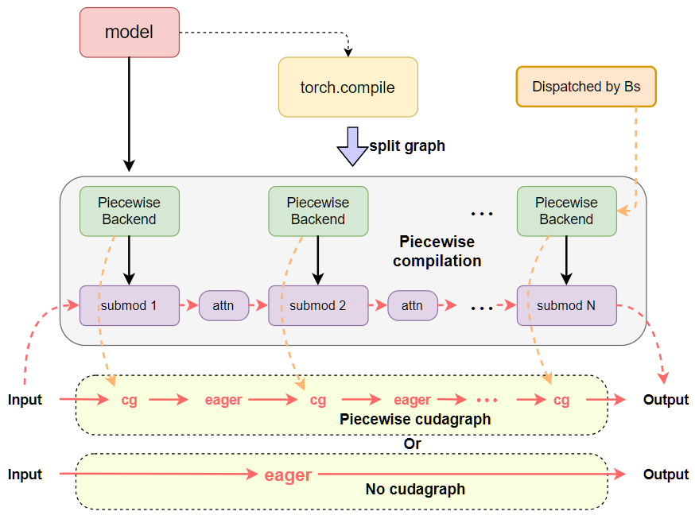
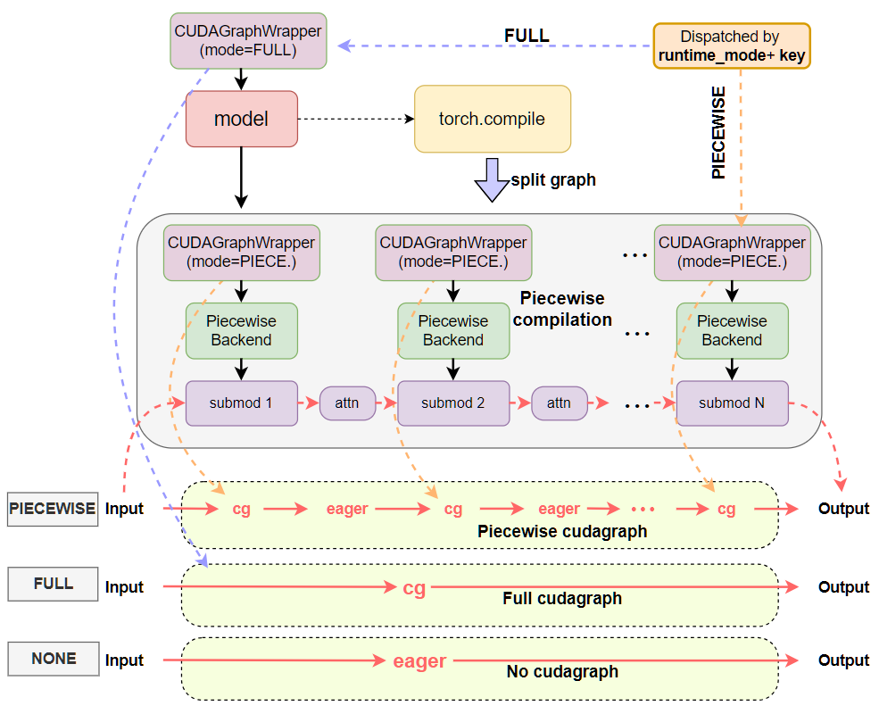

## 一次选路

假设已经准备了 token 桶 `[1, 2, 4, 8]`，本轮有 6 个 query token：

1. dispatcher 找到不小于 6 的最小桶 8。
2. 检查本轮是否满足该桶的 batch 条件。
3. 如果 FULL 图可用且 batch 兼容，选择 `FULL`。
4. 如果 FULL 不可用但 PIECEWISE 图可用，选择 `PIECEWISE`。
5. 如果没有兼容图，选择 `NONE`，按普通 callable 执行 6 个实际 token。

真实 key 不只有 token 数，还包括请求数、uniform 条件和 LoRA 情况。


## 配置模式与运行时模式

配置表示“允许采用哪些策略”，运行时模式表示“这一轮最终采用哪条路径”。

| 名称 | 本系列中的含义 |
| --- | --- |
| `NONE` | 不使用 vLLM 的设备图路径，执行原 callable。CUDA 上仍可能保留编译。 |
| `PIECEWISE` | 只捕获可用的编译分段，attention 等边界留在图外。 |
| `FULL` | 捕获目标模型执行区域中的完整路径，不包括调度器、整个服务请求或所有采样逻辑。 |
| `FULL_DECODE_ONLY` | 只为满足条件的 uniform decode 使用 FULL。 |
| `FULL_AND_PIECEWISE` | uniform decode 优先 FULL，其他 batch 使用 PIECEWISE。 |

`FULL` 不是“所有工作都在一张图里”。它描述目标执行区域的覆盖范围，实际能否使用还取决于 attention 后端、编译条件、捕获尺寸和平台限制。





这两张图来自 vLLM CUDA Graphs 设计文档，用于对照设计演进，不替代固定版本源码中的实际调用链。

## dispatcher、context 与 wrapper

| 对象 | 任务 |
| --- | --- |
| `BatchDescriptor` | 描述本轮 batch 的 token 数、请求数、uniform 条件和 LoRA 情况。 |
| `CudagraphDispatcher` | 维护合法 key，选择模式和补齐后的 descriptor。 |
| `ForwardContext` | 把模式和 descriptor 传给执行路径。 |
| `CUDAGraphWrapper` | 根据模式和 key，执行 replay、首次捕获或普通调用。 |

读源码时沿着这条顺序走：

```text
BatchDescriptor
  → dispatcher 选择 mode 和 padded descriptor
  → ForwardContext 传递选择结果
  → wrapper 查找图实例
  → replay，或执行普通 callable
```

外层 FULL wrapper 包住目标模型。PIECEWISE 模式下，外层可以放行，内部编译分段各自处理。NONE 模式下，相关 wrapper 都放行。

## 为什么不能只按 batch size

固定源码中的 descriptor 至少要考虑：

```python
BatchDescriptor(
    num_tokens=...,        # 实际或补齐后的 token 数
    num_reqs=...,          # 请求数
    uniform=...,           # query 长度是否一致
    has_lora=...,          # 是否使用 LoRA
    num_active_loras=...,  # 活跃 LoRA 适配器数
)
```

同样是 6 个 query token，它们可能来自 6 个单 token decode 请求，也可能来自 3 个各有 2 个 query token 的请求。两者的 attention 元数据和 kernel 条件可能不同。

所以“batch size = 6，一定使用 token 桶 6 的图”通常不够准确。vLLM 根据一组 batch 特征寻找兼容的图 key。

## 图桶与 padding

| 实际 token 数 | 选择的桶 | padding | 可能的结果 |
| --- | --- | --- | --- |
| 3 | 4 | 1 | 使用兼容的 FULL 或 PIECEWISE。 |
| 6 | 8 | 2 | 使用兼容的图。 |
| 8 | 8 | 0 | 使用 8 的图。 |
| 9 | 无 | 0 | 回退 `NONE`。 |

padding 会把工作补齐到已捕获尺寸，并用有效位置和 attention 元数据保持语义正确。它增加了额外计算或资源开销。桶越稀疏，命中图的补齐代价可能越高。

## 捕获与运行时查图

启动时，runner 根据配置和 attention 能力建立合法 descriptor，执行 dummy batch，先预热，再捕获图：

```text
capture_model()
  → get_capture_descs()
  → 按 mode 和 descriptor 预热
  → 捕获图并保存到图缓存
```

运行时，dispatcher 根据真实 batch 查找合法 key。已有图时，wrapper replay；没有匹配条目时，框架可能进入捕获分支或回退，具体行为以版本实现为准。正常服务通常应在启动阶段完成主要捕获。

捕获尺寸、图数量和 LoRA 档位会共同影响启动时间、图池、workspace 和 KV cache。增加更多桶不一定更好，应结合命中率和 padding 测量。

## attention 能力

| 能力 | 可能支持的 batch |
| --- | --- |
| `ALWAYS` | 更一般的非 uniform、混合 prefill 和 decode。 |
| `UNIFORM_BATCH` | 各请求 query 长度一致的 batch。 |
| `UNIFORM_SINGLE_TOKEN_DECODE` | query 长度为 1 的纯 decode。 |
| `NEVER` | 不支持该设备图捕获路径。 |

配置请求 FULL，不代表最终一定得到 FULL。框架可能改用 `FULL_AND_PIECEWISE`、`FULL_DECODE_ONLY` 或 `NONE`。

## 检查点

- 配置请求 `FULL`，日志最终显示 `PIECEWISE`：先查 attention 能力、平台归一化和编译条件。
- 6 个 token 没有命中 FULL：先看 padding 后的 descriptor、捕获桶、LoRA 和 uniform 条件。
- 日志显示 `Runtime Mode=FULL`：继续查 wrapper 分支和 profiler，不能直接写成“已 replay”。
- 选择设备图后端到端没有变快：比较 padding、通信、采样、提交开销占比和初始化成本。

## 源码与参考资料

- [模式枚举与尺寸配置](https://github.com/vllm-project/vllm/blob/349b21487a607ed4912d71f5e8ba54b8e2ec3578/vllm/config/compilation.py)
- [合法 key 与选路](https://github.com/vllm-project/vllm/blob/349b21487a607ed4912d71f5e8ba54b8e2ec3578/vllm/v1/cudagraph_dispatcher.py)
- [BatchDescriptor 与 ForwardContext](https://github.com/vllm-project/vllm/blob/349b21487a607ed4912d71f5e8ba54b8e2ec3578/vllm/forward_context.py)
- [预热、dummy run 与执行入口](https://github.com/vllm-project/vllm/blob/349b21487a607ed4912d71f5e8ba54b8e2ec3578/vllm/v1/worker/gpu_model_runner.py)
- [vLLM：CUDA Graphs 设计](https://docs.vllm.ai/en/latest/design/cuda_graphs/)
