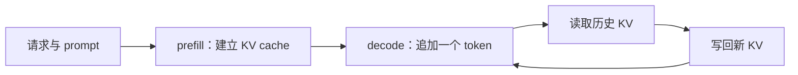

import InferenceTimeline from "./InferenceTimeline";

这套文章从一个很小的问题开始：**一次 decode 为什么会有“提交开销”**。先把请求在 CPU、调度器和设备之间经过的边界画清楚，再谈编译图、CUDA Graph 或 ACLGraph。没有 GPU/NPU 也能读懂这一层。

<InferenceTimeline client:visible />

## 先区分 prefill 与 decode

prefill 把整段输入一次送入模型，工作量随着 prompt 长度增长；decode 每轮通常只生成一个 token，却仍要读历史 KV cache、执行完整层堆栈并写回新 K/V。于是 decode 的设备计算可能很小，但 Python 调度、shape 检查和 kernel launch 的次数并不会随之消失。

图模式针对的是重复提交的路径。它不会替换 attention、改变采样结果，也不会自动减少 padding、通信或显存读写。

## 一轮请求的五个边界

1. **请求**：新 token、position、采样参数和 cache 句柄进入运行时。
2. **调度器**：合并活跃请求，形成 batch descriptor，并决定本轮是否满足某个图桶。
3. **CPU 提交**：eager 路径逐个调用算子；图路径把固定的设备工作作为一次 replay 提交。
4. **设备执行**：GPU 或 NPU 读取固定地址中的输入，执行已经捕获的 kernel 序列。
5. **状态写回**：输出和 KV cache 写回，下一轮复用同一批地址。

这五层不能混成一个“图”。编译图描述算子依赖，设备图记录一次设备工作，调度器负责判断当前输入能不能使用这张图。

## 三种路径

| 路径   | 记录的对象                   | 适合回答的问题                   |
| ------ | ---------------------------- | -------------------------------- |
| Eager  | 每个 Python/算子调用         | 逻辑是否正确、形状是否变化       |
| 编译图 | FX/后端可优化的算子图        | 哪些算子能融合或生成 callable    |
| 设备图 | 固定地址、形状和 launch 依赖 | 如何重复提交已经准备好的设备工作 |

编译图可以产生更快的 callable，但不等于已经捕获了设备图；设备图可以包住 eager 产生的固定工作，也不等于完成了编译优化。

## 捕获与重放的限制

捕获前要完成预热、分配稳定的输入/输出缓冲区，并确定流、shape 和内存池。重放时只能更新图允许更新的地址；重新给 Python 变量赋值，不会改变图里保存的设备指针。batch、sequence length、attention 元数据或通信路径变化时，运行时可能选择另一个图桶，或者回退到 eager。

因此“捕获成功”只说明某个 key 建过图，“replay 出现”也只说明采集范围内发生了图提交。端到端收益还要固定模型、软件、输入长度、并发、采样和稳态区间，用 profiler 对照。

## 无设备阅读路线

- 先用 [05 · 无设备练习](../05-dispatch-practice/) 熟悉图桶、padding 和回退。
- 再看 [01 · 编译图](../01-compile-graphs/)，区分 FX graph 与设备 graph。
- 最后进入 [02 · CUDA Graph](../02-cuda-graph/) 和 [06 · Ascend 图模式](../06-ascend-graph/)。

## 来源与边界

- [PyTorch CUDA Graph 文档](https://docs.pytorch.org/docs/stable/notes/cuda.html#constraints)
- [PyTorch CUDA Graph 博客](https://pytorch.org/blog/accelerating-pytorch-with-cuda-graphs/)
- vLLM 与 vLLM-Ascend 的源码版本、图桶策略和硬件限制见 [parent page](../)。

本文用示意数据解释提交边界，没有 GPU/NPU 实测，也不把图模式当作性能保证。
