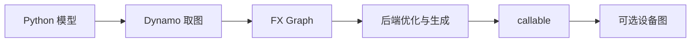

`torch.compile` 的核心动作是把一段 Python/算子执行记录成可分析的图，再交给后端生成 callable。它解决“如何实现这段计算”，而 CUDA Graph 和 ACLGraph 解决“如何重复提交已经确定的设备工作”。先分层，才能读懂 vLLM 的编译与运行时代码。

## 四个角色



| 层            | 产物                  | 关注点                   |
| ------------- | --------------------- | ------------------------ |
| Python/Dynamo | 追踪与 guards         | 哪些 Python 分支被观察到 |
| FX            | 算子节点和数据依赖    | 图能否继续优化           |
| 后端          | 融合或生成的 callable | 设备 kernel 怎样实现     |
| 运行时        | 图桶、capture、replay | 本轮输入能否复用         |


## FX 图表达什么

FX 节点表达算子调用、参数和数据依赖；它不是 GPU kernel 时间线，也不包含真实设备地址。一个最小的 `linear → relu` 图可以说明计算顺序，但不能说明后端是否融合、是否分配临时 buffer，更不能说明最终是否进入设备图。

```python
def block(x, weight, bias):
    return (x @ weight.T + bias).relu()
```

观察 FX 时，先问三个问题：输入 shape 是否稳定、是否存在 Python 控制流、后端是否支持每个节点。不要把打印出来的 graph 当作性能报告。

## guards 与 graph break

编译缓存要验证它仍适用于当前输入。shape、dtype、设备、对象属性或 Python 值变化都可能触发 guard 失败；无法安全追踪的分支会形成 graph break，前后两段分别编译或回到 eager。一个 graph break 不一定是 bug，但它会缩小可优化区域，并可能破坏设备图需要的连续工作。

**读日志时按这条链检查：**

1. 是否命中同一个编译缓存 key；
2. 是否出现 graph break 或 guard 失效；
3. 后端是否返回 callable；
4. 运行时是否再把这个 callable 放进设备图。


## 放回 vLLM

vLLM 的 compilation 层负责生成可复用的模型执行路径，dispatcher 依据 batch descriptor 选择 `FULL`、`PIECEWISE` 或 `NONE`，wrapper 决定 replay、首次捕获还是普通调用。编译缓存命中只证明 callable 可用，不能单独证明本轮 replay。


## 没有 GPU 时怎么读

可以在 CPU 上做图结构、guard 和断图的静态阅读；CUDA Graph/ACLGraph 的捕获与地址约束必须留到对应硬件。本文不要求安装 PyTorch，代码只用于说明函数形状。

## 检查点

- 编译图描述算子依赖，不记录设备地址。
- graph break 是编译边界，不等于模型语义改变。
- callable、图桶和 replay 是三个独立证据。

## 来源

- [PyTorch `torch.compile` 文档](https://docs.pytorch.org/docs/stable/torch.compiler.html)
- [PyTorch FX 文档](https://docs.pytorch.org/docs/stable/fx.html)
- [vLLM compilation 源码](https://github.com/vllm-project/vllm/tree/main/vllm/compilation)
