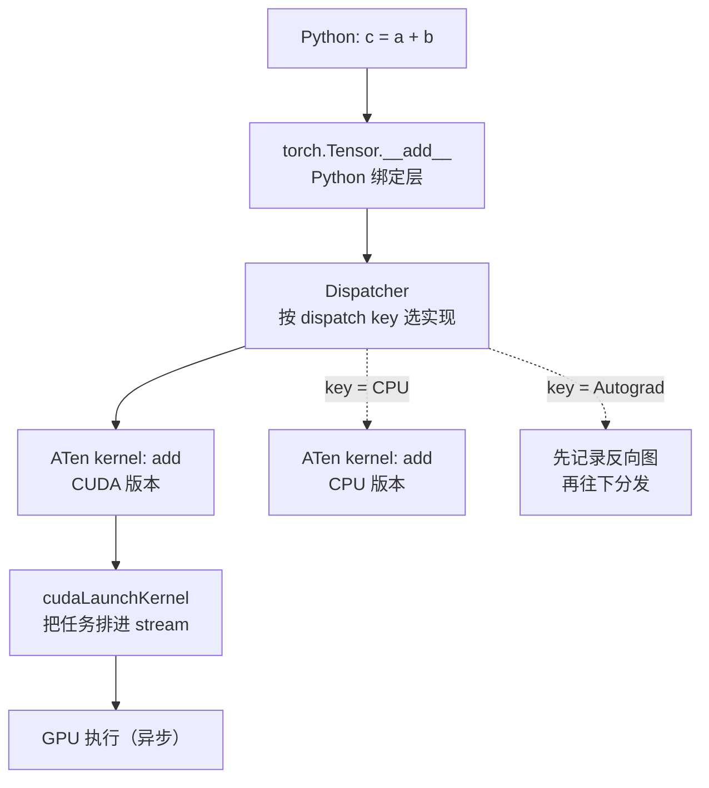

import SubmitTimeline from '../../../../explainers/react/SubmitTimeline';
import { decodeLayerOps } from '../../../../explainers/core/submit';

上一篇把一轮 decode 分成了「CPU 提交」和「设备执行」两条车道，并指出 decode 的时间大量花在前者。但「提交」这个词还是个黑箱。

这一篇把它打开。读完你能回答：一行 `c = a + b` 在 PyTorch 里经过哪几层、为什么 GPU 操作「立刻返回」却没算完、以及**同步点**为什么是后面所有图模式问题的根源。

不需要装 PyTorch，也不需要 GPU。

## 先看一个例子

```python
import torch
a = torch.randn(1000, 1000, device='cuda')
b = torch.randn(1000, 1000, device='cuda')
c = a + b          # 这一行返回时，加法算完了吗？
```

**没有。**这行代码做的是「把一个加法 kernel 排进 GPU 的队列」，然后立刻返回。真正的计算在 GPU 上异步进行[^pytorch-cuda-semantics]。

这个设计是整个性能故事的前提：正因为 CPU 不等 GPU，CPU 才能**跑在 GPU 前面**，提前把后续的活排好队。只要 CPU 排队的速度快过 GPU 消化的速度，GPU 就不会饿着——提交开销就被完全掩盖了。

上一篇那些红色空档，正是「CPU 没跑赢」的时候。

## 一行加法经过的四层



中间那层 **dispatcher** 是 PyTorch 的核心机制[^pytorch-dispatcher]：同一个 `add` 有很多实现（CPU、CUDA、autograd、量化、稀疏……），dispatcher 根据张量的 **dispatch key**（设备、是否需要梯度、布局等）决定调用哪一个，并且可以层层转发——例如先经过 autograd 层记录反向图，再转发给真正的 CUDA kernel。

这层间接调用很灵活，但**每个算子都要走一遍**。算子越碎，这部分固定开销占比越高。这就是「提交开销」的 CPU 侧来源：Python 解释、dispatcher 查表、参数检查、shape 推导，最后才是 `cudaLaunchKernel`。

**注意前面几步和算子大小完全无关**：加两个 $1000\times1000$ 的矩阵和加两个标量，CPU 这边的工作量几乎一样。

## 异步：CPU 跑在前面

GPU 操作按 **stream**（流）排队，同一个 stream 里的操作按提交顺序串行执行。CPU 提交后立刻返回，于是两条车道并行推进。

把算子调大（模拟 prefill 或大 batch），CPU 轻松跑赢，设备几乎不空闲：

<SubmitTimeline
  client:visible
  ops={decodeLayerOps(2).map((o) => ({ ...o, exec: o.exec * 6 }))}
  launchCost={1}
  title="图 01-1：算子够大时——CPU 提前排队，设备连续工作，提交开销被完全掩盖"
/>

把算子调小（decode），CPU 跑不赢，空档就出现了——这就是上一篇那张图。**同一套代码、同一个硬件，瓶颈位置完全不同**，区别只在每个算子的工作量。

## 同步点：把两条车道钉在一起

有些操作需要 CPU **拿到** GPU 上的数值，于是必须等：

```python
c = a + b
print(c[0, 0].item())      # ← 同步点：CPU 停下来，等 GPU 算完
```

常见的同步点：

| 操作                       | 为什么同步               |
| -------------------------- | ------------------------ |
| `.item()` / `.tolist()`    | 要把数值取回 Python      |
| `.cpu()` / `.numpy()`      | 要把数据拷回主机内存     |
| `print(tensor)`            | 要读出内容才能打印       |
| `if tensor > 0:`           | 要拿到布尔值才能决定分支 |
| `torch.cuda.synchronize()` | 显式等待                 |

同步点的代价不是「等待本身」，而是**它清空了流水线**：CPU 之前攒下的领先优势全部作废，之后要从零开始重新跑在 GPU 前面。

<SubmitTimeline
  client:visible
  ops={(() => {
    const o = decodeLayerOps(2).map((x) => ({ ...x }));
    o[4].sync = true;
    return o;
  })()}
  launchCost={0.2}
  title="图 01-2：中间插一个同步点——红色竖线处 CPU 被钉住，后面的空档都是它造成的"
/>

对比一下（提交开销 0.2、10 个算子不变）：

|                           | 墙钟 | 设备空闲     |
| ------------------------- | ---- | ------------ |
| 无同步点                  | 8.0  | 0.2（2.5%）  |
| 第 5 个算子后加一个同步点 | 8.2  | 0.4（4.9%）  |
| **每个算子后都同步**      | 9.8  | 2.0（20.4%） |

一个同步点让空闲占比翻倍；而**每步都同步就等于完全放弃流水线**——空闲涨到 20.4%，CPU 和设备变成严格交替，谁也掩盖不了谁。

`CUDA_LAUNCH_BLOCKING=1` 做的正是最后这一行。它让报错栈指向真正出问题的 kernel（否则错误会在后面某个同步点才冒出来），代价就是上表第三行。**它是调试工具，不能用来测性能。**

同步点还有第二个后果，直接关系到本系列后面的内容：**它让图捕获变得不可能**。图要记录的是「一串确定的设备操作」，而同步点意味着 CPU 要在中途读取设备结果再决定下一步——这不是一串固定操作，没法录下来重放。第 04 篇会把这一条和其他约束放在一起讲。

## 这三层分别对应什么优化

现在可以把本系列要讲的技术各自归位了：

| 开销来源                      | 对应优化                    | 本系列哪篇    |
| ----------------------------- | --------------------------- | ------------- |
| Python 解释 + dispatcher 查表 | **torch.compile**（编译图） | 02            |
| 每个 kernel 单独 launch       | **CUDA Graph**（设备图）    | 03            |
| 同步点打断流水线              | 消除同步点 / 异步化         | 01、04        |
| 设备上的算术本身              | 更好的 kernel、稀疏、量化   | DeepSeek 系列 |

**这四行是正交的。** torch.compile 减少的是前两层的 Python 侧工作（算子融合后算子更少），CUDA Graph 减少的是第二层的提交次数——两者可以叠加，也可以只用一个。把它们混成「图模式」一个词，是读这一块资料时最容易出的错。

## 代码实现

> 完整可运行脚本见文章目录下的 `toy.py`，纯 Python，不需要 PyTorch。

下面这段用一个假的「设备队列」复现上面的行为——提交只是入队，同步才等待：

```python
class FakeDevice:
    """用时间戳模拟异步队列：提交只入队，同步才等。"""
    def __init__(self):
        self.queue_end = 0.0     # 设备上已排到的时间点
        self.cpu = 0.0           # CPU 当前时间点

    def launch(self, exec_time, launch_cost=0.2):
        self.cpu += launch_cost                       # CPU 提交的固定开销
        start = max(self.queue_end, self.cpu)         # 设备不能早于提交完成
        self.queue_end = start + exec_time
        return start, self.queue_end

    def synchronize(self):
        self.cpu = max(self.cpu, self.queue_end)      # ← CPU 被钉住
```

`toy.py` 的输出：

```
不打断：     墙钟  8.0   设备空闲  0.2 ( 2.5%)
一个同步点： 墙钟  8.2   设备空闲  0.4 ( 4.9%)
每步都同步： 墙钟  9.8   设备空闲  2.0 (20.4%)

算子放大 6 倍（模拟 prefill / 大 batch）：
不打断：     墙钟 47.0  设备空闲  0.2 ( 0.4%)
同一个同步点只让空闲从 0.4% 涨到 0.8% —— 算子够大时，同步点也被掩盖了

提交开销降到 0.01：墙钟 7.81，设备空闲占 0.13%
```

后两段值得注意。**同步点的代价取决于算子大小**：算子放大 6 倍后，同一个同步点只让空闲从 0.4% 涨到 0.8%——设备本来就慢，CPU 等一下无所谓。而最后一行说明**提交足够便宜时空闲只剩 0.13%**，此时图模式没有任何可省的东西。这正是上一篇「图模式不是无条件更快」的另一个侧面。

## 真实实现在哪

| 概念                 | 位置                                                                                                               |
| -------------------- | ------------------------------------------------------------------------------------------------------------------ |
| 编译模式枚举         | `reference/vllm/vllm/config/compilation.py:38-51`（`CompilationMode`）                                             |
| 设备图模式枚举       | `reference/vllm/vllm/config/compilation.py:129-164`（`CUDAGraphMode`）                                             |
| 官方异步语义说明     | [PyTorch CUDA semantics](https://docs.pytorch.org/docs/stable/notes/cuda.html)                                     |
| 官方 dispatcher 说明 | [Let's talk about the PyTorch dispatcher](https://blog.ezyang.com/2020/09/lets-talk-about-the-pytorch-dispatcher/) |

本机没有 GPU，所以本篇不运行任何 CUDA 代码。想在有卡的机器上观察，用 `torch.profiler` 看 GPU 车道上的空档最直接。注意**不要**用 `CUDA_LAUNCH_BLOCKING=1` 来测性能——如上表所示，它本身就会把空闲推到 20% 量级。

## 代价与边界

- 本篇的「假设备」只是排程模型，`exec` 和 `launch_cost` 是示意参数。它解释结构，不预测性能。
- 真实的提交开销还包括 Python 解释、shape 推导、autograd 记录等，比模型里的一个常数复杂得多。
- 多 stream、多设备、通信算子会让两条车道变成多条，本篇只画了最简单的单 stream 情形（第 04 篇会补）。
- 「kernel launch 的典型耗时是几微秒」这类说法依赖硬件、驱动和算子，本篇不给具体数字。

## 自测

1. `c = a + b` 返回时计算完成了吗？如果没有，CPU 接下来在做什么？
2. 为什么说 dispatcher 的开销「和算子大小无关」？这对 decode 意味着什么？
3. 列出三个会造成同步点的常见写法。同步点的真正代价是什么（不是等待本身）？
4. torch.compile 和 CUDA Graph 分别消除本篇哪一层的开销？只用其中一个会怎样？
5. 动手：在 `toy.py` 里把 `launch_cost` 调到 0.01（模拟极快的提交），再看三种情形的空闲占比。什么时候图模式就不值得了？

## 来源

- 下一篇：[编译图](../02-compile-graphs/)（尚未按本系列约定重写）——torch.compile 怎么把一串算子变成一张图。

[^pytorch-cuda-semantics]: [PyTorch CUDA semantics（异步执行与 stream）](https://docs.pytorch.org/docs/stable/notes/cuda.html)。

[^pytorch-dispatcher]: [PyTorch dispatcher 介绍](https://blog.ezyang.com/2020/09/lets-talk-about-the-pytorch-dispatcher/)。
