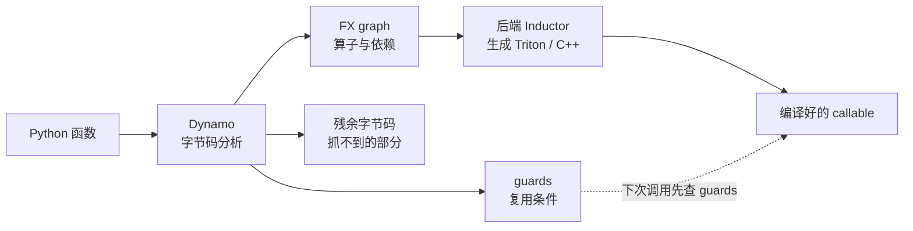

import SubmitTimeline from '../../../../explainers/react/SubmitTimeline';

上一篇把提交开销拆成了三层：Python 解释与 dispatcher 查表、每个 kernel 单独 launch、同步点打断流水线。

`torch.compile` 处理的是**第一层**。它的做法是：别再一个一个地解释执行了，先把这段代码整体看一遍，变成一张算子图，然后一次性编译成高效代码。

读完你能回答：Dynamo 是怎么抓到这张图的、guards 为什么存在、graph break 常见于哪几种写法、以及为什么编译图和 CUDA Graph 省的是两笔不同的钱。

## 先看一个例子

```python
import torch

def f(x, w):
    y = x @ w
    y = torch.relu(y)
    return y + 1

cf = torch.compile(f)
cf(a, b)      # 第一次：编译
cf(a, b)      # 之后：直接用编译好的
```

eager 下这三行是三次独立的 dispatch + 三次 kernel launch。编译之后，Inductor 可以把 `relu` 和 `+1` 融进同一个 kernel——**算子变少了**。

这就是编译图的收益来源：不是让单个算子更快，而是**让算子更少**。

## 机制

### Dynamo 怎么抓图

`torch.compile` 的前端是 **TorchDynamo**，它是一个 Python 层面的 JIT：通过 CPython 的 frame-evaluation API，在函数执行**之前**改写它的字节码，从连续的 PyTorch 操作里提取出一张 FX graph，再把图交给后端。



Dynamo 一次跟踪产出三样东西[^dynamo-docs]：**FX graph**、**残余字节码**（抓不到的那部分照常用 Python 跑）、以及 **guards**。

### guards：这张图什么时候还能用

guards 是「这张编译结果可以复用」所必须满足的条件[^dynamic-shapes-doc]。默认情况下 Dynamo 会**对输入张量的 shape 做特化**——也就是说，编译结果默认只对那个 shape 有效。

每次调用先检查 guards：通过就直接用编译好的；不通过就**重新编译**一份。

这件事对推理服务很关键：batch 大小每变一次，就可能触发一次重编译。而重编译是有上限的——`torch._dynamo.config.recompile_limit` 默认是 **8**，超过之后普通的 `torch.compile` 会直接回退 eager（`fullgraph=True` 时则抛错）。

所以**不能指望「编译一次，什么输入都快」**。这正是后面第 05 篇「图桶」要解决的问题：与其让运行时见一个 shape 编一次，不如预先规定好有限的几种 shape。

动态 shape 有三种策略（`torch.compile(dynamic=...)`）[^torch-compile-api]：

| 取值           | 行为                                                     |
| -------------- | -------------------------------------------------------- |
| `None`（默认） | 先按静态 shape 编；遇到 shape 变化后**再**尝试动态重编译 |
| `False`        | 永不生成动态 kernel，每种尺寸都可能重编译                |
| `True`         | 一开始就尽量生成动态 kernel；官方不建议把它当作通用优化  |

也可以用 `torch._dynamo.mark_dynamic(tensor, dim)` 显式标记某一维是动态的。

### graph break：抓不到的地方

Dynamo 遇到追踪不了的代码时，默认（`fullgraph=False`）不会报错，而是：**把已抓到的部分编译 → 用普通 Python 执行这段不支持的代码 → 从后面继续抓新的图**。这个断点就是 **graph break**。

官方列出的常见原因[^graph-breaks-doc]：

| 原因                 | 典型写法                                         | 为什么                                       |
| -------------------- | ------------------------------------------------ | -------------------------------------------- |
| **数据依赖的控制流** | `if tensor.sum() > 0:`、`.item()`、`.data_ptr()` | 要读设备上的值才能决定走哪条路               |
| **打印与日志**       | `print(t)`、`logging`、`warnings`                | 同上，要把值取出来                           |
| 调用 C 扩展          | PyTorch 之外的 C extension                       | Dynamo 看不见里面，无法插入保证安全的 guards |
| 代码本身有问题       | 不用 compile 也跑不通                            | 先用 eager 验证                              |

**注意前两行和上一篇的「同步点」是同一批写法。**这不是巧合：数据依赖的控制流既要 CPU 读取设备数据（同步点），又让「这段代码等价于一串固定算子」不再成立（graph break）。**一个写法同时破坏两件事**——这是本系列最值得记住的关联之一。

graph break 过多会引入开销并减少后端的融合机会。观察办法是环境变量：

```bash
TORCH_LOGS="graph_breaks"  python run.py   # 在哪断的、为什么
TORCH_LOGS="recompiles"    python run.py   # 为什么重编译
TORCH_LOGS="guards"        python run.py   # 生成了哪些 guards
TORCH_LOGS="dynamic"       python run.py   # 动态 shape 的符号与判定
```

### 后端：Inductor

默认后端是 **TorchInductor**：把 FX graph 编译成目标设备的代码，GPU 上通常生成 Triton kernel，CPU 上生成 C++/OpenMP。融合就发生在这一层。

`mode` 参数值得单独看一眼，因为它直接牵涉到下一篇：

| mode                         | 含义                                                                              |
| ---------------------------- | --------------------------------------------------------------------------------- |
| `default`                    | 性能与编译开销的平衡                                                              |
| **`reduce-overhead`**        | **用 CUDA Graphs 降低 Python 开销**，适合小 batch；会缓存 workspace，可能增加显存 |
| `max-autotune`               | 更激进的 autotune（Triton GEMM/卷积模板）                                         |
| `max-autotune-no-cudagraphs` | 同上但禁用 CUDA Graphs                                                            |

**`reduce-overhead` 就是「编译图 + 设备图一起上」[^torch-compile-api]。**注意官方的限定：目前只保证 CUDA-only、且不修改输入的图。有两个 mode 名字里直接带 `cudagraphs`，正说明这两件事在实现上是可分开开关的。

## 两种图省的不是同一笔钱

这是本篇最重要的区分，用上一篇那个排程模型可以直接看出来。

**eager**：10 个算子，10 次提交。

<SubmitTimeline
  client:visible
  mode="eager"
  launchCost={1}
  title="图 02-1：eager——10 个算子，10 次提交"
/>

**编译之后**：Inductor 把算子融合了，比如 10 个变成 4 个（每个稍大一点）。**仍然是逐个提交**，但提交次数从 10 降到 4：

<SubmitTimeline
  client:visible
  mode="eager"
  launchCost={1}
  ops={[
    { name: 'L0·融合(norm+qkv)', exec: 1.0 },
    { name: 'L0·attn', exec: 1.0, graphBreak: true },
    { name: 'L0·融合(out+ffn)', exec: 1.7 },
    { name: 'L1·融合(norm+qkv)', exec: 1.0 },
    { name: 'L1·attn', exec: 1.0, graphBreak: true },
    { name: 'L1·融合(out+ffn)', exec: 1.7 },
  ]}
  title="图 02-2：编译之后——算子被融合成 6 个，仍然逐个提交"
/>

**设备图**：算子个数不变，但提交合并成几次 replay（见下一篇）。

|            | 算子个数         | 提交次数         | 省掉了什么                                                      |
| ---------- | ---------------- | ---------------- | --------------------------------------------------------------- |
| eager      | 10               | 10               | —                                                               |
| **编译图** | **变少**（融合） | 跟着变少         | Python 解释、dispatcher、以及部分访存（融合后中间结果不落显存） |
| **设备图** | 不变             | **变少**（打包） | kernel launch 的提交次数                                        |
| 两者叠加   | 变少             | 最少             | 以上全部                                                        |

**编译图减少的是「有哪些算子」，设备图减少的是「提交几次」。**这就是为什么 vLLM 的配置里 `CompilationMode` 和 `CUDAGraphMode` 是两个独立的枚举——它们真的是两件事。

## 代码实现

> 完整可运行脚本见文章目录下的 `toy.py`，纯 Python。

`toy.py` 模拟 Dynamo 的 guard 机制与重编译上限，这是最容易踩坑的一处：

```python
class FakeCompiler:
    """模拟 Dynamo：按 guard key 缓存编译结果，超过上限回退 eager。"""
    def __init__(self, recompile_limit=8, dynamic=False):
        self.cache, self.limit, self.dynamic = {}, recompile_limit, dynamic
        self.compiles = self.hits = self.eager_fallbacks = 0

    def key(self, shape):
        # dynamic=False：按完整 shape 特化；dynamic=True：batch 维变成符号
        return shape if not self.dynamic else ('*',) + tuple(shape[1:])

    def __call__(self, shape):
        k = self.key(shape)
        if k in self.cache:
            self.hits += 1
            return 'cached'
        if self.compiles >= self.limit:
            self.eager_fallbacks += 1          # 超过上限，放弃编译
            return 'eager-fallback'
        self.cache[k] = True
        self.compiles += 1
        return 'compiled'
```

输出：

```
静态（dynamic=False），batch 依次为 1..12：
  编译 8 次，命中 0 次，回退 eager 4 次  ← 每个新 batch 都要重编译，很快撞上上限

静态，batch 只在 {1,2,4,8} 里取（图桶的做法），共 40 次调用：
  编译 4 次，命中 36 次，回退 eager 0 次  ← 预先限定形状，命中率 90%

动态（dynamic=True），batch 依次为 1..12：
  编译 1 次，命中 11 次，回退 eager 0 次  ← 一份动态 kernel 应付全部形状
```

第二行就是第 05 篇「图桶」的全部动机：**与其让运行时见一个 shape 编一次，不如预先规定只有那么几种 shape**。

但它不是免费的。把任意 batch 向上取整到桶，就要为不存在的位置做计算：

```
图桶的代价——padding：
  batch 1 → 桶 1，浪费 0 个位置
  batch 3 → 桶 4，浪费 1 个位置
  batch 5 → 桶 8，浪费 3 个位置
  batch 7 → 桶 8，浪费 1 个位置
  合计浪费 23.8% 的计算
```

**用确定性换掉一部分算力**——桶越少，命中率越高、padding 浪费越大。桶怎么选是第 05 篇的核心问题。

## 真实实现在哪

vLLM 的编译配置（本地快照 commit `cf5cea2d`）：

| 概念            | 位置                                     | 说明                                                                  |
| --------------- | ---------------------------------------- | --------------------------------------------------------------------- |
| 编译模式        | `vllm/config/compilation.py:38-51`       | `NONE` / `STOCK_TORCH_COMPILE` / `DYNAMO_TRACE_ONCE` / `VLLM_COMPILE` |
| vLLM 自己的后端 | `vllm/compilation/backends.py:832-842`   | `VllmBackend`——`VLLM_COMPILE` 模式下替换默认后端                      |
| 分段逻辑        | `vllm/compilation/backends.py:1180-1195` | `split_graph` / `fx_split_ops`：按 `splitting_ops` 切 FX 图           |
| 切分点          | `vllm/config/compilation.py:583-600`     | `splitting_ops` 默认包含 attention 算子                               |
| 编译尺寸        | `vllm/config/compilation.py:658-677`     | `compile_sizes`——预先指定要编哪些 shape                               |

注意 `DYNAMO_TRACE_ONCE` 这个模式名：**只做一次 Dynamo 跟踪**。推理服务不希望运行时反复重编译，所以 vLLM 宁可预先把形状定死，也不要动态重编译——和上面 toy 的第二行是同一个思路。

`compile_sizes` 的存在也印证了这一点：**哪些 shape 要编译是配置出来的，不是碰到了才编**。

## 代价与边界

- 编译本身要花时间，而且发生在第一次调用（冷启动变慢）。服务要么预热，要么用编译缓存。
- guards 默认按 shape 特化，形状一多就重编译；`recompile_limit` 默认 8，撞上之后静默回退 eager——**性能突然变差但不报错**，这是很隐蔽的坑。
- `fullgraph=True` 能保证没有 graph break，但要求整段代码可追踪，实际代码往往做不到。
- 融合能省中间结果的访存，但也可能增加寄存器压力；不是融得越多越好，这由 Inductor 决定。
- 本篇的 `toy.py` 只模拟 guard/缓存/上限的**逻辑**，不模拟编译耗时或融合效果，更不对应任何真实加速比。
- 本机没有 GPU，所有 PyTorch 行为均引自官方文档，未在本机运行。

## 自测

1. Dynamo 一次跟踪产出哪三样东西？guards 的作用是什么？
2. 为什么 batch 大小变化会触发重编译？撞上 `recompile_limit` 之后会发生什么（报错还是别的）？
3. 「数据依赖的控制流」同时破坏了哪两件事？把上一篇的同步点和本篇的 graph break 联系起来回答。
4. 编译图和设备图分别减少了什么？只开其中一个，另一笔开销还在吗？
5. 动手：在 `toy.py` 里把 `recompile_limit` 改成 2，用 batch 1..12 跑一遍。从第几次开始回退 eager？这在真实服务里会表现成什么现象？

## 来源

- 下一篇：[03 · CUDA Graph](../03-cuda-graph/)（尚未按本系列约定重写）——把提交次数也降下来。

[^dynamo-docs]: [Dynamo Overview](https://docs.pytorch.org/docs/stable/user_guide/torch_compiler/torch.compiler_dynamo_overview.html)、[Dynamo Core Concepts](https://docs.pytorch.org/docs/stable/user_guide/torch_compiler/compile/programming_model.dynamo_core_concepts.html)（FX graph、guards、graph break 的定义）。

[^dynamic-shapes-doc]: [Dynamic Shapes Core Concepts](https://docs.pytorch.org/docs/main/user_guide/torch_compiler/compile/dynamic_shapes_core_concepts.html)、[Dealing with Recompilations](https://docs.pytorch.org/docs/stable/user_guide/torch_compiler/compile/programming_model.recompilation.html)。

[^torch-compile-api]: [torch.compile API](https://docs.pytorch.org/docs/stable/generated/torch.compile.html)（dynamic、mode、recompile_limit）。

[^graph-breaks-doc]: [Common Graph Breaks](https://docs.pytorch.org/docs/main/user_guide/torch_compiler/compile/programming_model.common_graph_breaks.html)（官方的常见原因清单）。
