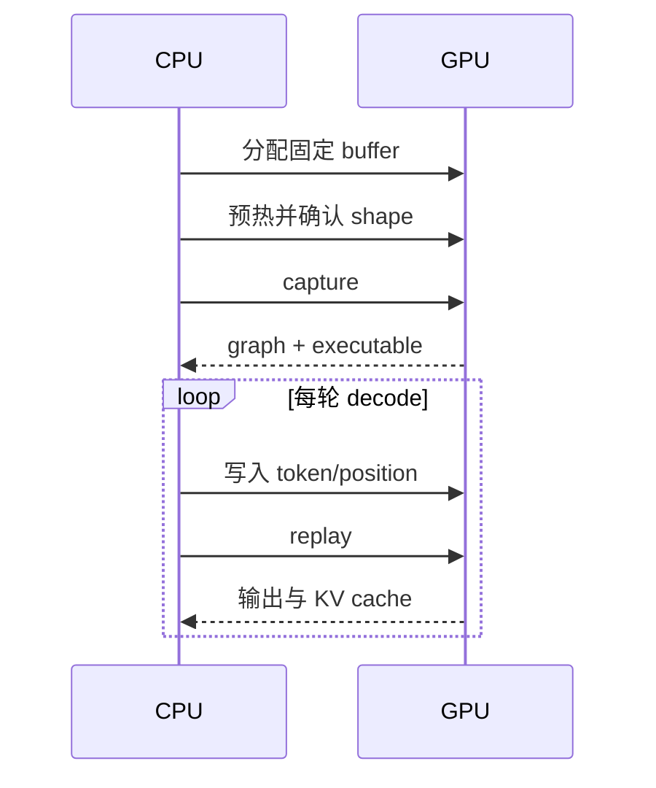

CUDA Graph 记录的是一段已经确定的设备工作：kernel、依赖、stream 和内存地址。启动阶段付出捕获和实例化成本，稳态阶段只更新允许变化的输入并 replay。它减少的是 CPU 提交次数，不是 attention 的 FLOPs。

## 生命周期




1. **分配**：输入、输出、临时区和 KV cache 地址稳定。
2. **预热**：先走相同路径，让 lazy 初始化和内存池完成。
3. **捕获**：在指定 stream 上记录设备工作；捕获期间不能执行不支持的主机动作。
4. **实例化**：把 graph 变成可提交的 executable。
5. **重放**：写入固定地址中的新值，再提交同一 executable。

## 地址比变量名重要

捕获记录的是设备指针，不是 Python 变量名。下面的赋值会换一个 Python 引用，不能让图自动读取新地址：

```python
new_token = token
# graph 仍然保存捕获时 token 对应的 device address
```

正确做法是把新值拷贝到捕获时的输入 buffer，再 replay。shape、dtype、stride、stream 或依赖变化也可能使这个 graph 不再适用，运行时应切换图桶或回退 eager。

## 哪些工作不能直接捕获

动态分配、设备同步后才决定的 Python 分支、未固定的通信路径、跨 stream 的隐式依赖，都会让完整捕获变得脆弱。实践中常把模型切成可捕获区域和普通区域，再由 dispatcher 组合。这就是 `FULL`、`PIECEWISE`、`NONE` 有意义的原因。

## 对应到 vLLM

vLLM 为常见 batch/sequence 组合准备图桶。一个桶保存固定 shape 与地址约束；本轮 batch 先 padding 到桶，再由 wrapper 查找 graph。桶数量更多会覆盖更多输入，却增加启动时间、显存和维护成本。

## 没有设备时怎么读

可以检查源码中的 buffer 生命周期、capture/replay 调用顺序和 fallback 分支；不能在 CPU 上验证 CUDA Graph 的正确性或收益。看到日志里的“capture success”时，只能确认某个 key 建图成功，仍要查看本轮是否命中和 replay。

## 检查点

- graph 记录地址和依赖，Python 变量重新绑定没有用。
- replay 前要更新允许更新的固定 buffer。
- capture 成功、命中 graph、端到端变快是三种证据。

## 来源

- [PyTorch CUDA Graph 约束](https://docs.pytorch.org/docs/stable/notes/cuda.html#constraints)
- [PyTorch CUDA Graph API](https://docs.pytorch.org/docs/stable/generated/torch.cuda.CUDAGraph.html)
- [vLLM CUDA graph wrapper](https://github.com/vllm-project/vllm/blob/main/vllm/compilation/cuda_graph.py)
