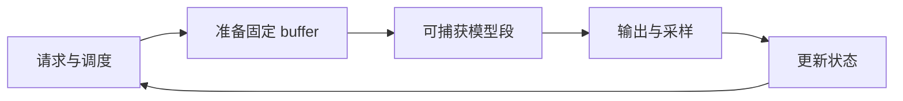

完整模型并不天然适合一张 CUDA Graph。图要求设备工作、地址、shape 和依赖稳定，而推理引擎恰好会遇到动态 batch、采样、通信和 cache 管理。工程问题是找出稳定的热路径，把变化留在图外。

## 捕获边界

适合进入图的通常是重复执行、shape 已桶化、没有主机分支的 decode 主干；调度器、采样、动态通信和首次分配通常留在图外。分段图减少了一部分提交，但也引入边界同步和数据搬运，不能默认比完整捕获更快。

## 预热与内存池

预热不只是跑一遍 forward。它要让 lazy 初始化、kernel 选择、临时 buffer 和 allocator 状态稳定。捕获使用的内存池在 graph 生命周期内必须保持有效；过早释放、重新分配或跨 graph 复用，都可能得到错误结果或难以解释的崩溃。

常见检查顺序：

1. capture 前是否已完成同一 shape 的 warmup；
2. 输入、输出、KV cache 的 storage 是否保持不变；
3. graph 是否依赖默认 stream 或隐式同步；
4. fallback 是否能在 graph 不适用时安全接管。

## 多流与通信

不同 stream 之间需要显式事件依赖。通信库可能读取或写入由另一个 stream 产生的 buffer；把它们一起捕获前要确认库和设备支持该路径。否则可以让通信留在图外，并在边界执行明确同步。看到“kernel 都在图里”不代表通信顺序正确。

## FULL、PIECEWISE 与 NONE

| 模式        | 典型范围         | 代价                   |
| ----------- | ---------------- | ---------------------- |
| `FULL`      | 整段稳定 decode  | 覆盖最广，捕获限制最多 |
| `PIECEWISE` | 稳定的模型子段   | 边界同步和搬运增加     |
| `NONE`      | 动态或不支持路径 | 提交灵活，失去图的收益 |

模式是运行时选择，不是性能等级。真正的选择由 batch descriptor、attention metadata、通信和设备能力共同决定。

## 按现象排错

- **capture 失败**：先找动态分配、同步、随机数或不支持的 API。
- **replay 结果旧**：检查是否把新值写回捕获时的地址。
- **偶发错误**：检查 stream/event、通信顺序和 buffer 生命周期。
- **图模式变慢**：对照 padding、同步、启动成本和 graph bucket 命中率。

没有 GPU 时只能做调用链审计；capture/replay 的正确性和收益必须用目标设备与 profiler 复核。

## 检查点

- 图外部分负责变化，图内部分负责重复。
- 分段捕获不是免费拆分，边界要有明确数据和同步语义。
- fallback 是正确性路径，不能当作异常删除。

## 来源

- [PyTorch CUDA Graph 约束](https://docs.pytorch.org/docs/stable/notes/cuda.html#constraints)
- [CUDA Graphs Programming Guide](https://docs.nvidia.com/cuda/cuda-c-programming-guide/index.html#cuda-graphs)
- [vLLM compilation 目录](https://github.com/vllm-project/vllm/tree/main/vllm/compilation)
