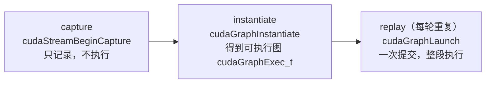

import SubmitTimeline from '../../../../explainers/react/SubmitTimeline';

上一篇让算子**变少**了，但每个算子仍然要单独提交一次。这一篇把提交次数也降下来。

思路很直接：decode 每一轮提交的是**同一串**设备工作——同样的 kernel、同样的顺序、同样的形状，只有缓冲区里的数值变了。既然如此，为什么每轮都要重新提交一遍？**录一次，之后重放。**

读完你能回答：capture / instantiate / replay 各做什么、为什么「固定地址」是整件事的核心约束、以及官方列出的那些约束背后是同一个原因。

## 先看一个例子

```python
import torch

static_in = torch.zeros(8, 4096, device='cuda')    # ① 固定的输入缓冲区
static_out = torch.zeros(8, 4096, device='cuda')

g = torch.cuda.CUDAGraph()
with torch.cuda.graph(g):                          # ② 捕获：不执行，只记录
    static_out.copy_(model(static_in))

static_in.copy_(real_input)                        # ③ 把真实数据写进那块固定内存
g.replay()                                         # ④ 一次提交，跑完整段
result = static_out.clone()                        # ⑤ 结果在那块固定内存里
```

注意第 ③ 步：**不是 `static_in = real_input`，而是 `copy_`**。

这是整篇文章的关键。图里记录的是**设备内存地址**，不是 Python 变量。给 Python 名字重新赋值，只是让名字指向别的张量，图里存的那个指针纹丝不动——replay 出来的还是旧数据。这个 bug 不会报错，只会给出错误结果。

## 机制

### 三个阶段



| 阶段            | 做什么                                                                                              |
| --------------- | --------------------------------------------------------------------------------------------------- |
| **capture**     | 把 stream 置于捕获模式；此后提交到该 stream 的工作**不执行**，而是追加进图[^cuda-programming-guide] |
| **instantiate** | 验证并把图实例化成可执行形式，一次性的准备成本集中在这里                                            |
| **replay**      | `cudaGraphLaunch` 一次提交整段工作；PyTorch 的 `CUDAGraph.replay()` 底层就是它                      |

收益回到第 00 篇那张图：提交从 N 次变成 1 次。

<SubmitTimeline
  client:visible
  mode="full"
  ops={[
    { name: 'norm', exec: 0.3 },
    { name: 'qkv', exec: 0.8 },
    { name: 'attn', exec: 1.0 },
    { name: 'out', exec: 0.6 },
    { name: 'ffn', exec: 1.2 },
    { name: 'norm', exec: 0.3 },
    { name: 'qkv', exec: 0.8 },
    { name: 'attn', exec: 1.0 },
    { name: 'out', exec: 0.6 },
    { name: 'ffn', exec: 1.2 },
  ]}
  launchCost={1}
  title="图 03-1：整图 replay——10 个算子，1 次提交"
/>

### 为什么必须固定地址

图记录的是「对**这些地址**执行**这些 kernel**」。它不记录数据，只记录操作和操作的对象。

于是每次 replay 必须读写**相同的（虚拟）内存地址**[^pytorch-cuda-graphs-doc]——这是官方明确列出的约束。实际后果：

- 输入输出都要用预先分配好的**静态缓冲区**；
- 每轮把新数据 `copy_` 进去，而不是换一个张量；
- 中间结果的分配也要稳定，所以 PyTorch 在捕获期间把分配放进**图私有的内存池**。

内存池还有一个坑：多个图可以通过 `pool=` 共享内存池，但**只有在按捕获顺序重放、且不并发**时才安全——共享池可能让一个图覆盖另一个图的输出。

### 官方列出的约束

PyTorch 文档把约束分成两类[^pytorch-cuda-graphs-doc]，这个分法比约束本身更重要：

**第一类：违反会报错**

1. 捕获必须在 non-default stream 上进行（`torch.cuda.graph` 这类封装会自动处理）。
2. **禁止让 CPU 与 GPU 同步的操作**，例如 `.item()`。
3. CUDA RNG 可以用；但多 `torch.Generator` 时捕获期间不要用 `get_state`/`set_state`，要用 `graphsafe_get_state`/`graphsafe_set_state`。
4. **禁止基于 CPU 或 GPU 数据的动态控制流**（GPU 数据的控制流只有用高阶算子 `torch.cond()` 才例外）。

**第二类：违反可能静默出错**

5. 一个进程同一时刻只能有一个捕获在进行。
6. 捕获期间，该进程的任何线程都不能运行未被捕获的 CUDA 工作。
7. **CPU 工作不会被捕获**；如果捕获的序列里夹着 CPU 工作，replay 时它会被直接跳过。
8. 每次 replay 必须读写相同的（虚拟）内存地址。
9. **禁止动态 shape**：序列中每个张量在每次 replay 都必须保持相同的 size 与 layout。
10. 可以用多 stream，但必须满足 fork/join 规则（子 stream 最终汇回原 stream，跨流依赖用捕获内的 event 表达）。

**非约束**：捕获完成后，图可以在任意 stream 上重放。

第二类才是真正危险的。**第 7 条尤其值得停下来想**：你在被捕获的代码里写的 Python 逻辑——打印、计数、更新 Python 变量——replay 时**一次都不会执行**。代码看起来在那里，实际从来没跑过。

### 所有约束其实是同一句话

把上面十条倒过来看，它们都在说一件事：

> **图是一段「固定的设备工作」。任何让「这一轮和上一轮不一样」的东西，都不能进去。**

- 动态 shape 让工作不固定 → 禁止；
- 数据依赖的控制流让顺序不固定 → 禁止；
- 同步点意味着中途要读设备结果再决定 → 禁止；
- CPU 工作不是设备工作 → 不被记录。

第 01 篇的**同步点**和第 02 篇的 **graph break**，在这里第三次出现，而且仍然是同一批写法。这不是三个独立的坑，是同一件事在三层上的表现：

| 层            | 名称        | 后果                   |
| ------------- | ----------- | ---------------------- |
| 异步执行      | 同步点      | 流水线被清空           |
| torch.compile | graph break | 图被切断，融合机会减少 |
| CUDA Graph    | 无法捕获    | 要么报错，要么静默跳过 |

### 为什么需要「图桶」

约束 9 禁止动态 shape。但推理服务的 batch 大小**天然是变的**——这一轮 3 个请求，下一轮 7 个。

唯一的出路是：**预先为有限的几种形状各捕获一张图，运行时把实际 batch 向上取整到最近的那个**。这就是图桶，上一篇 `toy.py` 已经量化过它的代价（padding 浪费）。第 05 篇会讲 vLLM 具体怎么选桶、怎么匹配、匹配不上怎么办。

### 三个 API 的关系

| API                                     | 用法                                           |
| --------------------------------------- | ---------------------------------------------- |
| `torch.cuda.CUDAGraph`                  | 底层对象，配合 `capture_begin/end` 手动控制    |
| `torch.cuda.graph(g)`                   | context manager，自动处理 side stream，最常用  |
| `torch.cuda.make_graphed_callables()`   | 把 callable 的 forward/backward 都图化，训练用 |
| `torch.compile(mode="reduce-overhead")` | 编译图 + CUDA Graph 一起上（上一篇）           |

`capture_error_mode` 控制捕获期间对「潜在不安全 API」的检查严格度[^torch-cuda-graph-api]：`global`（默认，阻止其他线程的不安全调用）、`thread_local`、`relaxed`。

## 代码实现

> 完整可运行脚本见文章目录下的 `toy.py`，纯 Python，不需要 CUDA。

`toy.py` 用一个假的「图」把前面几条约束做成可运行的演示——**重点是让那几个静默错误真的发生一次**：

```python
class FakeGraph:
    """记录「对哪些地址做哪些操作」，replay 时只重放设备操作。"""
    def __init__(self):
        self.recorded = []       # [(op_name, in_addr, out_addr)]
        self.shapes = {}

    def capture(self, ops):
        for op in ops:
            if op['kind'] == 'cpu':
                continue                       # 约束 7：CPU 工作不会被捕获
            if op.get('sync'):
                raise RuntimeError('捕获期间禁止同步操作（约束 2）')
            self.recorded.append((op['name'], op['in'], op['out']))
            self.shapes[op['in']] = op['shape']

    def replay(self, memory):
        for name, src, dst in self.recorded:
            memory[dst] = f'{name}({memory[src]})'   # 永远读写同一批地址
```

三个演示的输出：

```
① 固定地址：用 copy_ 写进静态缓冲区
   replay 后 out = f(第二轮数据)   ✓ 正确

② 重新赋值（最常见的 bug）：static_in = new_tensor
   replay 后 out = f(第一轮数据)   ✗ 错误，而且没有任何报错

③ CPU 工作被跳过（约束 7）
   捕获时 counter = 1；replay 3 次后 counter 仍然 = 1
   —— 被捕获代码里的 Python 逻辑一次都没执行

④ 形状变了（约束 9）
   捕获时 shape=(8, 4096)，replay 时传入 (16, 4096)
   —— 真实 CUDA 不会检查，直接按旧形状读内存

⑤ 同步点（约束 2）：这一条是会报错的
   RuntimeError: 捕获期间禁止同步操作（约束 2）
```

对比 ⑤ 和 ②③④：**只有第一类约束会拦住你**。②③④ 全都安安静静地给出错误结果——这是本篇最该亲手跑一遍的部分。

## 真实实现在哪

vLLM 的封装（本地快照 commit `cf5cea2d`）：

| 概念       | 位置                                                                    | 说明                                                                         |
| ---------- | ----------------------------------------------------------------------- | ---------------------------------------------------------------------------- |
| 图模式枚举 | `vllm/config/compilation.py:129-164`                                    | `NONE` / `PIECEWISE` / `FULL` / `FULL_DECODE_ONLY` / `FULL_AND_PIECEWISE`    |
| 捕获与重放 | `vllm/compilation/cuda_graph.py:234-358`（`CUDAGraphWrapper.__call__`） | 首次匹配时在 `torch.cuda.graph(...)` 里捕获，之后 `entry.cudagraph.replay()` |
| 图实例缓存 | `vllm/compilation/cuda_graph.py:126-136`（`CUDAGraphEntry`）            | 按 `BatchDescriptor` 索引                                                    |
| 捕获入口   | `vllm/v1/worker/gpu/model_runner.py:1132-1175`                          | `capture_model`：冻结 GC、清 cache，再逐个捕获                               |
| 预热       | `vllm/config/compilation.py:690-753`                                    | `cudagraph_num_of_warmups`——捕获前先跑几轮                                   |

两点值得注意：

1. **捕获由 `_dummy_run` 触发**（`model_runner.py:878-900`）：服务启动时用假数据把每个桶各跑一遍并录下来，而不是等真实请求来了才录。
2. **`FULL_DECODE_ONLY` 和 `FULL_AND_PIECEWISE` 这两个组合值**再次印证第 00 篇的结论：decode 用整图、prefill/mixed 用分段，因为两者的提交开销占比完全不同。

为什么默认是分段而不是整图？因为 attention 算子常带动态的 metadata，很多后端捕获不了（`splitting_ops` 默认包含 attention）。能整图捕获是有条件的——那些条件是下一篇的内容。

## 代价与边界

- 捕获要花时间和显存：每个桶一张图，桶越多启动越慢、显存占用越高。
- 图私有内存池会抬高显存峰值；多图共享池有覆盖风险。
- 约束 9 把动态 shape 彻底堵死，只能靠图桶 + padding 绕开，代价是算了用不上的位置。
- 第二类约束**静默出错**，不会报错。改动被捕获的代码时要特别小心。
- 本篇的 `toy.py` 只演示约束的**语义**，不模拟真实 CUDA 行为，也不给性能数字。本机没有 GPU，未运行任何真实捕获。

## 自测

1. 为什么必须 `static_in.copy_(x)` 而不是 `static_in = x`？后者会发生什么（报错吗）？
2. 约束 7 说「CPU 工作不会被捕获」。如果被捕获的代码里有一行 `self.step += 1`，replay 100 次后 `step` 是多少？
3. 把十条约束归纳成一句话。同步点、graph break、无法捕获三者是什么关系？
4. 为什么 vLLM 默认用分段图而不是整图？`FULL_DECODE_ONLY` 这个模式存在说明了什么？
5. 动手：在 `toy.py` 里给被捕获的序列加一个 `sync` 操作，看它在哪一步被拒绝；再把它改成 CPU 操作，观察它是如何被**静默跳过**的。

## 来源

- 下一篇：[边界](../04-boundaries/)（尚未按本系列约定重写）——动态 shape、通信、内存池、多流各自卡在哪一条约束上。

[^cuda-programming-guide]: [CUDA Programming Guide — CUDA Graphs](https://docs.nvidia.com/cuda/cuda-programming-guide/04-special-topics/cuda-graphs.html)（stream capture、instantiation、execution）。

[^pytorch-cuda-graphs-doc]: [PyTorch CUDA semantics — CUDA Graphs](https://docs.pytorch.org/docs/stable/notes/cuda.html)（约束与非约束清单、图内存管理、跨捕获共享内存池）。

[^torch-cuda-graph-api]: [torch.cuda.graph API](https://docs.pytorch.org/docs/stable/generated/torch.cuda.graph.html)（capture_error_mode）。
