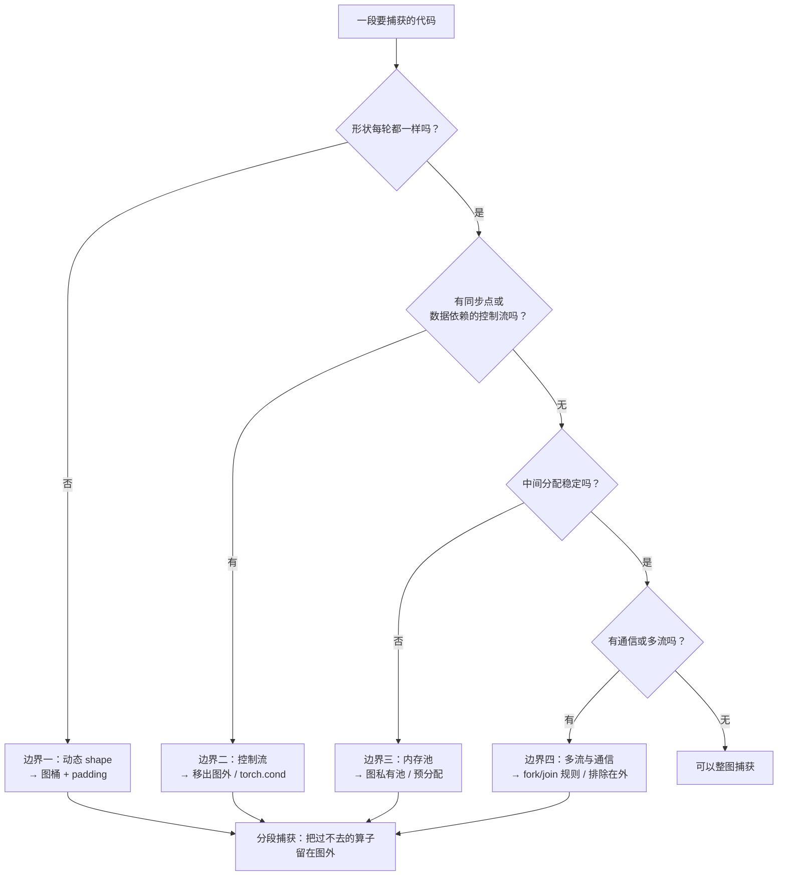

import SubmitTimeline from '../../../../explainers/react/SubmitTimeline';
import { decodeLayerOps } from '../../../../explainers/core/submit';

上一篇把约束归成了一句话：**图是一段固定的设备工作，任何让「这一轮和上一轮不一样」的东西都不能进去**。

这一篇把这句话落到四类具体问题上。读完你能回答：遇到一段代码时怎么判断它能不能被捕获、每条边界有哪些现成的绕法、以及为什么 vLLM 默认选择分段而不是整图。

## 判定流程

先给结论。面对一段要捕获的代码，按这个顺序问：



四条边界各自对应上一篇约束清单里的哪一条[^pytorch-constraints-doc]：

| 边界                 | 对应约束                       | 违反时                 |
| -------------------- | ------------------------------ | ---------------------- |
| 动态 shape           | 约束 9（size/layout 必须相同） | **静默**按旧形状读内存 |
| 同步与数据依赖控制流 | 约束 2、4                      | 报错                   |
| 内存地址与内存池     | 约束 8（相同虚拟地址）         | **静默**读到旧数据     |
| 多流与通信           | 约束 6、10（fork/join 规则）   | 未定义行为             |

## 边界一：动态 shape

推理服务的 batch 天然是变的，而约束 9 要求形状固定。唯一的出路是**图桶**：预先为有限几种形状各捕获一张图，运行时向上取整。

第 02 篇的 `toy.py` 已经量化过代价。桶的疏密是一个直接的取舍：

| 桶               | 命中率       | padding 浪费 | 捕获成本                   |
| ---------------- | ------------ | ------------ | -------------------------- |
| 密（1,2,3,…,64） | 高           | 低           | 高（图多、显存多、启动慢） |
| 疏（1,2,4,8,…）  | 低（要回退） | 高           | 低                         |

所以桶不是越多越好。实际做法是：**小 batch 密、大 batch 疏**——因为 padding 浪费的是相对比例，batch 3 补到 4 浪费 25%，batch 100 补到 128 也是 28%，但小 batch 的绝对数量多、出现频率高。

序列长度这一维通常不进桶：attention 的 KV 长度每一步都在变，这也正是 attention 常被排除在图外的原因之一[^vllm-cuda-design-doc]。

## 边界二：同步与数据依赖的控制流

这是第 01、02、03 篇反复出现的那批写法，第四次登场：

```python
if logits.max() > threshold:     # ✗ 数据依赖的控制流（约束 4）
    ...
n = mask.sum().item()            # ✗ 同步点（约束 2）
print(hidden.norm())             # ✗ 同步 + CPU 工作
seq_len = int(positions[-1])     # ✗ 把设备数据取回 CPU
```

三种绕法：

1. **移出图外**：把需要判断的部分留在 eager 执行，只捕获中间那段确定的计算。这就是**分段捕获**。
2. **改写成设备上的无分支计算**：用 `torch.where`、mask 乘法代替 `if`。两条路都算，但两条路都在图里。
3. **`torch.cond()`**：官方唯一允许在图内做 GPU 数据控制流的高阶算子[^pytorch-constraints-doc]。

采样是个典型例子：`top_p` 这类操作天然带数据依赖的判断，所以推理栈通常把**采样留在图外**，图只覆盖到 logits 为止。

## 边界三：内存地址与内存池

约束 8 要求每次 replay 读写相同的虚拟地址，于是：

- 输入输出必须是**预分配的静态缓冲区**，每轮 `copy_` 新数据进去；
- 中间结果的分配也要稳定——PyTorch 在捕获期间把分配放进**图私有内存池**；
- 多个图可以共享内存池（`pool=`），但**只有按捕获顺序重放且不并发时才安全**，否则一个图可能覆盖另一个图的输出。

KV cache 在这里有个值得注意的性质：它本来就是**预分配的大块显存**，每轮只是写进不同的槽位。槽位是通过**索引张量**传进去的，而索引张量本身也是固定地址的缓冲区——所以 KV cache 和图模式天然兼容。这是 PagedAttention 那套设计顺带带来的好处。

## 边界四：多流与通信

约束 10 允许多流，但要满足 fork/join 规则：子 stream 最终要汇回原 stream，跨流依赖要用捕获内的 event 表达。约束 6 更严：**捕获期间该进程任何线程都不能运行未被捕获的 CUDA 工作**。

张量并行的 all-reduce 落在这条边界上。它能不能进图，取决于通信库在捕获模式下的行为，而这件事和库版本、拓扑、是否用了独立通信流都有关——不能一概而论。

**结论：通信要不要进图，必须按具体部署验证，不能照搬别人的配置。** 这是本系列最该保守对待的一条。

## 分段：承认有些地方过不去

把四条边界合起来看，整图捕获的条件相当苛刻。于是实际做法是**分段**：能捕获的片段各打包成图，过不去的算子留在图外逐个提交。

<SubmitTimeline
  client:visible
  mode="piecewise"
  launchCost={1}
  title="图 04-1：分段捕获——attention 留在图外，其余片段各自打包"
/>

对照一下三种模式在同一组算子上的结果（上一篇那张整图只有在**没有任何 graphBreak** 时才可能）：

| 模式          | 提交次数 | 墙钟 | 设备空闲 | 前提                 |
| ------------- | -------- | ---- | -------- | -------------------- |
| eager         | 10       | 11.2 | 30.4%    | 无                   |
| **piecewise** | 5        | 9.1  | 14.3%    | **只要能切开就行**   |
| full          | 1        | 9.0  | 13.3%    | 整段都过得去四条边界 |

**分段拿到了整图 90% 以上的收益，却几乎没有前提条件。** 这就是 vLLM 默认选 `PIECEWISE` 的原因——它是一个工程上非常划算的折中。

而 `FULL_DECODE_ONLY` 的含义现在也清楚了：decode 阶段形状规整、没有采样分支（采样在之后），**有机会满足整图条件**；prefill 和混合批次则满足不了，退回分段。

## 代码实现

> 完整可运行脚本见文章目录下的 `toy.py`，纯 Python。

`toy.py` 把判定流程写成一个检查器——这正是 vLLM 里 `splitting_ops` 和 attention 后端支持级别在做的事：

```python
def can_capture(op):
    """返回 (能否进图, 原因)。顺序与文章的判定流程一致。"""
    if op.get('dynamic_shape'):  return False, '边界一：形状每轮都变（约束 9）'
    if op.get('sync'):           return False, '边界二：同步点（约束 2）'
    if op.get('data_branch'):    return False, '边界二：数据依赖的控制流（约束 4）'
    if op.get('unstable_alloc'): return False, '边界三：中间分配不稳定（约束 8）'
    if op.get('comm'):           return False, '边界四：通信，需按部署验证（约束 6/10）'
    return True, ''

def split_into_segments(ops):
    """把能捕获的连续片段打包，过不去的单独提交 —— 这就是 piecewise。"""
    segments, cur = [], []
    for op in ops:
        ok, why = can_capture(op)
        if ok:
            cur.append(op)
        else:
            if cur: segments.append(('graph', cur)); cur = []
            segments.append(('eager', [op], why))
    if cur: segments.append(('graph', cur))
    return segments
```

输出：

```
逐算子判定：
  L0·norm              ✓ 可捕获
  L0·qkv               ✓ 可捕获
  L0·attn              ✗ 边界一：形状每轮都变（约束 9）
  L0·out               ✓ 可捕获
  L0·ffn               ✓ 可捕获
  L0·sample            ✗ 边界二：数据依赖的控制流（约束 4）
  L0·allreduce         ✗ 边界四：通信，需按部署验证（约束 6/10）

分段结果：2 段图 + 3 个图外算子 = 5 次提交（eager 需要 7 次）
去掉通信后：2 段图 + 2 个图外算子 = 4 次提交
全部边界都过得去时：1 次提交

桶的取舍（batch 1..64）：
  密桶 1..64 共 64 个    命中率 100.0%   padding 浪费  0.0%   要捕获 64 张图
  疏桶 1,2,4,8,16,32,64   命中率 100.0%   padding 浪费 23.8%   要捕获  7 张图
  混合 1,2,3,4,6,8,12,16,24,32,48,64 命中率 100.0%  padding 浪费 13.0%  要捕获 12 张图
```

最后一组说明了「小 batch 密、大 batch 疏」这个策略的价值：**用 12 张图把浪费压到 13.0%，而均匀疏桶用 7 张图要浪费 23.8%**。多花 5 张图的捕获成本，换回 10 个百分点的算力——这个取舍通常是划算的。

## 真实实现在哪

| 概念                 | 位置                                              | 说明                                                                                       |
| -------------------- | ------------------------------------------------- | ------------------------------------------------------------------------------------------ |
| 切分点               | `vllm/config/compilation.py:583-600`、`1317-1326` | `splitting_ops` / `_attention_ops`：默认把 attention 列为切分点                            |
| 为什么排除 attention | `docs/design/cuda_graphs.md:25-40`                | attention 常带动态/后端特定的 metadata，许多后端不能整图捕获                               |
| **后端的支持级别**   | `vllm/v1/attention/backend.py:551-563`            | `AttentionCGSupport`：`ALWAYS` / `UNIFORM_BATCH` / `UNIFORM_SINGLE_TOKEN_DECODE` / `NEVER` |
| 支持级别的判定       | `vllm/v1/attention/backend.py:587-627`            | `AttentionMetadataBuilder.get_cudagraph_support`                                           |
| 一个实例             | `vllm/v1/attention/backends/triton_attn.py:96-99` | Triton 后端声明为 `ALWAYS`                                                                 |
| 桶的生成             | `vllm/config/compilation.py:78-126`、`1278-1302`  | `_walk_grid`、`post_init_cudagraph_sizes` 等                                               |

`AttentionCGSupport` 这个枚举是本篇四条边界在代码里的直接体现：

| 级别                          | 含义                            | 对应边界     |
| ----------------------------- | ------------------------------- | ------------ |
| `ALWAYS`                      | 混合批次也能整图                | 都过得去     |
| `UNIFORM_BATCH`               | 只接受 query 长度一致的批次     | 边界一       |
| `UNIFORM_SINGLE_TOKEN_DECODE` | 只接受 query_len=1（纯 decode） | 边界一，更严 |
| `NEVER`                       | 不支持                          | —            |

**能不能开整图，不是一个全局开关，而是由 attention 后端声明、再和本轮 batch 的形状共同决定的。** 下一篇就讲这个判定过程。

## 代价与边界

- 分段的代价是段与段之间仍要逐个提交，而且跨段无法融合。段越碎越接近 eager。
- 图桶用算力（padding）换确定性，桶的选择没有通用最优解，依赖实际的 batch 分布。
- 通信能否进图高度依赖部署，本篇不给结论性建议。
- 本篇的检查器是**示意**：真实判定由 attention 后端的支持级别、运行时的 batch descriptor 和编译配置共同完成，比这几行复杂得多。
- 本机没有 GPU/NPU，四条边界的行为均引自 PyTorch 官方文档与 vLLM 源码，未在本机验证。

## 自测

1. 四条边界分别对应上一篇约束清单的哪几条？哪两条违反时是**静默**出错？
2. 为什么桶不是越密越好？列出密桶的两项成本。
3. 采样为什么通常留在图外？它卡在哪条边界上？
4. 分段只比整图多 1 次提交却几乎没有前提条件——用本篇那张表解释 vLLM 为什么默认选 `PIECEWISE`。
5. 动手：在 `toy.py` 里把 `L0·attn` 的 `dynamic_shape` 改成 `False`（假设换了个支持 `ALWAYS` 的后端），重新分段。提交次数变成多少？这对应 `AttentionCGSupport` 的哪个级别？

## 来源

- 源码行号按本地快照 `reference/vllm`（commit `cf5cea2d`）
- 下一篇：[vLLM 选路](../05-dispatch/)（尚未按本系列约定重写）——运行时怎么在这些约束里选出本轮该走哪条路。

[^pytorch-constraints-doc]: [PyTorch CUDA semantics — Constraints](https://docs.pytorch.org/docs/stable/notes/cuda.html)（四条边界对应的官方约束）。

[^vllm-cuda-design-doc]: [vLLM CUDA Graphs 设计文档](https://github.com/vllm-project/vllm/blob/main/docs/design/cuda_graphs.md)（为什么排除 attention）。
