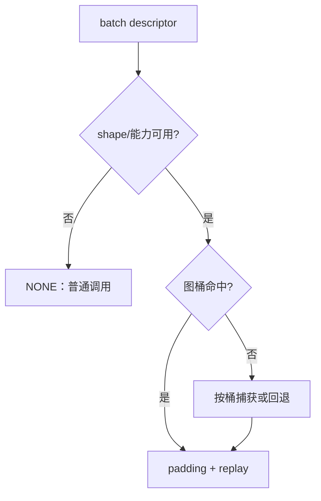
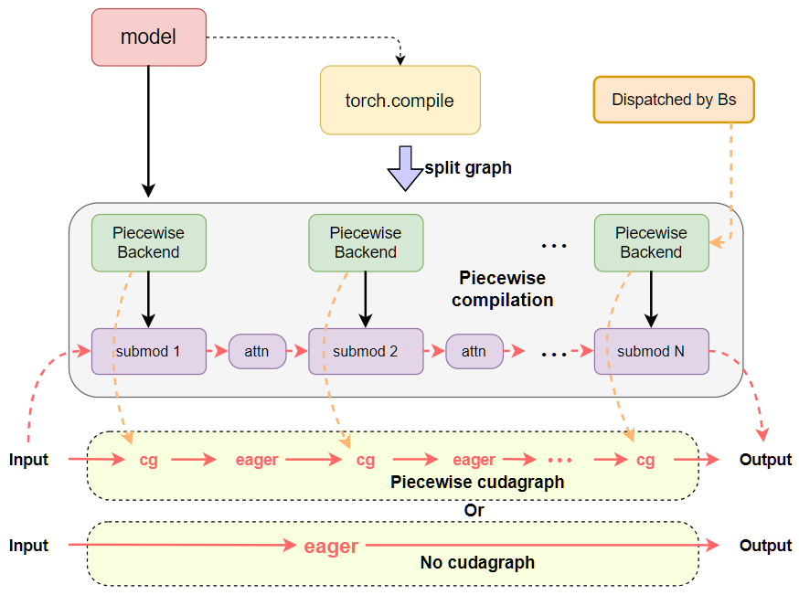
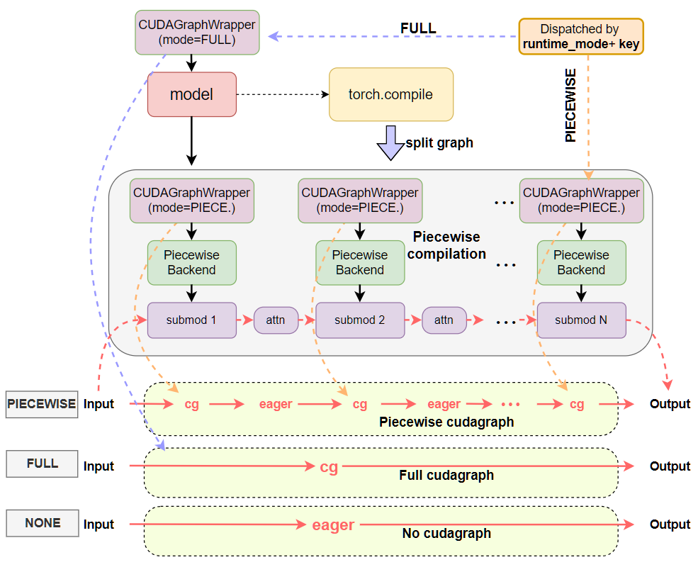

图模式的关键不是“有没有一张图”，而是本轮请求能否落入一个已经准备好的图桶。vLLM 先把 batch、sequence、attention metadata 和平台能力整理为 descriptor，再由 dispatcher 选择模式和 padding，最后由 wrapper 执行 replay、捕获或普通 callable。

## 一次选路

`FULL`、`PIECEWISE`、`NONE` 是本轮执行路径；图桶是固定 shape/地址的实例；wrapper 是真正调用设备图的层。三者的日志不能互相替代。

## 为什么不能只按 batch size

两个 batch 都可能有相同的 request 数，却拥有不同的 query length、KV cache 长度、block table、attention backend 或通信状态。只用 batch size 做 key 会让图读取错误地址，或频繁失配。可靠的 descriptor 至少要覆盖影响 kernel 形状和地址的字段。

## padding 的账本

图桶通常按离散大小准备，例如 `1, 2, 4, 8...`。本轮真实 batch 为 5 时，可能 padding 到 8，再用 mask 和 metadata 保持语义。padding 提高命中率，却增加无效计算和显存读写；桶越密，启动捕获和显存占用越高。

| 选择               | 结果                        |
| ------------------ | --------------------------- |
| 桶太少             | 命中率低，频繁回退          |
| 桶太多             | 捕获慢、占显存、维护复杂    |
| 桶与 workload 对齐 | 在命中率和 padding 之间折中 |

## 源码阅读顺序

1. 找 descriptor 的构造处，确认本轮使用了哪些字段。
2. 找 dispatcher 的模式判断和桶查找，记录每个回退条件。
3. 找 forward context，确认 mode 和 descriptor 如何传入模型。
4. 找 wrapper 的 `_call_`，区分 replay、首次 capture 和普通调用。

## attention 不是单独开关

attention metadata、KV cache layout、block table 和 backend 共同决定图是否可复用。日志显示 `FULL` 只说明 dispatcher 选了 FULL 路径，不能单独证明 attention kernel 已 replay，更不能证明端到端更快。

## 检查点

- descriptor 决定能否进入桶，wrapper 决定怎么执行。
- padding 维持固定 shape，却可能吞掉收益。
- 运行模式、图实例和 profiler 事件要分别取证。

## 源码与参考资料

- [vLLM GPU model runner](https://github.com/vllm-project/vllm/blob/main/vllm/v1/worker/gpu_model_runner.py)
- [vLLM CUDA graph](https://github.com/vllm-project/vllm/blob/main/vllm/compilation/cuda_graph.py)
- [vLLM compilation 配置](https://github.com/vllm-project/vllm/tree/main/vllm/compilation)
