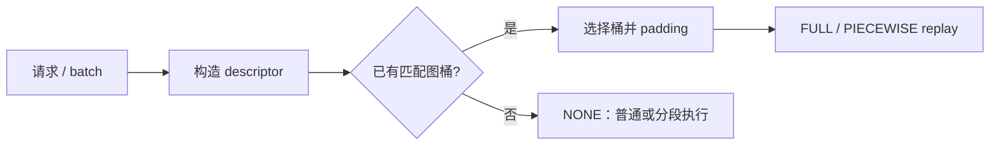

import BucketSelector from "./BucketSelector";

图模式的第一步不是 replay，而是判断本轮输入能不能放进某个已经准备好的图桶。下面的播放器把这个判断拆成几帧：先读 descriptor，再选桶，最后决定 padding、图模式或回退。

## 练习范围

<BucketSelector client:visible />

## 播放器里的四个状态

| 状态       | 发生了什么                                                       | 要观察的量                 |
| ---------- | ---------------------------------------------------------------- | -------------------------- |
| descriptor | 把 batch、token 上限、attention metadata 和 cache 状态整理成 key | 哪些字段会影响地址和 shape |
| 命中桶     | 选择能容纳本轮工作的固定大小                                     | 桶大小与真实 batch 的差值  |
| padding    | 用 mask 和 metadata 保持真实语义                                 | 无效槽位会增加多少工作     |
| 回退       | 没有匹配桶时进入 `NONE` 或分段路径                               | 回退原因与后续是否仍正确   |

播放器中的数字是教学输入，用来展示决策顺序；它不模拟 kernel、显存、CUDA stream、ACLGraph 或性能。

## 固定引用与回退

真实运行时不能因为“看起来相同”就复用图。descriptor 中的引用、stride、block table 或 attention metadata 变化，都应让 key 失配并选择新桶或 `NONE`。回退不是失败，它是动态输入的正确性路径。

## 有设备后的验证顺序

1. 固定软件、模型、dtype、prompt 长度和并发。
2. 记录每个 descriptor 的 mode、bucket、padding 和命中情况。
3. 用 profiler 观察 capture/replay、同步和通信。
4. 分开比较首轮、稳态和回退比例。
5. 只有在输出正确且样本足够后，才讨论吞吐和延迟。

## 检查点

- 图桶先于 replay，`FULL`、`PIECEWISE`、`NONE` 是运行时路径。
- padding 是可观测账本，不能直接换算成性能。
- 回退分支应当可预测、可记录、可验证。

## 来源

- [vLLM CUDA graph](https://github.com/vllm-project/vllm/blob/main/vllm/compilation/cuda_graph.py)
- [vLLM-Ascend ACLGraph](https://github.com/vllm-project/vllm-ascend/tree/main/vllm_ascend/compilation)
